# SelfService Infrastructure Catalog - Architecture Diagram Index

**Version**: 2.0  
**Last Updated**: 2024-01-20  

> This document provides quick access to all architecture diagrams. For full context, see [Architecture.md](./Architecture.md)

---

## Table of Contents

1. [System Architecture Diagrams](#system-architecture-diagrams)
2. [Data Flow Diagrams](#data-flow-diagrams)
3. [Component Diagrams](#component-diagrams)
4. [Workflow Diagrams](#workflow-diagrams)
5. [Deployment Diagrams](#deployment-diagrams)
6. [Security Diagrams](#security-diagrams)

---

## System Architecture Diagrams

### High-Level System Architecture

**Location**: Architecture.md → System Overview → High-Level Architecture

**Shows**: Complete system topology with all major components

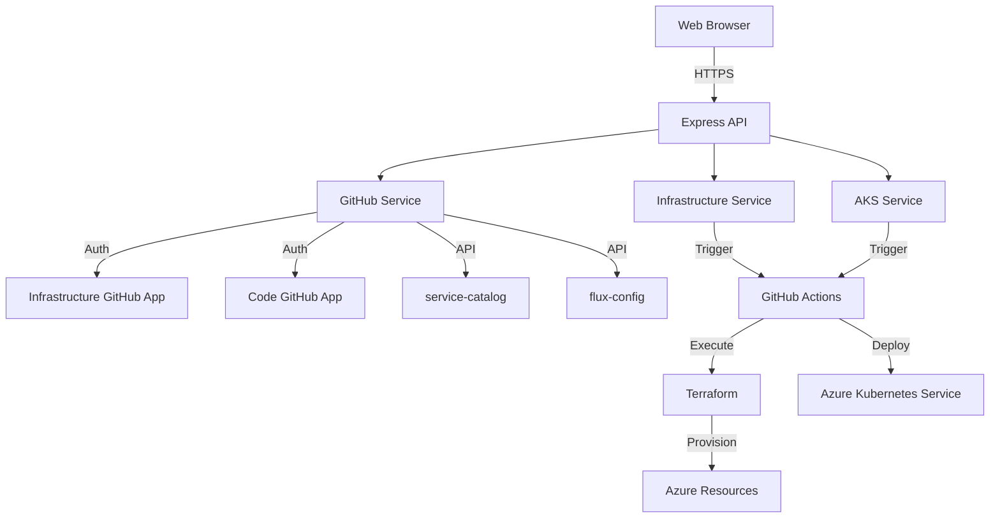

**Key Points**:
- Browser communicates with Express API via HTTPS
- Dual GitHub Apps for infrastructure and code operations
- GitHub Actions orchestrates infrastructure provisioning and deployments
- Azure resources provisioned via Terraform
- AKS deployments via GitOps (Flux)

---

### Layered Architecture

**Location**: Architecture.md → System Architecture → Layered Architecture

**Shows**: Application layers from presentation to data

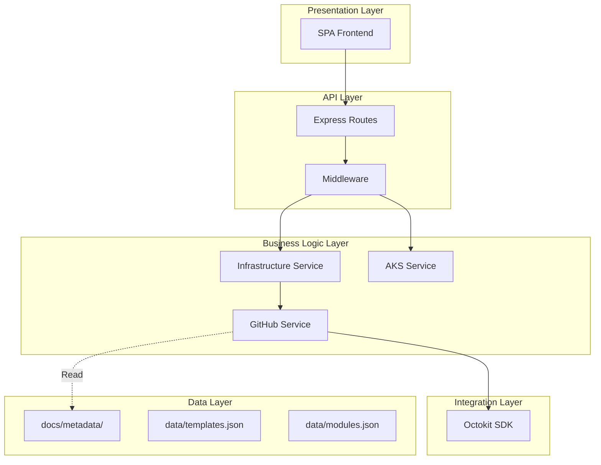

**Key Points**:
- Clear separation of concerns across layers
- Business logic isolated in service layer
- Data layer uses GitHub as source of truth
- No database required

---

## Data Flow Diagrams

### GitHub as Database Pattern

**Location**: Architecture.md → Core Architecture Patterns → GitHub as Database

**Shows**: How metadata is fetched from GitHub repository

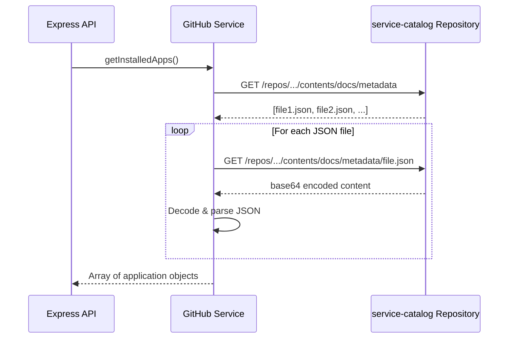

**Key Points**:
- GitHub repository is the single source of truth
- Metadata stored as JSON files in `docs/metadata/`
- No database synchronization required
- Full version control and audit trail

---

### Correlation ID Tracking

**Location**: Architecture.md → Core Architecture Patterns → Correlation ID Tracking

**Shows**: How correlation IDs flow through the entire system

```mermaid
sequenceDiagram
    participant Browser
    participant API
    participant GitHubSvc
    participant Workflow
    participant Log
    
    Browser->>Browser: Generate correlationId<br/>cid-{timestamp}-{random}
    Browser->>API: POST /api/custom<br/>{correlationId, ...}
    API->>Log: Log request [correlationId]
    API->>GitHubSvc: triggerWorkflow(correlationId, ...)
    GitHubSvc->>Log: Log workflow trigger [correlationId]
    GitHubSvc->>Workflow: Dispatch workflow<br/>PR description includes correlationId
    Workflow->>Workflow: Execute workflow<br/>correlationId in PR body
    Browser->>API: GET /api/status/{correlationId}
    API->>GitHubSvc: getWorkflowStatusByCorrelationId()
    GitHubSvc->>GitHubSvc: Search PRs by correlationId
    GitHubSvc-->>API: {status, prUrl, workflowUrl}
    API-->>Browser: {status, correlationId, ...}
```

**Key Points**:
- Correlation ID generated on client side
- Threaded through entire request lifecycle
- Stored in GitHub PR descriptions for tracking
- Enables end-to-end request tracing

---

### Workflow Polling Pattern

**Location**: Architecture.md → Core Architecture Patterns → Workflow Polling

**Shows**: How clients poll for workflow status updates

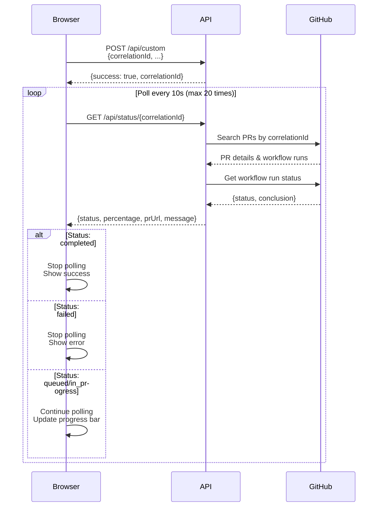

**Key Points**:
- Client-initiated polling every 10 seconds
- Stateless backend (no session storage)
- Automatic timeout after ~3.3 minutes
- Progress bar updates based on status

---

### Read Pattern: Fetch Installed Applications

**Location**: Architecture.md → Data Architecture → Data Flow Patterns

**Shows**: Complete flow for fetching application list

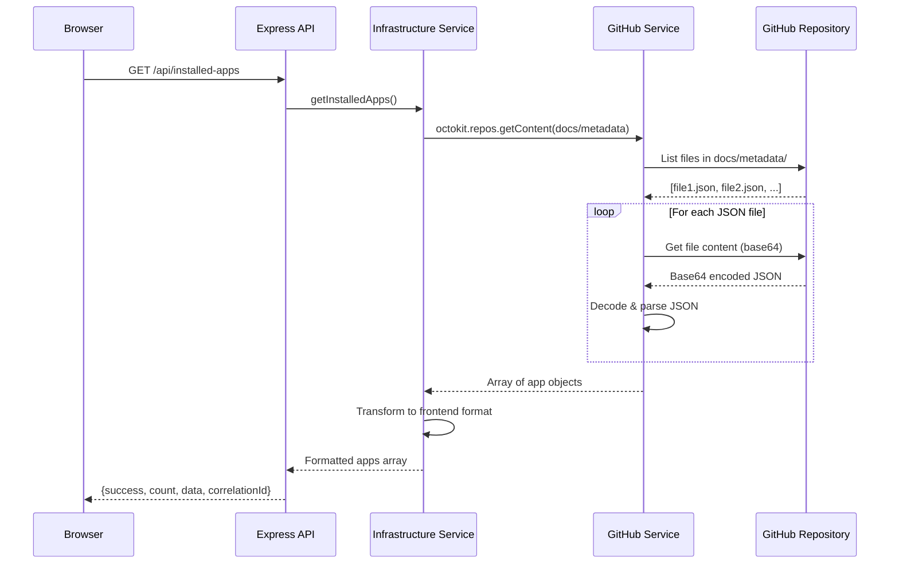

**Key Points**:
- Parallel fetching of metadata files
- Base64 decoding and JSON parsing
- Data transformation for frontend consumption
- Includes correlation ID in response

---

### Write Pattern: Create Infrastructure

**Location**: Architecture.md → Data Architecture → Data Flow Patterns

**Shows**: Infrastructure creation workflow from request to completion

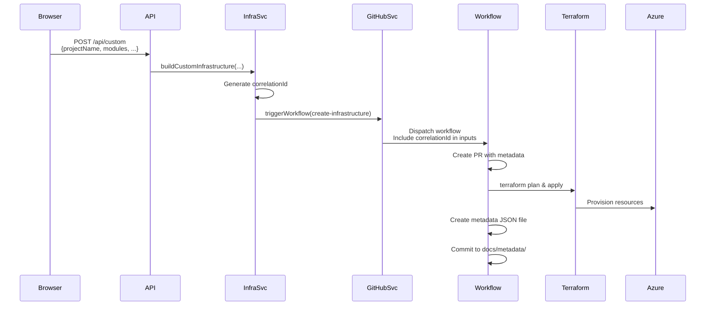

**Key Points**:
- Infrastructure provisioned via GitHub Actions workflow
- Terraform plans and applies changes
- Metadata JSON created and committed to repository
- Client polls for status using correlation ID

---

## Component Diagrams

### Multi-GitHub-App Architecture

**Location**: Architecture.md → Core Architecture Patterns → Multi-GitHub-App Pattern

**Shows**: Separation of infrastructure and code operations

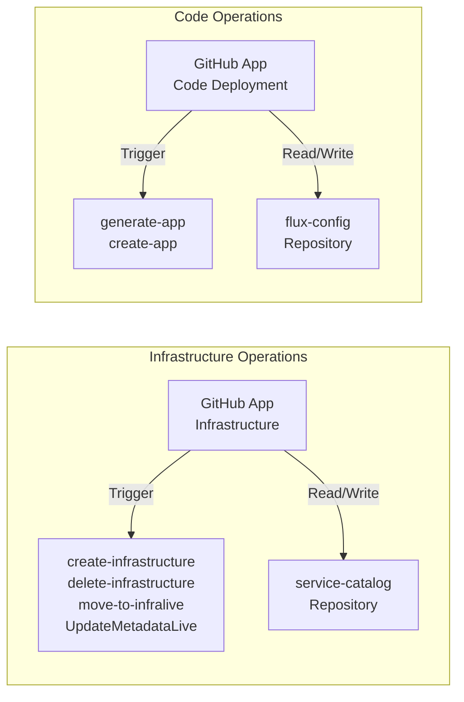

**Key Points**:
- Separate GitHub Apps for different concerns
- Infrastructure App: Terraform workflows, metadata management
- Code App: AKS deployments, application code
- Least privilege access control

---

### Frontend SPA Structure

**Location**: Architecture.md → Frontend Architecture → Single Page Application Structure

**Shows**: Page sections and modals in the SPA

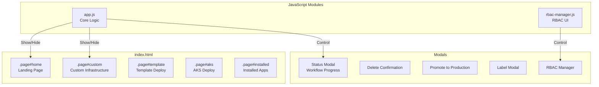

**Key Points**:
- 5 main page sections (hidden/visible via CSS)
- 5 modal overlays for user interactions
- app.js handles core navigation and forms
- rbac-manager.js handles RBAC-specific UI

---

### Data Storage Architecture

**Location**: Architecture.md → Data Architecture → Data Storage Strategy

**Shows**: How data is stored and cached

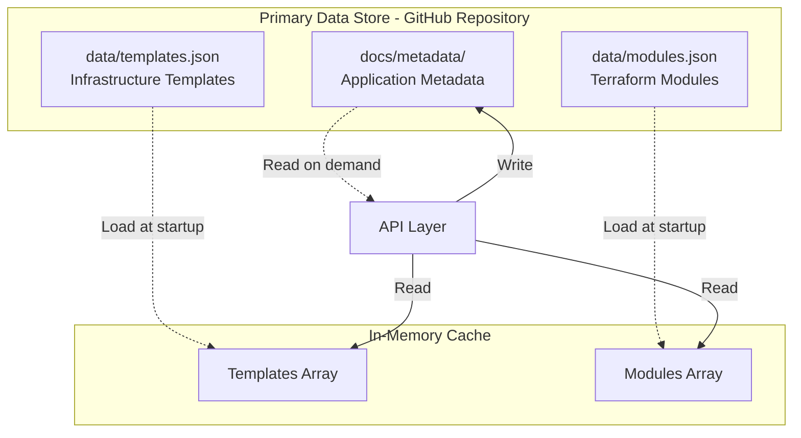

**Key Points**:
- GitHub repository is primary data store
- Templates and modules cached in memory at startup
- Metadata fetched on demand from GitHub
- No traditional database required

---

## Workflow Diagrams

### SPA Navigation Flow

**Location**: Architecture.md → Frontend Architecture → Navigation Flow

**Shows**: State transitions between pages

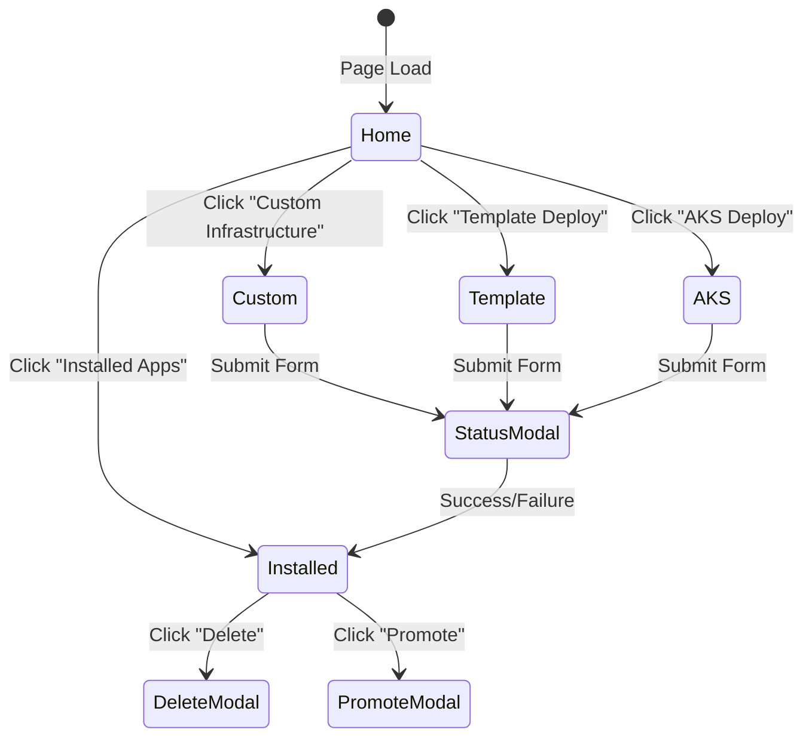

**Key Points**:
- Simple state machine for page navigation
- Form submissions trigger status modals
- Modals show workflow progress
- Success/failure returns to appropriate page

---

### Workflow Status Lifecycle

**Location**: Architecture.md → Workflow Management → Workflow Status Lifecycle

**Shows**: Workflow status state transitions

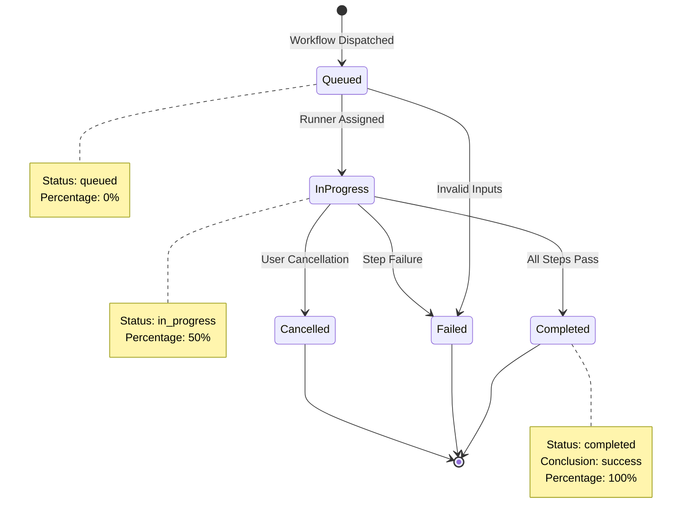

**Key Points**:
- Workflow starts in "queued" state
- Transitions to "in_progress" when runner assigned
- Completes with "success" or "failure"
- Client polls and updates progress bar

---

### Progress Feedback Flow

**Location**: Architecture.md → Frontend Architecture → UI/UX Patterns

**Shows**: User feedback during workflow execution

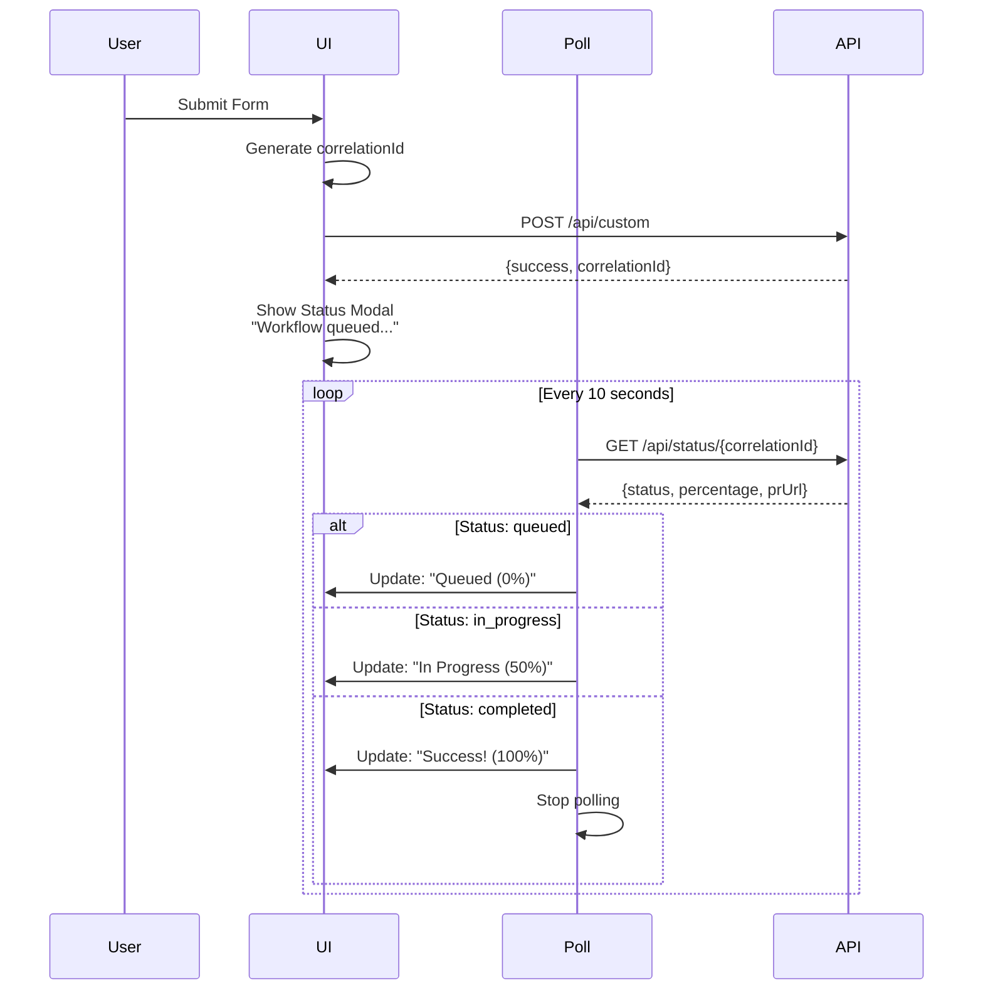

**Key Points**:
- Immediate feedback with status modal
- Progress bar shows visual progress
- Polling continues until completion
- Links to PR and workflow provided

---

## Deployment Diagrams

### Kubernetes Deployment Architecture

**Location**: Architecture.md → Deployment Architecture → Kubernetes Deployment

**Shows**: Complete K8s deployment topology

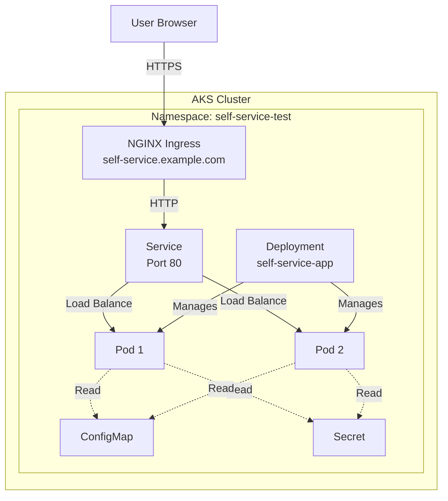

**Key Points**:
- NGINX ingress for external access
- Service load balances across pods
- ConfigMap for non-sensitive configuration
- Secret for GitHub keys and Azure credentials
- Multiple pod replicas for high availability

---

### CI/CD Pipeline Flow

**Location**: Architecture.md → Deployment Architecture → CI/CD Pipeline

**Shows**: Complete deployment pipeline from code to production

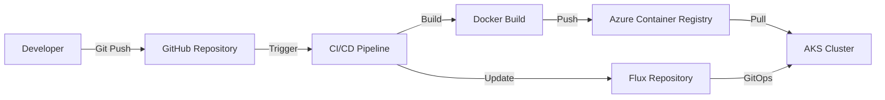

**Key Points**:
- Git push triggers CI/CD pipeline
- Docker image built and pushed to ACR
- Flux repository updated with new image tag
- Flux operator syncs changes to AKS
- GitOps ensures declarative infrastructure

---

## Security Diagrams

### Authentication Architecture

**Location**: Architecture.md → Security Architecture → Authentication & Authorization

**Shows**: Multi-layered authentication

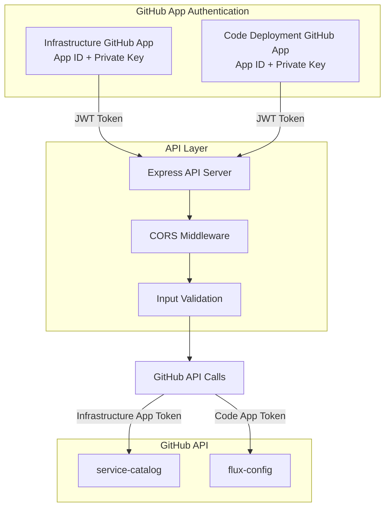

**Key Points**:
- Dual GitHub Apps with separate credentials
- JWT tokens for API authentication
- CORS middleware for cross-origin security
- Input validation on all requests
- Least privilege access per GitHub App

---

## Integration Diagrams

### External System Integration

**Location**: Architecture.md → Integration Architecture → External System Integration

**Shows**: All external system connections

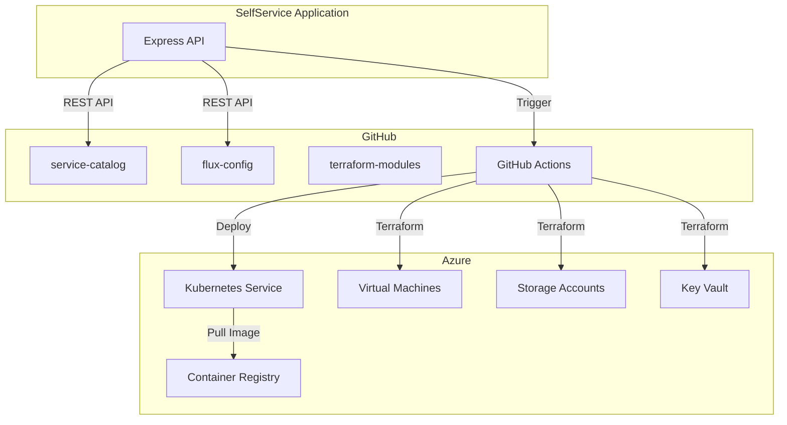

**Key Points**:
- GitHub for metadata storage and workflows
- GitHub Actions for infrastructure automation
- Terraform provisions Azure resources
- AKS pulls container images from ACR
- GitOps pattern for Kubernetes deployments

---

## Summary

This document provides an index to all architecture diagrams in the SelfService Infrastructure Catalog system. Each diagram is referenced with its location in the main [Architecture.md](./Architecture.md) document.

### Diagram Categories

- **System Architecture**: 2 diagrams (High-level, Layered)
- **Data Flow**: 4 diagrams (GitHub DB, Correlation ID, Polling, CRUD)
- **Component**: 3 diagrams (Multi-App, Frontend, Data Storage)
- **Workflow**: 3 diagrams (Navigation, Status Lifecycle, Progress Feedback)
- **Deployment**: 2 diagrams (Kubernetes, CI/CD)
- **Security**: 1 diagram (Authentication)
- **Integration**: 1 diagram (External Systems)

**Total**: 16 comprehensive architecture diagrams

---

**For Full Documentation**: See [Architecture.md](./Architecture.md) for complete architectural details, code examples, API specifications, and more.

**For Quick Reference**: See [Architecture-Quick-Reference.md](./Architecture-Quick-Reference.md) for quick access to key patterns, API endpoints, and checklists.

---

**Document Version**: 2.0  
**Last Updated**: 2024-01-20  
**Maintained By**: DevOps Team
