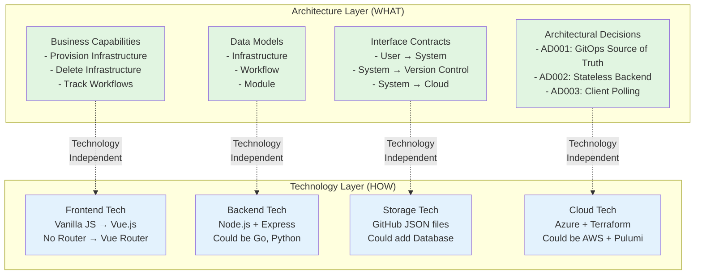
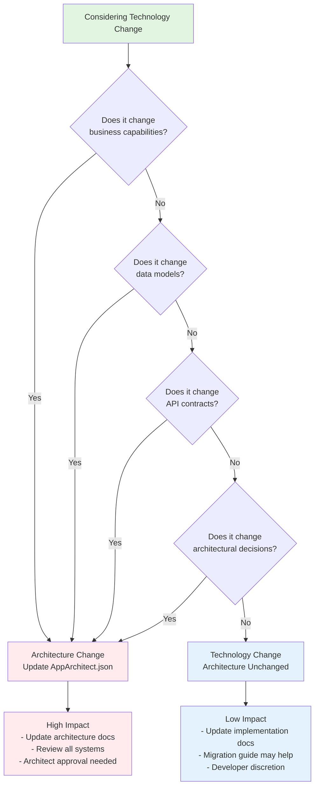
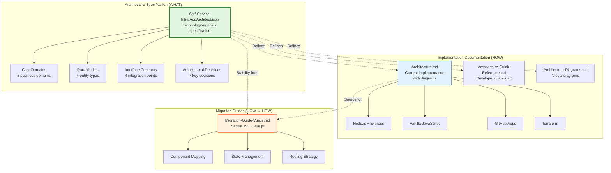

# Architecture vs Technology: Separation of Concerns

**Version**: 1.0  
**Last Updated**: 2026-01-20  
**Purpose**: Explain how architecture remains stable across technology changes  

---

## Overview

This document explains the critical distinction between **architecture** (WHAT) and **technology** (HOW) in the Self-Service Infrastructure Catalog, demonstrating how the system can evolve technologically without architectural redesign.

## Key Principle

> **Architecture defines WHAT the system does. Technology defines HOW it's done.**
> 
> When technology changes, the architecture specification remains the authoritative definition.

---

## Architecture Layers



---

## Example: Provisioning Infrastructure

### Architecture (WHAT) - Never Changes

**Capability**: Custom Infrastructure Provisioning

```json
{
  "name": "Custom Infrastructure Provisioning",
  "inputs": [
    "projectName (string, maxLength: 8)",
    "environment (enum: devsand|sand|prod)",
    "modules (array of strings)",
    "owner (string)",
    "approvalNumber (string)"
  ],
  "outputs": [
    "provisioningWorkflow (object)",
    "metadata (object)",
    "correlationId (uuid)"
  ],
  "businessRules": [
    "Project names must be unique within environment",
    "All provisioning requires approval number",
    "Project age must be specified"
  ]
}
```

**Data Model**: Infrastructure

```json
{
  "projectName": { "type": "string", "maxLength": 8 },
  "environment": { "type": "enum", "values": ["devsand", "sand", "prod"] },
  "modules": { "type": "array", "items": "string" },
  "owner": { "type": "string" },
  "status": { "type": "enum", "values": ["provisioning", "active", "failed"] }
}
```

**Interface Contract**: POST /api/custom

```json
{
  "request": {
    "projectName": "string",
    "environment": "string",
    "modules": ["string"],
    "correlationId": "uuid"
  },
  "response": {
    "correlationId": "uuid",
    "workflowUrl": "string",
    "status": "string"
  }
}
```

### Technology (HOW) - Can Change

#### Current Implementation (Vanilla JavaScript)

**Frontend**:
```javascript
// Vanilla JS with manual DOM manipulation
const form = document.getElementById('custom-form')
form.addEventListener('submit', async (e) => {
  e.preventDefault()
  const data = {
    projectName: document.getElementById('projectName').value,
    environment: document.getElementById('environment').value,
    modules: Array.from(document.querySelectorAll('.module:checked')).map(m => m.value),
    correlationId: generateUUID()
  }
  
  const response = await fetch('/api/custom', {
    method: 'POST',
    headers: { 'Content-Type': 'application/json' },
    body: JSON.stringify(data)
  })
  
  // Show status modal and start polling
  showStatusModal(data.correlationId)
})
```

**Backend**:
```javascript
// Node.js + Express
router.post('/api/custom', async (req, res) => {
  const { projectName, environment, modules, correlationId } = req.body
  
  // Validate against data model
  if (projectName.length > 8) {
    return res.status(400).json({ error: 'Project name too long' })
  }
  
  // Trigger workflow
  const result = await infrastructureService.buildCustomInfrastructure(
    projectName, environment, modules, correlationId
  )
  
  res.json({ correlationId, workflowUrl: result.url })
})
```

#### Future Implementation (Vue.js) - Architecture Unchanged

**Frontend**:
```vue
<!-- Vue.js with reactive state -->
<template>
  <form @submit.prevent="handleSubmit">
    <input v-model="form.projectName" maxlength="8" />
    <select v-model="form.environment">
      <option value="devsand">Dev Sandbox</option>
      <option value="sand">Sandbox</option>
    </select>
    <label v-for="module in modules" :key="module">
      <input type="checkbox" :value="module" v-model="form.modules" />
    </label>
    <button type="submit">Provision</button>
  </form>
</template>

<script setup>
import { ref } from 'vue'
import { v4 as uuidv4 } from 'uuid'
import { useInfrastructureStore } from '@/stores/infrastructure'

const store = useInfrastructureStore()
const form = ref({
  projectName: '',
  environment: '',
  modules: []
})

async function handleSubmit() {
  const correlationId = uuidv4()
  
  // Same data contract as vanilla JS
  await store.provisionCustomInfrastructure({
    ...form.value,
    correlationId
  })
  
  // Track workflow status
  showStatusModal(correlationId)
}
</script>
```

**Backend**: Same Node.js code, no changes needed

---

## Architectural Decisions: Technology-Independent

### AD001: GitOps as Source of Truth

**Architecture (WHAT)**:
- Metadata stored in version control
- Built-in audit trail
- No separate database

**Technology (HOW) - Can Vary**:
- ✅ Current: GitHub with JSON files
- ✅ Could be: GitLab with YAML files
- ✅ Could be: Bitbucket with JSON files
- ⚠️ Database could be added as cache layer without changing architecture

### AD002: Stateless Backend

**Architecture (WHAT)**:
- Backend maintains no session state
- All context passed in requests
- Enables horizontal scaling

**Technology (HOW) - Can Vary**:
- ✅ Current: Node.js + Express
- ✅ Could be: Go + Gin
- ✅ Could be: Python + FastAPI
- ✅ Could be: Java + Spring Boot

All implementations honor stateless constraint.

### AD003: Client-Side Polling

**Architecture (WHAT)**:
- Client polls for workflow status
- Server provides status endpoint
- Polling continues until terminal state

**Technology (HOW) - Can Vary**:
- ✅ Current: `setInterval` in Vanilla JS
- ✅ Vue.js: `watch` + `computed` in Pinia store
- ✅ Could upgrade to: WebSockets (architecture decision changes)
- ✅ Could upgrade to: Server-Sent Events (architecture decision changes)

### AD004: Correlation ID Tracking

**Architecture (WHAT)**:
- Unique ID per operation
- Threaded through all layers
- Used for tracing and debugging

**Technology (HOW) - Can Vary**:
- ✅ Current: UUID v4 generated in browser
- ✅ Could be: Server-generated ULID
- ✅ Could be: OpenTelemetry Trace ID
- ✅ Could be: AWS X-Ray Trace ID

Format can change, pattern stays the same.

---

## Technology Migration Stability Matrix

| Architecture Element | Current Tech | Alternative Tech | Stability |
|---------------------|--------------|-----------------|-----------|
| **Data Models** | JavaScript objects | Go structs, Python dataclasses, Java POJOs | ✅ Structure identical |
| **API Contracts** | Express routes | Gin handlers, FastAPI routes, Spring controllers | ✅ JSON schemas identical |
| **Business Rules** | JavaScript validation | Any language validation library | ✅ Rules identical |
| **Correlation IDs** | uuid npm package | uuid library in any language | ✅ Pattern identical |
| **Workflow Polling** | setInterval | Vue computed, React useEffect, polling library | ✅ Frequency/pattern identical |
| **Stateless Backend** | Node.js process | Go binary, Python process, JVM | ✅ No state constraint identical |
| **GitOps Storage** | GitHub API (Octokit) | GitLab API, Bitbucket API, git CLI | ✅ Operations identical |
| **Frontend UI** | Vanilla JS SPA | Vue.js, React, Angular, Svelte | ✅ User flows identical |
| **Authentication** | GitHub App JWT | OAuth, OIDC, SAML | ✅ Identity contracts identical |
| **Infrastructure** | Terraform | Pulumi, CDK, Crossplane | ✅ Declarative pattern identical |

**Key Insight**: All architecture decisions from `Self-Service-Infra.AppArchitect.json` remain valid across technology choices.

---

## Migration Decision Tree



### Examples

**Scenario 1: Replace Vanilla JS with Vue.js**
- Business capabilities? No ❌
- Data models? No ❌
- API contracts? No ❌
- Architectural decisions? No ❌
- **Result**: Technology change only ✅ Use Migration-Guide-Vue.js.md

**Scenario 2: Replace Node.js with Go**
- Business capabilities? No ❌
- Data models? No ❌
- API contracts? No ❌ (same HTTP/JSON)
- Architectural decisions? No ❌ (stateless, GitOps, polling all preserved)
- **Result**: Technology change only ✅ Follow same API contracts

**Scenario 3: Replace client polling with WebSockets**
- Business capabilities? No ❌
- Data models? No ❌
- API contracts? Yes ✅ (ws:// instead of http://)
- Architectural decisions? Yes ✅ (AD003 changes from polling to push)
- **Result**: Architecture change ⚠️ Update AppArchitect.json

**Scenario 4: Add database for metadata**
- Business capabilities? No ❌
- Data models? No ❌ (same schema)
- API contracts? No ❌
- Architectural decisions? Yes ✅ (AD001 GitOps as sole source changes)
- **Result**: Architecture change ⚠️ Update AppArchitect.json

---

## Document Relationships



---

## Best Practices

### When Proposing Technology Changes

1. **Start with Architecture Spec** (`Self-Service-Infra.AppArchitect.json`)
   - Review relevant core domains
   - Check affected data models
   - Verify interface contracts remain valid
   - Ensure architectural decisions are honored

2. **Verify Stability**
   - Run through migration decision tree
   - Confirm no architecture changes needed
   - Document any assumptions

3. **Update Implementation Docs**
   - Update `Architecture.md` with new technology
   - Update `Architecture-Quick-Reference.md` if needed
   - Create migration guide if switching technologies

4. **Preserve Contracts**
   - Keep API endpoints identical (or versioned)
   - Keep data models identical
   - Keep integration patterns identical

### When Proposing Architecture Changes

1. **Update JSON Specification First**
   - Modify `Self-Service-Infra.AppArchitect.json`
   - Document rationale for change
   - Identify impacted systems

2. **Get Architect Approval**
   - Architecture changes are high impact
   - Require review by technical leadership
   - Consider long-term implications

3. **Update All Documentation**
   - Update `Architecture.md`
   - Update diagrams
   - Update quick reference
   - Create migration guide if needed

---

## Summary

### Key Takeaways

1. **Architecture = WHAT**, Technology = HOW
2. `Self-Service-Infra.AppArchitect.json` is the authoritative architecture specification
3. Technology can change without changing architecture
4. Use migration decision tree to determine impact
5. Preserve data models, API contracts, and architectural decisions across technology changes

### Document Usage Guide

| Need | Document to Use |
|------|----------------|
| Understand WHAT system does (capabilities, contracts) | `Self-Service-Infra.AppArchitect.json` |
| Understand HOW it's currently implemented | `Architecture.md` |
| Migrate to Vue.js | `Migration-Guide-Vue.js.md` |
| Quick API reference | `Architecture-Quick-Reference.md` |
| Visual diagrams for presentation | `Architecture-Diagrams.md` |
| Determine if change is architecture vs technology | This document |

---

**Last Updated**: 2026-01-20  
**Maintained By**: Architecture Team  
**Questions**: Refer to `Self-Service-Infra.AppArchitect.json` for authoritative definitions
