# SelfService Infrastructure Catalog - Architecture Specification

**Version**: 2.1
**Last Updated**: 2026-03-19
**Status**: Production  

---

## Table of Contents

1. [Executive Summary](#executive-summary)
2. [System Overview](#system-overview)
3. [Core Architecture Patterns](#core-architecture-patterns)
4. [System Architecture](#system-architecture)
5. [Component Architecture](#component-architecture)
6. [Data Architecture](#data-architecture)
7. [API Architecture](#api-architecture)
8. [Frontend Architecture](#frontend-architecture)
9. [Workflow Management](#workflow-management)
10. [Security Architecture](#security-architecture)
11. [Deployment Architecture](#deployment-architecture)
12. [Integration Architecture](#integration-architecture)
13. [Quality Attributes](#quality-attributes)
14. [Future Enhancements](#future-enhancements)

---

## Executive Summary

The SelfService Infrastructure Catalog is a **web-based self-service platform** that enables teams to provision, manage, and delete Azure infrastructure using standardized Terraform modules. The system follows a **GitOps-driven architecture** with GitHub as the single source of truth for both metadata and infrastructure-as-code.

### Key Capabilities
- **Custom Infrastructure Builder**: Select and compose Terraform modules
- **Template-Based Deployment**: Deploy pre-configured infrastructure templates
- **AKS Application Deployment**: Deploy containerized applications to Azure Kubernetes Service
- **Infrastructure Management**: View, label, delete, and promote infrastructure
- **RBAC Manager**: Define Azure role-based access control relationships
- **Workflow Tracking**: Real-time status updates with correlation ID tracing

### Technology Stack
- **Frontend**: Vue 3.4+ with Composition API, Pinia 2.1+ for state management, TypeScript 5.0+, Tailwind CSS 3.x (built from `srcV2/`, output to `dist/`)
- **Backend**: Node.js 20+ with Express 4.18+
- **Authentication**: Dual GitHub Apps (infrastructure + code deployment)
- **Data Storage**: GitHub repository (`docs/metadata/`, `docs/aks-metadata/`) - **No database**
- **CI/CD**: GitHub Actions workflows
- **Infrastructure**: Terraform modules
- **Deployment**: Docker + Kubernetes (AKS)
- **Logging**: Winston with correlation ID tracking

---

## System Overview

### High-Level Architecture

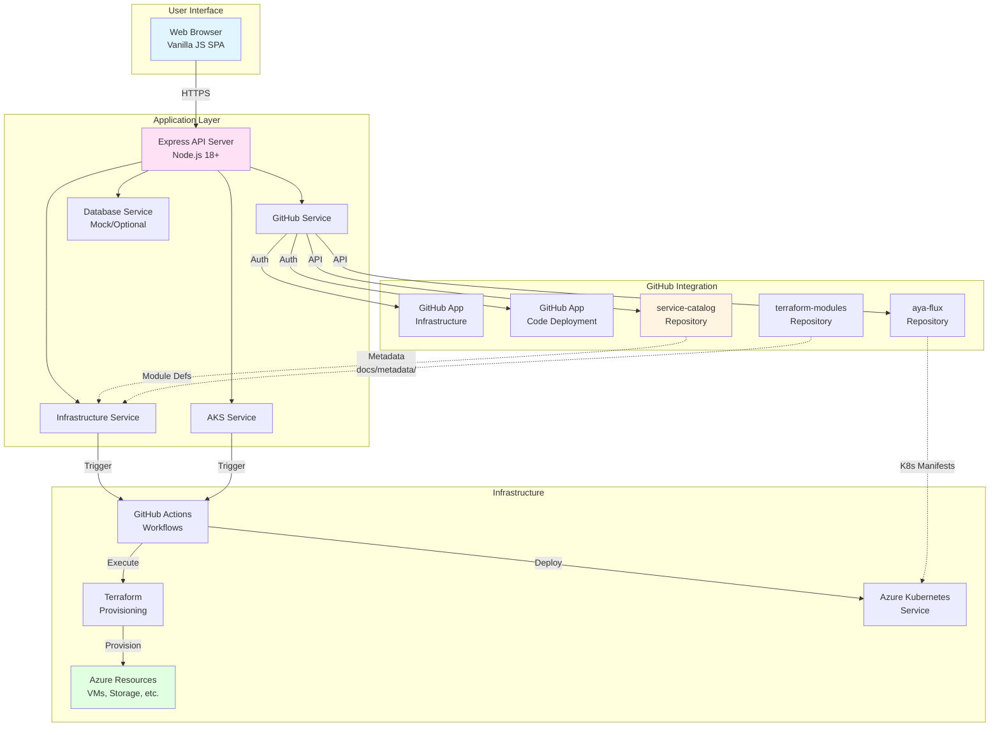

---

## Core Architecture Patterns

### 2.1 GitHub as Database Pattern

The system uses GitHub repositories as the **single source of truth** for all metadata and state, eliminating the need for a traditional database. This GitOps pattern provides:

- **Version Control**: All metadata changes tracked with git history
- **Audit Trail**: Who changed what, when, and why
- **Consistency**: Single point of truth across all environments
- **Scalability**: No database infrastructure to maintain

#### Metadata Storage Structure

```
service-catalog/
└── docs/
    └── metadata/
        ├── {projectName}-{environment}.json
        ├── {projectName}-{environment}.json
        └── ...
```

#### Metadata Document Schema

```json
{
  "projectName": "my-app",
  "environment": "sand",
  "description": "Application description",
  "owner": "team-name",
  "lifecycle": "experimental|production",
  "status": "active|archived",
  "modules": ["vnet", "storage", "keyvault"],
  "createdAt": "2024-01-15T10:30:00Z",
  "createdBy": "user@company.com",
  "prNumber": 1234,
  "crNumber": "CR-2024-001",
  "age": "30 days"
}
```

#### GitHub-as-Database Sequence Diagram

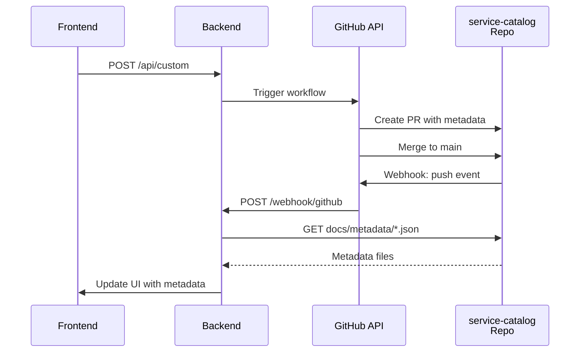

### 2.2 Multi-GitHub-App Pattern

The system uses **two separate GitHub Apps** for different responsibilities:

1. **Infrastructure App**: Manages infrastructure provisioning workflows
2. **Code Deployment App**: Handles application code and deployment manifests

#### Multi-App Architecture Diagram

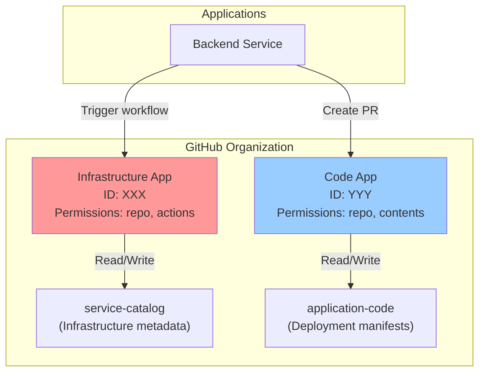

#### App Configuration Example

```javascript
// config.js
github: {
  // Infrastructure App
  appId: process.env.GITHUB_APP_ID,
  installationId: process.env.GITHUB_INSTALLATION_ID,
  privateKeyPath: process.env.GITHUB_PRIVATE_KEY_PATH,

  // Code Deployment App
  codeApp: {
    appId: process.env.GITHUB_CODE_APP_ID,
    installationId: process.env.GITHUB_CODE_INSTALLATION_ID,
    privateKeyPath: process.env.GITHUB_CODE_KEY_PATH
  }
}
```

### 2.3 Correlation ID Tracking Pattern

Every workflow execution is tracked using a **Correlation ID** that flows through all components for complete end-to-end traceability.

#### Correlation ID Format

```
{prefix}-{timestamp}-{randomSuffix}
```

Examples:
- `cid-1705329000000-a1b2` (deployment)
- `del-1705329000000-c3d4` (deletion)
- `prm-1705329000000-e5f6` (promotion)

#### Correlation ID Flow Diagram

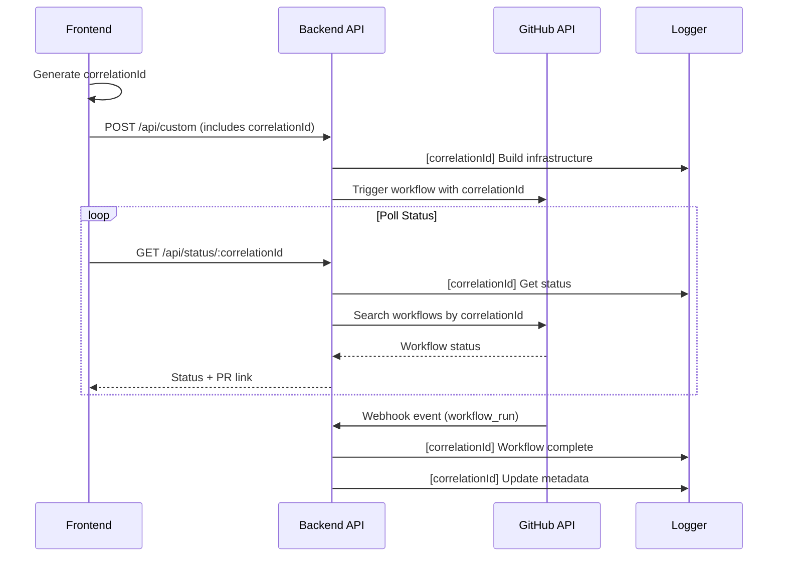

### 2.4 SPA Navigation Pattern

Single Page Application with stateful navigation and efficient data loading.

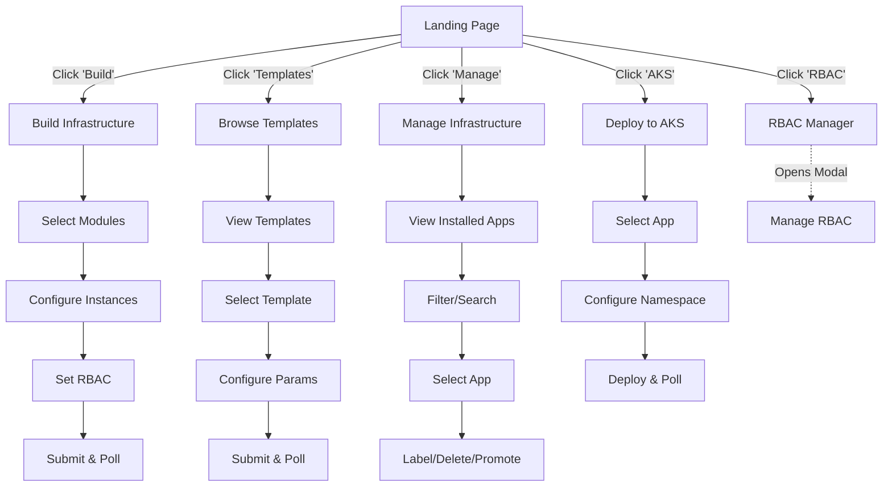

### 2.5 Workflow Polling Pattern

The frontend continuously polls the backend for workflow status updates until completion.

```mermaid
sequenceDiagram
    participant UI as Frontend
    participant Backend as Backend
    participant DB as GitHub Workflows

    UI->>Backend: POST /api/custom (trigger)
    Backend-->>UI: correlationId + PR link

    rect rgba(100, 150, 255, 0.1)
    Note over UI: Polling Loop

    loop Every 2-5 seconds
        UI->>Backend: GET /api/status/:correlationId
        activate Backend
        Backend->>DB: Search workflows with correlationId
        DB-->>Backend: status: queued|in_progress|completed
        Backend-->>UI: { status, conclusion, url, prUrl }
        deactivate Backend

        alt Workflow Running
            UI->>UI: Show progress indicator
        else Workflow Complete
            UI->>UI: Show success message
            UI->>UI: Display PR link
            break Stop polling
        end
    end
    end
```

---

## Component Architecture

### 3.1 Backend Services

The backend consists of five key services that handle different responsibilities:

#### GitHubService

**Responsibilities:**
- Manage GitHub App authentication (dual apps)
- Dispatch workflows to GitHub Actions
- Create pull requests for infrastructure
- Retrieve workflow status
- Handle GitHub webhook events
- Query GitHub API for metadata

**Key Methods:**

```javascript
class GitHubService {
  // Authentication & Initialization
  initialize()

  // Workflow Management
  triggerWorkflow(repo, workflow, branch, inputs)
  getWorkflowStatusByCorrelationId(correlationId, type)

  // Pull Request Management
  createPullRequest(repo, title, body, branch)

  // Webhook Handling
  handleWebhookEvent(event, payload)

  // Repository Access
  getRepositoryContent(path)
  getFileContent(path)
}
```

#### InfrastructureService

**Responsibilities:**
- Orchestrate infrastructure provisioning
- Fetch templates and modules
- Retrieve installed applications
- Coordinate GitHub workflows and metadata
- Manage infrastructure lifecycle (create, promote, delete)

**Key Methods:**

```javascript
class InfrastructureService {
  // Data Retrieval
  getTemplates()
  getModules()
  getInstalledApps()
  getApplicationDetails(projectName, environment)

  // Infrastructure Operations
  buildCustomInfrastructure(projectName, desc, env, modules, owner, cr, age, correlationId, rbac)
  deployFromTemplate(templateName, projectName, desc, env, owner, age, correlationId, jira)
  deleteInfrastructure(projectName, environment, correlationId)
  promoteToProduction(projectName, sourceEnv, crNumber, correlationId)
}
```

#### AKSService

**Responsibilities:**
- Manage Azure Kubernetes Service deployments (web apps and ADO agents)
- Trigger AKS deployment workflows in aya-flux repository
- Persist deployment metadata to `docs/aks-metadata/` in service-catalog
- Track deployment status via correlation ID in workflow job logs

**Key Methods:**

```javascript
class AKSService {
  // Web App deployment — triggers generate-webapp-config.yaml
  // Inputs: envname, appname, namespace, teamLabel, image, tag, port, health_path,
  //         externalSecret_enabled, kv_secrets, env_vars, secret_env_vars,
  //         workload_identity_grants, correlation_id
  deployToAks(envname, appname, namespace, isWebApp, imageName, imageTag,
              teamLabel, port, healthPath, externalSecretEnabled, kvSecrets,
              envVars, secretEnvVars, agentName, poolName, allowUpdate,
              workloadIdentityGrants, correlationId, triggeredBy)

  // Agent deployment — triggers generate-agent-config.yaml
  // Inputs: envname, appname, namespace, agentname, poolname, agentimagesource,
  //         agentimagetag, teamLabel, externalSecret_enabled, kv_secrets,
  //         workload_identity_grants, allow_update, correlation_id

  getDeploymentStatusByCorrelationId(correlationId)  // polls last 10 workflow runs
  saveDeploymentMetadata(metadata)                    // upserts {appname}-{envname}.json
}
```

#### DatabaseService

**Responsibilities:**
- (Legacy/Optional) Interface with SQL Server
- Currently mocked for GitHub-as-database approach

**Key Methods:**

```javascript
class DatabaseService {
  getDeployedApplications()
  // Other methods mocked
}
```

#### HCLParser

**Responsibilities:**
- Parse Terraform/HCL configuration files
- Extract variable definitions and module structure
- Validate HCL syntax

**Key Methods:**

```javascript
class HCLParser {
  parseHcl(content)
  extractVariables(ast)
  extractModules(ast)
}
```

### 3.2 API Layer

Express.js routes in `routes/api.js` define all endpoints. The API uses:
- **Express Validator** for input validation
- **Correlation ID** middleware for tracking
- **Error handling** with standardized responses
- **Logging** with Winston logger

---

## Data Architecture

### 4.1 Data Storage Strategy

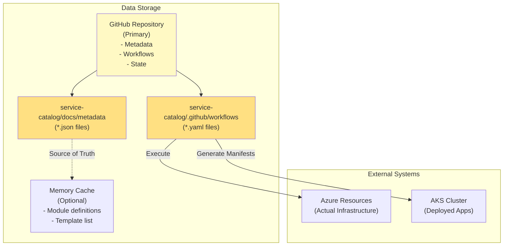

### 4.2 Metadata Schema Examples

#### Application Metadata

```json
{
  "projectName": "webapp-prod",
  "environment": "production",
  "description": "Customer-facing web application",
  "owner": "platform-team",
  "lifecycle": "production",
  "status": "active",
  "modules": ["virtual-network", "app-service", "sql-database", "keyvault"],
  "moduleInstances": {
    "virtual-network": 1,
    "app-service": 2,
    "sql-database": 1,
    "keyvault": 1
  },
  "createdAt": "2024-01-10T15:30:00Z",
  "createdBy": "user@company.com",
  "updatedAt": "2024-01-20T10:00:00Z",
  "updatedBy": "user2@company.com",
  "prNumber": 42,
  "crNumber": "CR-2024-0042",
  "age": "10 days",
  "azureResourceGroup": "rg-webapp-prod-eastus"
}
```

#### Template Metadata

```json
{
  "id": "template-web-api",
  "name": "Web API Template",
  "description": "Pre-configured template for REST APIs",
  "modules": ["virtual-network", "app-service", "sql-database"],
  "defaultValues": {
    "instanceCount": {
      "app-service": 2,
      "sql-database": 1
    }
  },
  "tags": ["api", "backend", "recommended"],
  "createdAt": "2023-12-01T00:00:00Z"
}
```

#### Module Metadata

```json
{
  "id": "module-keyvault",
  "name": "Azure Key Vault",
  "category": "Security",
  "description": "Secure secrets and key management",
  "version": "1.2.0",
  "variables": [
    {
      "name": "sku",
      "type": "string",
      "default": "standard",
      "description": "Key Vault SKU (standard or premium)"
    }
  ],
  "outputs": [
    {
      "name": "vault_id",
      "description": "Key Vault resource ID"
    }
  ],
  "minTerraformVersion": "1.0.0"
}
```

### 4.3 Data Flow Patterns

#### Read Flow

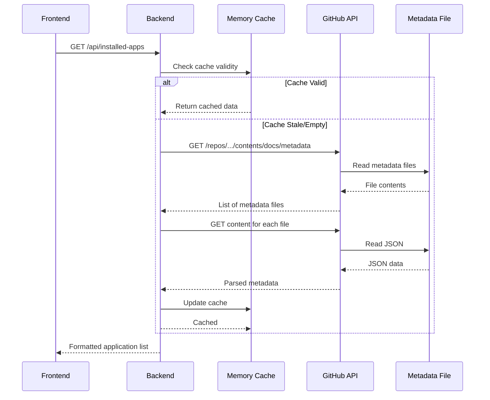

#### Write Flow

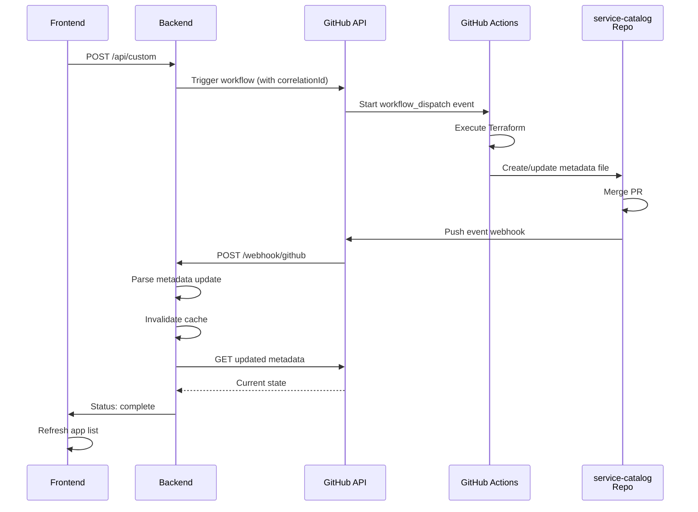

---

## API Architecture

### 5.1 Complete API Endpoint Reference

| **Category** | **Method** | **Endpoint** | **Purpose** | **Auth** |
|---|---|---|---|---|
| **Infrastructure Management** | GET | `/api/templates` | Fetch available Terraform templates | Public |
| | GET | `/api/modules` | Fetch available Azure modules | Public |
| | GET | `/api/installed-apps` | Get all deployed applications from metadata | Public |
| | POST | `/api/custom` | Deploy custom infrastructure (module composition) | Validated |
| | POST | `/api/template` | Deploy from pre-configured template | Validated |
| | POST | `/api/delete` | Delete infrastructure deployment | Validated |
| | POST | `/api/promote` | Promote app to production environment | Validated |
| **Status & Polling** | GET | `/api/status/:correlationId` | Poll workflow execution status by correlationId | Public |
| | POST | `/api/webhook/github` | GitHub webhook handler (verified signature) | Webhook Secret |
| **Application Management** | GET | `/api/deployed-apps` | Get all deployed applications from database | Public |
| | GET | `/api/deployed-apps/:projectName/:environment` | Get specific application details | Public |
| | POST | `/api/deployed-apps/update-pr` | Update PR information for app | Validated |
| | POST | `/api/deployed-apps/:id/request-production` | Request production transition | Validated |
| | POST | `/api/lifecycle-transitions/:id/approve` | Approve production transition | Validated |
| | POST | `/api/label` | Label app as Live or Experiment | Validated |
| | POST | `/api/add-code-repo` | Trigger create-app workflow | Validated |
| **AKS Operations** | POST | `/api/aks-deploy` | Deploy web app or ADO agent to AKS (health_path, allow_update, KV integration, workload identity) | Validated |
| | GET | `/api/aks-status/:workflowId` | Get AKS deployment status by workflow ID | Public |
| | GET | `/api/aks-status-by-correlation/:correlationId` | Get AKS deployment status by correlation ID | Public |
| | GET | `/api/aks-apps` | List all deployed AKS applications (from service-catalog metadata) | Authenticated |
| **Testing/Debug** | GET | `/api/test-repo-structure` | Inspect repository structure | Authenticated |
| | GET | `/api/test-docs-structure` | Inspect docs folder structure | Authenticated |
| | GET | `/api/test-metadata-structure` | Inspect metadata folder structure | Authenticated |
| **RBAC** | GET | `/api/rbac-manager` | Get RBAC relationship templates | Public |
| | POST | `/api/rbac-relationships` | Save and apply RBAC relationships | Validated |

### 5.2 Request/Response Patterns

#### Custom Infrastructure Request

```javascript
// POST /api/custom
{
  "projectName": "my-project",
  "project_desc": "My project description",
  "environment": "sand",
  "modules": [
    { "name": "virtual-network", "instances": 1 },
    { "name": "storage-account", "instances": 2 },
    { "name": "keyvault", "instances": 1 }
  ],
  "owner": "team-name",
  "crNumber": "CR-2024-001",
  "projectAge": 30,
  "correlationId": "cid-1705329000000-a1b2",
  "rbacPairs": "user1:reader;user2:contributor"
}
```

#### Successful Response

```javascript
{
  "message": "Custom infrastructure workflow triggered successfully",
  "url": "https://github.com/org/service-catalog/actions/runs/123456",
  "correlationId": "cid-1705329000000-a1b2"
}
```

#### Status Poll Response

```javascript
// GET /api/status/:correlationId
{
  "status": "completed",
  "conclusion": "success",
  "url": "https://github.com/org/service-catalog/actions/runs/123456",
  "prUrl": "https://github.com/org/service-catalog/pull/42",
  "message": "Workflow completed successfully",
  "correlationId": "cid-1705329000000-a1b2",
  "workflowType": "build-infrastructure",
  "data": { /* full workflow run data */ }
}
```

#### Error Response

```javascript
{
  "success": false,
  "error": "Failed to build custom infrastructure",
  "message": "Validation error: Project name is required",
  "correlationId": "cid-1705329000000-a1b2"
}
```

### 5.3 Status Codes

| **Code** | **Meaning** | **Scenario** |
|---|---|---|
| **200** | OK | Successful data retrieval |
| **201** | Created | Resource created |
| **202** | Accepted | Async operation accepted (webhooks) |
| **400** | Bad Request | Validation errors, missing required fields |
| **401** | Unauthorized | Authentication required |
| **403** | Forbidden | Insufficient permissions |
| **404** | Not Found | Resource doesn't exist |
| **500** | Server Error | Unexpected backend error |
| **503** | Service Unavailable | GitHub API rate limited |

---

## Frontend Architecture

### 6.1 SPA Structure

```
public/
├── index.html              # Main entry point
├── css/
│   ├── style.css          # Global styles
│   └── responsive.css     # Mobile responsive
├── js/
│   ├── app.js             # Main SPA logic
│   └── rbac-manager.js    # RBAC manager modal
└── images/                # UI assets
```

#### HTML Page Sections

```html
<!-- Main Navigation -->
<nav class="navbar">
  - Logo & branding
  - Main navigation links
  - User profile (if auth implemented)
</nav>

<!-- Build Infrastructure Page -->
#build-page
  - Module selector with categories
  - Module instance configuration
  - Environment selection
  - Owner field
  - RBAC manager button
  - Submit & polling UI

<!-- Browse Templates Page -->
#templates-page
  - Template cards grid
  - Template details modal
  - Configuration form
  - Deploy button

<!-- Manage Infrastructure Page -->
#manage-page
  - Application list/table
  - Search & filter controls
  - Environment selector
  - Lifecycle badge (experimental/production)
  - Actions: Label, Delete, Promote

<!-- Deploy to AKS Page -->
#aks-page  (AKSDeployPage.vue)
  - Deployment type toggle: Web App | ADO Agent
  - Common: environment, app name, namespace, container image, image tag
  - Web App fields: team label, port, health_path, env vars, secret env vars,
                    Key Vault (ExternalSecret) integration, workload identity grants
  - Agent fields: agent name (auto-populated), pool name, team label,
                  allow_update toggle, Key Vault integration, workload identity grants
  - Status polling via correlation ID
  - Navigation link to AKS Installed Apps

<!-- AKS Installed Apps Page -->
#aks-apps-page  (AKSInstalledAppsPage.vue)
  - Searchable/filterable table of deployed apps (web apps + agents)
  - Metadata sourced from docs/aks-metadata/ in service-catalog repo
  - Columns: app/namespace, environment, image, type badge, owner, status, deployed at

<!-- RBAC Manager Modal -->
- Resource role selector
- Relationship builder
- User/group mapper
- Apply button
```

### 6.2 Navigation State Diagram

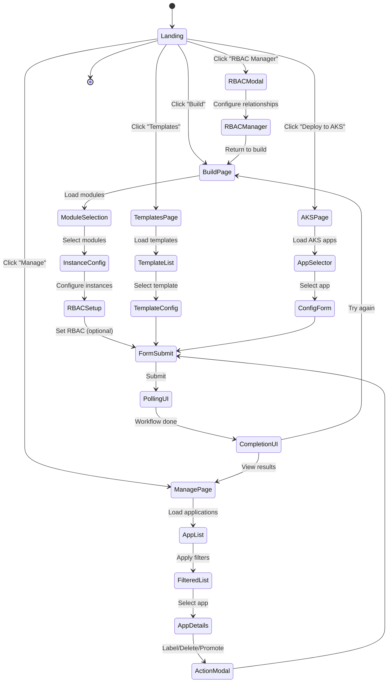

### 6.3 Component Responsibilities

#### app.js - Main Application Logic

```javascript
// Global State
let rbacRelationships = []
let selectedModulesForRBAC = []

// Initialization
initApp()                           // Setup on page load
setupNavigation()                   // Configure SPA routing
setupCustomForm()                   // Custom deployment form
setupTemplateForm()                 // Template deployment form
setupAksForm()                      // AKS deployment form

// Data Loading
loadModules()                       // Fetch available modules
loadTemplates()                     // Fetch available templates
loadInstalledApps()                 // Fetch deployed applications

// Module Management
handleModuleToggle(moduleName)      // Select/deselect module
updateModuleInstances(module, count) // Configure instance count
getSelectedModulesWithInstances()   // Collect selected modules

// RBAC Management
openRBACManager()                   // Launch RBAC modal
getRBACPairsForDeployment()         // Serialize RBAC config

// Navigation
navigateToPage(pageId)              // Switch SPA pages

// Workflow Status
pollWorkflowStatus(correlationId)   // Poll /api/status
pollAksDeploymentStatus(correlationId) // Poll AKS status
showProgressIndicator()             // UI feedback

// Actions
labelApplication(projectName, env, label)  // Label as live/experiment
deleteApplication(projectName, env)        // Delete infrastructure
promoteToProduction(projectName, env, cr)  // Promote app
addCodeRepo(projectName, env)              // Trigger create-app
showDeleteModal()                          // Confirmation modal
showPromoteModal()                         // Promotion form modal
```

#### rbac-manager.js - RBAC Modal

```javascript
class RBACManager {
  constructor()                      // Initialize manager
  open(selectedModules)              // Show modal with modules
  close()                            // Close modal
  addRelationship(resource, role, user) // Add role assignment
  removeRelationship(id)             // Remove role assignment
  getRelationships()                 // Export as string
  serialize()                        // Convert to deployable format
}
```

### 6.4 Correlation ID Generation

```javascript
// Frontend generates unique tracking ID
function generateCorrelationId(prefix = 'cid') {
  const timestamp = Date.now();
  const random = Math.random().toString(36).substring(2, 6);
  return `${prefix}-${timestamp}-${random}`;
}

// Included in all API requests
const correlationId = generateCorrelationId();
const response = await fetch('/api/custom', {
  method: 'POST',
  body: JSON.stringify({
    ...formData,
    correlationId
  })
});
```

### 6.5 Polling Mechanisms

#### Status Polling

```javascript
async function pollWorkflowStatus(correlationId) {
  let attempts = 0;
  const maxAttempts = 60; // 5 minutes with 5-second intervals
  const pollInterval = 5000; // 5 seconds

  while (attempts < maxAttempts) {
    const response = await fetch(`/api/status/${correlationId}`);
    const data = await response.json();

    updateUI(data.status); // Show progress

    if (data.status === 'completed') {
      if (data.conclusion === 'success') {
        showSuccessMessage(data.prUrl);
      } else {
        showErrorMessage(data.conclusion);
      }
      break;
    }

    attempts++;
    await sleep(pollInterval);
  }
}
```

---

## Workflow Management

### 7.1 GitHub Actions Workflows

The system triggers multiple GitHub Actions workflows from the service-catalog repository:

#### Custom Infrastructure Workflow

```yaml
# .github/workflows/build-infrastructure.yaml
name: Build Custom Infrastructure

on:
  workflow_dispatch:
    inputs:
      projectName:
      projectDescription:
      environment:
      modules:
      owner:
      crNumber:
      correlationId:  # Embedded for tracking

jobs:
  validate:
    - Validate inputs
    - Check module availability

  plan:
    - Run terraform plan
    - Generate cost estimate

  apply:
    - Run terraform apply
    - Create/update metadata
    - Create PR with metadata
    - Post results to GitHub
```

#### Template Deployment Workflow

```yaml
# .github/workflows/deploy-template.yaml
name: Deploy Template

on:
  workflow_dispatch:
    inputs:
      templateName:
      projectName:
      environment:
      correlationId:

jobs:
  render:
    - Load template definition
    - Substitute variables

  deploy:
    - Run terraform
    - Create metadata
    - Create PR
```

#### Delete Infrastructure Workflow

```yaml
# .github/workflows/delete-infrastructure.yaml
name: Delete Infrastructure

on:
  workflow_dispatch:
    inputs:
      projectName:
      environment:
      correlationId:

jobs:
  confirm:
    - Verify deletion request
    - Check approval status

  destroy:
    - Run terraform destroy
    - Archive metadata
    - Create PR
```

#### Promote to Production Workflow

```yaml
# .github/workflows/promote-to-production.yaml
name: Promote to Production

on:
  workflow_dispatch:
    inputs:
      projectName:
      sourceEnvironment:
      crNumber:
      correlationId:

jobs:
  validate:
    - Verify CR number
    - Check approval status

  promote:
    - Copy configuration from source env
    - Deploy to production
    - Update metadata
    - Create PR
```

#### AKS Deployment Workflows

Two separate workflows in the `aya-flux` repository (branch configurable via `config.aks.fluxBranch`):

**Web App** — `generate-webapp-config.yaml`
```yaml
inputs:
  envname, appname, namespace, teamLabel
  is_web_app: 'true'
  image_name, image_tag
  port               # container port (default: 80)
  health_path        # liveness/readiness probe endpoint (default: /healthz)
  externalSecret_enabled   # 'true'|'false'
  kv_secrets         # JSON: [{"kvName":"...","k8sKey":"..."}]
  env_vars           # JSON: [{"name":"...","value":"..."}]
  secret_env_vars    # JSON: [{"name":"...","key":"..."}]
  workload_identity_grants  # JSON: [{"resourceType","resourceName","role"}]
  correlation_id, triggered_by
```

**ADO Agent** — `generate-agent-config.yaml`
```yaml
inputs:
  envname, appname, namespace
  agentname          # defaults to {appname}-agent
  poolname           # Azure DevOps pool (default: DevOpsPool)
  agentimagesource, agentimagetag
  teamLabel          # namespace label
  externalSecret_enabled, kv_secrets
  workload_identity_grants
  allow_update       # 'true' to overwrite existing manifests
  correlation_id, triggered_by
```

### 7.2 Workflow Status Lifecycle

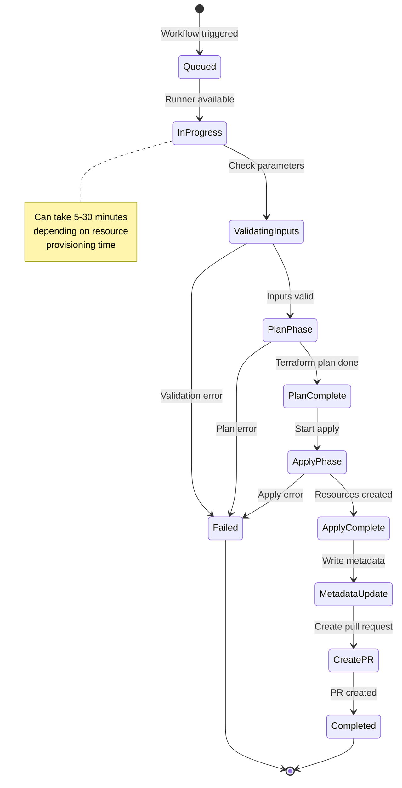

### 7.3 Correlation Tracking in PRs

Correlation ID is embedded in PR metadata for traceability:

```markdown
<!-- PR Description -->
## Infrastructure Deployment

**Correlation ID:** cid-1705329000000-a1b2
**Project:** my-app
**Environment:** sand
**Modules:** virtual-network, storage-account, keyvault

## Requested Changes
- Deploy new Azure resources
- Configure RBAC relationships

## Workflow Status
- Plan: ✓ Completed
- Apply: ✓ Completed
- Metadata: ✓ Updated

**Deployed by:** self-service-infra automation
```

---

## Security Architecture

### 8.1 Authentication & Authorization

#### Dual GitHub Apps

```javascript
// Infrastructure App
- Purpose: Provision infrastructure
- Permissions: repo (read/write), actions (trigger), workflows
- Scoped to: service-catalog repository
- App ID: ${GITHUB_APP_ID}

// Code Deployment App  
- Purpose: Create PRs for application code
- Permissions: repo (read/write), contents
- Scoped to: application repositories
- App ID: ${GITHUB_CODE_APP_ID}
```

#### Webhook Verification

All GitHub webhooks are verified using HMAC-SHA256:

```javascript
// middleware/verifyWebhook.js
const crypto = require('crypto');

function verifyWebhook(req, res, next) {
  const signature = req.headers['x-hub-signature-256'];
  const payload = req.rawBody; // Must be raw buffer, not parsed JSON

  const hash = crypto
    .createHmac('sha256', process.env.WEBHOOK_SECRET)
    .update(payload)
    .digest('hex');

  const expected = `sha256=${hash}`;

  if (!crypto.timingSafeEqual(expected, signature)) {
    return res.status(403).json({ error: 'Webhook verification failed' });
  }

  next();
}
```

### 8.2 Input Validation

All user inputs are validated using express-validator:

```javascript
// routes/api.js
router.post('/custom', [
  check('projectName')
    .notEmpty().trim().escape()
    .matches(/^[a-zA-Z0-9-]+$/).withMessage('Invalid project name format'),

  check('environment')
    .isIn(['sand', 'devsand', 'prod']).withMessage('Invalid environment'),

  check('modules')
    .isArray({ min: 1 }).withMessage('Select at least one module'),

  check('crNumber')
    .notEmpty().matches(/^CR-\d+$/).withMessage('Invalid CR format'),

  check('projectAge')
    .isInt({ min: 1, max: 365 }).withMessage('Invalid project age')
], async (req, res) => {
  const errors = validationResult(req);
  if (!errors.isEmpty()) {
    return res.status(400).json({ errors: errors.array() });
  }
  // Process request
});
```

### 8.3 Secret Management

```javascript
// config.js - Secure loading of secrets

// GitHub App Private Key (from file or environment)
const privateKey = fs.readFileSync(
  process.env.GITHUB_PRIVATE_KEY_PATH,
  'utf8'
);

// Or from environment variable (base64 encoded)
const privateKey = Buffer.from(
  process.env.GITHUB_PRIVATE_KEY_B64,
  'base64'
).toString('utf8');

// Webhook Secret
const webhookSecret = process.env.WEBHOOK_SECRET;

// Never log secrets
logger.info('Configuration loaded', {
  hasGithubKey: !!privateKey,
  hasWebhookSecret: !!webhookSecret,
  // Do NOT log: privateKey, webhookSecret
});
```

### 8.4 CORS Configuration

```javascript
// server.js
const cors = require('cors');

app.use(cors({
  origin: process.env.ALLOWED_ORIGINS?.split(',') || ['http://localhost:3000'],
  credentials: true,
  methods: ['GET', 'POST', 'PUT', 'DELETE'],
  allowedHeaders: ['Content-Type', 'Authorization']
}));
```

### 8.5 Security Hardening

**Transport Security:**
- All endpoints require HTTPS in production
- HSTS headers enabled
- Secure cookies only

**Session Security:**
- Correlation IDs are cryptographically random
- Session timeouts implemented
- No sensitive data in URLs

**API Security:**
- Rate limiting on sensitive endpoints
- Request size limits (10MB default)
- Timeouts on all external API calls

**Infrastructure Security:**
- GitHub App permissions minimized
- Webhook IP whitelisting recommended
- Audit logging of all operations

---

## Deployment Architecture

### 9.1 Docker Configuration

```dockerfile
# Dockerfile - Multi-stage build
FROM node:24-alpine AS base

# Dependencies stage
FROM base AS dependencies
WORKDIR /app
COPY package*.json ./
RUN npm ci --only=production

# Release stage
FROM base AS release
WORKDIR /app

# Security: Create non-root user
RUN addgroup -g 1001 -S nodejs
RUN adduser -S nodejs -u 1001

# Copy dependencies and app
COPY --from=dependencies /app/node_modules ./node_modules
COPY --chown=nodejs:nodejs . .

USER nodejs
EXPOSE 3000

# Health check
HEALTHCHECK --interval=30s --timeout=3s --start-period=5s --retries=3 \
  CMD node -e "require('http').get('http://localhost:3000/health', (r) => {if (r.statusCode !== 200) throw new Error(r.statusCode)})"

CMD ["node", "server.js"]
```

### 9.2 Kubernetes Deployment

```yaml
# kubernetes/deployment.yaml
apiVersion: apps/v1
kind: Deployment
metadata:
  name: self-service-infra
  namespace: self-service-test
spec:
  replicas: 3
  selector:
    matchLabels:
      app: self-service-infra
  template:
    metadata:
      labels:
        app: self-service-infra
    spec:
      containers:
      - name: self-service-infra
        image: myregistry.azurecr.io/self-service-infra:latest
        ports:
        - containerPort: 3000
        env:
        - name: NODE_ENV
          value: "production"
        - name: PORT
          value: "3000"
        - name: GITHUB_APP_ID
          valueFrom:
            secretKeyRef:
              name: github-credentials
              key: app-id
        - name: GITHUB_INSTALLATION_ID
          valueFrom:
            secretKeyRef:
              name: github-credentials
              key: installation-id
        - name: GITHUB_PRIVATE_KEY_PATH
          value: "/secrets/github-key"
        volumeMounts:
        - name: github-key
          mountPath: /secrets
          readOnly: true
        resources:
          requests:
            cpu: 100m
            memory: 256Mi
          limits:
            cpu: 500m
            memory: 512Mi
        livenessProbe:
          httpGet:
            path: /health
            port: 3000
          initialDelaySeconds: 30
          periodSeconds: 10
      volumes:
      - name: github-key
        secret:
          secretName: github-credentials
          items:
          - key: private-key
            path: github-key
```

### 9.3 Ingress Configuration

```yaml
# kubernetes/ingress.yaml
apiVersion: networking.k8s.io/v1
kind: Ingress
metadata:
  name: self-service-ingress
  namespace: self-service-test
  annotations:
    kubernetes.io/ingress.class: nginx
    nginx.ingress.kubernetes.io/rewrite-target: /
    nginx.ingress.kubernetes.io/ssl-redirect: "true"
    cert-manager.io/cluster-issuer: letsencrypt-prod
spec:
  tls:
  - hosts:
    - self-service.sand.k8s.com
    secretName: self-service-tls
  rules:
  - host: self-service.sand.k8s.com
    http:
      paths:
      - path: /
        pathType: Prefix
        backend:
          service:
            name: self-service-test-svc
            port:
              number: 80
```

### 9.4 Service Configuration

```yaml
# kubernetes/service.yaml
apiVersion: v1
kind: Service
metadata:
  name: self-service-test-svc
  namespace: self-service-test
spec:
  selector:
    app: self-service-infra
  type: ClusterIP
  ports:
  - port: 80
    targetPort: 3000
    protocol: TCP
    name: http
```

### 9.5 CI/CD Pipeline

```yaml
# .github/workflows/build-and-deploy.yaml
name: Build and Deploy

on:
  push:
    branches: [main]

jobs:
  build:
    runs-on: ubuntu-latest
    steps:
    - uses: actions/checkout@v3

    - name: Build Docker image
      run: docker build -t ${{ env.REGISTRY }}/self-service-infra:${{ github.sha }} .

    - name: Push to registry
      run: docker push ${{ env.REGISTRY }}/self-service-infra:${{ github.sha }}

    - name: Update K8s deployment
      run: |
        kubectl set image deployment/self-service-infra \
          self-service-infra=${{ env.REGISTRY }}/self-service-infra:${{ github.sha }} \
          -n self-service-test
```

---

## Integration Architecture

### 10.1 External System Integrations

#### GitHub Integration

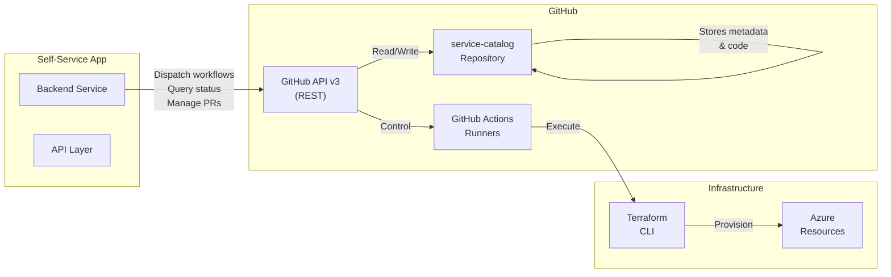

#### Azure Integration

The system provisions Azure resources through Terraform modules:

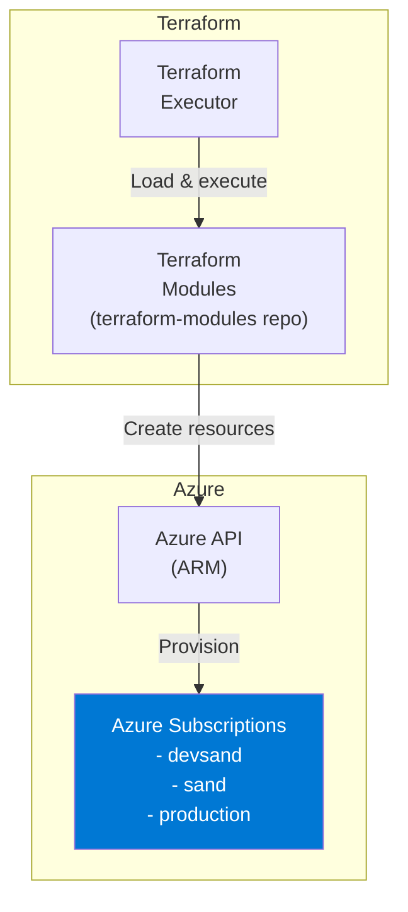

### 10.2 Integration Patterns

#### GitOps Pattern

The system follows GitOps principles:

1. **Declarative Infrastructure**: All infrastructure defined in Git (Terraform + metadata)
2. **Git as Source of Truth**: GitHub repository is single source of truth
3. **Automated Reconciliation**: GitHub Actions automatically applies changes
4. **Audit Trail**: All changes tracked with git history

#### Terraform Pattern

```hcl
# Example Terraform module structure
module "virtual_network" {
  source = "git::https://github.com/org/terraform-modules.git//modules/vnet?ref=v1.0.0"

  name              = var.project_name
  address_space     = ["10.0.0.0/16"]
  environment       = var.environment
  resource_group    = azurerm_resource_group.main.name
  tags              = local.common_tags
}

module "storage_account" {
  source = "git::https://github.com/org/terraform-modules.git//modules/storage?ref=v1.0.0"

  name              = "${var.project_name}storage"
  resource_group    = azurerm_resource_group.main.name
  environment       = var.environment
  tags              = local.common_tags
}
```

#### Flux Pattern (for AKS)

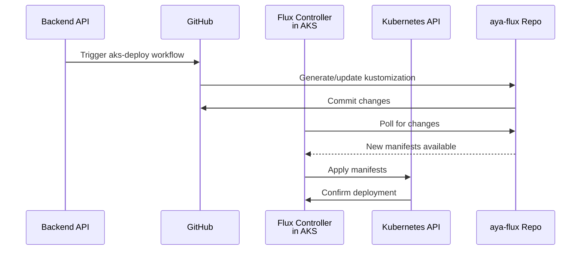

---

## Quality Attributes

### 11.1 Performance Targets

| **Metric** | **Target** | **Measurement** |
|---|---|---|
| **API Response Time** | < 200ms | P95 latency |
| **Workflow Trigger** | < 5s | From request to GitHub workflow start |
| **Status Poll** | < 100ms | Per request latency |
| **Page Load** | < 1s | Time to interactive |
| **Module Load** | < 2s | Fetch and render modules |
| **App List Load** | < 3s | Fetch and render installed apps |

### 11.2 Scalability Approach

**Horizontal Scaling:**
- Stateless backend (can run multiple replicas)
- Session state stored in GitHub (not in-memory)
- Kubernetes auto-scaling based on CPU/memory

**Data Scalability:**
- GitHub metadata in separate files (not single document)
- Lazy loading of app lists
- Pagination support for large result sets

**Concurrency:**
- Multiple simultaneous deployments supported
- Each tracked by unique correlation ID
- No shared state between deployments

### 11.3 Reliability Principles

**High Availability:**
- Multiple API replicas behind load balancer
- Health checks every 30 seconds
- Automatic pod restart on failure
- Graceful degradation (fallback to cached data)

**Error Handling:**
- All API endpoints have try-catch blocks
- Validation errors returned with details
- Transient errors automatically retried
- Circuit breaker for GitHub API calls

**Data Consistency:**
- Metadata source of truth in GitHub
- Eventual consistency model
- Webhooks ensure state synchronization

### 11.4 Security Measures

**Authentication:**
- GitHub App authentication (OAuth2)
- Webhook signature verification (HMAC-SHA256)
- Secure private key management

**Authorization:**
- Input validation on all endpoints
- Principle of least privilege for permissions
- Rate limiting on sensitive operations

**Data Protection:**
- Secrets stored in Kubernetes secrets
- Private keys never logged
- Sensitive data excluded from audit logs

**Network Security:**
- TLS/HTTPS for all traffic
- CORS restrictions
- Ingress network policies

---

## Future Enhancements

### 12.1 Short-Term (1-3 Months)

**Infrastructure Features:**
- [ ] Support for production environment deployments
- [ ] Infrastructure cost estimation
- [ ] Rollback capability for failed deployments
- [ ] Multi-module dependency resolution

**Operations:**
- [ ] Automated testing for Terraform modules
- [ ] Infrastructure change approval workflow
- [ ] Scheduled deletion of experimental resources
- [ ] Email notifications for deployment status

**UI/UX:**
- [ ] Real-time workflow logs in UI
- [ ] Advanced filtering and search
- [ ] Resource cost dashboard
- [ ] Dark mode support

### 12.2 Mid-Term (3-6 Months)

**Platform Features:**
- [ ] Self-service databases (SQL, CosmosDB)
- [ ] Managed identities auto-configuration
- [ ] Network policies and security groups
- [ ] Backup and disaster recovery templates

**Advanced Capabilities:**
- [ ] Infrastructure-as-Code validation (Checkov)
- [ ] Compliance scanning and reporting
- [ ] Cost optimization recommendations
- [ ] Auto-tagging and resource governance

**Integration:**
- [ ] ServiceNow integration for change management
- [ ] Slack notifications for workflow status
- [ ] Audit log export to Log Analytics
- [ ] Azure DevOps integration

### 12.3 Long-Term (6+ Months)

**Enterprise Features:**
- [ ] Multi-tenant support with isolation
- [ ] Advanced RBAC with custom roles
- [ ] Fine-grained approval workflows
- [ ] Infrastructure as a Service (IaaS) marketplace

**Advanced Operations:**
- [ ] ML-based cost prediction
- [ ] Automatic scaling policies
- [ ] Chaos engineering tests
- [ ] Multi-cloud support (AWS, GCP)

**Developer Experience:**
- [ ] CLI tool for local development
- [ ] VSCode extension
- [ ] Infrastructure templates marketplace
- [ ] AI-assisted infrastructure recommendations

**Observability:**
- [ ] Distributed tracing (OpenTelemetry)
- [ ] APM integration
- [ ] Custom metrics and dashboards
- [ ] Anomaly detection

---

## Architecture Decision Records (ADRs)

### ADR-001: GitHub as Database

**Status:** Accepted

**Context:**
The system needed a persistent storage layer for application metadata. Traditional databases required additional infrastructure and maintenance.

**Decision:**
Use GitHub repository (`docs/metadata/` folder) as the primary data store for all application metadata.

**Consequences:**
- ✅ No additional database infrastructure
- ✅ Built-in version control and audit trail
- ✅ Familiar Git workflows for operations
- ❌ GitHub API rate limits (15,000 requests/hour)
- ❌ Eventual consistency (propagation delay)

---

### ADR-002: Dual GitHub Apps

**Status:** Accepted

**Context:**
The system needed to manage both infrastructure provisioning and application code deployment with different scopes and permissions.

**Decision:**
Use two separate GitHub Apps with distinct responsibilities:
1. Infrastructure App - provisions Azure resources
2. Code Deployment App - creates application PRs

**Consequences:**
- ✅ Security: Least privilege principle
- ✅ Isolation: Failure in one doesn't affect other
- ✅ Permissions: Granular control per app
- ❌ Complexity: Multiple credentials to manage
- ❌ Synchronization: App state must be coordinated

---

### ADR-003: Correlation ID Tracking

**Status:** Accepted

**Context:**
Needed end-to-end traceability of workflow executions across frontend, backend, and GitHub.

**Decision:**
Implement correlation ID as unique identifier for each operation, flowing through all layers.

**Consequences:**
- ✅ Complete audit trail per operation
- ✅ Debugging simplified with correlation context
- ✅ Status tracking without database queries
- ❌ Correlation ID must be maintained in all logs
- ❌ Frontend must generate and persist ID

---

### ADR-004: Vanilla JavaScript SPA

**Status:** Accepted

**Context:**
Needed lightweight frontend without external framework dependencies for rapid development and deployment.

**Decision:**
Build SPA using vanilla JavaScript with DOM manipulation and Fetch API.

**Consequences:**
- ✅ Minimal dependencies
- ✅ Fast page loads
- ✅ Simple deployment
- ❌ No component reusability
- ❌ State management complexity at scale

---

## Glossary

| **Term** | **Definition** |
|---|---|
| **Correlation ID** | Unique identifier for tracking an operation end-to-end |
| **GitOps** | Operations practice using Git as source of truth for infrastructure |
| **Metadata** | Application configuration and deployment information stored in GitHub |
| **Module** | Reusable Terraform configuration for specific Azure resource |
| **Template** | Pre-configured composition of modules for common deployment patterns |
| **Workflow** | GitHub Actions automation for provisioning and managing infrastructure |
| **Flux** | GitOps tool for automatic Kubernetes reconciliation |
| **RBAC** | Role-Based Access Control for Azure resources |
| **Correlation** | Linking related events and logs through a unique identifier |

---

## References & Resources

### Documentation
- [GitHub API Documentation](https://docs.github.com/en/rest)
- [GitHub Actions Documentation](https://docs.github.com/en/actions)
- [Terraform Documentation](https://www.terraform.io/docs)
- [Azure Terraform Provider](https://registry.terraform.io/providers/hashicorp/azurerm/latest)
- [Kubernetes Documentation](https://kubernetes.io/docs)
- [Flux Documentation](https://fluxcd.io/docs)

### Configuration Files
- `config.js` - Application configuration
- `Dockerfile` - Docker image build
- `kubernetes/` - Kubernetes manifests
- `.github/workflows/` - GitHub Actions workflows

### Key Source Files
- `server.js` - Express application entry point
- `routes/api.js` - API endpoint definitions
- `services/githubService.js` - GitHub integration
- `services/infrastructureService.js` - Infrastructure orchestration
- `public/js/app.js` - Frontend SPA logic
- `middleware/verifyWebhook.js` - Webhook verification

---

**Document Version:** 2.0  
**Last Updated:** 2024-01-20  
**Maintained By:** Architecture Team  
**Next Review:** Q1 2024
