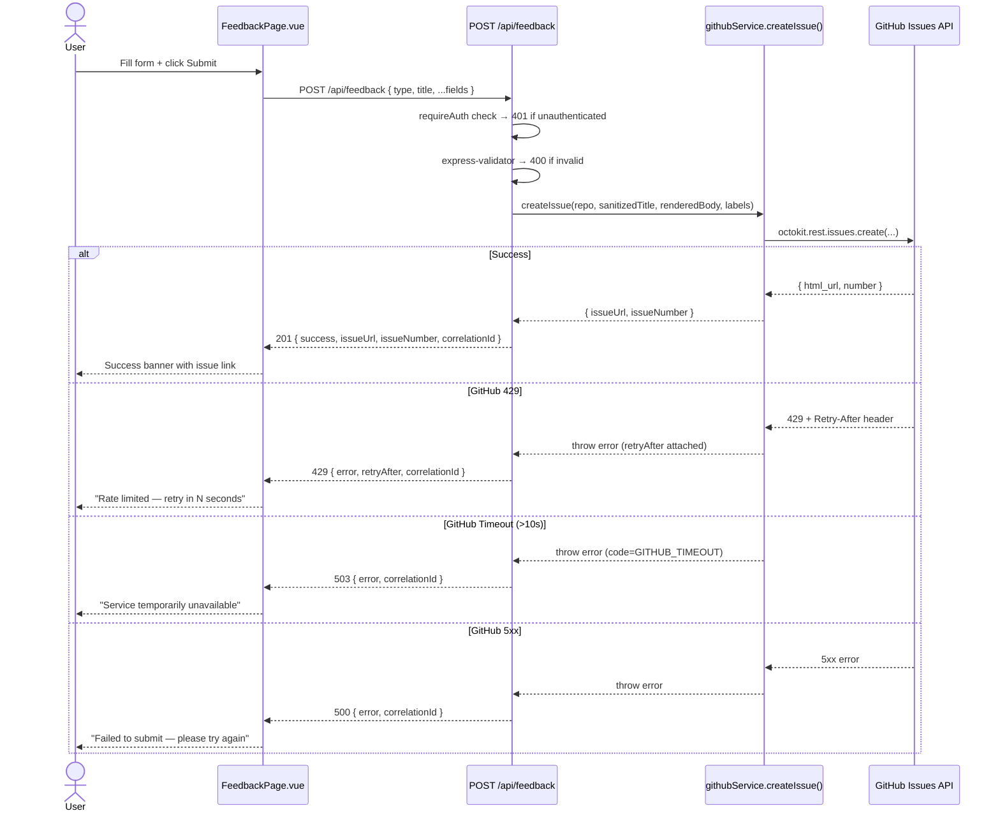

# Bug / Feature Request Form — Feature Specification

| Field          | Value                                     |
|----------------|-------------------------------------------|
| **Feature**    | Bug / Feature Request Form                |
| **Slug**       | bug-feature-request-form                  |
| **Status**     | Approved                                  |
| **Last Modified** | 2025-01-20                             |
| **Spec JSON**  | `docs/architecture/bug-feature-request-form-spec.json` |
| **PRD**        | `docs/prd/bug-feature-request-form.md`    |

---

## 1. Context

### Why This Feature?
Users of the Self-Service Infra Catalog currently have no in-app way to report bugs, request features, or propose new AI agent capabilities. Feedback loops are informal and scattered (Slack, email). This feature closes that gap by embedding a structured feedback form directly into the application and automating GitHub Issue creation in `Aya-DevOpsTeam/self-service-infra`.

### User Value
- **Zero context switching**: users submit feedback without leaving the portal
- **Structured data**: templated issue bodies ensure the DevOps team receives consistent, actionable information
- **Immediate confirmation**: success state shows the created GitHub Issue URL, giving users confidence their feedback was received

### Business Impact
- Reduces feedback friction → more issues reported → faster quality improvements
- GitHub Issues serve as the audit trail — no additional tooling required
- Leverages the existing GitHub-as-Database architectural pattern

---

## 2. Scope

### In Scope
- Three sub-forms: Bug Report, Feature Request, Agent Request
- `POST /api/feedback` backend endpoint
- `createIssue()` method on `GitHubService`
- Feedback nav item in `SharedHeader.vue` (authenticated users only)
- `FeedbackPage.vue` component + `FeedbackPage.spec.ts` tests

### Out of Scope
- Issue tracking / status updates within the app (users follow the GitHub link)
- Email notifications
- Admin dashboard for viewing submitted issues
- Rate limiting per-user beyond GitHub API's own 429 response

---

## 3. Architecture Alignment

This feature follows all five critical system patterns without exception:

| Pattern | How It Applies |
|---------|---------------|
| **GitHub as Database** | Issues created in `Aya-DevOpsTeam/self-service-infra` — GitHub is the record store |
| **Multi-GitHub-App** | Issue creation uses the **Infrastructure App** (`this.octokit`) — no code app involvement |
| **Correlation ID Tracking** | `req.correlationId` threaded through route → service → GitHub issue body → all log lines |
| **SPA Navigation** | `'feedback'` added to `PageId` union; `navigateToPage('feedback')` in SharedHeader; `v-else-if` branch in App.vue |
| **No Workflow Polling** | This feature creates an Issue directly (synchronous API call) — no polling required |

---

## 4. Component Changes

### 4.1 `srcV2/stores/navigation.ts` — MODIFY

**Change**: Extend the `PageId` union type to include `'feedback'`.

**Before:**
```ts
export type PageId = 'home' | 'docs' | 'custom' | 'template' | 'apps' | 'aks' | 'aks-apps' | 'rbac' | 'change'
```

**After:**
```ts
export type PageId = 'home' | 'docs' | 'custom' | 'template' | 'apps' | 'aks' | 'aks-apps' | 'rbac' | 'change' | 'feedback'
```

> ⚠️ **Do this first** — TypeScript errors will cascade to SharedHeader and App.vue if PageId is not updated before those files reference `'feedback'`.

---

### 4.2 `srcV2/components/common/SharedHeader.vue` — MODIFY

**Change**: Add a `Feedback` entry to `allNavItems` (after `apps`, `requiresAuth: true`).

```ts
// In <script setup>
const allNavItems = [
  { id: 'home' as PageId,     label: 'Home',                   requiresAuth: false },
  { id: 'docs' as PageId,     label: 'Quick Start',            requiresAuth: false },
  { id: 'custom' as PageId,   label: 'Custom Infrastructure',  requiresAuth: true  },
  { id: 'template' as PageId, label: 'Template Deploy',        requiresAuth: true  },
  { id: 'aks' as PageId,      label: 'AKS Playground',         requiresAuth: true  },
  { id: 'apps' as PageId,     label: 'Installed Apps',         requiresAuth: true  },
  { id: 'feedback' as PageId, label: 'Feedback',               requiresAuth: true  }, // ← ADD
]
```

No template changes required — the existing `v-for` loop and `requiresAuth` filter handle rendering automatically.

---

### 4.3 `srcV2/App.vue` — MODIFY

**Change**: Import `FeedbackPage` and add a `v-else-if` guard branch for `currentPage === 'feedback'`.

```ts
// In <script setup>
import FeedbackPage from './pages/FeedbackPage.vue'
```

```html
<!-- In <template>, after the last existing v-else-if page branch -->
<div v-else-if="navigationStore.currentPage === 'feedback' && isAuthenticated">
  <FeedbackPage />
</div>
```

---

### 4.4 `srcV2/pages/FeedbackPage.vue` — CREATE

#### Component Responsibilities
- Render a three-option form-type selector (Bug Report / Feature Request / Agent Request)
- Render the correct sub-form for the selected type
- Load available agent types from `GET /api/agents` on mount (for Agent Request dropdown)
- Perform client-side validation before submitting
- POST to `/api/feedback` and handle all response states
- Display success state with issue URL or error state with actionable message

#### Form Fields by Type

**Bug Report**

| Field | Type | Required | Constraints |
|-------|------|----------|-------------|
| title | text | ✅ | max 120 chars |
| observedBehaviour | textarea | ✅ | — |
| expectedBehaviour | textarea | ✅ | — |
| stepsToReproduce | textarea | ❌ | — |
| severity | select | ✅ | Critical \| High \| Medium \| Low |

**Feature Request**

| Field | Type | Required | Constraints |
|-------|------|----------|-------------|
| title | text | ✅ | max 120 chars |
| painPoint | textarea | ✅ | — |
| desiredOutcome | textarea | ✅ | — |
| businessJustification | textarea | ❌ | — |
| priority | select | ✅ | High \| Medium \| Low |

**Agent Request**

| Field | Type | Required | Constraints |
|-------|------|----------|-------------|
| title | text | ✅ | max 120 chars |
| agentType | select | ✅ | Populated from `GET /api/agents`; fallback to free-text |
| agentBehaviour | textarea | ✅ | — |
| businessJustification | textarea | ✅ | — |

#### State Machine

```
idle ──[submit]──► submitting ──[201 success]──► success
                      │
                      ├──[400 / 429 / 500 / 503]──► error (form remains editable)
```

#### Required `data-testid` Attributes

| Element | `data-testid` |
|---------|---------------|
| Form root | `feedback-form` |
| Bug tab/radio | `feedback-type-bug` |
| Feature tab/radio | `feedback-type-feature-request` |
| Agent tab/radio | `feedback-type-agent-request` |
| Title input | `feedback-title` |
| Submit button | `feedback-submit` |
| Success banner | `feedback-success-banner` |
| Error banner | `feedback-error-banner` |
| Issue URL link | `feedback-issue-url` |

#### Pattern Reference
Follow the structure of `srcV2/pages/InstalledAppsPage.vue`:
- `<script setup lang="ts">` with typed `ref()` state
- `onMounted` for data loading
- `api.*` calls via `@v2/services/api`
- Tailwind CSS for styling (match existing page styles)
- WCAG 2.1 AA: every `<input>` / `<select>` / `<textarea>` must have a `<label>` with matching `for`/`id`

---

### 4.5 `srcV2/pages/FeedbackPage.spec.ts` — CREATE

Vitest component tests. Follow `srcV2/pages/CustomInfrastructurePage.spec.ts` exactly for:
- Import style (`describe`, `it`, `expect`, `beforeEach`, `vi`)
- Mounting with `@vue/test-utils`
- Pinia isolation (`setActivePinia(createPinia())`)
- Mocking the API service (`vi.mock('@v2/services/api', ...)`)

---

### 4.6 `services/githubService.js` — MODIFY

**Add `createIssue()` method** to the `GitHubService` class.

```js
async createIssue(repo, title, body, labels = []) {
  this.ensureInitialized();
  const [owner, repoName] = repo.split('/');
  const start = Date.now();
  try {
    // Wrap with 10 s timeout (NFR-002)
    const response = await Promise.race([
      this.octokit.rest.issues.create({ owner, repo: repoName, title, body, labels }),
      new Promise((_, reject) =>
        setTimeout(() => { const e = new Error('GitHub API timeout'); e.code = 'GITHUB_TIMEOUT'; reject(e); }, 10000)
      )
    ]);
    logMetric('github_api_call', { operation: 'createIssue', repo, duration_ms: Date.now() - start, success: true });
    return { issueUrl: response.data.html_url, issueNumber: response.data.number };
  } catch (error) {
    logMetric('github_api_call', { operation: 'createIssue', repo, duration_ms: Date.now() - start, success: false, error: error.message });
    if (error.status === 429) {
      error.retryAfter = error.response?.headers?.['retry-after'] || '60';
    }
    throw error;
  }
}
```

**Key implementation notes**:
- Uses `this.octokit` (Infrastructure App) — same client as `createPullRequest()`
- Follows the same `logMetric` / `logger` pattern as `triggerWorkflow()`
- 10-second timeout wraps the entire octokit call (NFR-002)
- `retryAfter` attached to error object for 429 propagation to the route handler

---

### 4.7 `routes/api.js` — MODIFY

**Add `POST /api/feedback` route** at the end of the router definitions.

```js
router.post('/feedback', requireAuth, [
  check('type').isIn(['bug', 'feature-request', 'agent-request'])
    .withMessage('type must be bug, feature-request, or agent-request'),
  check('title').notEmpty().withMessage('title is required')
    .isLength({ max: 120 }).withMessage('title must be ≤ 120 characters'),
  check('description').notEmpty().withMessage('description is required')
], async (req, res) => {
  const errors = validationResult(req);
  if (!errors.isEmpty()) {
    return res.status(400).json({ success: false, errors: errors.array(), correlationId: req.correlationId });
  }

  const { type, title, ...fields } = req.body;
  logger.info(`[${req.correlationId}] User ${req.user.email} submitting feedback type=${type}`);

  try {
    const body = buildIssueBody(type, fields, req.user.email, req.correlationId); // sanitises + templates
    const labels = { bug: ['bug'], 'feature-request': ['enhancement'], 'agent-request': ['agent-request'] }[type];
    const { issueUrl, issueNumber } = await githubService.createIssue(config.github.selfServiceRepo, sanitize(title), body, labels);

    logger.info(`[${req.correlationId}] Feedback issue created: ${issueUrl}`);
    return res.status(201).json({ success: true, issueUrl, issueNumber, correlationId: req.correlationId });
  } catch (error) {
    if (error.code === 'GITHUB_TIMEOUT') {
      logger.error(`[${req.correlationId}] GitHub timeout creating feedback issue`);
      return res.status(503).json({ success: false, error: 'GitHub API timeout', correlationId: req.correlationId });
    }
    if (error.status === 429) {
      logger.warn(`[${req.correlationId}] GitHub rate limit: retryAfter=${error.retryAfter}`);
      return res.status(429).json({ success: false, error: 'GitHub rate limit exceeded', retryAfter: error.retryAfter, correlationId: req.correlationId });
    }
    logger.error(`[${req.correlationId}] Error creating feedback issue: ${error.message}`, { error: error.stack, correlationId: req.correlationId });
    return res.status(500).json({ success: false, error: 'Failed to create feedback issue', correlationId: req.correlationId });
  }
});
```

> **`buildIssueBody(type, fields, email, correlationId)`** is a private helper function (defined above the route or in a utils module) that:
> 1. Strips HTML tags from every user-supplied string field
> 2. Fills the appropriate markdown template
> 3. Returns the rendered string

#### Sanitisation Rule (NFR-004)
Strip HTML before interpolation. A simple approach:
```js
function sanitize(str) {
  return (str || '').replace(/<[^>]*>/g, '');
}
```
Apply `sanitize()` to every user-supplied field before inserting into the issue body.

---

## 5. API Contract

### `POST /api/feedback`

**Auth**: `requireAuth` middleware required

**Request Body** (JSON):
```json
{
  "type": "bug",
  "title": "Login button unresponsive on mobile",
  "observedBehaviour": "Tapping the login button does nothing on iOS Safari",
  "expectedBehaviour": "User should be redirected to the Entra ID login page",
  "stepsToReproduce": "1. Open app on iPhone 14\n2. Tap 'Sign in with EntraId'",
  "severity": "High"
}
```

**Success Response** (HTTP 201):
```json
{
  "success": true,
  "issueUrl": "https://github.com/Aya-DevOpsTeam/self-service-infra/issues/42",
  "issueNumber": 42,
  "correlationId": "550e8400-e29b-41d4-a716-446655440000"
}
```

**Validation Error** (HTTP 400):
```json
{
  "success": false,
  "errors": [
    { "type": "field", "msg": "type must be bug, feature-request, or agent-request", "path": "type" }
  ],
  "correlationId": "550e8400-e29b-41d4-a716-446655440000"
}
```

**Rate Limit** (HTTP 429):
```json
{
  "success": false,
  "error": "GitHub rate limit exceeded",
  "retryAfter": "60",
  "correlationId": "550e8400-e29b-41d4-a716-446655440000"
}
```

**Timeout** (HTTP 503):
```json
{
  "success": false,
  "error": "GitHub API timeout",
  "correlationId": "550e8400-e29b-41d4-a716-446655440000"
}
```

---

## 6. GitHub Issue Body Templates

### Bug Report
```markdown
## Observed Behaviour
{observedBehaviour}

## Expected Behaviour
{expectedBehaviour}

## Steps to Reproduce
{stepsToReproduce | "_Not provided_"}

## Severity
{severity}

## Submitted By
{user.email}

## Correlation ID
{correlationId}
```
**Labels**: `bug`

### Feature Request
```markdown
## Pain Point
{painPoint}

## Desired Outcome
{desiredOutcome}

## Business Justification
{businessJustification | "_Not provided_"}

## Priority
{priority}

## Submitted By
{user.email}

## Correlation ID
{correlationId}
```
**Labels**: `enhancement`

### Agent Request
```markdown
## Existing Infrastructure / Agent Type
{agentType}

## What the Agent Should Do
{agentBehaviour}

## Business Justification
{businessJustification}

## Submitted By
{user.email}

## Correlation ID
{correlationId}
```
**Labels**: `agent-request`

---

## 7. Data Flow Diagram



---

## 8. Testing

### Unit Tests — FeedbackPage.vue

| Scenario | Expected |
|----------|----------|
| Renders three form-type tabs | All three visible on mount |
| Switching tabs resets fields | State cleared on type change |
| Submit bug with valid data | `api.submitFeedback` called with type='bug' |
| Submit with title > 120 chars | Inline error shown, no API call |
| Submit with empty required field | Inline error shown, no API call |
| On 201 response | Success banner visible, form hidden |
| 'Submit another' clicked | Form resets to idle state |
| On 429 response | Error banner shows retryAfter message |
| On 503 response | Error banner shows service-unavailable message |
| Submit button disabled while submitting | `disabled` attribute present |
| All inputs have `<label>` | Accessibility requirement |

### Unit Tests — `githubService.createIssue()`

| Scenario | Expected |
|----------|----------|
| Valid call | Returns `{ issueUrl, issueNumber }` |
| octokit.rest.issues.create args | Correct owner/repo/title/body/labels |
| GitHub 429 | Error thrown with `.retryAfter` property |
| 10 s timeout elapses | Error thrown with `.code === 'GITHUB_TIMEOUT'` |
| Not initialized | Throws 'GitHub client not initialized' |
| logMetric called | `operation: 'createIssue'`, `success: true/false` |

### Integration Tests — `POST /api/feedback`

| Scenario | HTTP Status | Response |
|----------|-------------|----------|
| Valid bug payload | 201 | `{ success: true, issueUrl, issueNumber, correlationId }` |
| Valid feature-request payload | 201 | `{ success: true, ... }` |
| Valid agent-request payload | 201 | `{ success: true, ... }` |
| Missing `type` | 400 | `{ errors: [...] }` |
| Missing `title` | 400 | `{ errors: [...] }` |
| Title > 120 chars | 400 | `{ errors: [...] }` |
| Unauthenticated | 401 | `{ error: 'Unauthorized' }` |
| createIssue throws 429 | 429 | `{ error, retryAfter }` |
| createIssue throws GITHUB_TIMEOUT | 503 | `{ error: 'GitHub API timeout' }` |
| createIssue throws generic error | 500 | `{ error: 'Failed to create feedback issue' }` |
| HTML in user field | 201 | Issue body contains no `<script>` tag |
| correlationId in success response | 201 | `correlationId` field present |

### E2E Test — Full Bug Report Journey

1. Authenticate
2. Click **Feedback** in nav header
3. Select **Bug Report**
4. Fill required fields
5. Click **Submit Feedback**
6. Assert: `[data-testid="feedback-success-banner"]` visible
7. Assert: `[data-testid="feedback-issue-url"]` href matches `github.com/Aya-DevOpsTeam/self-service-infra/issues/`
8. Assert: axe-core reports zero critical violations

---

## 9. Non-Functional Requirements

| ID | Category | Requirement |
|----|----------|-------------|
| NFR-001 | Performance | `POST /api/feedback` p95 ≤ 5000 ms end-to-end |
| NFR-002 | Reliability | GitHub API timeout threshold = 10 s → HTTP 503 |
| NFR-003 | Security | Unauthenticated request → HTTP 401 (via `requireAuth`) |
| NFR-004 | Security | No raw HTML in GitHub Issue body — all fields sanitised |
| NFR-005 | Observability | `correlationId` in 100% of log lines during request lifecycle |
| NFR-006 | Accessibility | Zero critical axe-core violations on FeedbackPage (WCAG 2.1 AA) |
| NFR-007 | Reliability | GitHub 429 → HTTP 429 + `retryAfter` hint to client |
| NFR-008 | Code Quality | `npm run type-check` exits 0 after all changes |

---

## 10. Implementation Order

The following sequence avoids TypeScript errors and missing-dependency failures:

```
1. srcV2/stores/navigation.ts       — add 'feedback' to PageId
2. services/githubService.js        — add createIssue()
3. routes/api.js                    — add POST /api/feedback
4. srcV2/components/common/SharedHeader.vue  — add Feedback nav item
5. srcV2/pages/FeedbackPage.vue     — create page component
6. srcV2/App.vue                    — import + register FeedbackPage
7. srcV2/pages/FeedbackPage.spec.ts — write component tests
```

---

## 11. Dependencies

| File | Role | Change Required |
|------|------|-----------------|
| `srcV2/stores/navigation.ts` | PageId type | Add `'feedback'` to union |
| `srcV2/stores/auth.ts` | Authentication state | Read-only — no change |
| `srcV2/composables/useAuth.ts` | `isAuthenticated`, `user` | Read-only — no change |
| `srcV2/components/common/SharedHeader.vue` | Navigation bar | Add Feedback nav item |
| `services/githubService.js` | GitHub Issues API client | Add `createIssue()` |
| `routes/api.js` | REST endpoint | Add `POST /api/feedback` |
| `config.js` | `config.github.selfServiceRepo` | Read-only — no change |
| `GET /api/agents` | Agent type dropdown | Read-only — consumed by FeedbackPage |
