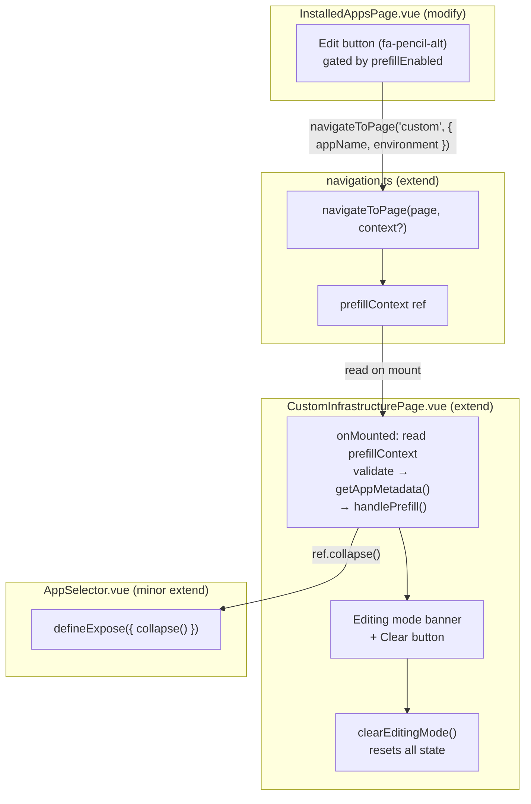
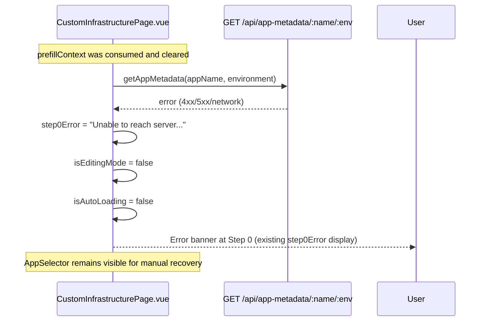

# Architecture Specification: Edit Existing Infrastructure UI Path

| Field          | Value                                        |
|----------------|----------------------------------------------|
| Feature        | edit-existing-infra-ui-path                  |
| Source PRD     | docs/prd/edit-existing-infra-ui-path.md      |
| Date           | 2026-06-03                                   |
| Status         | approved                                     |
| Author         | SelfService App Architect Agent              |

---

## 1. Context

### Problem

The `service-catalog-prefill` pipeline (v2.1.0, PR #64) is fully functional end-to-end:
`AppSelector → getApplicationDetails() → handlePrefill() → form populated`. However there is
no UI path by which users can discover or trigger it from the most natural starting point —
the Installed Apps list.

The gap is two-fold:
1. `InstalledAppsPage.vue` action toolbar has Promote, Label, Add Code Repo, Delete — **no Edit button**.
2. `navigateToPage(pageId)` in `navigation.ts` carries no context; there is no mechanism to
   deep-link the Custom Infrastructure wizard to a specific app.

### User Value

Completes the self-service loop: **create → view → modify → delete** — all within the catalog
UI, without raising a manual ticket.

### Scope

- Phase 1 — Navigation store extension (backward-compatible)
- Phase 2 — Edit button on InstalledAppsPage
- Phase 3 — Auto-load on CustomInfrastructurePage mount
- Phase 4 — Editing-mode indicator banner + "Clear" escape hatch

No new API endpoints, no URL routing, no database changes.

---

## 2. Component Change Map

Four files require changes. One file requires a minor additive change to expose a method.



---

## 3. Detailed Component Changes

### 3.1 `srcV2/stores/navigation.ts` — existing-extend

**Current signature**: `navigateToPage(page: PageId): void`

**New signature**: `navigateToPage(page: PageId, context?: { appName: string; environment: string }): void`

**State additions**:
```typescript
// New state field
const prefillContext = ref<{ appName: string; environment: string } | null>(null)
```

**Behaviour**:
- When `context` is provided, `prefillContext.value = context` before updating `currentPage`.
- When `context` is omitted or `undefined`, `prefillContext.value = null` (explicit clear).
- `prefillContext` must be included in the store's `return` object.

**Backward compatibility**: The `context` param is strictly `optional`. All 18 existing call
sites across 8 files (`App.vue`, `SharedHeader.vue`, `CustomInfrastructurePage.vue`,
`TemplateDeployPage.vue`, `AKSDeployPage.vue`, `AKSInstalledAppsPage.vue`,
`ExistingInfraChangePage.vue`, `DocsPage.vue`) compile and run without modification.

---

### 3.2 `srcV2/pages/InstalledAppsPage.vue` — modify

**Location**: Action toolbar inside the `<tbody>` row loop, after the existing Delete button
(lines ~430–440).

**New computed**:
```typescript
const prefillEnabled = computed(() =>
  import.meta.env.VITE_ENABLE_CATALOG_PREFILL !== 'false'
)
```

**New handler**:
```typescript
function handleEditInfra(app: InstalledApp): void {
  navigationStore.navigateToPage('custom', {
    appName: app.name,
    environment: app.environment
  })
}
```

**New template element** (placed after Delete button, before `</div>`):
```html
<button
  v-if="prefillEnabled"
  @click="handleEditInfra(app)"
  :title="`Edit Infrastructure`"
  :aria-label="`Edit infrastructure for ${app.name} in ${app.environment}`"
  class="p-2 text-yellow-600 hover:text-yellow-700 dark:text-yellow-400 dark:hover:text-yellow-300
         hover:bg-yellow-50 dark:hover:bg-yellow-900/20 rounded-lg transition-colors duration-200"
>
  <i class="fas fa-pencil-alt"></i>
</button>
```

**Required import addition**: `useNavigationStore` from `@v2/stores/navigation`.

---

### 3.3 `srcV2/pages/CustomInfrastructurePage.vue` — existing-extend

**New state**:
```typescript
// Editing mode: set from navigation store prefillContext on mount
const isEditingMode = ref(false)
const editingAppName = ref<string | null>(null)
const editingEnvironment = ref<string | null>(null)
const isAutoLoading = ref(false)
```

**Template ref for AppSelector**:
```typescript
const appSelectorRef = ref<InstanceType<typeof AppSelector> | null>(null)
```
```html
<AppSelector ref="appSelectorRef" ... />
```

**`onMounted` addition** (after existing initialization):
```typescript
// FR-003: Auto-load from navigation context
const ctx = navigationStore.prefillContext
if (ctx && prefillEnabled.value) {
  const nameValid = /^[a-zA-Z0-9_-]{1,64}$/.test(ctx.appName)
  const envValid = /^[a-zA-Z0-9_-]{1,64}$/.test(ctx.environment)
  if (!nameValid || !envValid) {
    step0Error.value = 'Invalid prefill context: appName/environment must be alphanumeric (hyphens and underscores allowed, max 64 chars).'
    navigationStore.prefillContext = null  // clear regardless
    return
  }
  // Capture for banner before clearing
  isEditingMode.value = true
  editingAppName.value = ctx.appName
  editingEnvironment.value = ctx.environment
  // Clear context immediately so back-navigation does not re-trigger
  navigationStore.prefillContext = null
  // Auto-load
  isAutoLoading.value = true
  try {
    const response = await api.getAppMetadata(ctx.appName, ctx.environment)
    if (response.success && response.data) {
      handlePrefill(response.data as AppMetadata)
      appSelectorRef.value?.collapse()
    } else {
      step0Error.value = response.error || `Failed to load metadata for ${ctx.appName}/${ctx.environment}.`
      isEditingMode.value = false
    }
  } catch {
    step0Error.value = `Unable to reach the server. Please try again or use the Load panel below.`
    isEditingMode.value = false
  } finally {
    isAutoLoading.value = false
  }
}
```

**New `clearEditingMode` function**:
```typescript
function clearEditingMode(): void {
  isEditingMode.value = false
  editingAppName.value = null
  editingEnvironment.value = null
  prefillData.value = undefined
  step0Error.value = undefined
  selectedModules.value = []
  rbacRelationships.value = []
  currentStep.value = 0
}
```

**Banner template** (below page `<h1>` / header, above stepper):
```html
<div
  v-if="isEditingMode"
  role="status"
  aria-live="polite"
  class="mb-4 flex items-center gap-3 rounded-lg border border-yellow-300 bg-yellow-50
         dark:bg-yellow-900/20 dark:border-yellow-700 px-4 py-3 text-sm text-yellow-800
         dark:text-yellow-200"
>
  <i class="fas fa-pencil-alt" aria-hidden="true"></i>
  <span>
    Editing existing app:
    <strong>{{ editingAppName }}</strong> /
    <strong>{{ editingEnvironment }}</strong>
  </span>
  <button
    type="button"
    class="ml-auto text-yellow-600 hover:text-yellow-900 dark:text-yellow-400
           dark:hover:text-yellow-100 underline focus:outline-none focus:ring-2
           focus:ring-yellow-400 rounded"
    @click="clearEditingMode"
  >
    Clear and start fresh
  </button>
</div>

<!-- Loading overlay during auto-load -->
<div
  v-if="isAutoLoading"
  role="status"
  aria-live="polite"
  class="mb-4 text-sm text-gray-500 dark:text-gray-400"
>
  <i class="fas fa-spinner fa-spin mr-2" aria-hidden="true"></i>
  Loading app configuration…
</div>
```

---

### 3.4 `srcV2/components/infrastructure/AppSelector.vue` — existing-refine

**Only change**: Add `defineExpose` to expose a `collapse` method that parent can call after
auto-loading via the navigation context.

```typescript
defineExpose({
  collapse(): void {
    isExpanded.value = false
  }
})
```

No prop changes. No emit changes. The manual "Load from Existing App" flow is **unchanged**.

---

## 4. Data Flow

### 4.1 Happy Path: Edit from InstalledAppsPage

```mermaid
sequenceDiagram
    actor User
    participant InstalledApps as InstalledAppsPage.vue
    participant NavStore as navigation.ts
    participant CustomInfra as CustomInfrastructurePage.vue
    participant API as GET /api/app-metadata/:name/:env
    participant AppSelector as AppSelector.vue

    User->>InstalledApps: Click "Edit Infrastructure" (pencil icon)
    InstalledApps->>NavStore: navigateToPage('custom', { appName, environment })
    NavStore->>NavStore: prefillContext = { appName, environment }
    NavStore->>NavStore: currentPage = 'custom'
    NavStore->>CustomInfra: mount triggered by App.vue page switch
    CustomInfra->>NavStore: read prefillContext (non-null)
    CustomInfra->>NavStore: prefillContext = null (cleared immediately)
    CustomInfra->>CustomInfra: isEditingMode = true; editingAppName/Env set
    CustomInfra->>CustomInfra: isAutoLoading = true
    CustomInfra->>API: getAppMetadata(appName, environment)
    API-->>CustomInfra: AppMetadata { modules, rbacPairs, ... }
    CustomInfra->>CustomInfra: handlePrefill(metadata)
    CustomInfra->>AppSelector: appSelectorRef.collapse()
    CustomInfra->>CustomInfra: isAutoLoading = false
    CustomInfra-->>User: Banner "Editing existing app: X / Y" + pre-filled wizard
```

### 4.2 Error Path: Auto-load API Failure



### 4.3 Context Lifecycle (NFR-004: No Context Leak)

```
navigateToPage('custom', ctx)     → prefillContext = ctx
CustomInfrastructurePage.onMounted → reads ctx, sets prefillContext = null
User navigates away                → navigateToPage('home')  → prefillContext = null (cleared by absence of context arg)
User returns to 'custom'           → prefillContext is null  → no auto-load triggered
```

---

## 5. API Contracts

### 5.1 Existing Endpoint (no change)

| Field       | Value                                          |
|-------------|------------------------------------------------|
| Method      | `GET`                                          |
| Path        | `/api/app-metadata/:appName/:env`              |
| Auth        | `requireAuth` (Entra ID JWT)                   |
| Status      | existing — no modification needed              |
| Response    | `{ success: true, data: AppMetadata, correlationId }` |

**`AppMetadata` shape** (from `srcV2/types/infrastructure.types.ts`):

```typescript
{
  name: string
  environment: string
  description: string
  owner: string
  lifecycle: string
  modules: string[]
  rbacPairs?: RbacRelationship[]
  costCenter: string
  commitSha: string
  deployedAt: string
}
```

### 5.2 Navigation Store Context Contract

```typescript
interface PrefillContext {
  appName: string      // /^[a-zA-Z0-9_-]{1,64}$/ — validated before use
  environment: string  // /^[a-zA-Z0-9_-]{1,64}$/ — validated before use
}
```

Validation is performed in `CustomInfrastructurePage.onMounted` immediately after reading
context. Invalid context triggers `step0Error` and clears the context without calling the API.

---

## 6. Error Scenarios

| Scenario | Handling | User Message |
|---|---|---|
| Auto-load API returns 4xx | `step0Error` set; `isEditingMode = false`; `AppSelector` stays open for manual recovery | "Failed to load metadata for {appName}/{env}." |
| Auto-load API returns 5xx / network | `step0Error` set; `isEditingMode = false` | "Unable to reach the server. Please try again or use the Load panel below." |
| Invalid `appName` / `environment` in context | `step0Error` set; context cleared; no API call | "Invalid prefill context: appName/environment must be alphanumeric (hyphens and underscores allowed, max 64 chars)." |
| `prefillContext` is null on mount | No auto-load; normal create flow proceeds | — |
| Feature flag off (`VITE_ENABLE_CATALOG_PREFILL=false`) | Edit button not rendered; auto-load block skipped | — |
| `handlePrefill()` called with empty modules array | Existing guard in `handlePrefill` applies; `selectedModules` stays empty | — |

---

## 7. Testing Scenarios

### Unit / Component Tests

| ID | File | Scenario | Expected |
|---|---|---|---|
| TS-001 | `navigation.spec.ts` | `navigateToPage('custom', ctx)` | `prefillContext.value === ctx` |
| TS-002 | `navigation.spec.ts` | `navigateToPage('home')` (no context) | `prefillContext.value === null` |
| TS-003 | `navigation.spec.ts` | Existing call sites compile without context arg | No TypeScript error |
| TS-004 | `InstalledAppsPage.spec.ts` | Edit button renders when `VITE_ENABLE_CATALOG_PREFILL !== 'false'` | Button present in DOM |
| TS-005 | `InstalledAppsPage.spec.ts` | Edit button hidden when `VITE_ENABLE_CATALOG_PREFILL === 'false'` | Button absent from DOM |
| TS-006 | `InstalledAppsPage.spec.ts` | Click Edit button | `navigateToPage('custom', { appName, environment })` called once |
| TS-007 | `CustomInfrastructurePage.prefill.spec.ts` | Mount with valid `prefillContext` | `getAppMetadata()` called; `handlePrefill()` called; `prefillContext` cleared to null |
| TS-008 | `CustomInfrastructurePage.prefill.spec.ts` | Mount with valid context, API success | `isEditingMode = true`; banner rendered with appName/env; `AppSelector.collapse()` called |
| TS-009 | `CustomInfrastructurePage.prefill.spec.ts` | Mount with valid context, API failure | `step0Error` set; `isEditingMode = false`; banner absent |
| TS-010 | `CustomInfrastructurePage.prefill.spec.ts` | Mount with invalid `appName` (special chars) | No API call; `step0Error` set; context cleared |
| TS-011 | `CustomInfrastructurePage.prefill.spec.ts` | Navigate away and back (context already cleared) | No second auto-load triggered |
| TS-012 | `CustomInfrastructurePage.prefill.spec.ts` | Click "Clear and start fresh" | `isEditingMode = false`; `selectedModules = []`; `currentStep = 0`; banner absent |
| TS-013 | `CustomInfrastructurePage.prefill.spec.ts` | Mount without `prefillContext` (normal create path) | No auto-load; no banner |
| TS-014 | `AppSelector.spec.ts` | Manual "Load" flow unaffected by `defineExpose` addition | Existing tests pass; no regression |
| TS-015 | `CustomInfrastructurePage.prefill.spec.ts` | Editing banner has `role="status"` | Accessibility attribute present |
| TS-016 | `CustomInfrastructurePage.prefill.spec.ts` | Edit button has correct `aria-label` | `aria-label="Edit infrastructure for {appName} in {environment}"` |

### E2E Tests

| ID | File | Journey | Assertion |
|---|---|---|---|
| E2E-001 | `tests/e2e/edit-existing-infra.spec.ts` | Installed Apps → click Edit → Custom Infra wizard | Banner visible; modules pre-selected; `AppSelector` collapsed |
| E2E-002 | `tests/e2e/edit-existing-infra.spec.ts` | Editing mode → "Clear and start fresh" | Banner gone; form cleared; Step 0 shown |
| E2E-003 | `tests/e2e/edit-existing-infra.spec.ts` | Navigate away from Custom Infra → navigate back | No auto-load; blank wizard |

---

## 8. Non-Functional Requirements

| ID | Category | Target |
|---|---|---|
| NFR-001 | Performance | Auto-load via `getAppMetadata()` completes within 5 s (p95); loading indicator shown immediately |
| NFR-002 | Regression | Existing manual `AppSelector` flow unaffected; 437+ existing tests must pass |
| NFR-003 | Backward compat | `navigateToPage()` without context arg: zero TypeScript errors at 18 existing call sites across 8 files |
| NFR-004 | Context leak | `prefillContext` cleared to `null` before `getAppMetadata()` is awaited; no re-trigger on subsequent mounts |
| NFR-005 | Input validation | `appName` and `environment` validated against `/^[a-zA-Z0-9_-]{1,64}$/` before API call |
| NFR-006 | Feature flag consistency | `VITE_ENABLE_CATALOG_PREFILL=false` suppresses Edit button AND auto-load block |
| NFR-007 | Observability | `api.ts` interceptor emits `api_request_completed` / `api_request_failed` telemetry for the auto-load call (no extra code needed — handled by existing interceptor) |
| NFR-008 | Type safety | No `any` types introduced; all new state uses explicit TypeScript types |

---

## 9. Dependencies

| Dependency | Type | Notes |
|---|---|---|
| `service-catalog-prefill` (v2.1.0) | existing feature | `handlePrefill()`, `AppMetadata` type, `getAppMetadata()` API — all present |
| `VITE_ENABLE_CATALOG_PREFILL` | env var | Must be set to anything other than `'false'` in target environments |
| Font Awesome `fa-pencil-alt` | icon library | Already available in project |

---

## 10. Delivery Phases and Definition of Done

| Phase | Scope | Key Test File |
|---|---|---|
| 1 | `navigation.ts` store extension | `srcV2/stores/navigation.spec.ts` |
| 2 | `InstalledAppsPage.vue` edit button | `srcV2/pages/InstalledAppsPage.spec.ts` |
| 3 | `CustomInfrastructurePage.vue` auto-load | `srcV2/pages/CustomInfrastructurePage.prefill.spec.ts` |
| 4 | Editing mode banner + Clear | `srcV2/pages/CustomInfrastructurePage.prefill.spec.ts` |

**Definition of Done**:
- All FRs implemented per acceptance criteria.
- `npm test` passes (≥ 437 tests, 0 regressions).
- `npm run type-check` passes (0 errors, 0 `any`).
- Manual walkthrough: Installed Apps → Edit → wizard pre-filled → banner shows → modify → Deploy.
- Pre-commit hooks pass (no trailing whitespace, newline at EOF).
