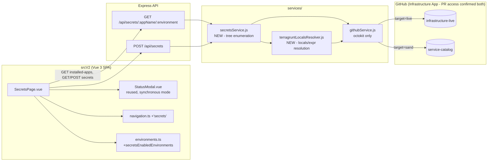

# Architecture Spec: Developer Self-Service Secret Management (`secret-self-service`)

**Status**: ready_for_challenger
**Source PRD**: [docs/prd/secret-self-service.md](../prd/secret-self-service.md)
**Structured contract**: [secret-self-service-spec.json](./secret-self-service-spec.json)

This document is the narrative companion to `secret-self-service-spec.json`. Implementers should
build directly against the JSON; read this file only for the diagrams and rationale below.

---

## 1. Why this shape

The PRD (after 4 review rounds, then amended 2026-07-31 to fix Architecture Challenger Round 3
findings B1–B3) settled on a **synchronous, SOPS-encrypt-and-PR** write path with **no new
repository, no new Azure SDK dependency, and no decrypt capability in the portal**. The
architecture adds two new backend components: `secretsService.js`, which composes largely from
already-existing `githubService.js` primitives (`getFileContent`, `createBranch`,
`createOrUpdateFile`, `createPullRequest`, plus small additions `branchExists` and
`findOpenPullRequest`), and `terragruntLocalsResolver.js`, a genuinely new component that owns
Terragrunt locals-following, expression evaluation, and comment stripping — capability that does
not exist anywhere in the codebase today (`hclParser.js` only extracts a single file's
`module{}.source`/`version`). Both reuse the same `githubService.octokit` client and Infrastructure
GitHub App auth; no new GitHub App, no new Octokit client, no new database table.

An app/environment may resolve to **one or more** Key Vault directories — discovery is now
tree enumeration (one GitHub Trees API call per repo) rather than path probing, and the return
contract is a `vaults[]` list, never a singular nullable name. See §4 for the full B1/B2/B3
resolution log.

## 2. Component diagram



## 3. Sequence: create secret (synchronous, FR-002)

```mermaid
sequenceDiagram
  participant Dev as Developer (SecretsPage.vue)
  participant API as POST /api/secrets
  participant Svc as secretsService.js
  participant TLR as terragruntLocalsResolver.js
  participant SOPS as sops CLI (wrapKey only)
  participant GH as githubService.js (octokit)
  participant Repo as target repo (live|sand)

  Dev->>API: {target, appName, environment, qualifier?, vaultDir?, secretName, secretValue}
  API->>API: express-validator (400 on invalid; widened regexes)
  API->>Svc: resolveKeyVaults(appName, environment, target, qualifier?)
  Svc->>GH: getTree(defaultBranchSha, recursive=1) [cached per-target, in-flight Promise]
  GH-->>Svc: tree entries
  Svc->>Svc: filter /^keyvault\d*$/i over BOTH roots (infrastructure/ + azureDatabricks/), skip grouping dirs (keyvaults, _idmapplications), derive appName/env/qualifier positionally; shared heuristic /(^_?common$|^shared$)/i
  Svc->>TLR: resolveName(vaultDir, target) per matched vault
  TLR-->>Svc: vaultName | null
  alt found=false (no qualifying vault)
    Svc-->>API: {found:false, vaults:[]}
    API-->>Dev: 422 Cannot resolve Key Vault
  else qualifiers.length > 1 and qualifier omitted
    Svc-->>API: {found:true, vaults:[], qualifiers:[...]}
    API-->>Dev: 422 Multiple sub-apps found; qualifier required (qualifiers list included)
  else qualifier supplied but not in qualifiers
    API-->>Dev: 422 qualifier does not match a resolved sub-app
  else vaults.length > 1 and vaultDir omitted
    Svc-->>API: {found:true, vaults:[...], qualifiers:[]}
    API-->>Dev: 422 Multiple Key Vaults found; vaultDir required (vaults list included)
  else vaultDir supplied but not in vaults
    API-->>Dev: 422 vaultDir does not match a resolved vault
  else exactly one vault (or a valid vaultDir resolved) with qualifier resolved
    Svc->>GH: getFileContent({vaultDir}/secrets.enc.yaml) [current SHA]
    Svc->>SOPS: encrypt secretValue (azure_keyvault, wrapKey)
    SOPS-->>Svc: encrypted document
    Svc->>GH: getFileContent({vaultDir}/secrets.enc.yaml) [re-check SHA before write]
    alt SHA changed since branch base
      Svc-->>API: conflict
      API-->>Dev: 503 Concurrent secret submission
    else SHA unchanged
      Svc->>GH: findOpenPullRequest(branch) [branch includes qualifier prefix when present + vaultSlug]
      alt open PR exists
        GH-->>Svc: existing PR
        Svc-->>API: 409 duplicate
        API-->>Dev: 409 A PR is already open
      else no open PR
        Svc->>GH: createBranch / createOrUpdateFile({vaultDir}/secrets.enc.yaml) / createPullRequest
        GH->>Repo: commit + PR
        Repo-->>GH: {prNumber, prUrl}
        GH-->>Svc: {prNumber, prUrl}
        Svc-->>API: {prNumber, prUrl}
        API-->>Dev: 200 {success, correlationId, prNumber, prUrl}
      end
    end
  end
```

Note: the request/response cycle is entirely synchronous — no workflow dispatch, no
`useWorkflowPolling.ts`, no `/api/status/:correlationId` polling. `StatusModal.vue` is reused only
for its visual in-flight/terminal states, driven directly by the Axios promise, not by the polling
composable.

The "SOPS encrypt" step above operates on **one key's value only** — see §4a below for why, and how
that reconciles with `secrets.enc.yaml` holding multiple secret names.

## 4a. How one wrapKey-only edit touches a shared multi-secret file (Round 1 finding B1)

`secrets.enc.yaml` is **not** a single native multi-key SOPS document. It is a plain YAML map where
each top-level key is a secret name (plaintext — satisfies FR-001(f)) and each **value** is an
opaque, self-contained SOPS-encrypted blob with its own embedded metadata/MAC covering only that one
value:

```yaml
DATABASE_PASSWORD: |
  {"value":"ENC[AES256_GCM,data:...,iv:...,tag:...,type:str]","sops":{"azure_kv":[...],"mac":"ENC[...]",...}}
API_KEY: |
  {"value":"ENC[...]","sops":{...}}
```

Submitting one secret: `secretsService.js` (1) writes `{ "value": secretValue }` to a temp file, (2)
runs `sops --encrypt --input-type json --output-type json` against it (azure_keyvault rule,
wrapKey-only), producing a self-contained encrypted blob, (3) reads the outer YAML as **plain text**
(no sops invocation on the outer file), (4) sets/replaces exactly that one key's value with the new
blob, leaving every other key's blob byte-identical, and (5) writes the file back. No whole-document
MAC is ever recomputed and no existing value is ever decrypted.

CI's decrypt-and-sync (unrelated to this feature's scope, but noted for completeness): iterates each
outer YAML key, writes that key's blob to a temp file, runs `sops --decrypt` on just that one blob,
and syncs the resulting plaintext to the app's Key Vault secret of the same name.

## 4. Key design decisions carried over from the PRD (do not re-litigate)

| Decision | Rationale | PRD source |
|---|---|---|
| `target` param (`live`/`sand`) selects repo, not a new UI concept per repo | Both repos share the `infrastructure/{appName}/...` root, though each has layout variance (numbered vault dirs, extra path depth, varying `env.hcl` locals aliases) | FR-007 |
| Only `githubService.octokit` (Infrastructure App) used, never `codeOctokit` | Infrastructure App already has PR-create access on both repos; Code Deployment App is for AKS/code, unrelated credential | FR-003(a), FR-007(c) |
| `POST /api/secrets` synchronous | No async workflow exists to dispatch/poll; commit+PR happen inline | FR-002(i) |
| `resolveKeyVaults` returns a `vaults[]` list, never a singular nullable name | An app/environment may own more than one Key Vault directory (confirmed: `mlops`-style `keyvault01`/`keyvault02`); `found` is a directory-existence fact, `vaultName` per vault is a best-effort static reconstruction and legitimately may be `null` on success | FR-003(d)/(e), Arch Challenger Round 3 B1 |
| Discovery is tree enumeration (one GitHub Trees API call per repo), not path probing | The old primary-path/fallback-scan design rescues none of the real layout variants (numbered vault dirs, `{app}/hub/{env}` depth-3, `{app}/{env}/{subapp}` nesting, `_common/keyvault.hcl` as a file); tree enumeration catches all of them in one pass and is also strictly fewer GitHub API calls | FR-003(b)/(c), Arch Challenger Round 3 B2 |
| `vaultDir` identifies which vault a request targets; optional when exactly one resolves, required when more than one | Without a vault discriminator, a write request has no way to say which of several sibling vaults it targets | FR-001(j), FR-002(a)/(l) |
| `vaultDir` is allow-list validated against the current `resolveKeyVaults()` result before any path construction | A client-supplied `vaultDir` used unchecked in a repo path is an arbitrary-repo-path write | FR-002(l) |
| Conflict detection via file-SHA compare, no merge, scoped to a single `vaultDir`'s file | SOPS's whole-document MAC makes a git-level merge of two independently re-encrypted documents fail integrity on decrypt; portal holds `wrapKey` only, never `unwrapKey`, so it cannot merge decrypted content. Scoping to one `vaultDir` also means concurrent writes to *sibling* vaults never spuriously conflict | FR-002(k) |
| Single `sops-master-key` in a shared platform Key Vault, `azure_keyvault` creation rule | Portal = `wrapKey` only; CI = `unwrapKey` + scoped `Key Vault Secrets Officer` on the app's vault | NFR-SEC-003, OQ-001 |
| Branch naming `secrets/{appName}-{environment}-{vaultSlug}-{secretName}` | `vaultSlug` (final segment of `vaultDir`) is required — without it, two sibling vaults submitting the same secret name would collide on one branch | FR-002(h) |
| `resolveKeyVaults` cache re-keyed to `${target}` alone (repo-level) | One tree fetch answers every app/environment/vault lookup in that repo; a narrower key would discard most of the benefit and not fix the underlying stampede-across-tuples gap Round 3 found | NFR-SCALE-001, Arch Challenger Round 3 Recommendation |
| `services/terragruntLocalsResolver.js` is a new, separately named component, not an extension of `hclParser.js` | `hclParser.js` has zero cross-file locals resolution, expression evaluation, or comment stripping; describing the new logic as "reuses hclParser.js patterns" understated the actual unbuilt surface | FR-003(i), Arch Challenger Round 3 B3 |
| `secrets.enc.yaml` is a plain YAML map of independently-SOPS-encrypted per-value blobs, not one native multi-key SOPS document | Added in Architecture Challenger Round 1 (B1): a native multi-key SOPS document's whole-file MAC can only be recomputed by decrypting every existing value, which the wrapKey-only portal can never do. Making each value its own self-contained SOPS blob means adding/updating one secret only replaces that one key — no other key's ciphertext or MAC is touched, and no decrypt is ever required. See `technical.data_contracts.secrets_enc_yaml_format` in the JSON spec. Preserved unchanged through the Round 3 revision. | Architecture (not PRD) — reconciles FR-001(f)/FR-002(e)/NFR-SEC-003 |
| `resolveKeyVaults` cache stores the in-flight Promise, not the resolved value | Added in Round 1 (B2), preserved through Round 3's re-keying to repo-level: a plain value-cache only prevents *repeat* calls after the first resolves; caching the pending Promise itself is what actually caps a concurrent burst at 1 GitHub call (NFR-SCALE-001) | Architecture |
| `submitSecretViaGitOps` checks `githubService.branchExists()` before `createBranch()` | Added in Round 1 (B3), preserved unchanged: the existing `createBranch()` helper throws on an already-existing ref, but FR-002(h)'s update path reuses the same deterministic branch name — the architecture must branch on existence, not blindly create | Architecture, resolves FR-002(h) |
| Discovery recognizes TWO accepted top-level roots: `infrastructure/` AND `azureDatabricks/`, in one tree pass | Added in Round 4: the real `infra-live` tree has Key Vault directories under BOTH `infrastructure/` (the canonical root) and `azureDatabricks/` (depth-1 `<env>/keyvault`). The previous `parts[0] !== 'infrastructure'` guard silently dropped every azureDatabricks vault. A synthetic `appName='azureDatabricks'` exposes them as a single app selector entry, since they don't fit the `<appName>/<env>` shape | FR-003(b), Round 4 tree analysis |
| `infrastructure/` enumeration skips a grouping-dir set (`keyvaults`, `_idmapplications`, ...) | Added in Round 4: `infrastructure/exampleApplications/exampleCoreServices/keyvaults/shared/keyvault` and `infrastructure/idm/_idmapplications/notif/dev/keyvault` are real layout patterns. A grouping segment like `keyvaults` (plural) or `_idmapplications` is not the appName, not the environment, and not the vault file; it must be skipped, not treated as a positionable field | FR-003(c), Round 4 tree analysis |
| Environment-agnostic `shared` heuristic widened from `/_?common$/i` to `/(^_?common$|^shared$)/i` | Added in Round 4: the `shared` directory under `exampleCoreServices/keyvaults/` holds a Key Vault applicable to every environment, but the old heuristic only matched `_?common`. Without the widening, `exampleCoreServices` returns 404 for every non-shared environment selection | FR-003(c), Round 4 tree analysis |
| Sub-apps under a grouping directory surface a separate `qualifier` field, NOT a longer compound appName | Added in Round 4: Option A (user-locked). `infrastructure/idm/_idmapplications/<subapp>/dev/keyvault` has sub-apps `notif`, `autobk`. Keeping `appName='idm'` and adding `qualifier='notif'` preserves the existing `GET /api/secrets/apps` enumeration (one entry per top-level app) and lets the client render a sub-app selector when more than one sub-app resolves for (appName, environment). A compound `appName='idm/notif'` would have widened appName semantics AND forced the tree matcher to know the grouping layout | FR-001(d), FR-002, FR-004 (sub-app selector), Round 4 Q5 decision |
| express-validator regexes widened: appName `/^[a-zA-Z0-9_-]{1,64}$/`, environment `/^[a-zA-Z0-9_-]{1,32}$/`, qualifier `/^[a-zA-Z0-9_-]{1,64}$/` | Added in Round 4: the previous `^[a-zA-Z0-9]{1,8}$/appName` and `^[a-zA-Z0-9]{1,16}$/environment` rejected real-tree values (`azureDatabricks`=14, `exampleApplications`=13, `facilityContracts`=17, hyphenated `shared-services`=16). The widened bounds and `-`/`_` allowance cover every observed tree segment without diverging from the GitHub-safe identifier universe | FR-001(c), FR-002(b), Round 4 tree analysis |
| Branch naming widens to `secrets/{appName}-{environment}-{qualifier?qualifier+'-':''}{vaultSlug}-{secretName}` | Added in Round 4: two sub-apps of the same (appName, environment) submitting the same secretName would collide on the old branch name; prepending the qualifier (when present) keeps branch names unique per sub-app without diverging from the existing pattern | FR-002(h), Round 4 |
| `.sops.yaml` `creation_rules` widened to TWO entries, one per accepted root | Added in Round 4: the SOPDS policy in `infra-live` currently has a single `path_regex: ^infrastructure/.*/keyvault[0-9]*/secrets\.enc\.yaml$`, so an azureDatabricks-rooted `secrets.enc.yaml` would not match and `sops --encrypt` would fail. Two entries (`infrastructure/...` and `azureDatabricks/...`) make both roots writable by the portal's wrapKey-only identity | FR-002(e), infra-live handoff doc, Round 4 |

## 5. What is deliberately NOT built (ponytail: no speculative scope)

- No Azure Key Vault SDK call anywhere in this feature — secret names come from Git, not the vault.
- No new GitHub App, no new repo, no new database table.
- No decrypt path in the portal — `secretsService.js` never invokes `sops --decrypt`.
- No polling composable usage for this endpoint; `StatusModal.vue` is driven directly, not via `useWorkflowPolling`.
- No merge/rebase of encrypted content — conflict handling is SHA-compare-and-reject only.
- No cross-vault secret copy — v1 targets exactly one vault per submission; copying a secret across sibling vaults in one action is out of scope (PRD Non-Goal).
- No general HCL/Terraform expression evaluator in `terragruntLocalsResolver.js` — only the small, bounded grammar actually observed (`substr()`, `format()`, `"${a}-${b}"` interpolation), not a full language implementation.

## 6. File-level change list

See `technical.component_changes` in `secret-self-service-spec.json` for the authoritative list.
Summary: two new backend services (`services/secretsService.js`, `services/terragruntLocalsResolver.js`),
two small additions to `services/githubService.js` (`branchExists`, `findOpenPullRequest`), two new
routes in `routes/api.js`, one new Vue page (`srcV2/pages/SecretsPage.vue`), small additive edits to
`navigation.ts`, `environments.ts`, `api.ts`, `SharedHeader.vue`, `App.vue`, `config.js`, and
`data/environments.json`, plus a `Dockerfile` line to install the `sops` CLI binary in the runtime
image.

## 7. Architecture Challenger Round 3 resolution log (human-directed, Key Vault discovery only)

| Finding | Resolution |
|---|---|
| B1 — singular `{ vaultName: string\|null }` contract cannot represent apps with >1 Key Vault | `resolveKeyVaultName` → `resolveKeyVaults`, returning `{ found, vaults: [{ vaultDir, vaultName, resourceGroup }] }`; propagated into FR-001 (aggregation + `vaultDir` filter), FR-002 (`vaultDir` required when >1, allow-list validated), and FR-004/UI (vault selector shown when >1 resolves) |
| B2 — documented fallback scan rescues none of the real path-shape variants | Fallback scan withdrawn entirely; replaced with one-shot tree enumeration (`git/trees?recursive=1`) filtered on `/^keyvault\d*$/i` / `keyvault.hcl`, with positional-agnostic appName/environment derivation and a `truncated:true` per-directory fallback |
| B3 — "reuses hclParser.js patterns" overstated existing coverage; the locals/expression resolver is 100% new | Named as a new component, `services/terragruntLocalsResolver.js`, responsible for alias discovery (`env`/`config`/`common_vars`), `substr()`/interpolation evaluation, and comment stripping; documented as reusing only `githubService.octokit`/auth, not `hclParser.js`'s parsing logic |
| A1 — `resolveKeyVaultName`'s "identical to infrastructure-live" claim for `service-catalog` should be scoped down | §4 decision table and FR-007 no longer claim uniform ease of discovery across both repos — only directory-depth similarity, not value-resolution simplicity |
| A2 — no disambiguation rule between the per-app `keyvaultname` local and the shared `env_key_vault_name` local | `terragruntLocalsResolver.js` component description (spec.json) explicitly restricts matching to `inputs.keyvaultname` inside the matched `keyvault*/terragrunt.hcl`, ignoring any `*_key_vault_name` local encountered while resolving |
| A3 — tree-enumeration's GitHub App scope not confirmed in writing | Documented in spec.json (`terragruntLocalsResolver.js` component description): `git.getTree`/`git.getRef` are standard REST calls under the existing Infrastructure GitHub App installation already used elsewhere in this file; no new permission required |

## 8. Architecture Challenger Round 1 resolution log

| Finding | Resolution |
|---|---|
| B1 — no mechanism for editing a shared multi-key SOPS doc without decrypt | §4a: per-value self-contained SOPS blobs inside a plain outer YAML map |
| B2 — cache stampede under concurrent burst | `resolveKeyVaults` caches the in-flight Promise, not the resolved value |
| B3 — `createBranch` throws on already-existing deterministic branch | `submitSecretViaGitOps` calls new `githubService.branchExists()` first and reuses the branch when present |
| A1 — `sops` binary not tied to a Dockerfile action item | Added `Dockerfile` to `component_changes` |
| A2 — `findOpenPullRequest` head-filter format unspecified | Documented as `${owner}:${branchName}` |

## 9. Architecture Challenger Round 4 resolution log (tree-pattern amendment, pre-implementation)

Round 4 is a spec-only amendment triggered by reviewing a tree dump of the real `infra-live` repo
(116 keyvault paths) against the existing spec contract. No code has been written yet; the changes
below are what goes into the spec BEFORE implementation, so the spec remains the source of truth.

| Finding (from the tree) | Spec change |
|---|---|
| F1 — `azureDatabricks/<env>/keyvault` paths are silently dropped by `parts[0] !== 'infrastructure'` | FR-003(b) introduces a root table with two accepted top-level directories (`infrastructure/` and `azureDatabricks/`); azureDatabricks paths map to a synthetic `appName='azureDatabricks'` with no qualifier. §4 decision table row added. |
| F2 — `infrastructure/exampleApplications/exampleCoreServices/keyvaults/shared/keyvault` — the `keyvaults` (plural) segment is NOT the appName, NOT the environment, NOT the vault file | FR-003(c) introduces a grouping-dir skip-list (`keyvaults`, `_idmapplications`, ...). §4 decision table row added. |
| F3 — `infrastructure/idm/_idmapplications/<subapp>/<env>/keyvault` — enumeration returns `environment='_idmapplications'` (wrong) but lookup accidentally works | FR-003(c)+(d)+(FR-001(d)+FR-002) introduce a separate `qualifier` field that disambiguates sub-apps under a parent appName. User-locked decision: Option A (single-segment appName + qualifier), not a compound `idm/notif` appName. §4 decision table row added. |
| F4 — the env-agnostic `shared` directory under `exampleCoreServices/keyvaults/` is only matched when `environment='shared'` | FR-003(c) widens the heuristic from `/_?common$/i` to `/(^_?common$|^shared$)/i`. §4 decision table row added. |
| F5 — real-tree segments reject the existing express-validator regexes: `azureDatabricks`=14, `exampleApplications`=13, `facilityContracts`=17, hyphenated `shared-services`=16 | FR-001(c) and FR-002(b) widen appName to `^[a-zA-Z0-9_-]{1,64}$`, environment to `^[a-zA-Z0-9_-]{1,32}$`, and add qualifier `^[a-zA-Z0-9_-]{1,64}$`. §4 decision table row added. |
| F6 — `.sops.yaml` `path_regex` only matches `infrastructure/...`, so an azureDatabricks-rooted `secrets.enc.yaml` would not match and `sops --encrypt` would fail | infra-live handoff doc (`docs/secret-self-service-infra-live-handoff.md`) updated to two `creation_rules` entries, one per accepted root. FR-002(e) cross-references this. §4 decision table row added. |
| F7 — branch-name collision when two sub-apps of the same (appName, environment) submit the same secretName | FR-002(h) widens the deterministic branch name to include the qualifier prefix when present: `secrets/{appName}-{environment}-{qualifier?qualifier+'-':''}{vaultSlug}-{secretName}`. §4 decision table row added. |

### Round 4 tests added (deferred to implementation phase)

Spec.json now lists TS-035 through TS-043 (tree-pattern coverage) and E2E-003/E2E-004
(azureDatabricks surfacing + sub-app selector). Implementation must add these test files:

- `services/secretsService.test.js` — TS-035 (dual root), TS-036 (shared env-agnostic), TS-037
  (idm/notif and idm/autobk as distinct qualifiers), TS-038 (qualifier omitted -> qualifiers list)
- `tests/integration/secrets-api.spec.ts` — TS-040 (qualifier POST flows), TS-041
  (azureDatabricks root reachable), TS-042 (exampleCoreServices shared reachable for env='dev')
- `srcV2/pages/SecretsPage.spec.ts` — TS-043 (sub-app selector renders and gates submit)
- `tests/e2e/secrets.spec.ts` — E2E-003 (azureDatabricks selector entry), E2E-004 (sub-app
  selector for idm/dev)

The pre-Round-4 tests TS-018..TS-027 stay valid because their canonical/numbered/depth-3/file-form
fixtures still match; the widened shared heuristic and root table are additive and do not change the
depth-2 / depth-3 / sub-app-nesting behaviour those tests already cover.

## 10. Out-of-scope carry-overs from Round 4 (explicit non-decisions)

These were considered and deliberately left out of Round 4 to keep the spec change surgical:

- **No new root beyond `infrastructure/` and `azureDatabricks/`.** The tree dump exclusively showed
  these two roots; adding speculative roots would re-introduce the over-engineering problem Round 4
  set out to remove. A new root is a spec amendment, not a runtime toggle.
- **No auto-discovery of grouping dirs.** The skip-list (`keyvaults`, `_idmapplications`, ...) is a
  curated allow-list maintained in `secretsService.js` constants, not a heuristic that learns from
  the tree. This avoids a hot path that re-evaluates "is this segment a grouping dir?" for every
  path on every lookup.
- **No compound appName.** Option A (qualifier field) was chosen over `appName='idm/notif'` because
  the compound form would force every existing appName consumer (the app selector, the branch name,
  the log lines) to learn a path-shaped identifier, and the tree matcher would still need to know
  the grouping layout. The qualifier keeps appName flat and tree-shaped knowledge in one place.
- **No azureDatabricks qualifier.** azureDatabricks paths have a single fixed shape
  (`<env>/keyvault`), so the synthetic app selector entry is enough; a qualifier would be dead UI.
- **No path-probing fallback.** The Round 3 withdrawal of the fallback scan still holds: the tree
  enumeration with the widened root table now catches every observed path variant in one pass, so a
  fallback would just add code for no rescue.
