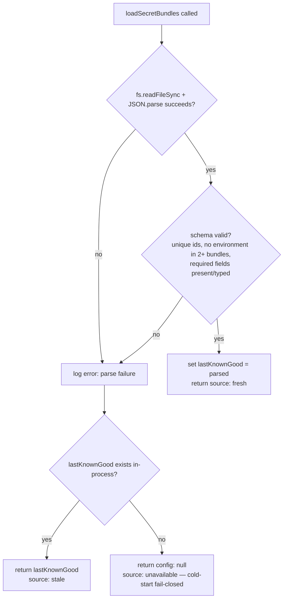
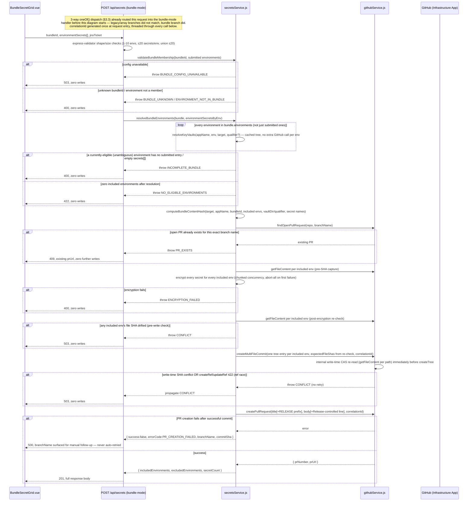

# Architecture Spec: Secrets Environment Bundles

**Feature**: `secrets-environment-bundles` | **Source PRD**: `docs/prd/secrets-environment-bundles.md`
(Challenger round 2: `approved`, 0 blocking) | **Author**: Architect Agent | **Date**: 2026-09-18
(revised 2026-09-19, see §1.4 and §1.5) | **Status**: `ready_for_challenger_round_3`

---

## 1. Context

### 1.1 Why this feature

`secrets-environment-scope` shipped a binary tier model (`production`/`non-production`/`unclassified`)
and an N-commit/N-PR fan-out for multi-environment secret submission. Platform Engineering has now
supplied a richer, configurable **bundle** taxonomy (`independent`/`developer`/`release`) and three
governance requirements that the tier model cannot express:

1. Bundle membership/count/order must be configurable in a versioned JSON file, not hardcoded.
2. A bundle submission must be **one atomic commit and one PR**, not one per environment.
3. Bundle membership must be **enforced server-side**, never trusted from the client.
4. A developer must be able to enter a **different secret value per environment** for the same
   secret name within one bundle submission.
5. A `release`-flagged bundle must carry a machine-discoverable release-control marker so that
   external PR-review/CODEOWNERS enforcement (owned by Platform/DevSecOps, outside this codebase)
   can act on it.

This spec resolves every "must" FR/NFR in the PRD into concrete components, contracts, and a single
resolved design for OQ-005 (the atomic multi-file commit mechanism), which the PRD flagged as this
feature's single highest-risk unknown.

### 1.2 Stakeholder clarification on OQ-001 (read before Phase 3 planning)

The task that produced this spec carries an explicit stakeholder clarification: **the external
PR-review/CODEOWNERS controls referenced by OQ-001 are now stated to be configured in both
`infrastructure-live` and `service-catalog`.** This Architect independently re-attempted the same
verification the PM Agent performed (`gh api repos/organization/infrastructure-live` and the
equivalent GitHub MCP `get_file_contents` call against both `infrastructure-live` and
`service-catalog`) and got the **same `404 Not Found`** result — this workspace's credentials still
cannot inspect either target repo's CODEOWNERS file or branch-protection ruleset directly. This spec
therefore treats the control's existence as **stakeholder-asserted, architecture-unverified** — see
§9.2 for the exact evidence gap and the Definition-of-Done artifact this Architect recommends before
Phase 3 rollout sign-off. This does **not** change any FR/NFR acceptance criterion; FR-007 ships the
in-repo signal exactly as specified regardless of which state OQ-001 is in.

### 1.3 What this feature does NOT change

Per PRD Non-Goals: no change to the SOPS encryption model, no change to `resolveKeyVaults()`'s
vault-discovery algorithm, no cross-target submission, no automatic retry of excluded environments,
no new GitHub App/workflow, and `data/environmentTiers.json` is neither deleted nor modified — the
legacy tier-based UI and `environments[]` fan-out shape (`secrets-environment-scope`) keep working
completely unchanged (FR-009).

### 1.4 Round 1 Revision Log (2026-09-19)

`docs/reviews/secrets-environment-bundles-arch-review-round1.md` returned `changes_requested` with 3
blocking and 5 advisory findings. This revision resolves all 3 blocking findings and addresses all 5
advisory findings; no unrelated scope was introduced and no FR/NFR traceability was removed.

| # | Finding | Resolution | Where |
|---|---|---|---|
| B1 | Unconditional legacy `oneOf()` rejects bundle-mode requests before bundle logic runs | Legacy `oneOf()` extended to a genuine 3-way alternative (adds a bundle-shape branch); manual XOR replaced with a 3-way exactly-one check; explicit routing branch added before the legacy duplicate-environment loop | §3.3, §8 (Resolution 7) |
| B2 | Git Data API multi-file commit path has no write-time compare-and-swap | `createMultiFileCommit()` gains `expectedFileShas` + a final parallel re-read (reusing `getFileContent()`) immediately before `createTree()`; ref-update/ref-create races on `422` are mapped to the same `CONFLICT` code; no retries | §2.4, §2.5, §8 (Resolution 8); deep-dive doc §"Contract"/"Guarantees" |
| B3 | correlationId/bundleId not threaded through commit/PR creation logging | `createIssue()`'s existing `tag`/`logMetric` convention extended to `createMultiFileCommit()`, `createPullRequest()`, `getFileContent()`; `submitSecretBundleViaGitOps()` emits its own `[correlationId][bundle:bundleId]`-tagged phase lines; NFR-OBS-001 scope reconciled to this feature's new/modified log lines (§1.4 rationale below) | §2.4, §7, §5, §8 (Resolution 9) |
| A1 | Diagnostic misconfigured-bundle-member log line description was ambiguous about API cost | Reworded to state explicitly: zero new API calls, a pure in-memory set-difference over data already fetched by the existing tree scan | §7 |
| A2 | `QUALIFIER_MISMATCH`/`VAULT_INVALID` test cases not explicitly named | Added as named unit test cases for `resolveBundleEnvironments()` | §4.1, spec.json `testing.unit_tests` |
| A3 | Editable grid accessibility approach unspecified | `BundleSecretGrid.vue` steered toward a semantic `<table>` + native `<input>` elements (no ARIA-grid reimplementation) | §2.7 |
| A4 | PRD Round 2 Security/Compliance sign-off advisory not tracked | Added as an explicit Phase 3 risk-register action item | §9.3 |
| A5 | Per-entry bundle-config re-parsing (mirrors `classifyEnvironmentTier()`'s per-call `fs.readFileSync`) | `classifyBundleMembership()`/`getBundleCatalog()` redesigned as pure functions over an already-loaded config object; `discoverAppsForTarget()` gains a `bundleConfig` parameter; the config is loaded exactly once per HTTP request | §2.3 |

**NFR-OBS-001 scope note**: `resolveKeyVaults()` is an explicit PRD Non-Goal (§1.3) and is not modified
by this feature. Its existing log lines already carry `correlationId` (pre-existing behavior, verified
in `services/secretsService.js`) but never carried, and will not carry, `bundleId` — retrofitting a
bundle-specific field into a shared, non-bundle-aware function reused by other (non-bundle) call sites
would violate the Non-Goal and risk regressing those callers. NFR-OBS-001's "100%" target is therefore
scoped to log lines emitted by code this feature adds or modifies: `submitSecretBundleViaGitOps()`'s own
phase-transition lines, plus `createMultiFileCommit()`/`createPullRequest()`/`getFileContent()` once
`correlationId` is threaded through them (§7 has the full enumeration and exact tag format). This makes
the target concretely testable rather than an unachievable absolute claim.

### 1.5 Round 2 Revision Log (2026-09-19)

`docs/reviews/secrets-environment-bundles-arch-review-round2.md` returned `changes_requested` with 1
blocking finding (0 advisory); all 3 Round 1 blocking findings and all 5 Round 1 advisory items were
independently re-verified as genuinely resolved. This revision resolves the single Round 2 blocking
finding. It is a wording-only correction — no design, code, endpoint, or parameter changes were made.

| # | Finding | Resolution | Where |
|---|---|---|---|
| B1 (R2) | §2.5's "Exhaustive scope for NFR-OBS-001" paragraph and its log-assertion sentence, plus the §4.2 NFR-OBS-001 bullet and the §5 NFR Traceability row, stated that `createMultiFileCommit()`'s and `createPullRequest()`'s own log lines must carry both `correlationId` and `bundleId` — contradicting §2.4's actual method signatures (no `bundleId` parameter exists on either method), and contradicting §7/§8 Resolution 9/spec.json's `testing.unit_tests`, which already correctly stated `correlationId` only | Reworded §2.5, §4.2, and §5 to state precisely: category 1 (`submitSecretBundleViaGitOps()`'s 6 phase-transition lines) requires both `correlationId` and `bundleId`; categories 2–3 (`createMultiFileCommit()`, `createPullRequest()`, `getFileContent()`'s own lines/`logMetric` calls) require `correlationId` only, since none of these three methods ever receives a `bundleId` parameter. No `bundleId` parameter was added to any method; §2.4's signatures are unchanged | §2.5, §4.2, §5 |

This resolves the sole Round 2 blocking finding; no other section changed. Round 3 is expected to be a
narrow, delta-only re-check limited to this item.

---

## 2. Design

### 2.1 Component map

```mermaid
flowchart TB
    subgraph Frontend["srcV2/ (Vue 3 SPA)"]
        SP[SecretsPage.vue<br/>adds mode toggle: Bundles | All Environments]
        BS[BundleSelector.vue <i>(new)</i><br/>bundle tabs + eligibility/exclusion display]
        BG[BundleSecretGrid.vue <i>(new)</i><br/>secretName x environment value grid]
        UC[useBundleSubmission.ts <i>(new composable)</i><br/>pre-flight orchestration + submit payload]
        SP --> BS --> BG
        BS --> UC
        BG --> UC
    end

    subgraph Backend["Express (routes/ + services/)"]
        R1[GET /api/secrets/apps<br/><i>modified</i>]
        R2[GET /api/secrets/:appName/:environment<br/><i>unchanged</i> — reused for pre-flight]
        R3[POST /api/secrets<br/><i>modified</i> — bundle-mode branch added]
        SB[secretsService.js<br/>+loadSecretBundles<br/>+classifyBundleMembership<br/>+getBundleCatalog<br/>+validateBundleMembership<br/>+resolveBundleEnvironments<br/>+computeBundleContentHash<br/>+submitSecretBundleViaGitOps]
        GH[githubService.js<br/>+createMultiFileCommit <i>(new, Git Data API)</i>]
        CFG[(data/secretBundles.json <i>(new)</i>)]
    end

    UC -->|GET target| R1
    UC -->|GET per-environment, parallel| R2
    UC -->|POST bundle-mode| R3
    R1 --> SB
    R3 --> SB
    SB --> CFG
    SB --> GH
    GH -->|octokit.rest.git.*, rest.pulls.create| GitHub[(infrastructure-live / service-catalog<br/>via existing Infrastructure GitHub App)]
```

No new GitHub App, no new external workflow, no new repository. Every write still goes through
`githubService.octokit` (Infrastructure App) exactly as `secret-self-service`/`secrets-environment-scope`
already do — this feature never touches `githubService.codeOctokit`.

### 2.2 Read path: bundle-scoped, existence-filtered visibility (FR-002, FR-004)

**Key design decision**: `GET /api/secrets/apps` already returns one entry per real, discovered
`{name, environment, qualifier?}` combination (`discoverAppsForTarget()` walks the cached repo tree).
Because that array is *already* both "bundle-member-checkable" and "deployed" by construction, the
bundle-scoped visibility rule (FR-002(b)/(c)) requires **no new eligibility computation on the read
path** — it is a pure client-side filter of the existing response, once each entry additionally
carries `bundleId`:

```
bundleEnvironmentsForApp(bundleId, appName) =
  apps.filter(a => a.name === appName && a.bundleId === bundleId).map(a => a.environment)
```

An environment that is a bundle member but never appears in `apps` (not deployed) is — by
construction — never in this filtered list, satisfying FR-002(c)'s "indistinguishable from never
configured" requirement with zero new backend logic.

**Architect resolution (beyond the PRD's literal API Impact text)**: FR-002(b) requires grouping by
`displayName` and `order`, and FR-007(a)'s UX requires knowing which bundle is `releaseControlled`.
A per-app `bundleId: string | null` field alone cannot supply these (the PRD's §8 "Modified
Endpoints" table only lists the per-entry `bundleId` addition). Hardcoding `displayName`/`order`/
`releaseControlled` in the Vue client would silently break Goal #1 ("0 code changes required to
add/rename/reorder a bundle"). This spec therefore adds one more additive field to the **same**
existing `GET /api/secrets/apps` response (no new endpoint, consistent with §8's "No New Endpoints"):

```jsonc
{
  "success": true,
  "data": [ { "name": "...", "environment": "...", "qualifier": "...", "tier": "...", "bundleId": "developer" } ],
  "bundles": [
    { "id": "independent", "displayName": "Independent Environments", "order": 1, "releaseControlled": false },
    { "id": "developer",   "displayName": "Developer Bundle",         "order": 2, "releaseControlled": false },
    { "id": "release",     "displayName": "Release Bundle",           "order": 3, "releaseControlled": true }
  ],
  "correlationId": "..."
}
```

`bundles` is the full bundle **catalog** (not membership lists — the per-app `bundleId` field already
conveys membership); it is `[]` whenever `loadSecretBundles()` has no usable config (§2.3). This is
flagged explicitly for the Architecture Challenger: it is a necessary elaboration of FR-002(b)/FR-007(a),
not new scope.

**Pre-flight eligibility (FR-004)** reuses the **existing, unmodified** `GET /api/secrets/:appName/:environment?target=...&qualifier?` endpoint — the same one `resolveEnvironmentEligibility()` already
calls today for the free multi-select (`SecretsPage.vue` lines 344–379). The bundle UI calls it once
per bundle-member-and-deployed environment, in parallel (`Promise.all`), classifying each response:

| Response shape | Classification |
|---|---|
| `vaults.length === 1 && qualifiers.length <= 1` (200) | **eligible** |
| `qualifiers.length > 1` and no `qualifier` supplied (422) | **excluded**, reason `QUALIFIER_AMBIGUOUS` |
| `vaults.length > 1` and no `vaultDir` supplied (422 or 200 with `vaults.length>1`) | **excluded**, reason `VAULT_AMBIGUOUS` |
| `vaultMismatch`/404 with `vaults.length === 0` | **excluded** or not-deployed depending on prior state — see composable note below |

This is a genuinely new behavior versus the legacy multi-select: the legacy flow shares one global
`selectedQualifier` ref across all environments (`SecretsPage.vue` line 54). FR-004(g) requires
**per-environment** `vaultDir`/`qualifier` disambiguation, so `useBundleSubmission.ts` tracks
disambiguation state as `Record<environment, { vaultDir?: string; qualifier?: string }>`, not a
single shared ref — call this out explicitly for Vue.js Developer since it is a deliberate deviation
from the closest existing precedent, not an oversight.

### 2.3 Bundle configuration loader (FR-001)

`data/secretBundles.json` is a new, hand-maintained, PR-reviewed config file (schema in §3.1). Its
loader lives in `services/secretsService.js`, mirroring `classifyEnvironmentTier()`'s
per-call-synchronous-read convention (so a Platform Engineering config edit takes effect without a
`discoverCache`/`treeCache` eviction), but adds the last-known-good fallback FR-001(c)/(d) require —
`classifyEnvironmentTier()` has no such fallback today because a malformed `environmentTiers.json`
degrades to a *documentation-only* label (`unclassified`), never a hard-fail path. Bundle-mode
**submission** is a governance boundary, so it must fail closed rather than silently degrade.



```
// services/secretsService.js — new module-level state, alongside treeCache/discoverCache/overridesCache
let lastKnownGoodBundleConfig = null; // survives across calls within one process; reset only by restart/test

function loadSecretBundles(correlationId) {
  let candidate;
  try {
    candidate = JSON.parse(fs.readFileSync(path.join(__dirname, '../data/secretBundles.json'), 'utf8'));
  } catch (error) {
    logger.error(`[${correlationId}] loadSecretBundles: parse failure: ${error.message}`);
    return fallback();
  }
  const validationError = validateBundleConfigShape(candidate); // unique id, ≤1 bundle per env, field types
  if (validationError) {
    logger.error(`[${correlationId}] loadSecretBundles: invalid config: ${validationError}`);
    return fallback();
  }
  lastKnownGoodBundleConfig = candidate;
  return { config: candidate, source: 'fresh' };

  function fallback() {
    return lastKnownGoodBundleConfig
      ? { config: lastKnownGoodBundleConfig, source: 'stale' }
      : { config: null, source: 'unavailable' };
  }
}
```

`validateBundleConfigShape(candidate)` checks: `bundles` is a non-empty array; every bundle has
string `id`/`displayName`, numeric `order`, boolean `releaseControlled`, and a non-empty
`environments: string[]`; `id` is unique case-insensitively across bundles; no environment name
(case-insensitive) appears in more than one bundle's `environments[]`. Returns `null` when valid, or
a short description of the first violation found (for the log line) otherwise.

**Consumers — request-scoped config, no per-entry re-parsing (Round 1 Advisory A5)**: `discoverAppsForTarget()`
today calls `classifyEnvironmentTier()` once per discovered app, and `classifyEnvironmentTier()` itself
does a fresh synchronous `fs.readFileSync` on every call (`services/secretsService.js` lines ~552–565) —
an O(N) file-read for N discovered apps. Bundle membership must **not** repeat this pattern: a bundle
config lookup happens once per HTTP request, then is reused across every app/environment entry in that
request, regardless of how many apps or environments are being classified.

- `loadSecretBundles(correlationId)` is called **exactly once** per HTTP request, at the top of the
  `GET /api/secrets/apps` route handler and at the top of the bundle-mode `POST /api/secrets` handler
  (§2.5). The returned `{ config, source }` is threaded through as a plain function argument — it is
  **not** a new TTL cache and does not add a new caching layer; it is simply "load once, pass down,"
  the minimal fix for the flagged redundancy.
- `classifyBundleMembership(environment, bundleConfig)` — **pure, synchronous** function taking the
  already-loaded `bundleConfig` (the `config` field from `loadSecretBundles()`) as a parameter. Returns
  the matching bundle `id` (case-insensitive) or `null` (including when `bundleConfig === null`). No
  file I/O of its own.
- `getBundleCatalog(bundleConfig)` — pure function over the same preloaded `bundleConfig`; returns
  `bundleConfig ? bundleConfig.bundles.map(b => ({id, displayName, order, releaseControlled})).sort((a,b)=>a.order-b.order) : []`.
- `discoverAppsForTarget(target, correlationId, bundleConfig)` gains a third parameter. Its internal
  `apps.map(...)` now calls `classifyBundleMembership(app.environment, bundleConfig)` alongside the
  existing `classifyEnvironmentTier(app.environment)` call — the bundle classification adds no
  additional file read because `bundleConfig` was already resolved once by the caller.
- `validateBundleMembership(bundleId, environments, correlationId)` remains a **single call per POST
  request** (unaffected by A5 — it was never a per-entry call): it calls `loadSecretBundles(correlationId)`
  itself (its own one-time load for that request) and throws `BUNDLE_CONFIG_UNAVAILABLE` (config is
  `null`), `BUNDLE_UNKNOWN` (no bundle matches `bundleId`), or `ENVIRONMENT_NOT_IN_BUNDLE` (any requested
  environment isn't in that bundle's `environments[]`), else returns the matched bundle object. Used by
  the bundle-mode `POST /api/secrets` handler (FR-003), before any other work.

This is a deliberate, explicit deviation from `classifyEnvironmentTier()`'s existing per-call-read
convention: `classifyEnvironmentTier()`'s pattern is preserved unchanged (Non-Goal, §1.3) for the legacy
tier path, while the new bundle path uses request-scoped loading from the outset so it does not
introduce the same O(N)-file-read anti-pattern this review flagged.

Test-only export: `_internal.lastKnownGoodBundleConfig` accessor/reset, mirroring the existing
`_internal: { treeCache, discoverCache, overridesCache }` pattern so unit tests can force a cold-start
state between cases.

### 2.4 Atomic single-commit / single-PR submission — resolving OQ-005 (FR-005)

**Decision**: use the GitHub Git Data API (`octokit.rest.git.*`) directly — `getRef`/`getCommit` →
`createTree` (multi-entry, one call for all included environments) → `createCommit` → `createRef`/
`updateRef`. **Evidence for GitHub App scope**, resolving the PRD's own open scope question: this
workspace's `githubService.createBranch()` (already shipped, in production use today) already calls
`octokit.rest.git.getRef` and `octokit.rest.git.createRef` (`services/githubService.js` lines
244–257) under the **same single "Contents" GitHub App permission** that also governs
`git/trees`/`git/blobs`/`git/commits` — GitHub scopes the entire Git Data API family under one
repository permission, Contents, not a separate grant per verb. Since `git/refs` calls already
succeed in production, `git/trees` and `git/commits` require no additional GitHub App permission
grant. This closes OQ-005's scope-uncertainty half; the remaining half (does the 10×20 case meet the
20000 ms budget) is explicitly a Phase 2 load-test Definition-of-Done item per the PRD's own Delivery
Plan, not something this spec can resolve by design alone.

**New `githubService` method** (net-new; today only `createOrUpdateFile()`/Contents API exists —
confirmed via `grep -n "createTree\|createCommit\|createBlob\|updateRef" services/githubService.js`
returning no matches):

**Round 1 Blocking Finding 2 — write-time compare-and-swap**: the existing single-file precedent
(`createOrUpdateFile()`, Contents API) gets a free, atomic, server-side `sha`-conflict check on every
write. The Git Data API has **no equivalent server-side conditional multi-file write** — a literal
"identical guarantee" is not achievable with GitHub's actual primitives. The design below is
**best-effort CAS, tightened to the smallest achievable window**: it re-reads every target path's
current blob SHA as the *last possible read* before the mutating calls, and maps every subsequent
ref-update race to the same conflict error. No new API call *type* is introduced — the CAS re-read
reuses the existing `getFileContent()` method that callers already use for their own pre/post-encryption
checks (§2.5).

```js
// githubService.js — new method. `files`: [{ path, content }] (content is plain UTF-8 text; SOPS
// output is UTF-8 YAML, so no separate createBlob call is needed — createTree's `content` field
// creates the blob inline, avoiding N extra blob-creation calls).
//
// `expectedFileShas`: Record<path, string|null> — the SHA the caller believes each target path
// currently has (string), or null if the caller believes the path does not exist yet (first secret
// ever written to that vaultDir). Omit a path's key entirely to skip the write-time check for that
// path (this feature never omits a key — every included path always has an entry, sourced from the
// caller's own post-encryption re-check, §2.5).
//
// `correlationId`: optional, additive, backward-compatible (existing callers passing no 5th arg are
// unaffected) — threads into every log line and the logMetric call, mirroring the existing
// `createIssue(repo, title, body, labels, correlationId)` convention (services/githubService.js
// lines 134–206), reused here rather than inventing a new logging convention (Round 1 Blocking
// Finding 3).
async createMultiFileCommit(repo, { branchName, baseBranch, files, expectedFileShas, commitMessage, correlationId = '' }) {
  const start = Date.now();
  const tag = correlationId ? `[${correlationId}] ` : '';
  const [owner, repoName] = repo.split('/');
  try {
    const branchAlreadyExists = await this.branchExists(repo, branchName);
    const parentRef = branchAlreadyExists ? `heads/${branchName}` : `heads/${baseBranch}`;
    const contentApiRef = branchAlreadyExists ? branchName : baseBranch; // bare name — Contents API convention, not the `heads/`-prefixed Git Data API ref form

    const { data: refData } = await this.octokit.rest.git.getRef({ owner, repo: repoName, ref: parentRef });
    const parentCommitSha = refData.object.sha;
    const { data: commitData } = await this.octokit.rest.git.getCommit({ owner, repo: repoName, commit_sha: parentCommitSha });
    const baseTreeSha = commitData.tree.sha;

    // Write-time CAS (closes Blocking Finding 2): re-read each target path's current blob SHA,
    // on the exact ref this commit will be built on, as the LAST read before any mutating call.
    if (expectedFileShas) {
      const currentFiles = await Promise.all(
        files.map(f => this.getFileContent(repo, f.path, contentApiRef, correlationId))
      );
      const conflicts = [];
      files.forEach((f, i) => {
        if (!(f.path in expectedFileShas)) return; // caller opted out of CAS for this path
        const expected = expectedFileShas[f.path];
        const actual = currentFiles[i] ? currentFiles[i].sha : null;
        if (actual !== expected) conflicts.push({ path: f.path, expected, actual });
      });
      if (conflicts.length > 0) {
        logger.warn(`${tag}createMultiFileCommit: write-time SHA conflict on ${conflicts.length} path(s) in ${repo}: ${conflicts.map(c => c.path).join(', ')}`);
        const error = new Error(`Write-time SHA conflict on ${conflicts.length} path(s)`);
        error.code = 'CONFLICT';
        error.conflicts = conflicts;
        throw error;
      }
    }

    const { data: treeData } = await this.octokit.rest.git.createTree({
      owner, repo: repoName, base_tree: baseTreeSha,
      tree: files.map(f => ({ path: f.path, mode: '100644', type: 'blob', content: f.content }))
    });

    const { data: newCommit } = await this.octokit.rest.git.createCommit({
      owner, repo: repoName, message: commitMessage, tree: treeData.sha, parents: [parentCommitSha]
    });

    if (branchAlreadyExists) {
      try {
        await this.octokit.rest.git.updateRef({ owner, repo: repoName, ref: `heads/${branchName}`, sha: newCommit.sha, force: false });
      } catch (error) {
        if (error.status === 422) { // non-fast-forward: branch tip moved after our getRef (ref-update race)
          logger.warn(`${tag}createMultiFileCommit: ${branchName} moved concurrently in ${repo} (non-fast-forward)`);
          const conflictErr = new Error(`Branch ${branchName} moved during commit build`);
          conflictErr.code = 'CONFLICT';
          throw conflictErr;
        }
        throw error;
      }
    } else {
      try {
        await this.octokit.rest.git.createRef({ owner, repo: repoName, ref: `refs/heads/${branchName}`, sha: newCommit.sha });
      } catch (error) {
        if (error.status === 422) { // ref already exists: created concurrently by a parallel request
          logger.warn(`${tag}createMultiFileCommit: ${branchName} created concurrently in ${repo}`);
          const conflictErr = new Error(`Branch ${branchName} was created concurrently`);
          conflictErr.code = 'CONFLICT';
          throw conflictErr;
        }
        throw error;
      }
    }

    logger.info(`${tag}Multi-file commit created: ${newCommit.sha} (${files.length} files) on ${branchName} in ${repo}`);
    logMetric('github_api_call', { operation: 'createMultiFileCommit', repo, file_count: files.length, duration_ms: Date.now() - start, success: true, correlationId: correlationId || 'unknown' });
    return { commitSha: newCommit.sha, branchName, branchAlreadyExisted: branchAlreadyExists };
  } catch (error) {
    logMetric('github_api_call', { operation: 'createMultiFileCommit', repo, file_count: files.length, duration_ms: Date.now() - start, success: false, error: error.message, correlationId: correlationId || 'unknown' });
    throw error;
  }
}
```

**Ref-update race handling**: both branches that can create/move the ref are wrapped so a concurrent
actor is mapped onto the *same* `CONFLICT` code as a stale-SHA write, giving the route a single error
path to handle regardless of which check caught the race:
- `updateRef({ force: false })` on an existing branch → GitHub returns `422` when the update is not a
  fast-forward (another actor moved the branch tip after this method's own `getRef`). Mapped to `CONFLICT`.
- `createRef()` on a brand-new branch name → GitHub returns `422` when the ref already exists (a
  second concurrent submission created the identical content-hash branch name, §2.6, before this one's
  `createRef` ran). Mapped to `CONFLICT`.

**No automatic retries**: matching the existing single-secret precedent (`submitSecretViaGitOps()`'s
`err.code = 'CONFLICT'` path, which the route maps straight to `503` with no retry), a `CONFLICT` from
any of the three sources above (pre-write SHA drift caught by the caller's own post-encryption re-check
in §2.5, the write-time CAS re-read above, or a ref-update/ref-create race) results in a single clean
`503` response asking the user to resubmit — never a silent partial write, and never a silent overwrite.

**One-commit/one-PR contract preserved**: every addition above is a *read-only* verification call
(`getFileContent` reads) or a *rejected write* (the `422` mappings abort before any further mutation).
The actual mutating sequence remains exactly one `createTree` + one `createCommit` + one
`createRef`/`updateRef` — FR-005(a)'s "one commit" guarantee is unaffected by this fix.

**Revised API-call-count** (was previously stated as a flat "6 calls, O(1)" — corrected here): the
commit-build phase is now **6 calls independent of N** (branchExists, getRef, getCommit, createTree,
createCommit, createRef/updateRef) **plus N parallel CAS reads bounded ≤10** (one `getFileContent` per
included environment's file, run via `Promise.all`, not sequential). Total is bounded ≤16 calls for the
worst-case 10-environment bundle — still linear in N, not quadratic, still comfortably satisfying
NFR-SCALE-001's "no N² growth" bar, but no longer strictly O(1) for this method in isolation. Combined
with the pre-existing per-environment resolution/pre-write-check reads (§2.5, also bounded ≤10 each),
total GitHub API calls for a 10-environment bundle submission remain in the low tens, not hundreds —
still the Phase 2 load-test's job to confirm against the 20000 ms p95 budget (OQ-005 residual, §2.4
opening paragraph).

Reusing-existing-branch semantics (`branchAlreadyExists` above) intentionally mirror
`submitSecretViaGitOps()`'s existing permissive behavior (build on whatever the branch's current tip
is, rather than erroring) — see §2.6 for why this is safe under content-hash branch naming.

### 2.5 Full submission algorithm (FR-003, FR-004 server-side re-check, FR-005, FR-006, FR-007)



**`resolveBundleEnvironments(bundle, environmentSecretsByEnv, target, appName, correlationId)`**
(pseudocode; the "not just submitted ones" loop in the diagram above is what makes FR-005(a.2)'s
completeness check correct — the server must know the *true* currently-eligible set independent of
what the client happened to submit):

```
included = []
excluded = []
for env of bundle.environments:                      // full declared membership, not submitted-only
  submitted = environmentSecretsByEnv[env.toLowerCase()]      // may be undefined
  { found, vaults, qualifiers } = resolveKeyVaults(appName, env, target, correlationId, submitted?.qualifier)
  if !found: continue                                  // NOT_DEPLOYED — silently absent (FR-002(c)/FR-004(b))
  if qualifiers.length > 1 and !submitted?.qualifier:
    excluded.push({ environment: env, reason: 'QUALIFIER_AMBIGUOUS', qualifiers }); continue
  if submitted?.qualifier and vaults.length === 0:
    excluded.push({ environment: env, reason: 'QUALIFIER_MISMATCH', qualifiers }); continue
  selectedVault = submitted?.vaultDir
    ? vaults.find(v => v.vaultDir === submitted.vaultDir)
    : (vaults.length === 1 ? vaults[0] : null)
  if !selectedVault:
    excluded.push({ environment: env, reason: submitted?.vaultDir ? 'VAULT_INVALID' : 'VAULT_AMBIGUOUS', vaults }); continue
  // env is now "currently eligible" per FR-004(a)
  if !submitted or !submitted.secrets or submitted.secrets.length === 0:
    throw INCOMPLETE_BUNDLE(environment: env)           // FR-005(a.2) — hard 400, zero writes
  included.push({ environment: env, vault: selectedVault, secrets: submitted.secrets })
return { included, excluded }
```

Any submitted environment that is not a bundle member at all was already rejected by
`validateBundleMembership()` (FR-003) before this function runs — this function only ever sees
membership-valid environments.

**`submitSecretBundleViaGitOps()` phase-tagged logging (Round 1 Blocking Finding 3)**: extends the
existing `[${correlationId}]` bracket convention (already used by `resolveKeyVaults()` and other
`secretsService.js` logging) with a second bracket segment identifying the bundle, so every phase
transition of a bundle submission is independently greppable:

```js
// services/secretsService.js — submitSecretBundleViaGitOps(), phase-transition logging only
// (full encryption/resolution/commit logic omitted here; see algorithm above and §2.4)
const tag = `[${correlationId}][bundle:${bundleId}]`;

// 1. after validateBundleMembership() succeeds:
logger.info(`${tag} membership validated: bundle=${bundle.id}, releaseControlled=${bundle.releaseControlled}`);

// 2. after resolveBundleEnvironments() returns:
logger.info(`${tag} resolution complete: included=[${included.map(e => e.environment).join(',')}], excluded=[${excluded.map(e => e.environment).join(',')}]`);

// 3. if the post-encryption re-check finds drift (pre-write conflict, §2.5 diagram):
logger.warn(`${tag} pre-write SHA conflict detected for ${env}`);

// 4. after encryption completes for all included environments:
logger.info(`${tag} encryption complete: ${totalSecretCount} secret(s) across ${included.length} environment(s)`);

// 5. after createMultiFileCommit() resolves (correlationId passed through, §2.4):
logger.info(`${tag} commit created: ${commitSha} on ${branchName}`);

// 6. after createPullRequest() resolves or rejects (correlationId passed through):
logger.info(`${tag} PR created: ${pr.prUrl}`);
// or, on PR-creation failure after a successful commit:
logger.error(`${tag} PR creation failed after successful commit ${commitSha}: ${error.message}`);
```

**Exhaustive scope for NFR-OBS-001** (making the "100%" target concretely testable rather than an
unverifiable absolute claim, per §1.4's reconciliation note): during a bundle submission, the complete
set of log lines this NFR covers, and the exact tag(s) required on each, is:
1. **Category 1 — requires both** `[${correlationId}]` **and** `[bundle:${bundleId}]`: the 6
   phase-transition lines above, emitted directly by `submitSecretBundleViaGitOps()`.
2. **Categories 2–3 — require** `[${correlationId}]` **only** (no `bundleId` field/segment exists to
   assert, since none of these methods ever receives a `bundleId` parameter, §2.4):
   - `createMultiFileCommit()`'s own `logger.warn`/`logger.info` lines and its `logMetric` call (§2.4),
     once `correlationId` is passed through from the caller.
   - `createPullRequest()`'s `logger.info`/`logger.error` lines, once `correlationId` is passed through
     the same way (additive optional parameter, mirroring `createIssue()`).
   - `getFileContent()`'s own `logMetric` call, each time it is invoked (the pre/post-encryption
     re-checks and the write-time CAS re-read, §2.4), once `correlationId` is passed through the same
     way.
3. `branchExists()` and `findOpenPullRequest()` emit **zero** log lines today (confirmed by reading
   `services/githubService.js`) — they are trivially compliant because there is nothing to tag.
4. `resolveKeyVaults()`'s pre-existing, unmodified log lines (Non-Goal, §1.3) carry `correlationId` only,
   never `bundleId` — explicitly out of scope (§1.4 rationale).

A log-assertion test (§4.2) captures logger output for a full mocked bundle submission and asserts every
line in category 1 matches a regex requiring both `[${correlationId}]` and `[bundle:${bundleId}]`, and
every line in categories 2–3 matches a regex requiring `[${correlationId}]` only (no `bundleId` segment
is asserted, since no such field exists on those methods' lines) — and that the captured line count
matches the enumerated set above, so a future log line added without its category's required tag(s)
fails the test by appearing as an unexpected/unmatched line, not by being silently ignored.

### 2.6 Idempotency: content-addressed branch name (FR-005(g), NFR-REL-002)

Extends the existing `bulkBranchHash()` precedent (`services/secretsService.js` lines 572–580:
lowercase-before-sort, `sha256`, first 8 hex chars) across the whole bundle's structural shape,
**excluding secret values**:

```js
// services/secretsService.js — new pure function, exported via _internal for unit testing
function computeBundleContentHash({ target, appName, bundleId, included }) {
  const canonicalEnvs = included
    .map(e => ({
      environment: e.environment.toLowerCase(),
      vaultDir: (e.vault.vaultDir || '').toLowerCase(),
      qualifier: (e.qualifier || '').toLowerCase(),
      secretNames: e.secrets.map(s => s.secretName.toLowerCase()).sort()
    }))
    .sort((a, b) => a.environment.localeCompare(b.environment));
  const canonical = JSON.stringify({ target, appName: appName.toLowerCase(), bundleId: bundleId.toLowerCase(), environments: canonicalEnvs });
  return crypto.createHash('sha256').update(canonical).digest('hex').slice(0, 8);
}
```

`branchName = secrets/${appName}-${bundleId}-${bundleContentHash}` (keeps the existing `secrets/`
branch-namespace prefix used by every other secrets branch today). Two submissions with the same
structural shape and an already-open PR collide (→ 409, FR-005(g)); a distinct secret-name or
included-environment set produces a distinct hash → distinct branch/PR even while an unrelated PR for
the same app+bundle is open (NFR-REL-002).

**Documented edge case (mirrors existing single-secret behavior, not a new gap)**: because the hash
excludes secret *values*, a bundle resubmission with the identical structural shape but different
values, submitted after the prior PR has merged or closed (so `findOpenPullRequest` no longer matches),
reuses the same branch name. `createMultiFileCommit()`'s "build on the existing branch tip if it
already exists" behavior (§2.4) means this **updates** that branch with a new commit carrying the new
values, exactly mirroring `submitSecretViaGitOps()`'s existing permissive re-use-of-an-existing-branch
behavior today (`services/secretsService.js` lines 819–830) — this is intentional consistency with
shipped precedent, not a new design flaw introduced by this feature.

### 2.7 Frontend: mode toggle, bundle selector, per-environment grid (FR-002, FR-004, FR-006, FR-007)

**Architect decision (UX contract beyond the PRD's literal text)**: the PRD's UX Journey (§9) only
describes the new bundle flow; it does not say how the bundle UI and the still-shipping legacy
free-multi-select UI (`secrets-environment-scope`, kept per FR-009 and the still-open OQ-003)
coexist on one page. This spec adds a simple two-tab toggle at the top of the submission section of
`SecretsPage.vue`: **"Bundles"** (new, default) and **"All Environments"** (existing free multi-select,
completely unchanged). Switching tabs resets the other tab's in-progress form state, mirroring the
existing `onAppNameChange()` reset pattern. This satisfies the Rollout Plan's "ship bundle UI
alongside existing tier UI" instruction without hiding or deleting the legacy path (OQ-002/OQ-003
remain open, non-blocking, exactly as the PRD states) — call this out explicitly to the Architecture
Challenger as a UX decision made in the absence of an explicit PRD mockup, not an invented requirement.

**New components** (`srcV2/components/secrets/`, new subfolder — mirrors the existing
domain-folder convention: `agent/`, `aks/`, `infrastructure/`, `modals/`):

- **`BundleSelector.vue`** — renders the bundle tabs (from the `bundles` catalog, §2.2), each showing
  only bundles with ≥1 matching deployed environment for the selected app (FR-002(f)); within the
  selected bundle, renders eligible environments as enabled columns and excluded-but-deployed ones
  disabled with their reason text + a per-environment `vaultDir`/`qualifier` disambiguation control
  (FR-004(c)/(g)). Shows the `[RELEASE]` indicator (extending the existing production-write
  confirmation modal pattern from `secrets-environment-scope` FR-007) when the selected bundle's
  `releaseControlled === true`.
- **`BundleSecretGrid.vue`** — rows are secret names (added/removed once, shared across the bundle,
  reusing the existing `SECRET_NAME_RE`/duplicate-detection convention), columns are the eligible
  environments; each cell is an independent `{ value, confirmation }` pair. Enforces FR-006(c)'s
  per-cell match validation independently per cell (not once globally, unlike the legacy shared
  `secretEntries` model). **Accessibility (Round 1 Advisory A3)**: implement as a semantic `<table>`
  (`<thead>` with a `<th>` per environment column, `<tbody>` with one `<tr>` per secret name and a
  row-header `<th scope="row">` for the secret name) with plain native `<input type="text">` elements
  inside each `<td>` cell, each with a programmatically-associated `<label>` (visually-hidden, e.g.
  `sr-only`) combining the secret name and environment (e.g. "DATABASE_URL value for prod"). This
  reuses the browser's native table/form semantics and keyboard navigation (Tab/Shift+Tab moves
  cell-to-cell, arrow keys are not intercepted) instead of hand-rolling an ARIA `grid`/`gridcell`
  pattern, which requires a much larger amount of custom roving-tabindex/keyboard-handling code to get
  right. This directly supports NFR-USA-001's axe-core + manual keyboard-only acceptance criteria
  (§4.2) with the lowest-risk implementation path.
- **`useBundleSubmission.ts`** (new composable, `srcV2/composables/`) — owns:
  - `perEnvironmentDisambiguation: Record<string, { vaultDir?: string; qualifier?: string }>` (the
    genuinely-new per-environment tracking noted in §2.2, not a shared ref).
  - `eligibility: Record<string, 'pending' | 'eligible' | 'excluded'>` + `exclusionReason: Record<string, string>`.
  - `gridValues: Record<string /* secretName */, Record<string /* environment */, { value: string; confirmation: string }>>`.
  - `buildSubmissionPayload()` → assembles `{ target, appName, bundleId, environmentSecrets, jiraTicket }`
    strictly from `eligible` environments' populated grid cells (FR-006(d): never copies a value
    across environments).
  - `submit()` → calls the existing generic `api.submitSecret(payload)` (`srcV2/services/api.ts` line
    128 — already a generic `Record<string, unknown>` payload, so no new API-layer method is
    required).

**Types** (`srcV2/types/infrastructure.types.ts`, additive): `BundleCatalogEntry { id, displayName,
order, releaseControlled }`; extend the existing app-option shape with `bundleId?: string | null`;
`BundleEnvironmentSecrets { environment, vaultDir?, qualifier?, secrets: { secretName, secretValue }[] }`;
`BundleSubmitResponse { success, correlationId, bundleId, prNumber?, prUrl?, includedEnvironments,
excludedEnvironments: { environment, reason, vaults?, qualifiers? }[], secretCount, errorCode?,
branchName? }`.

### 2.8 Encryption concurrency (Architect recommendation for NFR-PERF-001 feasibility)

The existing single-environment/fan-out precedent (`submitSecretViaGitOps()`) encrypts secrets
**sequentially** in a `for` loop — acceptable at ≤20 operations. Bundle mode's worst case is up to
200 encrypt operations (10 environments × 20 distinct secret names, OQ-004's resolved cap). Purely
sequential encryption at that ceiling risks exceeding NFR-PERF-001's 20000 ms budget on `sops` process
spawn latency alone. This spec recommends **bounded-concurrency, chunked encryption** (no new
dependency — plain `Promise.all` over fixed-size chunks, e.g. 10–20 concurrent `sops` invocations at a
time, sequential across chunks so a failure in chunk *N* stops chunk *N+1* from starting):

```
for (const chunk of chunkBy(allSecretEnvPairs, CONCURRENCY_LIMIT)) {
  const results = await Promise.allSettled(chunk.map(pair => encryptValueWithSops(pair.secretValue)));
  if (results.some(r => r.status === 'rejected')) throw ENCRYPTION_FAILED (zero writes so far);
  // store successes, continue to next chunk
}
```

This is a recommendation, not a hard requirement — the PRD's own Phase 2 Definition-of-Done already
mandates a feasibility load test at the 10×20 ceiling; if sequential encryption already clears the
budget, the added complexity of chunking is unnecessary and the simpler sequential form (matching
existing precedent exactly) should be kept. Flag the load-test outcome in the Phase 2 dev-status
artifact either way.

---

## 3. Contracts

### 3.1 New data file: `data/secretBundles.json`

```json
{
  "_comment": "Hand-maintained by Platform Engineering, same convention as data/environmentTiers.json / data/environments.json. Order determines both UI display order and array position; environments are case-insensitive folder names as discovered by discoverAppsForTarget().",
  "version": "1.0",
  "bundles": [
    { "id": "independent", "displayName": "Independent Environments", "order": 1, "releaseControlled": false, "environments": ["sand", "devsand"] },
    { "id": "developer",   "displayName": "Developer Bundle",         "order": 2, "releaseControlled": false, "environments": ["dev", "int", "sint", "stage"] },
    { "id": "release",     "displayName": "Release Bundle",           "order": 3, "releaseControlled": true,  "environments": ["prod", "cint", "hot", "demo", "dr"] }
  ]
}
```

Validation: `bundles` non-empty array; each entry has string `id`/`displayName`, numeric `order`,
boolean `releaseControlled`, non-empty `environments: string[]`; `id` unique case-insensitively;
no environment name appears in >1 bundle's `environments[]` (case-insensitive). Any violation is a
"candidate config load failure" per §2.3 (last-known-good retained if available, else fail-closed).

### 3.2 Modified endpoint: `GET /api/secrets/apps?target=live|sand`

| | |
|---|---|
| Auth | `requireAuth` (unchanged) |
| Change | Each app entry gains `bundleId: string \| null`; response gains a sibling top-level `bundles: BundleCatalogEntry[]` (§2.2 Architect resolution) |
| Breaking? | No — additive fields only; existing `tier` field is unaffected |

Response:
```json
{
  "success": true,
  "data": [{ "name": "myapp", "environment": "dev", "qualifier": null, "tier": "non-production", "bundleId": "developer" }],
  "bundles": [{ "id": "developer", "displayName": "Developer Bundle", "order": 2, "releaseControlled": false }],
  "correlationId": "..."
}
```

### 3.3 Modified endpoint: `POST /api/secrets` (new bundle-mode request shape)

| | |
|---|---|
| Auth | `requireAuth` (unchanged) |
| Change | Accepts a third, mutually-exclusive `bundleId` + `environmentSecrets[]` shape alongside the existing `environment` / `environments[]` shapes |
| Breaking? | No — both legacy shapes and their response fields are fully preserved (FR-009) |

**Request** (bundle-mode):
```json
{
  "target": "live",
  "appName": "myapp",
  "bundleId": "release",
  "environmentSecrets": [
    { "environment": "prod", "secrets": [{ "secretName": "API_KEY", "secretValue": "..." }] },
    { "environment": "cint", "vaultDir": "infrastructure/myapp/cint/keyvault", "secrets": [{ "secretName": "API_KEY", "secretValue": "..." }] }
  ],
  "jiraTicket": "JIRA-1234"
}
```

**Round 1 Blocking Finding 1 — validator dispatch design**: the existing `router.post('/secrets', ...)`
validator chain (`routes/api.js` lines 313–333) wraps the legacy `secrets[]` array and legacy
`secretName`/`secretValue` singular shapes in an **unconditional** `oneOf([branchA, branchB])` — every
request, regardless of which top-level fields it actually sent, is validated against both branches, and
a 400 is returned if neither matches. A bundle-mode request (`bundleId` + `environmentSecrets[]`, no
`secrets`/`secretName`) fails **both** existing branches and is rejected before the route handler's own
manual XOR check (line 372) or any bundle logic ever runs — this is exactly the `oneOf()` collision the
review identified.

**Fix**: express-validator's `oneOf()` only requires *one* alternative to pass. The correct fix is to
add a **third alternative branch** to the *same* `oneOf()` array — not a separate `.if()`-gated chain —
so a bundle-mode request naturally fails branches A/B (harmless, expected — those fields are absent)
while it passes the new branch C. This is a minimal, additive change to an existing, already-proven
mechanism, not a new validation architecture:

```js
// routes/api.js — oneOf() extended from 2 branches to 3; branches A and B are byte-for-byte
// unchanged (lines 324–332 today). Only the array gains a third entry and the `message` option is
// reworded to describe all three shapes.
oneOf([
  [ // A: legacy secrets[] array
    check('secrets').isArray({ min: 1, max: 20 }).withMessage('secrets must contain 1-20 entries'),
    check('secrets.*.secretName').matches(/^[a-zA-Z0-9-]{1,127}$/).withMessage('Invalid secret name'),
    check('secrets.*.secretValue').isString().notEmpty().withMessage('Secret value is required')
  ],
  [ // B: legacy singular secretName/secretValue
    check('secretName').matches(/^[a-zA-Z0-9-]{1,127}$/).withMessage('Invalid secret name'),
    check('secretValue').isString().notEmpty().withMessage('Secret value is required')
  ],
  [ // C: new bundle-mode shape
    check('bundleId').matches(/^[a-zA-Z0-9_-]{1,64}$/).withMessage('Invalid bundleId'),
    check('environmentSecrets').isArray({ min: 1, max: 10 }).withMessage('environmentSecrets must contain 1-10 entries'),
    check('environmentSecrets.*.environment').matches(/^[a-zA-Z0-9_-]{1,32}$/).withMessage('Invalid environment'),
    check('environmentSecrets.*.secrets').isArray({ min: 1, max: 20 }).withMessage('secrets must contain 1-20 entries per environment'),
    check('environmentSecrets.*.secrets.*.secretName').matches(/^[a-zA-Z0-9-]{1,127}$/).withMessage('Invalid secret name'),
    check('environmentSecrets.*.secrets.*.secretValue').isString().notEmpty().withMessage('Secret value is required')
  ]
], { message: 'Request must include a secrets[] array, a legacy secretName/secretValue pair, or a bundleId+environmentSecrets[] bundle submission' })
```

Per-entry **optional** fields (`environmentSecrets.*.vaultDir`, `environmentSecrets.*.qualifier`) are
added as **top-level** `.optional()` checks *outside* the `oneOf()`, exactly mirroring how the existing
top-level `vaultDir`/`qualifier` checks (lines 319–320) already work for the legacy shape:

```js
check('environmentSecrets.*.vaultDir').optional().isLength({ min: 1, max: 512 }).withMessage('Invalid vault directory'),
check('environmentSecrets.*.qualifier').optional().matches(/^[a-zA-Z0-9_-]{1,64}$/).withMessage('Invalid qualifier'),
```

This is safe because express-validator's wildcard expansion produces **zero** matched instances (hence
zero errors) when `environmentSecrets` itself is absent from the request body — the *exact* same
zero-match-when-absent behavior the existing `environments.*`/legacy `secrets.*` wildcard chains already
rely on today for the other two shapes when their parent field is absent (verified: the current 2-way
`oneOf()` already depends on this same behavior in production).

**3-way exactly-one check** replaces the existing manual 2-way XOR (`hasSingular === hasArray`, line
372) — this is JS logic in the route handler, run *after* `validationResult(req)` passes, exactly where
the existing 2-way check runs today:

```js
// routes/api.js — replaces the existing 2-way check (lines 369–382)
const hasSingular = environment !== undefined && environment !== null && environment !== '';
const hasArray = Array.isArray(req.body.environments);
const hasBundle = req.body.bundleId != null && req.body.bundleId !== '' && Array.isArray(req.body.environmentSecrets);
const shapeCount = [hasSingular, hasArray, hasBundle].filter(Boolean).length;
if (shapeCount !== 1) {
  logger.logMetric('secret_create_submitted', {
    correlationId: req.correlationId, user: req.user?.email, target, appName,
    outcome: 'error', error_code: 400, reason: 'REQUEST_SHAPE_CONFLICT', latency_ms: Date.now() - startMs
  });
  return res.status(400).json({
    success: false,
    error: 'Provide exactly one of: environment, environments, or bundleId with environmentSecrets',
    correlationId: req.correlationId
  });
}

// Explicit routing branch (new) — must run before the existing duplicate-environment loop below,
// which assumes `environments` is defined and would misbehave on a bundle-mode request where it is
// undefined.
if (hasBundle) {
  return handleBundleSecretsSubmission(req, res, startMs);
}
```

`REQUEST_SHAPE_CONFLICT` is logged via `logMetric` only (matching the existing `ENVIRONMENT_FIELD_CONFLICT`
precedent's response shape) — the JSON response body uses a plain `error` string, not a new `errorCode`
field, so no existing client-side error-code switch needs updating. `handleBundleSecretsSubmission(req,
res, startMs)` contains all bundle-specific logic (§2.5's algorithm: `validateBundleMembership()` →
`resolveBundleEnvironments()` → duplicate/union-cap checks → encryption → commit → PR); it is a sibling
extraction to the existing inline legacy-path logic, not a rewrite of it.

**Legacy duplicate-environment / union-cap checks unaffected**: bundle-mode's own duplicate-environment
check (case-insensitive over `environmentSecrets[].environment`) and union-cap check (§3.3 below) live
inside `handleBundleSecretsSubmission()`, independent of the legacy path's equivalent checks — no shared
mutable state, no risk of the legacy loop running against bundle-shaped data.

**Request** (bundle-mode):
```json
{
  "target": "live",
  "appName": "myapp",
  "bundleId": "release",
  "environmentSecrets": [
    { "environment": "prod", "secrets": [{ "secretName": "API_KEY", "secretValue": "..." }] },
    { "environment": "cint", "vaultDir": "infrastructure/myapp/cint/keyvault", "secrets": [{ "secretName": "API_KEY", "secretValue": "..." }] }
  ],
  "jiraTicket": "JIRA-1234"
}
```

Plus the additional body-level custom checks that run only inside `handleBundleSecretsSubmission()`
(mirroring the existing manual-JS pattern already used for the legacy duplicate-environment check):
- Duplicate `environment` values within `environmentSecrets[]` (case-insensitive) → 400.
- Duplicate `secretName` within one environment's `secrets[]` (case-insensitive) → 400 (existing
  per-array pattern, reused).
- **Union cap**: distinct secret names across *all* `environmentSecrets[].secrets[]` (case-insensitive)
  must be ≤ 20 (FR-005(a.1), OQ-004 resolution) → 400 before encryption/writes.

**`redactSecretValues()` reuse (FR-008(c))**: the existing recursive redactor
(`routes/api.js` — checks `/secretValue/.test(sanitizedError.path)` and recurses into
`nestedErrors`) already matches on substring, so it requires **no code change** for the new nested
path `environmentSecrets[N].secrets[M].secretValue` — express-validator's dotted/bracketed path for
that field still contains the literal string `secretValue`, regardless of which of the **three**
`oneOf()` branches produced the error. **This must still be verified with an actual failing request
through the new bundle-mode validator chain, not a code read** — per this project's own recorded QA
lesson (`.github/agent-memory/qa-agent/MEMORY.md`): a prior redaction gap was specifically a
`oneOf()`-nested miss that only an executable test caught, and the new 3-way `oneOf()` introduces a
third branch shape. QA must write this exact regression test, not assume the substring match
generalizes safely without running it. In addition, per Blocking Finding 1, QA must add a **positive**
regression test: a well-formed bundle-mode request (`bundleId`+`environmentSecrets[]`, no
`secrets`/`secretName`) must pass the `oneOf()` validator chain and reach `handleBundleSecretsSubmission()`
— proving the fix, not just the redaction side-effect (§4.1).

**Error code → HTTP status map** (extends the existing `statusByCode` table):

| `errorCode` | HTTP | Notes |
|---|---|---|
| `BUNDLE_CONFIG_UNAVAILABLE` | 503 | Bundle config failed to load, no last-known-good (FR-001(c)) |
| `BUNDLE_UNKNOWN` | 400 | `bundleId` doesn't match any configured bundle (FR-003(a)) |
| `ENVIRONMENT_NOT_IN_BUNDLE` | 400 | Names the offending environment(s) (FR-003(b)) |
| `INCOMPLETE_BUNDLE` | 400 | A currently-eligible environment was omitted/empty (FR-005(a.2)) |
| `NO_ELIGIBLE_ENVIRONMENTS` | 422 | Zero environments resolved as included (defensive; UI already disables submit at 0 eligible, FR-004(f)) |
| `PR_EXISTS` | 409 | Reused existing code; `prUrl` of the open PR returned (FR-005(g)) |
| `ENCRYPTION_FAILED` | 400 | Reused existing code; names only the failing `{environment, secretName}` pairs |
| `CONFLICT` | 503 | Reused existing code; any included environment's file SHA drifted |
| `SOPS_NOT_CONFIGURED` | 503 | Reused existing code (environment misconfiguration) |
| `PR_CREATION_FAILED` | 500 | New: commit succeeded, PR creation failed — response includes `branchName`+`commitSha` for manual follow-up (FR-005(f)); never auto-retried |

**Response** (success, `201`):
```json
{
  "success": true,
  "correlationId": "...",
  "bundleId": "release",
  "prNumber": 145,
  "prUrl": "https://github.com/organization/infrastructure-live/pull/145",
  "includedEnvironments": ["prod", "cint", "hot"],
  "excludedEnvironments": [{ "environment": "demo", "reason": "VAULT_AMBIGUOUS", "vaults": [] }],
  "secretCount": 3
}
```
`secretCount` = count of **distinct** secret names actually written across all included environments
(the union set, matching OQ-004's resolved cap semantics).

**Response** (partial artifact, `500`):
```json
{ "success": false, "errorCode": "PR_CREATION_FAILED", "branchName": "secrets/myapp-release-a1b2c3d4", "commitSha": "...", "error": "Commit created but PR creation failed: <reason>", "correlationId": "..." }
```

### 3.4 Data contracts summary

| Contract | Location | Schema | Validation |
|---|---|---|---|
| Bundle config | `data/secretBundles.json` | §3.1 | Unique id, ≤1 bundle/environment, required fields typed |
| Bundle catalog (API) | `GET /api/secrets/apps` response `bundles[]` | `{id, displayName, order, releaseControlled}` | Server-derived only, sorted by `order` |
| Per-app bundle membership | `GET /api/secrets/apps` response `data[].bundleId` | `string \| null` | Server-derived only (NFR-SEC-002) |
| Bundle submission request | `POST /api/secrets` (bundle-mode) | §3.3 | Validator chain + `validateBundleMembership()` + `resolveBundleEnvironments()` |
| Bundle submission response | `POST /api/secrets` (bundle-mode) | §3.3 | — |

### 3.5 Flows

**Flow: Bundle-scoped read + pre-flight (FR-002/FR-004)**
1. Developer selects target + app → `GET /api/secrets/apps?target=...` (unchanged call).
2. Backend attaches `bundleId` per entry + `bundles` catalog (§2.2).
3. Frontend groups entries by `bundleId`, filtered to the selected app; omits any catalog bundle with
   zero matching entries (FR-002(f)).
4. Developer picks one bundle tab → frontend calls `GET /api/secrets/:appName/:environment` per
   candidate environment, in parallel (§2.2 pre-flight table).
5. Eligible environments become grid columns; excluded ones render disabled with reason + optional
   `vaultDir`/`qualifier` disambiguation control; submit stays disabled until ≥1 eligible (FR-004(f)).

*Error path*: `GET /api/secrets/apps` failure (5xx) → existing page-level error banner, unchanged
from today; no new error handling required since this call is unmodified in shape.

**Flow: Atomic bundle submission (FR-003/FR-005/FR-006/FR-007)** — see §2.5 sequence diagram for the
full step list and every error path with its HTTP status.

---

## 4. Testing

(Restated from the PRD's Test Strategy with concrete component bindings; see PRD §12 for the complete
coverage table this spec traces to.)

### 4.1 Functional test scenarios
- Bundle config loader: valid load; duplicate `id` rejected+last-known-good retained; environment in
  two bundles rejected; **cold-start** invalid config (`_internal` reset to force no last-known-good)
  → `bundleId: null` everywhere + bundle-mode submission returns 503; case-insensitive matching;
  moving `cint` between bundles in a fixture requires no code change (FR-001(g)).
- `GET /api/secrets/apps`: correct `bundleId` per environment; `bundles` catalog sorted by `order`;
  existing `tier` field unaffected; `bundles: []` when config unavailable.
- Bundle-scoped visibility (`BundleSelector.vue` component test): non-deployed bundle member never
  rendered; non-bundle-member environment never rendered; zero-eligible bundle omitted entirely, no
  placeholder/reason text (FR-002(f)).
- Pre-flight eligibility: eligible/excluded classification matches `VAULT_AMBIGUOUS`/
  `QUALIFIER_AMBIGUOUS`/not-deployed; **per-environment** `vaultDir`/`qualifier` disambiguation makes a
  previously-ambiguous environment eligible (must be genuinely per-environment, not the legacy shared
  ref — see §2.2); zero-eligible disables submit.
- **`QUALIFIER_MISMATCH` (explicitly named, Round 1 Advisory A2)**: a submitted `qualifier` that does
  not match any of the environment's actually-resolved vault qualifiers → environment excluded with
  reason `QUALIFIER_MISMATCH`, submission otherwise proceeds for the remaining environments (never a
  whole-request 400) — dedicated `resolveBundleEnvironments()` unit test case, distinct from
  `QUALIFIER_AMBIGUOUS` (no qualifier submitted, multiple vaults) above it.
- **`VAULT_INVALID` (explicitly named, Round 1 Advisory A2)**: a submitted `vaultDir` that does not
  match any of the environment's actually-resolved vault directories → environment excluded with
  reason `VAULT_INVALID`, submission otherwise proceeds — dedicated `resolveBundleEnvironments()` unit
  test case, distinct from `VAULT_AMBIGUOUS` (no `vaultDir` submitted, multiple vaults) above it.
- Backend membership enforcement: unknown `bundleId` → 400; environment outside declared bundle → 400
  naming it; a spoofed client-side `bundleId`/`releaseControlled` claim never governs the outcome or
  audit log (NFR-SEC-002) — assert via an integration test that submits a mismatched claim.
- **Validator dispatch regression (Round 1 Blocking Finding 1)**: a well-formed bundle-mode request
  (`bundleId`+`environmentSecrets[]`, no `secrets`/`secretName`) passes the 3-way `oneOf()` validator
  chain and reaches `handleBundleSecretsSubmission()` — a real HTTP request through the actual
  validator chain (not a code read), mirroring the existing `secretsRouteValidation.spec.ts` "full
  validator chain" precedent (§3.3). Also assert: a request with **both** `environment` and
  `bundleId`+`environmentSecrets[]` present → 400 `REQUEST_SHAPE_CONFLICT`; a request with **none** of
  the three shapes → 400.
- Atomic commit (mock GitHub Git Data API): exactly 1 commit + 1 PR for a multi-environment bundle;
  `INCOMPLETE_BUNDLE` when a currently-eligible environment is omitted, zero writes; per-environment
  `vaultDir`/`qualifier` disambiguation changes an environment from excluded to included; zero writes
  on encryption failure; zero writes on post-encryption SHA conflict; explicit `PR_CREATION_FAILED`
  surfaced with `branchName`/`commitSha` on commit-succeeds/PR-fails; 409 only for byte-identical
  canonical resubmission with an open PR; **a distinct secret-name or environment set succeeds even
  while an unrelated PR for the same app+bundle is open** — dedicated test case, not just asserted by
  code reading (round-2 PRD Challenger advisory: this exact scenario needs its own named test case,
  distinct from "environment becomes ineligible between pre-flight and submission").
- **Write-time CAS (Round 1 Blocking Finding 2, `createMultiFileCommit()` unit tests, mocked
  Octokit)**:
  - `expectedFileShas` mismatch on any included path throws `CONFLICT` before `createTree`/
    `createCommit`/`createRef`/`updateRef` are ever called (assert the mock spies for those four
    methods were never invoked).
  - `updateRef` returning `422` (non-fast-forward — branch moved concurrently) is mapped to
    `CONFLICT`, not surfaced as the raw GitHub error.
  - `createRef` returning `422` (ref already exists — branch created concurrently) is mapped to
    `CONFLICT`.
  - A successful call with no `expectedFileShas` mismatch performs the CAS re-read via `getFileContent`
    exactly once per included path (`Promise.all`, not sequential — assert call count and that all
    calls fire before `createTree`, not interleaved with it).
  - `correlationId` passed to `createMultiFileCommit()` appears in every `logger.info`/`logger.warn`
    line and in the `logMetric('github_api_call', ...)` call, on both the success and failure path.
- **Race condition test (explicitly named, addressing the round-2 Challenger's advisory gap)**: an
  environment eligible during the client's pre-flight check becomes not-deployed or unresolvable by
  the time the actual submission reaches the server (e.g., another actor merges an infra change
  mid-session) → must appear in `excludedEnvironments[]` with the submission otherwise succeeding for
  the remaining environments, never rejected as `INCOMPLETE_BUNDLE` and never a whole-request 400.
- Per-environment distinct values (`BundleSecretGrid.vue` + integration): two environments' values for
  the same secret name never cross-contaminate; per-cell value/confirmation validated independently.
- Release-bundle signal: `releaseControlled: true` bundle's PR body/audit log carry the marker and
  `[RELEASE]` title prefix; non-release bundle never does; marker is always server-derived (submit a
  request with a client-supplied `releaseControlled: true` on a non-release bundle and confirm it's
  ignored).
- No secret leakage: 0 `secretValue` occurrences in logs, PR body, commit message; **and** a real
  failing request through the new bundle-mode `oneOf()`-shaped validator branch, asserting the
  serialized JSON response (not just a code read) — see the QA-1 precedent note in §3.3.
- Backward compatibility: all existing `secretsRouteValidation.spec.ts`/`secretsFanOutRoute.spec.ts`
  tests pass unmodified.

### 4.2 NFR validation
- **NFR-PERF-001**: load test at 10 environments × 20 distinct secret names (≤200 encrypt ops) against
  a mocked GitHub API; assert p95 ≤ 20000 ms; `resolution_latency_ms`/`commit_latency_ms` both emitted.
  This is the load test the PRD's Phase 2 Delivery Plan gate already requires — confirm whether
  sequential or chunked-concurrent encryption (§2.8) is needed to clear the budget.
- **NFR-REL-001/002**: failure-injection suite (encryption failure, SHA conflict, PR-creation failure)
  asserts 0 partial-commit-without-PR states except the documented `PR_CREATION_FAILED` case; 0
  duplicate PRs on identical resubmission.
- **NFR-SEC-001/002**: CI grep check extended to the new bundle-mode source paths; integration test
  for server-derived membership/release-control (spoofed-claim test above).
- **NFR-SCALE-001**: unit test on `createMultiFileCommit()` with a mocked GitHub API call counter,
  confirming the commit-build phase issues 6 calls independent of N plus N parallel CAS reads (bounded
  ≤10, run via `Promise.all` not sequentially) — i.e. linear, not quadratic, growth (§2.4's revised
  call-count claim); a second counter on `resolveBundleEnvironments()`/the pre-write re-check confirms
  the resolution phase also scales linearly bounded at 10.
- **NFR-OBS-001**: log-line assertion test (§2.5) that captures logger output for a full mocked bundle
  submission and asserts: category 1 (submitSecretBundleViaGitOps()'s 6 phase-transition lines) matches
  a regex requiring both `[${correlationId}]` and `[bundle:${bundleId}]`; categories 2–3
  (createMultiFileCommit()'s, createPullRequest()'s, and getFileContent()'s own lines/`logMetric` calls)
  match a regex requiring `[${correlationId}]` only, since none of these three methods ever receives a
  `bundleId` parameter (§2.4); and the captured line count matches the enumeration exactly (catching an
  untagged line added in the future). Explicitly excludes `resolveKeyVaults()`'s own pre-existing,
  unmodified, correlationId-only log lines (§1.4 scope note) from the "100%" assertion.
- **NFR-USA-001**: automated axe-core scan + manual keyboard-only pass over `BundleSelector.vue` +
  `BundleSecretGrid.vue` — 0 critical/serious violations, full Tab/Shift+Tab/Space/Enter operability.

### 4.3 Edge cases
- `data/secretBundles.json` missing entirely (pre-deploy / fresh environment) → treated identically to
  a parse failure (cold-start fail-closed, §2.3).
- An app with zero environments in *any* bundle → the bundle tab UI shows nothing; the legacy "All
  Environments" tab remains fully usable (FR-009), consistent with OQ-002's default assumption.
- A bundle submission naming an environment twice in `environmentSecrets[]` → 400 (duplicate check).
- `qualifier`/`vaultDir` supplied for an environment that turns out to be unambiguous without them →
  accepted (extra disambiguation on an already-single-vault environment is a no-op, not an error).

---

## 5. NFR Traceability

| PRD NFR | Component(s) | Measurable target | Verification |
|---|---|---|---|
| NFR-PERF-001 | `resolveBundleEnvironments`, `createMultiFileCommit`, encryption loop | p95 ≤ 20000 ms @ 10×20 | Load test, §4.2 |
| NFR-REL-001 | `submitSecretBundleViaGitOps` (all-or-nothing) | 0 partial-commit-without-PR (except documented exception) | Failure-injection suite |
| NFR-REL-002 | `computeBundleContentHash` + `findOpenPullRequest` | 100% duplicate detection, 0 false-duplicate rejections | Integration test |
| NFR-SEC-001 | PR body/commit message/exclusion report construction | 0 `secretValue` occurrences | CI grep + executable test |
| NFR-SEC-002 | `validateBundleMembership`, `getBundleCatalog` | 100% server-derived | Spoofed-claim integration test |
| NFR-SCALE-001 | `createMultiFileCommit` (6 calls, O(1)) + CAS re-read (O(N), N≤10) + per-env resolution reads (O(N), N≤10) | No N² growth (linear, bounded ≤10 per phase) | API-call-counter unit test |
| NFR-OBS-001 | `submitSecretBundleViaGitOps` phase lines (category 1) + `createMultiFileCommit`/`createPullRequest`/`getFileContent` (category 2–3, correlationId threaded) | 100% of this feature's new/modified log lines carry their category's required tag(s): `correlationId`+`bundleId` for category 1; `correlationId` only for categories 2–3 (no `bundleId` field exists on these three methods, §2.4) — scope excludes unmodified `resolveKeyVaults()` lines, §1.4 | Log-assertion test |
| NFR-USA-001 | `BundleSelector.vue`, `BundleSecretGrid.vue` | 0 critical/serious axe-core violations | Automated scan + manual QA |

---

## 6. Backward Compatibility

Fully preserved per FR-009: `environment` (singular) and `environments[]` (array) shapes are
untouched — the new bundle-mode branch is reached only when `bundleId`+`environmentSecrets[]` are
both present, gated by the 3-way XOR (§3.3). `data/environmentTiers.json`-based tier grouping and
production-write confirmation remain available to the legacy "All Environments" tab, unaffected by
`data/secretBundles.json`'s existence (FR-009(d)). All existing integration tests
(`secretsRouteValidation.spec.ts`, `secretsFanOutRoute.spec.ts`) must continue passing unmodified.

---

## 7. Security & Observability

- Bundle membership and `releaseControlled` status are **always** server-derived from
  `data/secretBundles.json` via `validateBundleMembership()`/`getBundleCatalog()` — never trusted from
  the request body (NFR-SEC-002), mirroring the existing `vaultDir` allow-list pattern
  (`services/secretsService.js` FR-002(l) precedent) and server-side tier re-derivation
  (`routes/api.js` lines 471–474).
- `secretValue` never appears in: commit messages, PR titles/bodies, the exclusion report, validator
  error responses (redaction reuse, §3.3), or `logMetric` payloads at any nesting level (FR-008).
- `correlationId` and `bundleId` thread through commit/PR creation (Round 1 Blocking Finding 3; full
  design and exhaustive scope enumeration in §2.5): `submitSecretBundleViaGitOps()` emits 6
  phase-transition log lines tagged `[${correlationId}][bundle:${bundleId}]`; `createMultiFileCommit()`,
  `createPullRequest()`, and `getFileContent()` gain an additive, backward-compatible trailing
  `correlationId` parameter, reusing the existing `createIssue()` `tag`/`logMetric` convention
  (`services/githubService.js` lines 134–206) rather than inventing a new one. The final response body
  (already `{ success, correlationId, bundleId, ... }`, §3.3) is unaffected — this section closes the
  gap between "response body carries both IDs" (already true) and "every intermediate log line does
  too" (the actual gap the review identified). Also extend the existing
  `logMetric('secret_create_submitted', ...)` call site with `bundleId`, `releaseControlled`,
  `includedEnvironments`, `excludedEnvironments` (names + reasons only), `resolution_latency_ms`,
  `commit_latency_ms`.
- **Diagnostic-only log line for misconfigured bundle members** (PRD Risk table item 4; reworded per
  Round 1 Advisory A1 to remove ambiguity about API cost): when a configured bundle environment never
  matches any discovered environment across a full (non-truncated) tree scan, log a `logger.warn` line
  naming the bundle `id` and the unmatched environment — internal/Platform-Engineering-facing only,
  never surfaced to the developer-facing UI (which still silently omits it per FR-002(c)). **This is a
  pure in-memory set-difference** (declared bundle `environments[]` minus the environment names already
  returned by the existing `discoverAppsForTarget()`/tree-scan call) computed once after that call
  returns — it introduces **zero new GitHub API calls** and **zero new tree/content fetches**; it is
  bookkeeping over data the route already has in memory, not a new discovery pass. The "non-truncated"
  gate is unchanged from the original design: a truncated tree cannot reliably prove an environment's
  absence, so the diagnostic is skipped (not falsely fired) when `getRepoTree()` reports `truncated: true`.

---

## 8. Architect Resolutions (explicit, for the Architecture Challenger)

These are concrete decisions this spec makes where the PRD specified the *requirement* but not the
exact mechanism — each is traceable to a specific FR and does not add new user-facing scope:

1. **`bundles` catalog added as a sibling field on `GET /api/secrets/apps`** (§2.2) — necessary for
   FR-002(b)'s `displayName`/`order` grouping and FR-007(a)'s release-indicator, without violating
   the PRD's "No New Endpoints" statement or hardcoding bundle metadata client-side (which would
   break Goal #1's configurability promise).
2. **FR-004's pre-flight eligibility reuses the existing single-environment `GET /api/secrets/:appName/:environment`
   endpoint, called once per bundle-member-deployed environment** (§2.2) — no new backend endpoint or
   computation; this is the same endpoint already used by `resolveEnvironmentEligibility()` today.
3. **Git Data API mechanism for the atomic commit, resolving OQ-005** (§2.4) — `octokit.rest.git.*`
   direct calls, with evidence that the existing GitHub App permission already covers this (since
   `git/refs` calls already succeed in production via `createBranch()`).
4. **Two-tab UI toggle (Bundles / All Environments)** (§2.7) — the PRD does not specify how the new
   and legacy UIs coexist on one page; this is the Architect's concrete resolution.
5. **Per-environment (not shared) `vaultDir`/`qualifier` disambiguation state in the new composable**
   (§2.2) — a deliberate deviation from the legacy shared-ref pattern, required by FR-004(g).
6. **Chunked-concurrency encryption recommendation** (§2.8) — not mandated by any FR/NFR text
   directly, offered to reduce NFR-PERF-001 feasibility risk at the 200-operation ceiling.
7. **3-way `oneOf()` dispatch, not a separate conditional gate** (§3.3; resolves Round 1 Blocking
   Finding 1) — a bundle-shape branch was added as a third alternative to the *existing* `oneOf()`
   array so express-validator's own "at least one branch passes" semantics route bundle-mode requests
   correctly, rather than introducing a parallel `.if()`-based validation path that would duplicate the
   existing mechanism.
8. **Write-time CAS via a reused `getFileContent()` re-read, not a new API primitive** (§2.4; resolves
   Round 1 Blocking Finding 2) — GitHub's Git Data API has no server-side conditional multi-file write
   analogous to the Contents API's single-file `sha` parameter, so this spec closes the gap with the
   tightest achievable re-read window using an existing method, explicitly documented as best-effort
   (not a claim of identical atomicity) and with ref-race handling for both `createRef`/`updateRef`.
9. **`createIssue()`'s `tag`/`logMetric` convention extended to `createMultiFileCommit()`/
   `createPullRequest()`/`getFileContent()`, not a new logging pattern** (§2.4, §2.5, §7; resolves
   Round 1 Blocking Finding 3) — reuses an existing, already-proven correlationId-tagging convention
   already present in `services/githubService.js` rather than inventing a parallel one.
10. **Request-scoped (not TTL-cached) bundle-config loading** (§2.3; resolves Round 1 Advisory A5) —
    `loadSecretBundles()` is called once per HTTP request and threaded as a plain argument into
    `classifyBundleMembership()`/`getBundleCatalog()`/`discoverAppsForTarget()`, a deliberate deviation
    from `classifyEnvironmentTier()`'s existing per-call-read convention to avoid repeating its
    per-entry file-read redundancy for the new bundle path.

---

## 9. Risks, Assumptions, and Evidence Gaps

### 9.1 Carried over from the PRD (see PRD §10 for full detail)
- Git Data API complexity risk — mitigated by the concrete resolution in §2.4; still subject to the
  Phase 2 feasibility spike the PRD's Delivery Plan mandates.
- `stage`/`cint`/`hot`/`demo` dual classification during the legacy/bundle coexistence period — handled
  entirely by FR-007(e), unchanged by this spec; `data/secretBundles.json` is authoritative for
  bundle-mode requests only.
- Silent omission of a misconfigured bundle member — addressed by the diagnostic-only log line (§7).

### 9.2 OQ-001 — evidence status (updated per this handoff's stakeholder clarification)
- **Stakeholder-asserted**: PR-review/CODEOWNERS controls for release-bundle paths are now configured
  in both `infrastructure-live` and `service-catalog`.
- **Architecture-verified**: not yet possible from this workspace. This Architect re-ran the identical
  check the PM Agent performed (`gh api repos/organization/infrastructure-live`, and the equivalent
  GitHub MCP `get_file_contents` call against both repos' `CODEOWNERS` files) and received the same
  `404 Not Found` for both repos — no change in this workspace's access since the PRD was authored.
- **Recommended Definition-of-Done evidence before Phase 3 rollout** (in addition to what the PRD
  already requires): Platform/DevSecOps should attach a concrete artifact — e.g. a screenshot or
  exported branch-protection ruleset JSON and the relevant `CODEOWNERS` line(s) for
  `infrastructure/**/keyvault*/secrets.enc.yaml` under each release-tier environment path — to the
  readiness report, rather than relying on the verbal/ticket-level confirmation alone. This is
  proportionate to a security-relevant gate on a feature whose entire non-code enforcement path is
  external.
- **Two integration assumptions to validate once repo access exists** (not verifiable today, flagged
  for whoever has direct access): (a) the CODEOWNERS pattern must match **every** app's release-tier
  vault path, not a sample of paths spot-checked at setup time — a glob that only covers one app's
  directory shape would silently fail to gate other apps; (b) the required reviewer group must not
  include the Infrastructure GitHub App's own bot identity as a self-approving CODEOWNER, or the
  control is a no-op in practice.
- **Non-blocking SRE recommendation**: since this platform cannot verify per-submission whether the
  review gate was actually enforced (it only knows a PR was opened, not who approved it), SRE DevOps
  should consider a periodic reconciliation check (e.g., querying merged release-bundle PRs via the
  GitHub API and asserting each has ≥1 approving review) as a defense-in-depth signal for Phase 3 — not
  a blocking requirement of this feature, but a natural follow-on observability item.

### 9.3 New risk surfaced by this spec
- **Encryption-phase latency at the 200-operation ceiling** (§2.8) is not explicitly budgeted by any
  existing precedent (the largest prior batch was 20 sequential operations). The Phase 2 feasibility
  spike must measure this specifically, not only the commit-build phase.

### 9.4 Phase 3 action item: Security/Compliance sign-off on FR-007(e) (Round 1 Advisory A4)

`docs/reviews/secrets-environment-bundles-prd-review-round2.md` flags that FR-007(e)'s resolution of
the `stage`/dual-classification risk (bundle-mode's `data/secretBundles.json` is authoritative;
legacy tier-based confirmation is preserved unchanged for legacy requests) is a genuine
security-relevant behavior decision, and Security/Compliance — a named PRD stakeholder (PRD §1) — has
no recorded sign-off on this specific tradeoff, unlike OQ-001's external CODEOWNERS gap which
explicitly names Platform/DevSecOps as owner. The PRD Round 2 review does not treat this as blocking
(the AC itself is complete and independently testable), but recommends the sign-off happen "before
Phase 3 (release-bundle rollout)." This spec tracks it as an explicit, non-blocking **Phase 3
Definition-of-Done action item**, alongside the existing OQ-001 evidence-gap item (§9.2):
- **Owner**: Security/Compliance (named PRD stakeholder, PRD §1).
- **Artifact expected**: an explicit written sign-off (ticket comment, review approval, or equivalent)
  on FR-007(e)'s dual-classification tradeoff, attached to the Phase 3 readiness report alongside the
  OQ-001 CODEOWNERS evidence (§9.2).
- **Gate**: not required for Phase 1/2 (spec/implementation/QA) to proceed; required before
  release-bundle (`releaseControlled: true`) rollout to any production-tier environment.

---

## 10. References
- PRD: `docs/prd/secrets-environment-bundles.md`
- PRD Challenger reviews: `docs/reviews/secrets-environment-bundles-prd-review-round1.md` (changes_requested),
  `docs/reviews/secrets-environment-bundles-prd-review-round2.md` (approved)
- Architecture Challenger review: `docs/reviews/secrets-environment-bundles-arch-review-round1.md`
  (changes_requested, 3 blocking + 5 advisory — resolved by this revision, §1.4)
- Architecture deep-dive (conditional, new pattern): `docs/architecture/20260918-git-data-api-atomic-commit.md`
- ADR (conditional, supersession decision): `docs/adr/20260918-atomic-bundle-commit-supersedes-fanout.md`
- Prior features extended: `secret-self-service`, `secrets-ui-enhancements`, `secrets-app-selector-qualifiers`,
  `secrets-environment-scope` (no architecture spec exists for this one — see
  `docs/readiness/secrets-environment-scope-readiness.md` Process Gap section; this spec derives its
  code-precedent citations directly from `services/secretsService.js`/`routes/api.js`/
  `srcV2/pages/SecretsPage.vue` rather than a prior spec.json/md)
