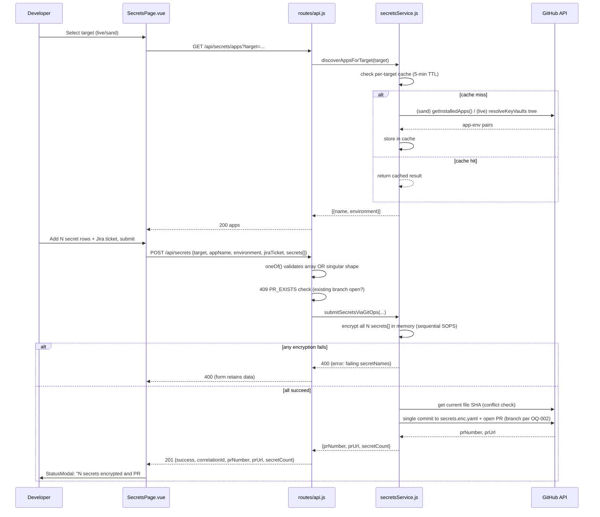

# Architecture Spec: Secrets UI Enhancements

## Context

The v1 Secrets self-service page (`srcV2/pages/SecretsPage.vue`) shipped 2026-07-31. Production
feedback surfaced three gaps: the app dropdown isn't filtered by infrastructure target (`live` vs
`sand`), only one secret can be submitted per PR, and there's no Jira/CR ticket field (every other
mutation flow in the portal has one). This spec extends the existing v1 components — no new
services, no new architectural pattern.

PRD: [docs/prd/secrets-ui-enhancements.md](../prd/secrets-ui-enhancements.md)
PRD Challenger approval: [docs/reviews/secrets-ui-enhancements-prd-review-round2.md](../reviews/secrets-ui-enhancements-prd-review-round2.md)

## Design Decisions (resolving PRD Open Questions)

| OQ | Decision | Rationale |
|---|---|---|
| OQ-001 (app discovery source) | Use the `resolveKeyVaults` tree cache for `target=live`, extracting unique `{app, environment}` pairs from cached `infrastructure-live` tree entries. For `target=sand`, use `infrastructureService.getInstalledApps()`. | Live: already fetches + caches the full tree with 5-min TTL; avoids a second GitHub tree call. Sand: reuses the existing metadata reader. See "App Discovery Algorithm" below for environment-derivation details. |
| OQ-002 (bulk branch naming) | `secrets/{appName}-{environment}-{vaultSlug}-bulk-{sha256(sortedSecretNames.join(',')).slice(0,8)}` for N>1. For N=1 (including the backward-compat singular request shape), keep the **exact v1 branch format** `secrets/{appName}-{environment}-{vaultSlug}-{secretName}` — no behavior change for existing single-secret callers. | Deterministic/idempotent for the same set of names; zero risk to v1 callers. The exact serialization is `sortedNames.join(',')` (comma-separated, no spaces), lowercased input names, SHA-256 hex digest, first 8 chars. This exact algorithm must be mirrored in unit tests. |
| OQ-003 (max secrets per submission) | 20, enforced both client- and server-side. | Matches PRD proposal; NFR-PERF-002 budget monitored via `latency_ms`. |
| FR-001(a) vs (b) endpoint shape (PRD Challenger advisory) | New endpoint: `GET /api/secrets/apps?target=live\|sand`. Do **not** overload `GET /api/installed-apps` — that endpoint has other consumers (AKS pages, installed-apps page) and changing its response shape based on a query param risks silent behavior drift there. | Isolates the new target-aware discovery logic to the Secrets feature only. |
| Secret-name validation parity | Both bulk-array and legacy-singular request shapes use `/^[a-zA-Z0-9-]{1,127}$/`. | Preserves the v1 contract; changing request shape must not change which secret names are valid. |
| Batch atomicity (PRD FR-003(j), resolved after PRD Challenger round 1) | Encrypt every `secrets[]` entry in memory first. Only call `createOrUpdateFileContents`/open the PR if all entries succeed. On first encryption failure, abort with HTTP 400 listing only the failing `secretName`s — zero GitHub writes. | Deterministic contract for Dev/QA; avoids partially-committed `secrets.enc.yaml`. |

## App Discovery Algorithm (FR-001)

### `target=live` (infrastructure-live repo)

Uses `resolveKeyVaults`'s cached tree (5-min TTL). For each tree entry matching the path
pattern `infrastructure/{app}/{env}/...`:

1. Extract `{app}` as the first path segment after `infrastructure/`.
2. Extract `{env}` as the second path segment after `infrastructure/`.
3. Deduplicate `{app, env}` pairs across the entire tree.

**Critical**: An app+env pair is included even if it has **no `keyvaultN` directory/file** under
it yet. The tree entry's existence (any file under `infrastructure/{app}/{env}/`) is sufficient —
we enumerate directory structure, not Key Vault presence. This prevents silently omitting valid
environments that have no Key Vault provisioned, which would be a functional regression against
PRD Goal 1 (mismatched/incomplete app-env lists).

The existing `matchVaultsFromEntries` function takes a **known** `appName`+`environment` and
filters vaults for that specific pair — it works in "lookup" mode. The new discovery logic works
in **enumerate** mode: iterate all `infrastructure/{app}/{env}` paths, collect unique pairs, and
return them as a flat list `[{name: app, environment: env}, ...]`. This is new logic in
`discoverAppsForTarget`, not a reuse of `matchVaultsFromEntries`.

### `target=sand` (service-catalog repo)

Delegates to `infrastructureService.getInstalledApps()`, which reads `docs/metadata/*.json` from
the service-catalog repo. The response is already an array of app objects with environment info.

### Caching

`discoverAppsForTarget` maintains its **own** per-target `Map<target, {promise, timestamp}>`
cache mirroring `treeCache`'s pattern (promise-based dedup, 5-min TTL, evict-on-rejection for
error safety). This is a **new cache** — `getInstalledApps()` has **no caching today**; the tree
cache only covers the `live` path. Without this new cache, repeated target toggling would hit
GitHub on every toggle for `sand`, risking NFR-PERF-001 (3000ms p95).

### Response Shape

Flat list, one row per `{app, environment}` pair:
```json
[{ "name": "app-a", "environment": "dev" }, { "name": "app-a", "environment": "prod" }, ...]
```
Not grouped. Apps with multiple environments appear as multiple rows. This matches the existing
`appNames`/`filteredEnvironments` computed properties in `SecretsPage.vue`.

## Data Flow



### Bulk Flow Step Ordering (explicit)

1. `oneOf()` validation — reject invalid shapes (400, sanitized errors)
2. `409 PR_EXISTS` check — dedup: is there already an open PR for this branch?
3. Capture current `secrets.enc.yaml` file SHA (for conflict detection)
4. Encrypt all N secrets sequentially via SOPS (in memory, abort on first failure → 400)
5. Re-check file SHA (detect concurrent modification → 503 SHA_CONFLICT, reject entire batch)
6. `createOrUpdateFileContents` (single commit, all encrypted keys)
7. `createPullRequest` (branch per OQ-002, PR body includes Jira ticket + secret count)
8. Return `{prNumber, prUrl, secretCount, correlationId}`

## Component Changes

### Backend

- `routes/api.js`
  - **New**: `GET /api/secrets/apps` — `requireAuth`, query param `target` (`live|sand`, required).
    Response: flat `[{name, environment}]` array (see App Discovery Algorithm above).
  - **Modify**: `POST /api/secrets` — use `oneOf()` to support two mutually-exclusive request shapes:
    - **Array shape (new)**: `check('secrets').isArray({min:1,max:20})` + per-element
      `check('secrets.*.secretName').matches(/^[a-zA-Z0-9-]{1,127}$/)` (same regex as the
      singular shape — a secret name valid under v1 must also be valid in the bulk form) and
      `check('secrets.*.secretValue').isString().notEmpty()` + `check('jiraTicket').matches(/^[A-Z]{2,10}-\d{1,6}$/)`.
    - **Singular shape (v1 backward-compat)**: `check('secretName').matches(...)` and
      `check('secretValue').isString().notEmpty()` (existing validators unchanged).
    - Implemented as `oneOf([arrayShapeChain, singularShapeChain])`. A request matching neither
      gets a 400 with standard validation errors. An integration test must assert **both** shapes
      independently pass validation.
  - **Error response sanitization (NFR-SEC-001)**: The 400 handler must strip the `value` field
    from `errors.array()` for any `param` matching `secretValue` or `secrets.*.secretValue` before
    sending the response. Today's `express-validator` default includes `value` (the submitted
    value) in error objects — this would leak secret plaintext into HTTP error responses. Fix:
    `const sanitized = errors.array().map(e => e.param.includes('secretValue') ? {...e, value: '[REDACTED]'} : e)`.
    Add an explicit QA test: submit a `secretValue` that fails a validator and grep the JSON
    response body for the submitted value (must be zero matches).
    The existing `409 PR_EXISTS` handling is preserved unchanged.
  - **Bulk PR title format**: `Secrets update: {secretCount} secrets ({appName}/{environment})`
    for N>1. For N=1 (including backward-compat singular shape), keep v1's existing PR title
    format unchanged.
  - **`SOPS_NOT_CONFIGURED` (503)**: inherited from v1 — `execFileAsync('sops', ...)` fails if
    the `sops` binary is not installed. Already covered by the generic `statusByCode` map in
    `routes/api.js`. No new error code needed.
- `services/secretsService.js`
  - **New**: `discoverAppsForTarget(target, correlationId)` — for `sand`, delegates to
    `infrastructureService.getInstalledApps()`; for `live`, derives `{app, environment}` pairs from the
    `resolveKeyVaults`-cached tree. **New per-target cache** (mirroring `treeCache`'s
    `Map<target, {promise, timestamp}>` pattern with 5-min TTL and evict-on-rejection). Note:
    `getInstalledApps()` has **no caching today** — this is a new cache for both `live` and `sand`,
    not a reuse of an existing module. The `live` path reuses the tree-fetch but the result cache
    for `discoverAppsForTarget` is new; the `sand` path needs both the fetch and cache to be new.
  - **Modify**: `submitSecretViaGitOps` → renamed internally to accept `secrets: [{secretName,
    secretValue}]` + `jiraTicket`; encrypts all entries before any GitHub write (see atomicity
    decision above); builds one commit updating all keys in `secrets.enc.yaml`; branch name and PR
    description per OQ-002/FR-004(f)/(g).
  - **Bulk branch hash algorithm (OQ-002)**: The exact implementation must be:
    ```js
    const sortedNames = secrets.map(s => s.secretName).sort().map(n => n.toLowerCase());
    const hashInput = sortedNames.join(','); // comma-separated, no spaces
    const shortHash = crypto.createHash('sha256').update(hashInput).digest('hex').slice(0, 8);
    const branch = `secrets/${appName}-${environment}-${vaultSlug}-bulk-${shortHash}`;
    ```
    Names are lowercased before hashing for case-insensitive determinism. The delimiter is `,`
    (comma, no spaces). Unit tests must assert the exact expected hash for a known input set.

### Frontend

- `srcV2/pages/SecretsPage.vue`
  - Replace `secretName`/`secretValue`/`secretConfirmation` refs with
    `secretEntries: ref<SecretFormEntry[]>([{ name: '', value: '', confirmation: '' }])`.
  - Add `jiraTicket = ref('')` (form-level, persists across row add/remove).
  - Add `addSecretRow()` / `removeSecretRow(index)`; disable "Add" at 20 rows, disable "Remove"
    at 1 row. Each call updates a visually-hidden `aria-live="polite"` region (e.g. "Secret row
    3 added" / "Secret row 2 removed, 4 remaining") so screen-reader users get the same feedback
    sighted users get from the row appearing/disappearing (carried forward from PRD Challenger
    Round 2 advisory notes; not a formal PRD AC, low-cost a11y addition).
  - `loadApps()` calls `api.getSecretApps(target.value)` instead of `api.getInstalledApps()`;
    add `target` to the existing `watch([selectedAppName, selectedEnvironment, target], ...)` —
    already watches `target`, extend to also call `loadApps()` on target change.
  - `validateForm()` iterates `secretEntries`, checks name pattern, non-empty value,
    value===confirmation, and duplicate names within the batch; keys errors by `${index}.${field}`.
  - `submitSecret()` posts `{ target, appName, environment, vaultDir, jiraTicket, secrets: [...] }`;
    on success, resets `secretEntries` to one empty row and shows count in `StatusModal`.
- `srcV2/services/api.ts`
  - Add `getSecretApps: (target: 'live' | 'sand') => api.get('/api/secrets/apps', { params: { target } })`.
  - `submitSecret` payload shape changes (still `Record<string, unknown>`, no signature change).
- `srcV2/types/infrastructure.types.ts`
  - Add `SecretFormEntry { name: string; value: string; confirmation: string }`.

## Sync Submission Model (deliberate, not an oversight)

This feature stays **synchronous** — a direct Octokit commit + PR via `secretsService`, no GitHub
Actions workflow dispatch, no status-modal polling — matching v1's existing implementation
(`SecretsPage.vue` already comments: "sync mode, no polling"). `encryptValueWithSops` calls remain
**sequential** in this iteration (same as v1's single-call path); revisit parallelizing only if
`latency_ms` monitoring shows the 5000ms/20-secret budget (NFR-PERF-002) is being missed.

## Testing Notes

- NFR-UX-001 keyboard-nav verified via a Playwright E2E scenario (Tab through all rows +
  Add-button, no mouse) — see `testing.e2e_tests` in spec.json.
- Atomicity (FR-003(j)) unit-tested by mocking `encryptValueWithSops` to fail on the Nth call and
  asserting zero `createOrUpdateFileContents`/`createPullRequest` calls occurred.
- **SHA-conflict race window**: The capture-before-encrypt / recheck-after pattern widens with
  batch size (up to ~20 sequential SOPS calls). Under concurrent edits to the same vault file,
  an occasional 503 SHA_CONFLICT on bulk submissions is expected behavior, **not** a functional
  bug. QA should not flag isolated bulk-503-under-load as a defect.
- **Error response sanitization test**: Submit a `secretValue` that fails a validator (e.g., empty
  string); grep the JSON response body for the submitted value — must be zero matches (the `value`
  field should be `[REDACTED]`).
- **Backward-compat test**: Submit a request with the v1 singular shape (`secretName` +
  `secretValue`, no `secrets[]`); assert it passes validation and produces a v1-format branch name.

## NFRs

See spec.json `nfrs` block — latency targets, no-plaintext-in-logs, keyboard nav.

## Dependencies

Existing: `services/infrastructureService.js` (`getInstalledApps`), `resolveKeyVaults` tree cache,
`ProjectInfoForm.vue` Jira regex pattern (`/^[A-Za-z]+-\d+$/`), `StatusModal.vue`, `requireAuth`
middleware, `logger.logMetric`.
