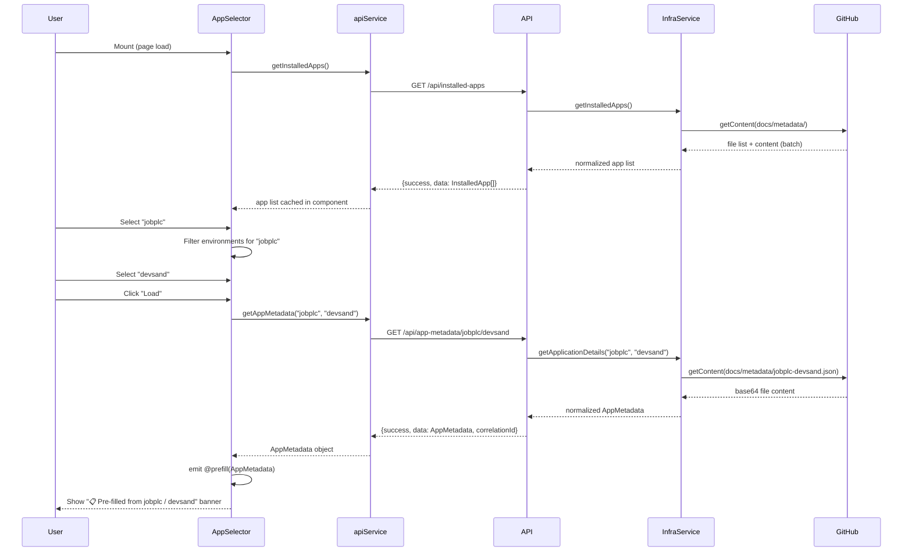

# Feature Specification: Service-Catalog Metadata Pre-fill

| Field | Value |
|---|---|
| Feature | `service-catalog-prefill` |
| Source PRD | `docs/prd/service-catalog-prefill.md` |
| Status | `approved` |
| Last Modified | 2025-07-15 |
| Architect | SelfService App Architect Agent |

---

## 1. Context

### Why This Feature

When a user wants to re-provision or modify an existing application through the self-service UI
(Custom Infrastructure or Template Deploy pages), every form field starts blank. The user must
manually retype the project abbreviation (max 8 chars), owner, environment, and re-select modules.
The authoritative metadata already exists in `organization/service-catalog` at
`docs/metadata/{appName}-{environment}.json` — it is simply never surfaced back into the form.

### User Persona

**Alex — Application Developer (Platform Consumer)**  
Alex owns applications already provisioned via self-service and needs to re-provision or modify
them. Today this takes ~3 minutes of error-prone manual re-entry. With pre-fill, it should take
< 30 seconds.

### Business Value

- Eliminates transcription errors in `projectName` (typos cause silent metadata file mismatches)
- Reduces form completion time from ~3 minutes to < 30 seconds for repeat workflows
- Establishes the pattern for future "edit existing app" and "promote to production" flows
- Ensures `cost_center` and `lifecycle` stay anchored to the canonical service-catalog record

### Scope

**In**: `CustomInfrastructurePage.vue` Step 0 + Step 1 pre-fill,
new `GET /api/app-metadata/:appName/:environment` endpoint, `AppSelector.vue` component,
`getApplicationDetails()` bug fix, `InstalledApp` type enrichment.

**Out**: `TemplateDeployPage.vue` pre-fill (deferred to future release), AKS deployment forms,
RBAC pair editing, real-time sync, `ExistingInfraChangePage.vue` agent flow.

---

## 2. Design

### Component Architecture

```mermaid
graph TD
    A[CustomInfrastructurePage.vue] -->|renders| B[AppSelector.vue]
    B -->|on mount| D[apiService.getInstalledApps]
    B -->|on Load click| E[apiService.getAppMetadata]
    D --> F[GET /api/installed-apps]
    E --> G[GET /api/app-metadata/:appName/:environment]
    G --> H[infrastructureService.getApplicationDetails - FIXED]
    H -->|primary lookup| I[GitHub API: docs/metadata/{appName}-{environment}.json]
    H -->|fallback| J[GitHub API: scan docs/metadata/]
    B -->|@prefill event| A
    A -->|sets prefillData prop| K[ProjectInfoForm.vue]
    A -->|sets selectedModules| L[ModuleSelector.vue]
```

### Data Flow: Pre-fill Happy Path



---

## 3. Contracts

### 3.1 New API Endpoint

#### `GET /api/app-metadata/:appName/:environment`

**Authentication**: `requireAuth` (Entra ID JWT)  
**Validation**:
- `appName`: `/^[a-zA-Z0-9]{1,8}$/` — returns HTTP 400 if invalid
- `environment`: must be a value from `data/environments.json` — returns HTTP 400 if unrecognized

**Success Response (HTTP 200)**:
```json
{
  "success": true,
  "data": {
    "name": "jobplc",
    "environment": "devsand",
    "description": "jobplc",
    "owner": "Example User",
    "lifecycle": "Live",
    "modules": ["functionAppSvcWindows"],
    "costCenter": "self-service",
    "commitSha": "649f071b29d6d9eec2c4cba417278735ce4d23a8",
    "deployedAt": "2025-07-14T21:59:14Z"
  },
  "correlationId": "cid-1234567890-abcd"
}
```

**Error Responses**:
| Status | Condition | Body |
|---|---|---|
| 400 | `appName` fails regex or `environment` not in allowlist | `{ success: false, error: "Invalid appName or environment", correlationId }` |
| 401 | No valid JWT bearer token | `{ success: false, error: "Unauthorized", correlationId }` |
| 404 | `docs/metadata/{appName}-{environment}.json` does not exist | `{ success: false, error: "App not found", correlationId }` |
| 500 | GitHub API failure or unexpected error | `{ success: false, error: "Failed to fetch metadata", correlationId }` |

### 3.2 Existing Endpoints (unchanged signatures)

| Endpoint | Change |
|---|---|
| `GET /api/installed-apps` | No change. Reused for selector app list. |
| `GET /api/deployed-apps/:projectName/:environment` | No signature change. Underlying `getApplicationDetails()` behaviour corrected by FR-007, returning normalized shape instead of raw JSON. Document breaking change before deploy. |

### 3.3 Frontend API Method

```ts
// srcV2/services/api.ts — addition to apiService object
getAppMetadata: (appName: string, environment: string): Promise<ApiResponse> =>
  api.get(`/api/app-metadata/${appName}/${environment}`)
```

Existing axios interceptors (auth token injection, telemetry `api_request_completed`) apply
automatically.

### 3.4 TypeScript Data Contracts

#### `AppMetadata` (new interface — `srcV2/types/infrastructure.types.ts`)
```ts
export interface AppMetadata {
  name: string           // project abbreviation (≤ 8 chars)
  environment: string    // environment identifier
  description: string    // human-readable description
  owner: string          // owner name or email
  lifecycle: string      // "experimental" | "production" | "deprecated"
  modules: string[]      // Terraform module IDs
  costCenter: string     // cost center tag
  commitSha: string      // most recent commit SHA
  deployedAt: string     // ISO 8601 deployment timestamp
}
```

#### `InstalledApp` enrichment (existing interface — `srcV2/types/infrastructure.types.ts`)
Add optional fields:
```ts
costCenter?: string    // previously missing
commitSha?: string     // previously missing
```

---

## 4. Component Specification

### 4.1 `AppSelector.vue`

**Location**: `srcV2/components/infrastructure/AppSelector.vue`  
**Type**: New reusable component

**Props**: none (self-contained loader)

**Emits**:
- `@prefill(metadata: AppMetadata)` — when metadata successfully loaded
- `@error(message: string)` — when app list load or metadata fetch fails

**Behaviour**:
1. On mount: call `apiService.getInstalledApps()` and cache result
2. Render searchable app name dropdown (populated from `InstalledApp[].name`, deduplicated)
3. On app name selection: reset environment dropdown; populate environment options from same list
   filtered to the selected app name (no new API call)
4. Enable "Load" button only when both app name AND environment are selected
5. On "Load": call `apiService.getAppMetadata(appName, environment)`, show spinner on button
6. On success: emit `@prefill(metadata)`, show "📋 Pre-filled from {appName} / {environment}" banner
7. On second load (form already populated): show confirmation dialog before overwriting
8. On error: emit `@error(message)`, show inline error in selector section
9. Handles empty app list: render "No apps found" empty state
10. The section is collapsible; collapse does not affect parent form state

**WCAG 2.1 AA Requirements**:
- All dropdowns and buttons keyboard-navigable (Tab / Arrow / Enter)
- Loading state: `aria-busy="true"` on container or `aria-live` region
- Error messages: `aria-describedby` linking error text to the relevant control

### 4.2 `ProjectInfoForm.vue` Changes

**Location**: `srcV2/components/infrastructure/ProjectInfoForm.vue`  
**Type**: Modify existing

**Changes**:
- Add `prefillData?: AppMetadata` prop
- Add `watch` on `prefillData`: when it changes, update `formData.projectName`,
  `formData.descriptiveName`, `formData.environment`, `formData.owner`
- `lifecycle` is **not** pre-filled (always forced to `'experimental'`)
- `projectAge` and `approvalNumber` are **not** pre-filled

### 4.3 `CustomInfrastructurePage.vue` Changes

**Location**: `srcV2/pages/CustomInfrastructurePage.vue`  
**Type**: Modify existing

**Changes**:
- Import and render `AppSelector.vue` at the top of Step 0 (Project Information)
- Handle `@prefill` event: store metadata, pass as `prefillData` prop to `ProjectInfoForm.vue`,
  set `selectedModules` state to `metadata.modules`
- Handle `@error` event: surface error in Step 0 banner area

**Field Mapping** (pre-fill → form):

| `AppMetadata` field | Form field | Component |
|---|---|---|
| `name` | `projectName` | `ProjectInfoForm.vue` |
| `description` | `descriptiveName` | `ProjectInfoForm.vue` |
| `environment` | `environment` | `ProjectInfoForm.vue` |
| `owner` | `owner` | `ProjectInfoForm.vue` |
| `modules` | `selectedModules` | `ModuleSelector.vue` (Step 1) |
| `lifecycle` | — | **Not pre-filled** |
| `projectAge` | — | **Not pre-filled** |
| `approvalNumber` | — | **Not pre-filled** |

### 4.4 `TemplateDeployPage.vue` — OUT OF SCOPE

> ⚠️ Template Deploy pre-fill is **deferred to a future release**.  
> `TemplateDeployPage.vue` must not be modified in this feature.

---

## 5. Backend Fix: `getApplicationDetails()`

**Location**: `services/infrastructureService.js` line ~617  
**Type**: Bug fix (FR-007)

**Current (broken) behaviour**:
1. Tries `docs/metadata/{projectName}.json` (no environment suffix) → wrong for multi-env apps
2. Falls back to scanning all files in `docs/metadata/` → N+1 GitHub API calls

**Fixed behaviour**:
1. **Primary**: `docs/metadata/{projectName}-{environment}.json` — direct lookup
2. **Fallback**: full directory scan (retained for legacy files without env suffix)
3. **Return shape**: normalized using the same fields as `getInstalledApps()` per-entry, plus
   `costCenter` (`appData.meta?.cost_center || appData.tags?.costCenter`) and
   `commitSha` (`appData.meta?.commit_sha || appData.commitSha`)

**Normalisation output**:
```js
{
  name: appData.projectName || appData.project,
  environment: appData.environment,
  description: appData.description || appData.meta?.description,
  owner: appData.owner || appData.meta?.owner,
  lifecycle: appData.lifecycle || appData.meta?.lifecycle || 'experimental',
  modules: this._normalizeModules(appData.modules),
  costCenter: appData.tags?.costCenter || appData.meta?.cost_center || 'self-service',
  commitSha: appData.meta?.commit_sha || appData.commitSha || '',
  deployedAt: appData.createdAt || appData.meta?.deployed_at || appData.timestamp
}
```

---

## 6. Error Scenarios

| Scenario | User-Visible Behaviour | Backend Behaviour |
|---|---|---|
| App list load fails on mount | Selector shows "Unable to load apps. Retry?" + retry button. Form still fully usable. | `GET /api/installed-apps` 5xx → `@error` emitted |
| Metadata fetch: app not found (404) | Error banner: "App '{name} / {env}' not found in service-catalog." | `getApplicationDetails` returns null → route returns 404 |
| Metadata fetch: GitHub 500 | Error banner: "Could not load metadata. Please fill in manually." | GitHub 5xx → retried 3× with backoff → 500 returned |
| Metadata fetch: times out (> 5 s) | Axios timeout aborts request; error banner shown immediately | Client-side timeout (Axios 30 s global; component-level 5 s) |
| Invalid `appName` path parameter | N/A (validated client-side by AppSelector) | Server: HTTP 400 before GitHub API touched |
| Invalid `environment` path parameter | N/A (validated client-side) | Server: HTTP 400, environment not in allowlist |
| Unauthenticated request | N/A (SPA requires auth) | HTTP 401, `requireAuth` middleware blocks |
| User loads second app after pre-fill | Confirmation dialog: "This will replace current data. Continue?" | No server interaction until user confirms |

---

## 7. Testing

### Backend Unit Tests

| Test Case | Assertion |
|---|---|
| Happy path: `GET /api/app-metadata/jobplc/devsand` | HTTP 200, `data.name === "jobplc"`, `data.environment === "devsand"`, `correlationId` present |
| Not found: `GET /api/app-metadata/notexist/devsand` | HTTP 404, `success: false`, `error: "App not found"` |
| Path traversal: `GET /api/app-metadata/../../etc/passwd/devsand` | HTTP 400 |
| Long appName: `GET /api/app-metadata/toolongname/devsand` | HTTP 400 (> 8 chars) |
| Invalid env: `GET /api/app-metadata/jobplc/invalid-env` | HTTP 400 |
| Unauthenticated: no JWT | HTTP 401 |
| `getApplicationDetails("jobplc","devsand")` | GitHub `getContent` called with path `docs/metadata/jobplc-devsand.json` (assert call args) |
| GitHub 404 during primary lookup | Falls back to directory scan; if not found there, returns `null` |
| GitHub 404 on both paths | Route returns HTTP 404 |
| `getApplicationDetails` return shape | Contains `name`, `environment`, `description`, `owner`, `lifecycle`, `modules`, `costCenter`, `commitSha`, `deployedAt` |
| NFR-008: single GitHub call on pre-fill | Mock `getContent`; assert called exactly once for primary lookup that succeeds |

### Frontend Unit Tests (Vitest + Vue Test Utils)

| Test Case | Assertion |
|---|---|
| `AppSelector.vue` mounts | `apiService.getInstalledApps()` called once on mount |
| App list empty | "No apps found" empty state rendered |
| Select app name | Environment dropdown resets and repopulates with that app's environments |
| Load button disabled | Disabled when only app or only env selected |
| Load button enabled | Enabled when both app and env selected |
| Click "Load" (success) | `apiService.getAppMetadata()` called with correct args; `@prefill` event emitted with metadata |
| Click "Load" (404) | `@error` event emitted; inline error message rendered |
| Click "Load" (500) | `@error` event emitted; generic error message rendered |
| Second load with existing data | Confirmation dialog shown before emitting new `@prefill` |
| `ProjectInfoForm.vue` with prefillData prop | `projectName`, `descriptiveName`, `environment`, `owner` set correctly; `projectAge`, `approvalNumber` remain blank |
| `CustomInfrastructurePage.vue` pre-fill wiring | After `@prefill` event, `selectedModules` matches `metadata.modules` |
| `apiService.getAppMetadata` method exists | `typeof apiService.getAppMetadata === 'function'` |
| `AppMetadata` TypeScript interface | `tsc --noEmit` passes with no errors |

### E2E Tests (Playwright)

| Test | Steps | Assertions |
|---|---|---|
| Full pre-fill flow — Custom Infrastructure | Navigate → expand selector → pick "jobplc" → pick "devsand" → click Load → verify form fields | `projectName`, `owner`, `environment` populated; module "functionAppSvcWindows" checked; pre-fill banner visible |
| Form usable after selector fails | Mock `GET /api/installed-apps` to fail → verify all form fields editable | Wizard completes without pre-fill; no console errors |

---

## 8. Non-Functional Requirements

| NFR | Target | Measurement |
|---|---|---|
| NFR-001 — Metadata fetch latency | `GET /api/app-metadata` ≤ 2 000 ms p95 | `api_request_completed` telemetry event, `duration_ms` field |
| NFR-002 — App list load time | `AppSelector.vue` populated ≤ 3 000 ms p95 from mount | `api_request_completed` telemetry for `/api/installed-apps` |
| NFR-003 — Graceful degradation | Form fully usable when API returns 4xx/5xx; error message within 500 ms | Unit tests mocking API failures; verify form fields remain enabled |
| NFR-004 — Auth enforcement | Unauthenticated request → HTTP 401, no metadata payload | Integration test: request without JWT → 401 |
| NFR-005 — Input validation | `appName` `/^[a-zA-Z0-9]{1,8}$/`; `environment` in `data/environments.json` allowlist; HTTP 400 before GitHub call | Unit tests: path traversal, overlong name, invalid env |
| NFR-006 — Correlation IDs | All backend log lines for new route include `req.correlationId`; response JSON includes `correlationId` | Log inspection; integration test |
| NFR-007 — Accessibility WCAG 2.1 AA | `AppSelector.vue` keyboard-navigable; `aria-busy` on loading; `aria-describedby` on errors | Manual keyboard test + `axe-core` scan |
| NFR-008 — No N+1 GitHub calls | Single pre-fill = exactly 1 GitHub `getContent` call | Unit test: mock `getContent`, assert call count = 1 |
| NFR-009 — Pre-fill banner visibility | Banner visible without scrolling at 375 px, 768 px, 1 280 px | Visual review at all three viewport widths |

---

## 9. Delivery Plan

### Phase 1 — Backend Foundation
- FR-007: Fix `getApplicationDetails()` file naming
- FR-002: Implement `GET /api/app-metadata/:appName/:environment`
- FR-008: Extend `InstalledApp` + add `AppMetadata` type

### Phase 2 — Frontend Core
- FR-006: Add `apiService.getAppMetadata()` to `srcV2/services/api.ts`
- FR-005: Build `AppSelector.vue`
- FR-003: Wire pre-fill into `CustomInfrastructurePage.vue`

> ⚠️ **Phase 3 (Template Deploy Extension, FR-004) has been removed from this release.**
> Template Deploy pre-fill is deferred to a future sprint.

### Rollout
Feature gated by `VITE_ENABLE_CATALOG_PREFILL=true` env var during rollout.
Backend endpoints are additive. Rollback: remove `AppSelector` from pages with no effect on
existing routes or functionality.

---

## 10. Open Questions

| # | Question | Blocking |
|---|---|---|
| OQ-1 | Deprecate `GET /api/deployed-apps/:projectName/:environment` after FR-007 lands? | No |
| OQ-2 | Pre-fill banner — persist across wizard steps or Step 0 only? | No (default: Step 0 only) |
| OQ-3 | Pre-fill on `ExistingInfraChangePage.vue` (agent flow) in future phase? | No |
| OQ-4 | Server-side 5-min TTL cache for `getInstalledApps()` to reduce GitHub rate-limit risk? | No |

---

## 11. Dependencies

| Dependency | Type | Notes |
|---|---|---|
| `organization/service-catalog` repo | External data source | `docs/metadata/*.json` — Infrastructure GitHub App already has read access |
| `services/githubService.js` | Internal service | Already initialised; `octokit.rest.repos.getContent` used for file reads |
| `services/infrastructureService.js` | Internal service | `getApplicationDetails()` needs bug fix (FR-007) before FR-002 can be built |
| `GET /api/installed-apps` | Existing endpoint | Reused unchanged for selector app list |
| `requireAuth` middleware | Existing middleware | Applied to new endpoint without modification |
| `express-validator` | Existing library | Used for `check()` validators on the new route |
| `AppSelector.vue` | New component | Must be built (FR-005) before FR-003 can be wired into `CustomInfrastructurePage.vue` |
| `apiService.getAppMetadata()` | New method | Must be added (FR-006) before `AppSelector.vue` can call it |
| `data/environments.json` | Config file | Used for `environment` allowlist validation in new endpoint |
| `VITE_ENABLE_CATALOG_PREFILL` | Feature flag | Optional env var for phased rollout |
