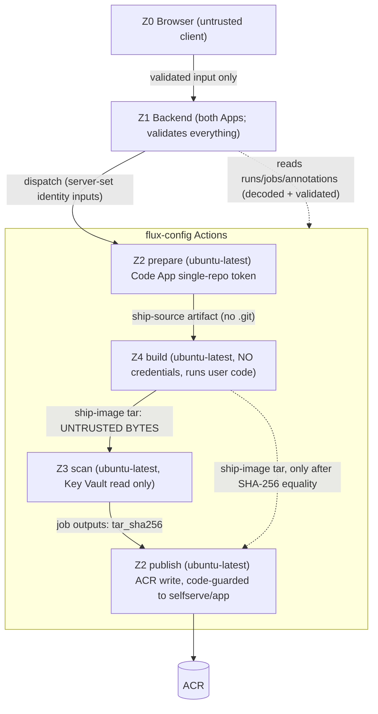

# Architecture Deep-Dive: Ship From Repo

| Field | Value |
|---|---|
| Feature | `ship-from-repo` |
| Companion to | `docs/architecture/ship-from-repo-spec.md` / `.json` (contracts, tests, traceability live there) |
| Author / date | SelfService App Architect · 2026-10-22 (Round 1 response, finding B-1; Round 2 response, N-1/N-A3; post-Round-3 delta: product-owner decisions H-9/H-10 and advisories N3-A1…A5) |
| Why this exists | The Architect escalation triggers fire: a **new architectural pattern** (five trust zones that run untrusted user code on GitHub-hosted runners), a **new status data plane** (check-run annotations), a **cross-repo workflow-as-backend** (flux-config owns the pipeline), a **pluggable identity seam**, and a **violated existing pattern** (`CLAUDE.md`: long-running operations use the status-modal + `useWorkflowPolling` pattern). |
| Decisions recorded | ADRs below; each is `Accepted` for design purposes, subject to Architecture Challenger approval and the human items in spec §2.3. |

ADRs:
1. `docs/adr/20261022-ship-trust-zones-and-untrusted-build-isolation.md`
2. `docs/adr/20261022-ship-status-via-annotations.md`
3. `docs/adr/20261022-ship-identity-provider-seam.md`
4. `docs/adr/20261022-ship-own-polling-composable.md`
5. `docs/adr/20261022-ship-config-handoff-dispatch-and-wait.md`
6. `docs/adr/20261022-ship-dedicated-workflow-ref-cache-isolation.md` (DD-11, Round 2 N-A3)
DD-11 (dedicated workflow ref) has its own ADR (`docs/adr/20261022-ship-dedicated-workflow-ref-cache-isolation.md`, summarised in §4a below). DD-16 (registry write scope) is recorded in §4 below rather than as a separate ADR; its open outcomes (H-10, V-8 scope) were decided by the product owner on 2026-10-22 (spec DD-19) and it will be promoted only if the post-pilot ABAC/separate-registry hardening (HO-3) changes a contract.

---

## 1. How this fits the five foundational patterns

| Pattern | Position |
|---|---|
| GitHub as database | **Kept.** State = Actions runs + check-run annotations + flux-config PR + `selfserve-metadata` + ACR tags/labels. No datastore added. |
| Multi-GitHub-App | **Extended, not violated.** Backend: Infrastructure App (flux-config dispatch/reads) and Code App (user-repo listing/permission). In-workflow: `prepare` mints its single-repo `contents:read` clone token from the **existing Code App** (H-9 decided 2026-10-22; its key is held as a `ship-prepare` environment secret — accepted risk R-A6; DD-15). Azure side: three OIDC identities (`ship-prepare` read, `ship-scan`, `ship-publish` write limited to `selfserve/<validated-app>` by a code-enforced guard — registry-wide AcrPush accepted, R-A7). |
| Correlation ID | **Kept, strengthened.** Server-minted **UUIDv7** ship ID (time-ordered, so run lookup needs no client hint, DD-17) is threaded through API → run-name → inputs → OCI label → config dispatch/PR → logs. The request's own ID is logged as `requestId`. |
| Vue 3 SPA navigation | **Kept.** New `'ship'` `PageId`; no router. Deep link `?ship=<id>` is a query parameter only. |
| Workflow polling | **Deliberate departure** (ADR 4): dedicated `useShipPolling` composable (15 s, backoff, same cleanup contract) instead of the shared 10 s workflow store, which parses the legacy `{success,status}` shape. |

## 2. Trust zones and data-flow rules

Normative rules (the spec's §3.2 is authoritative; this restates the reasoning):

1. **Z4 is assumed fully compromised** (it holds `ACTIONS_RUNTIME_TOKEN`, may reach the VM docker daemon). Nothing a trusted job *decides* may depend on Z4 output, except the image tar, which is hash-pinned and structurally validated.
2. **Trusted jobs also handle untrusted *text*** (git/clone errors, repo-derived names, Wiz findings, the tar's metadata). The runner interprets `::command::` lines in *any* step's stdout, so such text can forge annotations. Therefore: untrusted text is displayed only through a single sanitising path wrapped in `::stop-commands::<random-token>`; and result annotations are emitted only by `emit-result.sh`, which base64url-encodes a `jq -c` payload (ADR 2).
3. **Z2 ambient credentials** (`ARM_CLIENT_SECRET`, `GH_APP_PRIVATE_KEY`, SSH key, pre-existing `az` login are injected into every `ubuntu-latest` pod) must not be observable by any process that touches attacker bytes (clone, tar, tar validation, `crane`). Controlled by the **Z2 hygiene wrapper** (`ship-sandbox.sh`, spec §3.2.1) and verified by canary tests (WT-04b, V-12). Residual file-level exposure on a shared pod (and the existing Code App key held as a `ship-prepare` environment secret, DD-15) is recorded as R-A6 and **explicitly accepted by the product owner for the devsand pilot (H-9 decided 2026-10-22)**; the hygiene wrapper is the compensating control; a dedicated runner group/uid separation (HO-2) and a dedicated Ship Reader App (HO-1) are post-pilot hardening options.
4. **Publish is the only zone with registry write**, and its push target is limited to `selfserve/<validated-app>` by a **code-enforced allowlist** (DD-16, hard gate V-8) because the same registry hosts the runner image `githubrunner/devopsrunner`; registry-wide AcrPush on the identity is the residual risk R-A7, accepted by the product owner for the pilot (H-10 decided 2026-10-22).

## 3. Status data plane (summary of ADR 2)

`run-name` carries identity (`cid`, `app`, `env`, `repo`, `by`, `oid`, `mode`, `retry_by`); each trusted **stage** emits exactly one `ship.result` annotation (`prepare` and `scan` jobs: one each; the `publish` job: one per stage tag, `publish` and `config` — two in `mode=full`, one `config` in `config_only`); the backend reads annotations once per completed job and honours `ok:true` only when the **step group** behind that stage (job for `prepare`/`scan`; for `publish`/`config` the exact-named `Publish: guard|verify image|version|push` steps 1–4 / `Config PR: decide|guard|dispatch|wait` steps 6–9, **plus the stage's `Emit:` step**) concluded `success` (a `skipped` step never counts, so steps 7–9 always run — as no-ops on `skip_config`, N3-A3/N3-A4), so a failed config PR never discards a valid `publish` result and the image-bearing run needed by `retry-config-pr` stays defined (N-1; `Publish: cleanup` is `continue-on-error`, N3-A2). Status is a **fold over every run sharing a correlation ID** (the `config_only` retry creates run 2..n). The backend derives the search window from the UUIDv7 timestamp (`created=<t-3 min>..<t+retryWindow+1 h>`, N3-A1: 2 min skew + dispatch latency); the window holds every ship-from-repo run in that interval, so the ≤3-page bound is bounded by the DD-14 start cap (not unconditional) and the future-timestamp 404 relies on clock skew ≤ 2 min (ASM-13).

## 4. Registry write scope (DD-16) — decided by the product owner, 2026-10-22 (H-10)

The **existing registry `exampleregistry`** is used; there is no separate registry. The hard guard is code-enforced in the trusted `publish` job (V-8): every registry call (read or write) passes one guarded function that, **before any `az`/`crane`/network call**, requires registry host = `$SHIP_REGISTRY`, repository = exactly `selfserve/<validated-app>`, and tag ∈ {`X.Y.Z`, `sha-<7>`, `_stg-<cid8>`}; anything else ⇒ `PUBLISH_FAILED`, nothing sent. The `ship-publish` OIDC identity keeps registry-wide AcrPush (as PRD NFR-003/AC-007-4 state), so a guard defect or a parser RCE in `crane`/the tar validator in `publish` is **not** stopped by the registry — residual risk **R-A7, explicitly accepted by the product owner for the devsand pilot**.

Mandatory negative test (WT-09b, SR-01): a guard test with stub `crane`/`az` binaries — push, delete, untag, lock-change or read on `githubrunner/*`, `ship-negative-probe/canary`, another app's `selfserve/<other>`, malformed paths, another host or a non-allowed tag is rejected with zero stub invocations. **No live write probe against `githubrunner/*` is run** (the identity would be allowed). V-8 verifies the guard and records the ABAC status.

Post-pilot hardening (documented follow-ups, **not** Phase-1 blockers): (HO-3) **ACR repository-scoped ABAC** for `ship-publish` — Container Registry Repository Writer + role-assignment condition limited to `selfserve/*`; requires an ABAC-capable permission mode, and the mode switch changes role semantics for **all** identities of the registry, so Platform Eng must inventory existing assignments first (alternative HO-3b: a separate registry, config `config.ship.registry`, cluster pull identity AcrPull); (HO-4) pin the federated credential to `job_workflow_ref` via GitHub OIDC subject-claim customisation (changes the subject format for every federated credential bound to this repo, so it is evaluated, not assumed — feasibility recorded by V-8(c)).

## 4a. Dedicated workflow ref and cache isolation (DD-11)

Why it sits next to the trust-zone rules: the untrusted `build` job (Z4) holds `ACTIONS_RUNTIME_TOKEN`, which can write Actions caches in the scope of the ref the run was dispatched on. If ship were dispatched on flux-config's default branch, a compromised build could poison a default-branch-scoped cache that another flux-config workflow later restores — a path from user code to trusted workflows that no Z4 isolation rule can close from inside the build.

Decision (summary of ADR `20261022-ship-dedicated-workflow-ref-cache-isolation.md`):
1. **Dedicated protected ref** — `SHIP_WORKFLOW_REF` is required config; design default is a protected ref used only by ship (H-5). Environment `ship-prepare/-scan/-publish` branch rules admit only that ref, so dispatch on any other ref fails at the environment gate (V-11).
2. **Fail closed** — the backend refuses to dispatch (page shows the S2-style "temporarily unavailable" state) when `SHIP_WORKFLOW_REF` equals `config.aks.fluxBranch`, unless `SHIP_ALLOW_DEFAULT_REF=true` is set explicitly (Security waiver recorded in the runbook).
3. **Cache lint** — CODEOWNERS + a `no-actions-cache` lint forbid `actions/cache` and setup-action `cache:` inputs in every flux-config workflow, so the poisoning surface that is empty today (§1.3 observation) stays empty. Build never uses a cache itself.
4. **Evidence** — gate V-11 (dedicated ref dispatchable; other refs rejected at the environment gate) and hostile-matrix case 7.

## 5. Cross-repo ownership

`organization/flux-config` owns `ship-from-repo.yaml`, helper scripts, three environments (`ship-prepare`, `ship-scan`, `ship-publish`) and CODEOWNERS for them (H-6). This repo owns the backend/SPA and the contract (run-name, inputs, annotation schema). A contract change is a two-repo change; the contract lives in `spec.json → technical.workflow_contract` and `technical.data_contracts`. Fixture repos for CI live in **separate repositories** (not inside flux-config), see spec §5.2/WT-14.

## 6. Failure and rollback

Flag `features.shipFromRepo=false` hides the page and rejects `POST /api/ship`. Existing images, PRs and apps are untouched; tags stay locked. The legacy route's `requireAuth` change is intentionally not rolled back with the flag. The watchdog's cancel side effect has its own switch (`SHIP_WATCHDOG_CANCEL_ENABLED`, default false until V-4 passes).

## 7. Out of scope here

Auto-ship on push, cross-device history, runtime logs/health UI, non-devsand environments (PRD non-goals).
