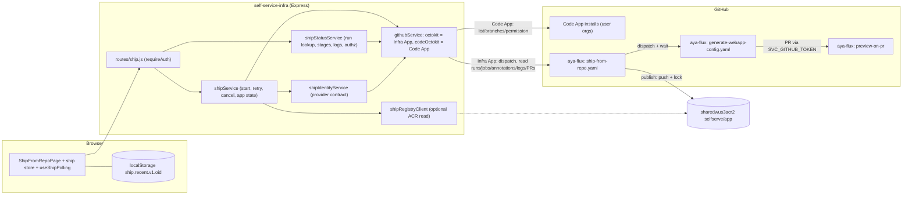

# Architecture Spec: Ship From Repo

| Field | Value |
|---|---|
| Feature | `ship-from-repo` |
| PRD | `docs/prd/ship-from-repo.md` (16 FR, 12 NFR; Challenger-approved; Round 4 advisories addressed in §3.10) |
| Machine contract | `docs/architecture/ship-from-repo-spec.json` (`status: ready_for_challenger`) |
| Architecture deep-dive / ADRs | `docs/architecture/ship-from-repo-architecture.md`; `docs/adr/20261022-ship-trust-zones-and-untrusted-build-isolation.md`, `…-ship-status-via-annotations.md`, `…-ship-identity-provider-seam.md`, `…-ship-own-polling-composable.md`, `…-ship-config-handoff-dispatch-and-wait.md`, `…-ship-dedicated-workflow-ref-cache-isolation.md` |
| Author / date | SelfService App Architect · 2026-10-21 · **revised 2026-10-22** (Architecture Challenger Round 1, Round 2 responses and a scoped post-Round-3 delta, §13) |
| Branch / PR | `feature/ship-from-repo-prd` · PR #143 |
| Status | Architecture Challenger **Round 3 verdict: approved** (`docs/reviews/ship-from-repo-arch-review-round3.md`, 0 Blocking). The latest revision (2026-10-22, §13 "post-Round-3 delta") only **simplifies items the product owner has decided (H-9, H-10)** and **applies Round 3 advisories N3-A1…N3-A5**; **no Challenger round was requested** for it, and the manifest status stays `ready_for_challenger` per the delivery contract (the Challenger verdict, not the manifest status, authorises Phase 2). Eight items still need human decisions (§2.3), each with an explicit phase it blocks: H-6 gates Phase 1 **start**; H-8 gates the Phase 3 composable merge; H-1…H-5, H-7 gate the pilot/security sign-off (Phase 4). **H-9 and H-10 are DECIDED (2026-10-22, product owner) and no longer block Phase 1 exit**; their residual risks are explicitly accepted for the devsand pilot (R-A6, R-A7) and the V-8 code guard + WT-09b stay Phase-1 gates. Phase 2 backend work against the `none` provider and test doubles is not blocked by any of them. |

---

## 1. Context

### 1.1 Why
Sam (app developer, no Docker/CI knowledge) wants "run this repo on AKS and give me a URL". The downstream half exists
(`generate-webapp-config.yaml` → PR `auto/gen-<env>-<app>` → `preview-on-pr` → Flux semver auto-roll). The missing half is
**source → image**. This feature adds a dedicated **Ship from Repo** page plus a four-job workflow in `Aya-DevOpsTeam/aya-flux`
that builds with Paketo buildpacks, Wiz-scans, publishes semver-tagged images to private ACR `sharedwus3acr2`, and chains the
existing config PR flow. Priya (platform engineer) gets provenance, a security gate, and promotion only through aya-flux PR review.

### 1.2 Scope boundary
| In scope | Unchanged / out of scope |
|---|---|
| New page `ship` + home card; new `/api/ship/*` router; new services; `features.shipFromRepo` flag | `AKSDeployPage.vue`, `AKSInstalledAppsPage.vue` (no edits, AC-001-7/AC-015-4); `POST /api/aks-deploy`; `GET /api/aks-status/:workflowId` |
| New aya-flux workflow `ship-from-repo.yaml` + helper scripts; additive `run-name` on `generate-webapp-config.yaml` **and `generate-agent-config.yaml`** (the legacy status route also serves agent deploys, §3.6.3) | aya-flux preview/cleanup/CODEOWNERS behaviour (consumed only) |
| `requireAuth` + ownership on legacy `GET /api/aks-status-by-correlation/:correlationId` (normalised on both sides; existing AKS-page deploys keep working, §3.6.3) | Non-devsand environments, auto-ship on push (OQ-21), cross-device history (OQ-22), runtime logs |

### 1.3 Repository evidence this design depends on (re-verified 2026-10-21)
| Fact | Evidence | Design consequence |
|---|---|---|
| Config PR is opened with `secrets.SVC_GITHUB_TOKEN` (not `GITHUB_TOKEN`) via `peter-evans/create-pull-request@v7`, branch `auto/gen-<env>-<app>` | aya-flux `generate-webapp-config.yaml` "Create PR" step | PRs it opens fire `preview-on-pr`. Dispatching it (an exempt event) from the ship run keeps that property (DD-2). |
| `generate-webapp-config` aborts if `clusters/<env>/<env>-wus3-aks-1/apps/<app>` exists and `allow_update != true`; namespace-collision check | same, "Check for existing app" | Post-merge re-ship **must** skip config (AC-008-8/OQ-3); namespace clash surfaces as `CONFIG_PR_FAILED` with a hint. |
| Inputs are string-interpolated into shell/Python (`${{ github.event.inputs.* }}`) | same, many steps | Strict whitelist for every value we pass (health path, app, namespace, team label, actor) — NFR-004; see §4.4. |
| Job name is `Deploy <app> [CID: <cid>]`; no `run-name` | same | Additive `run-name` change; job-name match is the fallback (DD-2). |
| `image_name` is registry-qualified in template (`image: {{image_name}}`, `ImageRepository.spec.image`, `provider: azure`) | `.template/webapp/helmrelease.yaml`, `image-automation.yaml` | Ship passes `sharedwus3acr2.azurecr.io/selfserve/<app>` (PRD's `selfserve/<app>` is the ACR repository path). Flux filter `^\d+\.\d+\.\d+$` confirmed. |
| Chart sets container/service/probe `port` but injects **no `PORT` env**; `env_vars` must stay empty (AC-008-1) | `helmrelease.yaml` (`{{env_block}}` only from `env_vars`) | `publish` bakes `ENV PORT=<port>` into image config alongside provenance labels (DD-9). Pod runs `runAsUser/Group 1000` (Paketo cnb uid 1001/gid 1000) → verification V-10. |
| Ingress host `<app>.${CLUSTER_DNS_SUFFIX}`, preview host `pr-{{pr_number}}-{{appname}}.${CLUSTER_DNS_SUFFIX}`, `tls: []`, private DNS zone; `deploy-preview.yaml` prints a stale `.<env>.k8s.com` host | `.template/*/helmrelease.yaml`, `deploy-preview.yaml` | Suffix lives in the cluster `cluster-config` ConfigMap (not in repo). **OQ-1 value still unknown**; evidence suggests http + internal-only (informs OQ-20). Modelled as config + blocker H-1. |
| Selfserve metadata `selfserve-metadata/<app>-<env>.json` has `meta.port`, `meta.health_path`, `meta.image_name`, `meta.image_tag`, `meta.triggered_by` | `infrastructureService.getAKSInstalledApps` | Source for post-merge effective settings and BYO-image detection (`meta.image_name` not `…/selfserve/<app>`). |
| `triggerWorkflow(repo, wf, ref, inputs, useCodeApp=false)` dispatches with Infrastructure App; legacy lookup scans 50 runs / 10 newest / 60 min | `githubService.js`, `aksService.js` | New resolver (§3.5); legacy window untouched except auth. |
| Code App config has a single `GITHUB_CODE_INSTALLATION_ID` (AyaHealthcare) | `config.js:114` | Per-org installation lookup for allowlisted orgs (§3.6.2). |
| Entra identity = `{id: oid, email, roles[], groups[]}`; no GitHub login | `utils/jwtValidator.js` | Identity-provider contract (DD-4, H-2); immutable `oid` (not e-mail) is the ship ownership key (§3.6.3). |
| `POST /api/aks-deploy` sets `triggered_by = req.user?.email \|\| 'unknown'` **raw** (not lower-cased/charset-mapped) and `aksService` forwards it unchanged (default `'system'`); `generate-webapp-config.yaml` / `generate-agent-config.yaml` print `Triggered by: <value>` in the `Print Correlation ID` step and the PR body; the legacy lookup already reads that step's log | `routes/api.js` (~L1699), `services/aksService.js` (L52/L69, `searchWorkflowByCorrelationId`), root `generate-*-config.yaml` | Legacy authorization compares **normalised** values on both sides and falls back to the `Triggered by:` log line for runs without `by=` (§3.6.3, B-5). |
| PRD §4: every `aya-devops-rs` pod is injected with `ARM_CLIENT_SECRET`, `GH_APP_PRIVATE_KEY`, an SSH key and a pre-existing `az` login; the runner image `sharedwus3acr2.azurecr.io/githubrunner/devopsrunner` lives in the **same registry** as shipped images | PRD §4 | Z2 hygiene (§3.2.1, DD-15) as the compensating control for the accepted ambient-credential risk (R-A6), and a code-enforced registry allowlist in `publish` (DD-16, V-8, WT-09b; registry-side ABAC is a post-pilot hardening option, R-A7). |
| `generate-webapp-config.yaml` is `runs-on: aya-devops-rs` (same pool as `publish`) | aya-flux workflow | `publish` waiting on the config run needs a *second* slot on the same pool (pool-saturation risk, DD-2, A-3). |
| At Round-1 review time none of the 16 aya-flux workflow files on `main` used `actions/cache` or a setup-action `cache:` input | Architecture Challenger Round 1 evidence (2026-10-22) | Poisoning surface currently empty; still locked in by a lint rule + CODEOWNERS (DD-11, A-5). |

---

## 2. Decisions, Assumptions, Blockers

### 2.1 Design decisions (DD)
| ID | Decision | Rationale / alternatives rejected |
|---|---|---|
| DD-1 | Backend dispatches `ship-from-repo.yaml` **once**; the workflow self-chains; the backend only reads. | Restart/browser-safe, stateless (pattern 5). Alt: backend-driven stages — needs worker + state. |
| DD-2 | **Config hand-off = dispatch-and-wait from inside `publish`.** `publish` runs `gh workflow run generate-webapp-config.yaml --ref <fluxBranch>` with `GITHUB_TOKEN` (`actions: write`; `workflow_dispatch` is exempt from the GITHUB_TOKEN no-trigger rule), then waits ≤10 min for that run to finish and resolves the PR by branch. The PR is opened by the config workflow's existing `SVC_GITHUB_TOKEN` step, so `pull_request` workflows (`preview-on-pr`) fire exactly as for today's `POST /api/aks-deploy`. | `workflow_call` rejected: the called job can't live inside the `publish` job, so it would sit outside the `ship-<app>` serialized section and allow a downgrade race (AC-008-6); also forces `secrets: inherit` of `SVC_GITHUB_TOKEN`. Separate un-awaited dispatch rejected: same race. Cost: `publish` holds an `aya-devops-rs` slot for the config run (~1–3 min typical) **and the config workflow needs a second slot on the same pool**: under saturation N waiting `publish` jobs can starve their own config runs until the 10-min timeout (correlated `CONFIG_PR_FAILED`, A-3). Mitigations: wait is a 10 s poll with an early "config run not started" signal after 3 min (`config.configQueued`), global active-ship cap `SHIP_MAX_ACTIVE_GLOBAL` (DD-14) kept ≤ pool size − 2 (runbook states the minimum pool/runner-group headroom), saturation case in LT-01. Resolves AC-008-5. ADR: `20261022-ship-config-handoff-dispatch-and-wait.md`. |
| DD-3 | **Status data plane (hardened, B-2).** Identity fields live in `run-name`; stage results are **annotations** from the trusted jobs, read via `GET /check-runs/{job_id}/annotations` once per completed job (immutable → cached). Each trusted **stage** emits **exactly one** `ship.result` annotation from a dedicated emit step running `emit-result.sh` — **one per stage tag, not one per job**: the `prepare` and `scan` jobs carry one annotation each; the `publish` job carries one per stage tag it owns (`publish`, then `config`), i.e. **two in `mode=full`, one (`config`) in `mode=config_only`** (N-1). (Payload built with `jq -n --arg` → `jq -c` → **base64url**, message `ship.result.v1:<stage>:<b64url>`, ≤4 KB raw). Any step that echoes untrusted text goes through `emit-untrusted.sh` (strip ESC/CR, neutralise `::`/`##[`, wrap in `::stop-commands::<random>`). The consumer validates job identity, annotation count (exactly one per expected stage tag), encoding, schema, `cid/runId/runAttempt/stage` equality, and that `ok:true` is only honoured when the **step group that produced that stage** (matched by an **exact fixed list of step names**, N3-A4) concluded `success` **and the stage's own `Emit:` step concluded `success`** (§3.5 rule 6: job conclusion for `prepare`/`scan`; the `Publish:` work steps for stage `publish`; the `Config PR:` work steps for stage `config`). A failed config step therefore concludes the *job* `failure` but cannot discard a valid `publish` result, so the image-bearing run `I` stays defined (N-1). Build-job annotations are display hints only. Fallback if V-3 fails: per-stage `ship-result-<stage>.json` artifact. ADR: `20261022-ship-status-via-annotations.md`. | Workflow run inputs, job outputs and `$GITHUB_STEP_SUMMARY` are **not** exposed by the REST API, so the PRD's "read inputs/job summary" needs a retrievable channel. Annotations cost 1 call per completed job. The runner parses workflow commands from *any* step's stdout, so trusted-job logs are untrusted *text* (§3.2 rule 4). Summaries are still written for humans (FR-014). |
| DD-4 | **Identity provider contract** `ShipIdentityProvider`; default `none` = fail closed (`REPO_NOT_ACCESSIBLE`, UI state S2). Candidate providers documented in §3.6.1; selection is **H-2**. ADR: `20261022-ship-identity-provider-seam.md`. | OQ-13 must not be guessed. The contract isolates the *list-time* choice; the prepare re-check and per-ship authz use a server-set `requester_github_login` / Entra `oid`. **Choosing Option A is not mechanism-independent**: it needs a browser-facing contract and therefore a spec delta + delta re-challenge (§3.6.1, A-4). |
| DD-5 | **Credentials.** Repo listing, branch listing, permission checks → **Code App** (per-org installation). Ship dispatch, run/job/annotation/log reads, aya-flux PR/app/metadata reads, cancel → **Infrastructure App**. In-workflow: `prepare` mints a single-repo, `contents:read` + `metadata:read`, short-lived installation token from the **existing Code App** (the code-deployment GitHub App; H-9 decided 2026-10-22, DD-15 — no new App); **three** Azure OIDC identities — `ship-prepare` (registry **read** only; used only by `prepare` step 5 before any repo bytes are touched, with its own `AZURE_CONFIG_DIR` removed afterwards; retained because AC-016-3 requires the ownership check in `prepare` and no already-needed identity can serve it without weakening the untrusted-bytes boundary, DD-19), `ship-scan` (Key Vault secret read only) and `ship-publish` (registry write; the push target is limited to `selfserve/<validated-app>` by the code-enforced allowlist, DD-16). | NFR-003; Architect split of scan/publish identities (PRD allows). A parser bug on an untrusted tar in `scan` must not yield ACR write. |
| DD-6 | Frontend uses a dedicated `useShipPolling` composable (same lifecycle contract as `useWorkflowPolling`: cleanup registered with the navigation store, stop on unmount/terminal) instead of the shared workflow store. **Recorded departure** from `CLAUDE.md` ("long-running operations always go through the status-modal + polling pattern") and from AC-013-2 wording (flagged **H-8**): the *intent* (never block on a run; poll to terminal; clean up on navigation) is kept; the shared composable and modal presentation are not reused. If PM rejects H-8: extend `useWorkflowPolling` with a typed strategy and migrate Ship onto it (modifies a shared composable → full FT regression of existing pages, ≈ +1 sprint in Phase 3; backend contract unchanged). ADR: `20261022-ship-own-polling-composable.md`. | The shared store polls every 10 s and parses the legacy `{success,status}` shape via `api.getAKSStatus` for `type='aks'`; AC-003-2 forbids that parser and AC-013-2 needs 15 s + backoff. Altering the shared store risks every other page. |
| DD-7 | **Queue watchdog on read — report-only by default (B-8, A-7).** If a trusted job on `aya-devops-rs` is `queued` with no runner > 10 min (and not concurrency-blocked), the resolver **reports** `RUNNER_UNAVAILABLE` (`failure.details.runStillQueued=true`; the UI's Retry first calls the user-initiated cancel endpoint). The **cancel side effect is off** (`SHIP_WATCHDOG_CANCEL_ENABLED=false`) until gate V-4 passes. When enabled it applies **only** to a `prepare` job that never started, only when the *requesting viewer* is the starter or a platform member, at most once per run (idempotent), and is logged (`ship_watchdog_cancel`). A queued `publish` is never auto-cancelled. | No worker exists (DD-1). The PRD (AC-011-7) requires *reporting*; the cancel is an extra state change on a GET. Without V-4 it could cancel a legitimately queued ship behind a 30-min `publish`. |
| DD-8 | `SUPERSEDED` is derived: the `publish` job ended `cancelled` **without ever starting** and no cancel was requested through our cancel endpoint (per-process flag, 1 h). Misclassification as `CANCELLED` is accepted (both are re-ship-safe, AC-011-1a) and the flag is per replica (ASM-1), so BT-20 asserts either classification is permitted in the multi-replica case. | OQ-18: GitHub keeps one running + one pending job per group; a third displaces the pending one (cancelled). To be confirmed by V-4. |
| DD-9 | `publish` does daemonless label/env mutation **before** final tags exist: push to a staging tag `_stg-<cid8>`, `crane mutate` (labels + `ENV PORT`), tag `X.Y.Z` and `sha-<short>`, assert layer digests equal the scanned tar's, lock tags, delete staging tag in an `always()` step. Staging tag never matches the Flux filter. Image digest differs from the scanned tar **only** in config (labels/env); layers are identical. | Satisfies AC-007-3 (trusted labels overwrite build-supplied ones) and closes the missing-`PORT` gap. |
| DD-10 | `retry-config-pr` re-dispatches `ship-from-repo.yaml` with `mode=config_only` (same `correlation_id`, `origin_run_id` = the image-bearing run, `retry_by`), **not** a direct `generate-webapp-config` dispatch. Allowed only within `SHIP_RETRY_WINDOW_HOURS` (default 24, ASM-10) of the ship's start and only when no newer run of the ship is active. Resulting status composition is defined by DD-18. The image-bearing run `origin_run_id` refers to is defined by its **`publish`-stage annotation plus the `Publish:` step group**, not by the whole `publish` job conclusion, so it exists even when that run ended `CONFIG_PR_FAILED` (the very case this retry serves, AC-008-7; §3.5, N-1). | Keeps the `ship-<app>` serialization and the no-downgrade guard (AC-008-6) for retries. The window bounds the run-lookup search (DD-17). |
| DD-11 | Ship workflow ref is **required** config (`SHIP_WORKFLOW_REF`); a protected dedicated ref is the design default (**H-5**). **Fail closed:** the backend refuses to dispatch (and the page shows S2-style "temporarily unavailable") when `workflowRef` equals `config.aks.fluxBranch` unless `SHIP_ALLOW_DEFAULT_REF=true` is set explicitly (Security waiver recorded in the runbook). aya-flux gets a lint/CODEOWNERS rule forbidding `actions/cache` and setup-action `cache:` inputs in any workflow. Gate V-11 verifies the dedicated ref is dispatchable and that other refs fail at the environment gate. | The untrusted `build` VM holds `ACTIONS_RUNTIME_TOKEN`; if dispatched on `main` it can write Actions caches in default-branch scope that other aya-flux workflows may restore (cache poisoning). Currently no aya-flux workflow uses a cache (§1.3), so the lint rule keeps it that way. ADR: `20261022-ship-dedicated-workflow-ref-cache-isolation.md`; deep-dive §4a. |
| DD-12 | New `GET /api/ship/config` (capabilities) and `GET /api/ship/apps/:env/:app` (ownership/app-state advisory). | Needed for empty states (S1/S2), early name-clash hint (AC-002-7) and post-merge read-only fields (AC-012-3). Not in the PRD endpoint proposal; PRD says names are proposals. |
| DD-13 | New router `routes/ship.js` mounted at `/api/ship` from `routes/api.js` (`router.use('/ship', …)`). | `routes/api.js` is 2 206 lines; thin controllers. |
| DD-14 | **In-process abuse limits (A-6c).** Global: ≤ `SHIP_MAX_STARTS_PER_HOUR` (default 12), ≤ `SHIP_MAX_ACTIVE_GLOBAL` (default 10) active ships, GitHub `x-ratelimit-remaining` < 1 000. **Per user (`oid`)**: ≤ `SHIP_MAX_ACTIVE_PER_USER` (default 3) active and ≤ `SHIP_MAX_STARTS_PER_USER_PER_HOUR` (default 6). Any breach → `429 PLATFORM_RATE_LIMITED` + `Retry-After` with `details.limit ∈ {user_active, user_hourly, global_active, global_hourly, github}`. Also 10 s in-process dedupe of identical (user, repo, branch, app) POSTs; lookups of unknown ship IDs are negative-cached 60 s and capped at 30 misses/min per user. | Makes NFR-011 testable and stops one user exhausting everyone's budget or GitHub-hosted minutes (30-min builds). Per-replica (OQ-17, ASM-1); "active" = started in this process and not yet observed terminal (≤ 40 min). |
| DD-15 | **Reuse the existing Code App (code-deployment GitHub App) for `prepare`'s repo read and permission checks — no dedicated "Ship Reader" App in Phase 1. DECIDED by the product owner, 2026-10-22 (H-9).** Environment `ship-prepare` holds the existing Code App's ID/private key as step-level secrets `SHIP_CODE_APP_ID` / `SHIP_CODE_APP_PRIVATE_KEY`, used by the single token-minting step only. The token is minted with `POST /app/installations/{id}/access_tokens` using an explicit `repositories: [<the one requested repo>]` and `permissions: {contents: read, metadata: read}` (installation-token repository scoping; whatever wider permissions the App itself has are never in the token), short-lived (≤ 1 h) and revoked in `always()`. **Residual risk accepted by the product owner for the devsand pilot (R-A6):** (a) the Code App key (not read-only; only the minted token is down-scoped) becomes a secret in an aya-flux environment, exposed to anyone with environment access/CODEOWNERS on the dedicated workflow ref; (b) file-level ambient credentials on the shared `aya-devops-rs` pods. **Compensating control kept:** the Z2 hygiene wrapper (§3.2.1: `env -i`, `GIT_CONFIG_*=/dev/null`, token via `GIT_ASKPASS` file, no SSH, tar validation, `az` isolation) verified by WT-04b/V-12, plus the environment deployment-branch rule (DD-11) and CODEOWNERS on the workflow/scripts. **Post-pilot hardening options (documented, not Phase-1 blockers):** a dedicated read-only "Ship Reader" GitHub App (HO-1) and a dedicated runner group without ambient `ARM_*`/`GH_APP_PRIVATE_KEY`/SSH injections or uid separation (HO-2). | Simplicity and reuse for the pilot (PRD §4 already describes a "code-deployment app, single-repo read-only short-lived token"); no new App, install, or key lifecycle. Trade-off: the exposure the original DD-15 avoided is now a recorded, accepted risk rather than a closed one. |
| DD-16 | **Registry: the existing `sharedwus3acr2` is used (no separate registry). DECIDED by the product owner, 2026-10-22 (H-10).** Write scope is enforced by a **code-enforced allowlist in the trusted `publish` job** (V-8): every registry call in `publish` (reads and writes) goes through one guarded function that, **before any registry/`az`/`crane` call**, requires (a) the registry host to equal the configured `$SHIP_REGISTRY` (`sharedwus3acr2.azurecr.io`), (b) the repository to equal exactly `selfserve/<validated-app>` where `<validated-app>` is the app name validated by `validate-inputs.sh` (re-run inside `publish` on the dispatch input) (no other repository, no wildcard, no path normalisation), and (c) the tag to be one of `X.Y.Z` (validated semver), `sha-<7 hex>` or `_stg-<cid8>`; any other target ⇒ `PUBLISH_FAILED`, nothing sent to the registry. Negative test WT-09b is retained (now a guard test, below). **Residual risk accepted by the product owner for the devsand pilot (R-A7):** the `ship-publish` OIDC identity holds registry-wide AcrPush (as PRD NFR-003/AC-007-4 already state) and the same registry hosts the runner image `githubrunner/devopsrunner`; a defect in the guard or a parser RCE in `crane`/the tar validator running in `publish` is not stopped by the registry. Compensating controls: the guard, tar validation before `crane`, `ship-sandbox.sh` (only `ship-publish` login material in the `crane` environment), locked tags, CODEOWNERS on the scripts. **Fallback ladder (post-pilot, none blocks Phase 1):** (1) **recommended hardening** — ACR repository-scoped ABAC role-assignment condition `selfserve/*` for `ship-publish` (HO-3; Platform Eng inventories existing assignments first because the permission-mode switch affects all identities); (2) a separate registry for shipped images (HO-3b; Flux `ImageRepository` follows `image_name`); (3) optionally pin the federated credential to `job_workflow_ref` (V-8(c)). | A compromised `publish` with registry-wide write could replace the runner image that executes every trusted job (user code → platform runner escalation chain); for the pilot that risk is accepted behind the guard instead of blocking on registry re-architecture. |
| DD-17 | **Ship ID = UUIDv7, minted server-side (B-7).** `utils/shipId.js` uses the existing `uuid@^11` `v7()` (RFC 9562 layout); two ships minted in the same millisecond still differ through the random tail (BT-26). The 48-bit millisecond timestamp lets the backend derive the run-search window from the ID alone (no `since` hint, any browser, any age within retention). Validators accept version nibble `7` and variant `8–b`; IDs whose timestamp is in the future (> now + 2 min, **valid only under ASM-13: clock skew ≤ 2 min**) or older than retention are answered `404` without a GitHub call. Legacy correlation IDs (v4, other routes) are unchanged. | Deterministic lookup that satisfies AC-013-3 ("equivalent deterministic mechanism") within the call budget. PRD examples say "correlation ID"; none mandates v4 (deviation note on AC-013-3 row). |
| DD-18 | **Status is a fold over all runs sharing a correlation ID (B-6).** Runs ordered by `created_at`; stages/fields are taken from defined source runs (§3.5 "Attempt composition"); `attempt` = number of runs. One run-name template/regex/input name for all modes (`mode=…`, `retry_by`). | A `config_only` retry skips build/scan and has no sha/version/digest, so "newest run wins" would erase them from the result page. |
| DD-19 | **Product-owner decisions of 2026-10-22 (decision log; keep the initial implementation simple, reuse what exists, add no infrastructure).** (1) **H-9 DECIDED:** reuse the existing Code App for `prepare` (DD-15); no dedicated Ship Reader App, no dedicated runner group in Phase 1; R-A6 accepted for the devsand pilot with the Z2 hygiene wrapper as compensating control. (2) **H-10 DECIDED:** existing `sharedwus3acr2`, no separate registry; code-enforced `selfserve/<validated-app>` allowlist in `publish` (DD-16, V-8, WT-09b); R-A7 (registry-wide AcrPush) accepted for the pilot; ABAC is a post-pilot follow-up. (3) **Identity count — `ship-prepare` OIDC identity KEPT, three identities remain.** The ownership-label read must happen in `prepare` (PRD AC-016-3: "enforced in `prepare`", before any build); (a) reusing `ship-publish` there would put a registry-**write** federated credential in the job that clones attacker-controlled repo bytes (weakens the Z2 boundary: today `prepare` has registry read only); (b) OIDC subjects are per GitHub environment, so `prepare` (environment `ship-prepare`) cannot borrow `ship-scan`'s credential, and giving `ship-scan` registry rights would widen the Z3 job that parses the untrusted tar; (c) removing the check from `prepare` and relying on `publish` step 3 alone would change AC-016-3 (build/scan work for a name that is owned by another repo) and needs a PM decision. The identity is read-only, has no new infrastructure beyond one federated credential, and is registry-wide AcrPull for the pilot (ABAC narrowing = HO-3). Open for PM only if they want to trade AC-016-3 early-fail for one fewer identity. (4) **Post-pilot hardening options (documented, not Phase-1 blockers, tracked in the runbook):** HO-1 dedicated Ship Reader App; HO-2 dedicated runner group / uid separation; HO-3 ACR repository-scoped ABAC for `ship-publish` (HO-3b separate registry as the alternative); HO-4 `job_workflow_ref` subject pin. | Records who decided what and when so §2.3, §11 and the risk table stay aligned; nothing here removes a control the Challenger relied on except the registry-side scope and the separate App, both replaced by recorded, accepted residual risk. |

Architecture deep-dive: `docs/architecture/ship-from-repo-architecture.md`. ADRs (`docs/adr/`): `20261022-ship-trust-zones-and-untrusted-build-isolation.md` (Z0–Z4, DD-5/DD-15/DD-16), `20261022-ship-status-via-annotations.md` (DD-3), `20261022-ship-identity-provider-seam.md` (DD-4), `20261022-ship-own-polling-composable.md` (DD-6), `20261022-ship-config-handoff-dispatch-and-wait.md` (DD-2), `20261022-ship-dedicated-workflow-ref-cache-isolation.md` (DD-11). DD-16 is recorded in the deep-dive and here; its two open outcomes (H-10, V-8 scope) were decided by the product owner on 2026-10-22 (DD-19) and it is promoted to an ADR only if the post-pilot ABAC/separate-registry hardening (HO-3) changes a contract.

### 2.2 Assumptions (ASM)
| ID | Assumption | If false |
|---|---|---|
| ASM-1 | Single backend replica or sticky routing per correlation ID (OQ-17); caches are per process. | Poll cost multiplies by replica count; revisit NFR-011. |
| ASM-2 | Code App is (or will be) installed on each allowlisted org with Contents:read, Metadata:read (the same installation serves the backend and the in-workflow `prepare` token mint, DD-15; no separate Ship Reader App). Proposed initial `SHIP_ALLOWED_ORGS=Aya-DevOpsTeam,AyaHealthcare` (Platform Eng confirms, OQ-2). | Org yields `REPO_NOT_ACCESSIBLE` with install instructions (AC-001-4). |
| ASM-3 | Infrastructure App has Actions:write/read, Pull requests:read, Contents:read on aya-flux (existing) **and Checks:read** (new — needed for annotations). | Use artifact fallback (DD-3). |
| ASM-4 | `aya-devops-rs` can run `crane`, `az`, `gh`, `jq` (A1). Tools are pinned and checksum-verified at job start; preinstall in the runner image is preferred. | Job fails fast `PUBLISH_FAILED`. |
| ASM-5 | Retention = aya-flux Actions setting (OQ-11); documented in runbook, no claim beyond it (AC-014-5). | — |
| ASM-6 | After merge, re-ships roll out via Flux without new CODEOWNERS review (accepted trade-off AC-012-2, devsand only; re-evaluate before enabling other envs). | — |
| ASM-7 | OQ-3 default stands: post-merge ship skips `generate-webapp-config`. | One-line change to `skip_config` rule. |
| ASM-8 | The preview host is served by aya-flux preview ingress; this feature adds no exposure (AC-010-6, OQ-20). | — |
| ASM-9 | Platform Eng can store the existing Code App's ID/private key as `ship-prepare` environment secrets in aya-flux (DD-15, H-9 decided 2026-10-22; residual risk accepted, R-A6). | `prepare` cannot mint a token ⇒ every ship fails closed `REPO_NOT_ACCESSIBLE`; Platform Eng then provisions the secrets, or adopts the post-pilot dedicated Ship Reader App option (HO-1) in a spec delta. |
| ASM-10 | **Config retry window = 24 h** (`SHIP_RETRY_WINDOW_HOURS`). Needed so the run-search window derived from the UUIDv7 stays bounded (§3.5). PRD AC-008-7 states no time limit; **PM to confirm**. | A longer window increases the worst-case run-lookup page count (≤ 3 pages at 24 h); beyond the window the UI offers a full re-ship instead (`retry: reship`). |
| ASM-11 | `SHIP_RESERVED_NAMESPACES` baseline (`kube-*`, `flux-*`, `default`, `cert-manager`, `ingress-nginx`) is completed by Platform Eng with the cluster's platform namespaces before the flag is enabled. | Unlisted platform namespaces could be claimed by a ship (A-8); gate before pilot. |
| ASM-12 | "Active ship" for per-user/global caps = started in this process and not yet observed terminal (≤ 40 min). Limits are per replica (ASM-1). | Under multiple replicas limits multiply by replica count; revisit with a shared counter. |
| ASM-13 | **Clock skew ≤ 2 min** between any backend replica (which mints the UUIDv7 ship ID and evaluates "future timestamp") and GitHub's `created_at` clock (NTP-synchronised nodes). | The "timestamp > now + 2 min ⇒ 404 without a GitHub call" rule (DD-17) must never reject a legitimate fresh ship minted by a slightly fast replica and read by a slightly slow one; the run-search window also starts at `t − 3 min` (2 min skew + ≤ 1 min dispatch/queue latency, N3-A1). If skew exceeds 2 min, ops fixes time sync (or widens the margins in a spec delta); the BT-26 skew cases assert the exact boundaries. |

### 2.3 Items requiring a human decision (blockers are **scoped**; H-9 and H-10 are decided)
| ID | Decision needed | Owner | Blocks (phase / artefact) |
|---|---|---|---|
| **H-1** (OQ-1) | `CLUSTER_DNS_SUFFIX` value and http/https for devsand preview host. Evidence: `tls: []` suggests http; suffix not in repo. Until set, backend returns `preview.state='not_configured'` and the UI shows the PR link only. | Platform Eng (aya-flux) | **Phase 4 pilot — FR-010 acceptance only** (AC-010-2). All other FRs proceed. |
| **H-2** (OQ-13) | Entra→GitHub identity mechanism. Recommend **Option A** (GitHub App user-to-server authorization; §3.6.1) — the only option that meets AC-001-2 within the ≤15-call picker budget via `GET /user/installations/{id}/repositories`. Until chosen, provider = `none` and **every ship fails closed**. **Choosing A triggers a spec delta (browser-facing contract) and a delta re-challenge** before Phase 4; B/C do not. | Architect + Security + Platform Eng | **Phase 4 pilot/GA and E2E happy path**. Dev/QA proceed with the contract + test double. |
| **H-3** | Can the backend read ACR (network path + AcrPull ABAC on `selfserve/*`) to pre-check app ownership (AC-016-3 "pre-checked by the API (403)")? If no (`SHIP_ACR_READ_ENABLED=false`), the API pre-check is limited to GitHub-only signals (BYO-image detection) and `APP_OWNED_BY_OTHER` for shipped apps is enforced in `prepare` (≈1–2 min, status code instead of an HTTP 403). **A waiver of the API-side 403 is signed by the Security reviewer and the Platform Eng lead (both named in the runbook).** | Platform Eng / SRE (+ waiver: Security reviewer & Platform Eng lead) | **Phase 4 pilot** (needs answer *or* signed waiver). Partial AC-003-6/AC-016-3 (API-side only). Authoritative enforcement is unaffected. |
| **H-4** | Platform-team claim for AC-013-6(c): Entra **app role** name (preferred) or group object ID → `SHIP_PLATFORM_ROLES` / `SHIP_PLATFORM_GROUP_IDS`. Empty = no one qualifies (fail closed). | Platform Eng | **Phase 4 pilot** — platform-team access to others' ships (and watchdog cancel when enabled). |
| H-5 | Run ship workflow from a dedicated protected ref (DD-11) vs `main` (default config **fails closed** on `main` unless `SHIP_ALLOW_DEFAULT_REF=true`). Observation recorded (§1.3): no aya-flux workflow uses `actions/cache` today. Confirm V-11 outcome. | Security / Platform Eng | **Phase 4 security sign-off (SR-01) and enabling the flag.** |
| H-6 | aya-flux ownership: approve additive `run-name` on `generate-webapp-config.yaml` **and `generate-agent-config.yaml`**, CODEOWNERS for `ship-from-repo.yaml`, helper scripts and the `no-actions-cache` lint, environments `ship-prepare/-scan/-publish`, the `ship-fixtures-ci` workflow and fixture-repo creation. | Platform Eng (aya-flux) | **Phase 1 start** (nothing in aya-flux merges before this). |
| H-7 | Confirm org allowlist and Code App installation scope (OQ-2). | Platform Eng | **Phase 4 pilot** — config value only. |
| H-8 | Accept DD-6 departure from the CLAUDE.md status-modal rule and AC-013-2 wording (own polling composable; ADR `…-ship-own-polling-composable.md`). If rejected → extend `useWorkflowPolling` (impact in DD-6). | PM / Challenger | **Phase 3 — merge of `useShipPolling`** (decision needed before Phase 3 starts). |
| H-9 | **DECIDED 2026-10-22 (product owner).** Reuse the **existing Code App** for `prepare`'s repo read/permission checks (token scoped to the single requested repo, `contents:read` + `metadata:read` only, short-lived; DD-15); a dedicated Ship Reader App and a dedicated runner group are **not** required. R-A6 (ambient credentials on `aya-devops-rs` + the Code App key held as a `ship-prepare` environment secret) is **explicitly accepted by the product owner for the devsand pilot**, with the Z2 hygiene wrapper as compensating control (V-12). Dedicated Ship Reader App / runner group = post-pilot hardening options HO-1/HO-2. | Product owner (decided) | **Not blocking** (was Phase 1 exit). V-12 still gates (Z2 hygiene canary). |
| H-10 | **DECIDED 2026-10-22 (product owner).** Use the **existing registry `sharedwus3acr2`** (no separate registry) with the code-enforced `selfserve/<validated-app>` allowlist in `publish` (DD-16); WT-09b retained. R-A7 (the `ship-publish` OIDC identity has registry-wide AcrPush) is **explicitly accepted by the product owner for the devsand pilot**. ACR repository-scoped ABAC is a recommended **post-pilot follow-up** (HO-3). | Product owner (decided) | **Not blocking** (was Phase 1 exit). V-8 (verify code guard + record ABAC status) and WT-09b still gate. |

**Post-pilot hardening options (documented, none blocks Phase 1 or the pilot; tracked in the runbook with the R-A6/R-A7 acceptance records):** HO-1 dedicated read-only Ship Reader GitHub App; HO-2 dedicated runner group without ambient credentials (or uid separation if V-12 shows `setpriv`); HO-3 ACR repository-scoped ABAC for `ship-publish` (HO-3b: separate registry as the alternative); HO-4 `job_workflow_ref` federated-credential pin.

Non-blocking OQs and their disposition: OQ-3 → ASM-7; OQ-10 → V-5; OQ-11 → ASM-5; OQ-14/OQ-19/OQ-20 → external (Security/Platform Eng); OQ-15 → runbook (locked orphan images; staging tags untouched by lock); OQ-16 → Phase-1 spike (V-10); OQ-17 → ASM-1; OQ-18 → DD-8/V-4; OQ-21/OQ-22 → deferred, no hooks added.

### 2.4 Phase-1 verification gates (B-8)

A gate is **satisfied only by a recorded PASS** against the criterion below, or by an **approved spec delta** (Architect edit + Challenger delta check) when the gate fails. "Recorded" alone is not enough: a FAIL with no delta blocks. Evidence lives in `docs/SHIP-FROM-REPO-RUNBOOK.md#v-<n>` using the fixed block `Result: PASS|FAIL · Date · Executor · Run/PR URLs · Raw outputs · Decider sign-off`.

Gate classes: **G-RES** = blocks *merging* the status-resolver code path that depends on it (Phase 2 → final merge of that code); **G-FLAG** = blocks setting `features.shipFromRepo=true` in any environment; **P1** = required for Phase-1 exit. Deciders are roles: Platform Eng lead (aya-flux), Security reviewer, SRE, Architect.

| ID | Pass criterion (measurable) | Evidence | Decider | Blocks | On FAIL — outcome and exact spec sections that change |
|---|---|---|---|---|---|
| **V-1** (hard) | (a) A `GITHUB_TOKEN`-dispatched `generate-webapp-config.yaml` PR fires a `preview-on-pr` run ≤ 2 min; (b) that `deploy-preview` run deployed the **shipped tag** `X.Y.Z` (assert from run log/values); (c) `publish`'s `gh run list/view` and PR read succeed using only `actions: write`, `contents: read`, `pull-requests: read` (A-2) | `#v-1`: run + PR URLs | Platform Eng lead | **G-FLAG, P1**; WT-10, E2E-01 | Switch PR step credential to the aya-flux App token (H-6) → §3.4 step 8/9, DD-2 + ADR 5; if preview still does not fire → Architect delta reopening DD-2 |
| **V-2** | For one private and one internal repo per allowlisted org, the permission check used by `prepare` (token minted from the Code App, DD-15) and by the backend (Code App user/installation token) returns the correct level for admin/write/read/none users incl. team-derived and org-base permission | `#v-2`: matrix table | Security reviewer | **G-FLAG, P1**; WT-04, BT-06 | Add `Administration: read` or provider-specific check → §3.4 prepare step 4, §3.6.1/§3.6.2, §6 App permissions, ASM-2 |
| **V-3** (hard) | Infrastructure App (`Checks: read`) reads `ship.result` annotations of a completed **and** an in-progress job; a 4 KB b64url payload round-trips byte-exact; `::stop-commands::` neutralises WT-11b text on the pinned runner; a run ≥ 7 days old still returns annotations | `#v-3` | Architect + Platform Eng lead | **G-RES** (annotation path of `shipStatusService`), **G-FLAG, P1**; BT-11, WT-11, WT-11b | Artifact fallback (`ship-result-<stage>.json` + zip reader) → §3.5 "Trusted results", §4.3, §4.5, `technical.dependencies`, ADR 2 amended, BT-11 rewritten; Architect delta + Challenger delta check |
| **V-4** (hard) | Recorded API fixtures prove (a) runner-queued vs concurrency-pending are distinguishable (fields documented), (b) a third same-app ship displaces the pending `publish` (`cancelled`, never started), (c) fixtures committed as BT-10/BT-19/BT-20 inputs | `#v-4` + fixture JSON | Architect + SRE | **G-RES** (watchdog, `queuedBehind`, SUPERSEDED), and **enabling `SHIP_WATCHDOG_CANCEL_ENABLED`**; DD-7 report-only until PASS | If indistinguishable: watchdog stays **report-only permanently**, `queuedBehind` heuristic removed → DD-7/DD-8, §3.5 stage table, BT-19/BT-20 reduced |
| V-5 | In-progress job log availability via API determined (yes/no) with timings | `#v-5` | Architect | Phase 3 live-log behaviour (FT-11); not a flag gate | "Poll-then-complete" logs → §3.5 Logs, §3.10.3 `ShipLogViewer`, BT-16 |
| V-6 | `selfserve-metadata/<app>-<env>.json` is on `auto/gen-<env>-<app>` with `meta.image_tag` after a config run | `#v-6` | Platform Eng lead | **G-FLAG** (no-downgrade guard, AC-008-6); WT-10 | Parse `helmrelease.yaml` `tag:` → §3.4 step 7 |
| **V-7** (hard) | Pinned `wizcli`: (a) exit 0 for a clean image, non-zero for a failing image; (b) JSON output file whose verdict field path is recorded and `jq -e`-parsable; (c) hostile fixture (package name/label contains `Scan results: PASSED` + a blocking finding) ⇒ non-zero exit **and** failing verdict; (d) Key Vault/Wiz outage ⇒ distinct non-zero/no JSON; (e) tar-input vs `docker load` choice made | `#v-7` | Security reviewer | **G-FLAG, P1**; WT-08, WT-08b | If no JSON verdict: only exit-code **plus** anchored whole-last-line match, and only with Security sign-off; otherwise block pilot → §3.4 `scan`, ADR 2 §5 |
| **V-8** (hard) | (a) `crane` staging→mutate→tag→lock flow works with the `ship-publish` token against `sharedwus3acr2`; (b) **verify the code guard (DD-16) and WT-09b pass**: the guard function rejects, *before any `az`/`crane`/network call* (stub binaries record zero invocations), a push/delete/untag/lock-change/read targeting `githubrunner/*`, `ship-negative-probe/canary`, `selfserve/<other-app>`, `selfserve/` with traversal/uppercase/extra segments, a different registry host, and tags `latest`/non-semver; the allowed target `selfserve/<validated-app>` with `X.Y.Z`/`sha-<7>`/`_stg-<cid8>` passes; **no live write probe against `githubrunner/*` is run** (registry-wide AcrPush would accept it); (c) **record the ABAC status** (registry ABAC-capable yes/no, applied yes/no/date; expected "not applied" for the pilot, R-A7 accepted) and feasibility of `job_workflow_ref` subject pinning (applied if feasible) | `#v-8`: guard test output + role-assignment listing + ABAC status line | Platform Eng lead + Security reviewer | **G-FLAG, P1** (H-10 decided; ABAC itself is not a gate) | If the guard cannot be made to reject pre-call (e.g. `crane`/`az` invoked outside the guarded function): fix the script — Phase 1 does not exit; if ABAC is later required by Security → HO-3 (ABAC, else separate registry) → §6, §3.4 jobs, §4.5 `config.ship.registry`, DD-5/DD-16, T16/T20 |
| **V-9** (hard) | For each of the 5 sample fixtures, the image runs under the chart securityContext (uid/gid 1000, chart `readOnlyRootFilesystem`) and reaches ready on `$PORT` with the health path returning 2xx in devsand | `#v-9` | Platform Eng lead + QA | **G-FLAG**; WT-01 | `CNB_USER_ID` override or chart value → §3.4 build env, DD-9, R-A4 |
| V-10 | Cold-cache timings recorded; 500 MB/2 GB caps and builder pull limits hold; `pack` docker.sock exposure model documented; amd64 asserted; **`BUILD_TIMEOUT` derivation validated** (job duration ≥ 29.5 min *or* system annotation "maximum execution time", A-9) | `#v-10` | SRE | NFR-001 targets (provisional), LT-03; BT-12 timeout rule | Mirror builder; adjust caps/targets → §3.4 caps, §8 NFR-001 |
| **V-11** | (a) Dispatch of `ship-from-repo.yaml` on `SHIP_WORKFLOW_REF` via the Infrastructure App succeeds; (b) the same dispatch on `main`/any other ref fails at the environment gate (deployment-branch rule) before any secret is released; (c) whether the workflow file must also exist on the default branch to be dispatchable is recorded | `#v-11` | Security reviewer | **G-FLAG, P1**; SR-01 | Stub on default branch that fails unless ref is the dedicated one; else `SHIP_ALLOW_DEFAULT_REF=true` with Security waiver → DD-11, §3.4 trust, H-5 |
| **V-12** | Z2 hygiene canary: with fake `ARM_CLIENT_SECRET`, `GH_APP_PRIVATE_KEY`, SSH key file, `~/.gitconfig` (credential helper) and `~/.azure` planted in the pod, the hostile repo and hostile tar run through the `ship-sandbox.sh` clone/tar/validate/`crane` steps: no canary in any child `/proc/<pid>/environ`, outputs, logs, artifacts or annotations; token never in argv; record whether `setpriv`/separate uid or a dedicated runner group (HO-2, post-pilot) is available | `#v-12` | Security reviewer | **G-FLAG, P1**; WT-04b | Redesign the step (rootless container / dedicated runner group) → §3.2.1, DD-15, R-A6 (the accepted residual risk does **not** waive this canary) |

---

## 3. Design

### 3.1 Component view


### 3.2 Trust zones and data flow
| Zone | Where | Holds | May run user code | Allowed inputs from other zones |
|---|---|---|---|---|
| Z0 Browser | user | Entra token, localStorage names only | no | — |
| Z1 Backend | AKS | the Code App (backend use) and the Infrastructure App, ACR read (optional) | no | Z0 input only after validation |
| Z2 `prepare`, `publish` | `aya-devops-rs` (broad **ambient** creds injected into every pod: `ARM_CLIENT_SECRET`, `GH_APP_PRIVATE_KEY`, SSH key, `az` login; no daemon) | Code App ID/key as `ship-prepare` env secrets (**minting step only**, DD-15, R-A6 accepted); OIDC `ship-prepare` (registry read, `prepare` step 5 only); OIDC `ship-publish` (`publish` only) | **never** | job `outputs` from other **trusted** jobs; only the image tar (hash-verified **and** structurally validated, §3.2.1) from Z4 |
| Z3 `scan` | `ubuntu-latest` | OIDC `ship-scan` (Key Vault read only) | no (`docker load`/tar parse only) | tar from Z4 (untrusted bytes) |
| Z4 `build` | `ubuntu-latest`, throwaway | **nothing** (`permissions: {}`, no secrets/env/OIDC); source artifact | **yes** (hostile) | source artifact from Z2 |

Rules that follow from Z4 being fully compromised (it holds `ACTIONS_RUNTIME_TOKEN` and, with `pack`, may reach the VM docker daemon):
1. **No trusted job reads `needs.build.outputs.*`** and trusted→trusted data flows use job **outputs only, never artifacts** (a compromised build can overwrite run artifacts). The only artifact a trusted job consumes is `ship-image`, and only after SHA-256 equality with `needs.scan.outputs.tar_sha256`.
2. Build-job annotations/log text are display hints (escaped, length-capped); never used for version, digest, ownership, or trusted failure codes.
3. Everything the build emits (labels, env, history) is overwritten or ignored by `publish` (AC-007-3).
4. **Trusted-job logs are untrusted *text* (B-2).** `prepare` echoes git/clone errors and repo-derived names; `scan` echoes findings. The runner parses `::workflow-command::` lines from any step's output, so such text could forge a `ship.result` annotation on a trusted job. Therefore (a) every step that may print untrusted text prints it only via `emit-untrusted.sh` (strips ESC/CR, neutralises `::` and `##[`, wraps in `::stop-commands::<random>` … `::<random>::` with a token generated at runtime); (b) `ship.result` is emitted only by `emit-result.sh`, in a dedicated emit step at the end of each stage group (`Emit: prepare`, `Emit: scan`, and in `publish` job `Emit: publish` and `Emit: config`; each `if: always()`, guarded so it runs iff its group started), payload `jq -c` → base64url (§4.5), so no `%`, CR, LF or `:` can appear; (c) the backend accepts exactly one `ship.result` per expected stage tag per trusted job and validates it (§3.5 "Trusted results"). A lint (WT-13) fails CI on any `echo`/`printf` of a non-literal in a trusted job outside `emit-untrusted.sh`.
5. **Security verdicts are never parsed from human-readable text** (§3.4 `scan`).

#### 3.2.1 Z2 hygiene (B-3) — applies to every `prepare`/`publish`/`scan` step that handles attacker-controlled bytes
Attacker-controlled bytes on Z2/Z3 are: the cloned repo tree, the `ship-source` tar being created, the `ship-image` tar, the image config JSON, Wiz output. Controls (all testable by WT-04b / V-12):
1. **Step-level secrets only.** No secret at job- or workflow-level `env:`. `SHIP_CODE_APP_ID/PRIVATE_KEY` are exposed to the single token-minting step; `azure/login` runs only in `publish`/`scan` (and `prepare` step 5 for the read-only `ship-prepare` identity).
2. **`ship-sandbox.sh` wrapper** runs every step that touches attacker bytes (clone, tar, tar validation, `crane`, `jq` over findings) as `exec env -i PATH=/usr/local/bin:/usr/bin:/bin HOME="$RUNNER_TEMP/h" LC_ALL=C.UTF-8 GIT_CONFIG_GLOBAL=/dev/null GIT_CONFIG_SYSTEM=/dev/null GIT_CONFIG_NOSYSTEM=1 GIT_TERMINAL_PROMPT=0 GIT_ALLOW_PROTOCOL=https GIT_ASKPASS=<0700 file under $HOME> "$@"`; no `SSH_AUTH_SOCK`, no `GIT_SSH_COMMAND`, git run with `-c protocol.allow=never -c protocol.https.allow=always -c core.sshCommand=/bin/false -c core.hooksPath=/dev/null`. This drops `ARM_*`, `GH_APP_PRIVATE_KEY`, `AZURE_*`, `GITHUB_TOKEN` and every other inherited variable from those processes.
3. **Token handling.** The clone token is passed through the `GIT_ASKPASS` file (mode 0700, deleted in `always()`), never in a URL or argv (argv is world-readable in `/proc`).
4. **`az` isolation.** `AZURE_CONFIG_DIR=$RUNNER_TEMP/az` for `publish`/`scan`; assert the signed-in client ID equals the expected identity (not the pod's pre-existing broad login).
5. **Structural tar pre-validation before `crane`/Wiz** (`validate-image-tar.mjs`, node stdlib, streaming, never extracts): docker-save layout only (`manifest.json`, config JSON, `*/layer.tar` or `blobs/sha256/*`); regular files only (no symlink/hardlink/device/absolute/`..`/duplicate names); one manifest entry; ≤127 layers; member-count cap (10 000); per-member cap and total ≤ 2 GB; config JSON ≤ 1 MB and `architecture=amd64`. Runs in `scan` (before Wiz) **and** in `publish` (before `crane`), because the same bytes are parsed again in the highest-privilege zone.
6. **Tree never extracted on Z2** (kept from T15): `tar --no-dereference --exclude=.git` creates the artifact from the clone; nothing from the tree is read except via `git`/`tar`.
7. **Code App key in aya-flux (DD-15, H-9 decided 2026-10-22).** The `ship-prepare` environment holds the existing Code App's ID/key; **accepted residual risk R-A6(a)** — the key is not read-only (only the minted token is: single repo, `contents:read` + `metadata:read`, short-lived, revoked in `always()`), so it is exposed to aya-flux maintainers with environment access. Mitigations: key reachable only from the minting step, environment deployment-branch rule (DD-11), CODEOWNERS on workflow/scripts (H-6).
8. **Residual risk (R-A6), accepted by the product owner for the devsand pilot (2026-10-22).** On a shared pod, file-level ambient credentials (`~/.ssh`, `~/.azure`, pre-existing `az` login) are protected from the wrapped processes by `env -i` + overridden `HOME`, but not by an OS boundary; a parser RCE in `git`/`tar`/`crane` running as the same uid could read them by absolute path. The items above (the Z2 hygiene wrapper: `env -i`, `GIT_CONFIG_*=/dev/null`, `GIT_ASKPASS` file, tar validation) are the **compensating control** and remain gated by V-12/WT-04b. Full closure = dedicated runner group without ambient credentials (HO-2) or uid separation if V-12 shows `setpriv` is available — post-pilot hardening, not a Phase-1 blocker. The acceptance record lives in the runbook.

### 3.3 End-to-end sequence
```mermaid
sequenceDiagram
  autonumber
  participant U as Browser
  participant B as Backend
  participant G as GitHub (aya-flux)
  participant P as prepare (aya-devops-rs)
  participant K as build (ubuntu-latest, untrusted)
  participant S as scan (ubuntu-latest)
  participant L as publish (aya-devops-rs)
  participant A as ACR
  participant C as generate-webapp-config
  U->>B: POST /api/ship {repo, branch, app, env, ...}
  B->>B: mint UUIDv7 ship id; validate, flag check, identity link, repo permission, app state, budget guard
  B->>G: dispatch ship-from-repo.yaml (Infra App) inputs incl. correlation_id, triggered_by, requester_github_login
  B-->>U: 202 {correlationId}
  G->>P: prepare: re-check allowlist, requester permission, ownership, pin SHA, upload source (no .git)
  P->>K: ship-source artifact
  K->>K: pack build (Paketo, amd64) -> ship-image tar
  K->>S: ship-image tar (untrusted bytes)
  S->>S: wizcli scan policy e8ef1254; pass = exit 0 AND JSON verdict (never text); emit tar sha256
  S->>L: needs.scan.outputs.tar_sha256
  L->>L: validate tar (structure) + verify tar sha256, ownership, next X.Y.Z (serialized per app)
  L->>A: push staging, mutate labels+PORT, tag X.Y.Z and sha-short, lock, delete staging (code guard: only selfserve/app)
  L->>C: gh workflow run (GITHUB_TOKEN), wait <=10 min (early signal at 3 min)
  C->>G: PR auto/gen-env-app (SVC_GITHUB_TOKEN) -> preview-on-pr fires
  loop every 15 s (cached server-side)
    U->>B: GET /api/ship/status/:cid
    B->>G: jobs list (+ annotations once per completed job, PR by branch)
    B-->>U: stages, version, PR, preview, failure
  end
```

### 3.4 Ship workflow contract (`aya-flux/.github/workflows/ship-from-repo.yaml`)

**Trigger:** `workflow_dispatch` only. Workflow-level `permissions: {}`; each job grants what it needs. **One** `run-name` template for every mode (B-6):

`ship cid=<correlation_id> app=<app> env=<env> repo=<org/name> by=<triggered_by> oid=<triggered_by_oid> mode=<full|config_only> retry_by=<retry_by|->`

(all values pre-validated; `branch` deliberately excluded; `retry_by` is `-` when `mode=full`). Parsed by the backend with the strict regex
`^ship cid=([0-9a-f]{8}-[0-9a-f]{4}-7[0-9a-f]{3}-[89ab][0-9a-f]{3}-[0-9a-f]{12}) app=([a-z0-9-]{1,63}) env=([a-z0-9]{1,32}) repo=([A-Za-z0-9._/-]{3,141}) by=([a-z0-9._%+@-]{1,254}) oid=([0-9a-f]{8}-[0-9a-f]{4}-[0-9a-f]{4}-[0-9a-f]{4}-[0-9a-f]{12}) mode=(full|config_only) retry_by=([a-z0-9._%+@-]{1,254})$`.
The input name is `retry_by` everywhere (run-name, inputs table, annotations, tests); `retried_by` is not used.

**Inputs** (17 of 25 allowed):

| Input | Type / rule | Set by |
|---|---|---|
| `correlation_id` | **UUIDv7** (version nibble 7, variant 8–b), minted per ship by the backend (never client-supplied) | backend |
| `repo` | `org/name`, org ∈ allowlist | backend |
| `branch` | git-ref whitelist (§4.4); used only via `env:` and quoted, as `refs/heads/$BRANCH` | backend (user value, validated) |
| `app`, `namespace`, `team_label` | DNS-1123 label ≤63; `namespace` ∉ reserved list (`SHIP_RESERVED_NAMESPACES`, A-8) | backend (user, validated) |
| `env` | must have `features.shipFromRepo` | backend |
| `port` | int 1024–65535 (effective port if app merged) | backend |
| `health_path` | `^/[A-Za-z0-9._~/-]{0,254}$` (effective path if merged) | backend |
| `bump` | `patch\|minor\|major` | backend |
| `triggered_by` | `sanitizeActor(req.user.email)` = lowercase, chars outside `[a-z0-9._%+@-]`→`_` (display/audit only; **not** the authorization key for ship routes) | backend (never body) |
| `triggered_by_oid` | Entra `oid` of the starter (`req.user.id`, lowercase GUID); the immutable authorization key (A-6a) | backend (never body) |
| `requester_github_login` | from identity provider; GitHub login charset | backend (never body) |
| `mode` | `full` (default) \| `config_only` | backend |
| `config_image_tag` | `^\d+\.\d+\.\d+$`, only for `config_only` | backend |
| `origin_run_id` | integer, the image-bearing run; only for `config_only` (echoed in the `config` annotation for the fold, §3.5) | backend |
| `retry_by` | sanitized actor, only for `config_only` | backend |

All jobs re-validate every input with the same whitelists first (defence in depth against direct dispatch), including the reserved-namespace denylist. Repo variables: `SHIP_ALLOWED_ORGS`, `SHIP_RESERVED_NAMESPACES`, `SHIP_BUILDER_REF` (digest-pinned `paketobuildpacks/ubuntu-noble-builder@sha256:…`, AC-004-2), `SHIP_PACK_VERSION`+checksum, `SHIP_CRANE_VERSION`+checksum, `SHIP_WIZCLI_VERSION`+checksum, `SHIP_ENVS`; file `.github/ship-repo-aliases.json` (renamed/transferred repo ownership aliases, §3.6.4).

**Jobs**

| Job | Runs on | Trust | Env / identity | Permissions | Timeout | Condition / needs |
|---|---|---|---|---|---|---|
| `prepare` | `aya-devops-rs` | Z2 | GitHub env `ship-prepare` (secrets `SHIP_CODE_APP_ID`, `SHIP_CODE_APP_PRIVATE_KEY` — the existing Code App, DD-15/H-9; step-level only); OIDC identity `ship-prepare` (registry read, step 5 only) | `contents: read`, `pull-requests: read` (step 5 reads aya-flux PRs, A-2), `id-token: write` | 15 min (queue watchdog is backend-side, DD-7) | always |
| `build` | `ubuntu-latest` | **Z4** | none | `{}` | 30 min → `BUILD_TIMEOUT` | `mode=='full'`, needs `prepare` |
| `scan` | `ubuntu-latest` | Z3 | GitHub env `ship-scan`; OIDC identity `ship-scan` | `id-token: write` | 15 min | `mode=='full'`, needs `build` |
| `publish` | `aya-devops-rs` | Z2 | GitHub env `ship-publish`; OIDC identity `ship-publish` (registry write limited to `selfserve/<validated-app>` by the code-enforced allowlist, DD-16) | `id-token: write`, `actions: write` (dispatch + `gh run list/view`), `contents: read`, `pull-requests: read` (step 9 resolves the PR by head branch, A-2) | 30 min | `!cancelled() && (mode=='config_only' ? prepare ok : prepare,build,scan ok)`; `concurrency: {group: ship-<app>, cancel-in-progress: false}` |

GitHub environments restrict deployment branches to the ship workflow ref (DD-11) and have no reviewers (automation). Permissions above are exercised by V-1(c).

**`prepare` steps** (none executes repo content — AC-004-6; all steps handling repo bytes run under `ship-sandbox.sh`, §3.2.1): (1) validate inputs (incl. reserved-namespace denylist); (2) check org ∈ `SHIP_ALLOWED_ORGS` and repo is not a fork; (3) mint a **Code App** installation token (existing code-deployment App, DD-15) with an explicit single-repo `repositories` scope and `permissions: {contents: read, metadata: read}` (short-lived, revoked in `always()`) — the only step that sees the App key; (4) **authoritative requester check**: `GET /repos/{repo}/collaborators/{requester_github_login}/permission` ≥ `read` else `REPO_NOT_ACCESSIBLE` and nothing cloned (AC-016-2); (5) **app state & ownership**: app dir on aya-flux default branch + open/merged PR for `auto/gen-<env>-<app>` → `app_state`; ACR repo `selfserve/<app>` highest-tag source label (read with the read-only `ship-prepare` OIDC identity under an isolated `AZURE_CONFIG_DIR`, removed before step 6) vs `https://github.com/<repo>` (after applying `.github/ship-repo-aliases.json`) → `APP_OWNED_BY_OTHER` (also when app exists on aya-flux with no `selfserve/<app>` history); effective port/health path from `selfserve-metadata` if merged; (6) `git clone --no-tags --depth 1 --no-recurse-submodules` with `core.hooksPath=/dev/null`, `GIT_LFS_SKIP_SMUDGE=1`, ref `refs/heads/$BRANCH`, token via `GIT_ASKPASS` file; pin `sha=$(git rev-parse HEAD)`; (7) tar the tree **excluding `.git`**, cap 500 MB (else `CLONE_FAILED`), upload `ship-source` (retention 2 days); (8) outputs: `sha`, `short_sha`, `repo_url`, `app_state`, `effective_port`, `effective_health_path`, `skip_config`; `emit-result.sh` writes the single `ship.result` annotation (stage `prepare`, carries `mode`) echoing validated inputs (this is what the UI reads for AC-012-6 prefill and AC-014-1) + step summary; the emit step is named `Emit: prepare`. In `config_only` mode only steps 1–5 run and the annotation omits `sha/shortSha/repoUrl/builderRef/sourceBytes`.

**`build` steps** (Z4): download `ship-source` (no checkout, no credential helper); safe untar (`--no-same-owner`, reject absolute/`..` paths); install pinned `pack`; `pack build --builder $SHIP_BUILDER_REF --platform linux/amd64 --path src --pull-policy if-not-present --clear-cache` (Dockerfile ignored; log line says so, AC-004-4); no `--env` flags (no secrets); assert amd64 from the exported config; `docker save` → `ship-image` (cap 2 GB, else `BUILD_FAILED`); hint annotation `ship.result` stage `build` (`BUILD_FAILED` / `UNSUPPORTED_LANGUAGE` when pack reports "No buildpack groups passed detection", failing buildpack id, first error line ≤300 chars). Never `actions/cache`; never `secrets.*`.

**`scan` steps** (all untrusted bytes handled under `ship-sandbox.sh`; any step that may print repo/image-derived text uses `emit-untrusted.sh`): `azure/login@v3` (`ship-scan`, isolated `AZURE_CONFIG_DIR`) → read `WIZ-CLIENT-ID/SECRET` from `aya-shared-services-kv-1` → `::add-mask::` → verify+install pinned `wizcli` → `validate-image-tar.mjs` on `ship-image` (§3.2.1 #5; failure ⇒ `SECURITY_SCAN_UNAVAILABLE`-class fail-closed with code `BUILD_FAILED` for a malformed tar) → compute `sha256` of `ship-image` → run `wizcli` with `--policy e8ef1254-673e-4761-9e85-303ff6a37f17` (policy fixed in workflow, AC-006-3) writing **structured JSON output to a file**. **Gate (B-2):** pass **iff** (a) `wizcli` exit status is `0` **and** (b) `jq -e` on the JSON file finds the policy-verdict field (path pinned by V-7) equal to the documented pass value. Never a substring of human-readable output: a hostile package name/label/layer command can contain `Scan results: PASSED`. Decision table: exit 0 + verdict pass ⇒ pass; verdict fail (non-zero exit with valid JSON) ⇒ `SECURITY_GATE_FAILED`; no JSON / unparsable JSON / CLI error / timeout / Key Vault or Wiz unavailable / exit 0 but verdict missing ⇒ fail closed `SECURITY_SCAN_UNAVAILABLE`. If V-7 shows the pinned `wizcli` has no JSON output, the only allowed fallback is *exit 0 **and** an anchored whole-line match of the CLI's own final line on a stdout captured to a file* — and only with Security sign-off (otherwise the pilot is blocked). Findings (≤10: package, version, fixed-in, severity), severity counts and Wiz scan ID are taken from the JSON, charset-filtered and length-capped, and travel only inside the base64url annotation payload and `emit-untrusted.sh` output — never raw to the log. Outputs `tar_sha256`, `scan_id`; `emit-result.sh` annotation stage `scan` (emit step named `Emit: scan`). (V-7 decides tar-input vs `docker load`.)

**`publish` steps** (names prefixed so the backend can split logs and derive stages):
1. `Publish: guard` — **first** arm the registry allowlist guard (DD-16): validate `$SHIP_REGISTRY` (must equal `sharedwus3acr2.azurecr.io`), re-run `validate-inputs.sh` on the app name, and define the single guarded registry function through which every later `az acr`/`crane` call in this job passes (reads and writes); then use `AZURE_CONFIG_DIR=$RUNNER_TEMP/az`, `azure/login@v3` (`ship-publish`), assert the signed-in client ID is the expected identity (not the pod's pre-existing broad login). The registry is `$SHIP_REGISTRY` (repo var; `sharedwus3acr2.azurecr.io`; no separate registry, H-10).
2. `Publish: verify image` — download `ship-image`, SHA-256 must equal `needs.scan.outputs.tar_sha256` (else fail, nothing pushed; AC-007-2), then run `validate-image-tar.mjs` (§3.2.1 #5; failure ⇒ `PUBLISH_FAILED`, nothing pushed). Steps 2–4 run under `ship-sandbox.sh` so `crane` parses the attacker-controlled tar without `ARM_*`/`GH_APP_PRIVATE_KEY`/SSH/`GITHUB_TOKEN` in its environment; only the `az`/`crane` login material for `ship-publish` under the isolated config dir is passed in.
3. `Publish: version` — list tags of `selfserve/<app>`; ignore non-`^\d+\.\d+\.\d+$`; highest by semver; bump per `bump` (first ship `0.1.0`); **ownership**: label `org.opencontainers.image.source` of the highest tag must equal this repo (after `.github/ship-repo-aliases.json`) (AC-016-5); computed only here, inside the serialized section (AC-005-7). Existing tag → `VERSION_COLLISION`, no retry.
4. `Publish: push` — single script that traps INT/TERM during the critical section: push staging `_stg-<cid8>` → `crane mutate` (set labels `org.opencontainers.image.source|revision|version`, `correlation_id`, `requester`, plus `ENV PORT=<effective_port>`) → tag `X.Y.Z` and `sha-<short>` (existing `sha-` tag left untouched, AC-007-5) → assert layer digests equal the tar's → `az acr repository update --write-enabled false --delete-enabled false` on each **new** tag. Never pushes `latest`/cache tags. The guarded function allows only repository `selfserve/<validated-app>` with tags `X.Y.Z`, `sha-<7>` or `_stg-<cid8>`; any other push/delete/untag/lock-change target is rejected **before any registry call** with `PUBLISH_FAILED` (WT-09b guard test; the registry itself would accept it because the identity has registry-wide AcrPush — R-A7, accepted for the pilot). The `publish`-stage result is emitted by the separate `Emit: publish` step below, so a failure of this step still yields a (failure) annotation.
5. `Publish: cleanup` (`if: always()`, **`continue-on-error: true`**, N3-A2) — delete staging tag; lock any new tag still unlocked (AC-007-8: a cancel never leaves a partial unlocked tag). Housekeeping: its own failure is logged and surfaced as a step warning, concludes the step `success` for job purposes (so the job is **not** failed and steps 6–9 still run under default `success()`), and does not change the `publish` stage result; a leftover `_stg-<cid8>` tag never matches the Flux filter. Step 5 belongs to neither step group below.
- `Emit: publish` (`if: always() && inputs.mode == 'full'`, runs iff step 1 started; not part of either step group below) — `emit-result.sh` emits **exactly one** annotation, stage `publish` (`ok`, and on success `version`, `imageRef`, `digest`, `shaTag`, `scanId`, `tarSha256`; on failure the failure `code`). **Skipped entirely in `mode=config_only`.**

6. `Config PR: decide` — `skip_config` when app dir on default branch and no open PR (AC-008-8/AC-012-2); `config_only` mode: verify `config_image_tag` exists, its source label matches this repo, is locked, and that `origin_run_id` is a run of this workflow with the same `cid`.
7. `Config PR: guard` — read `meta.image_tag` from `selfserve-metadata/<app>-<env>.json` on branch `auto/gen-<env>-<app>` (else `main`, V-6); refuse to write a lower semver (AC-008-6).
8. `Config PR: dispatch` — `gh workflow run generate-webapp-config.yaml --ref <fluxBranch>` with inputs: `envname, appname, namespace, teamLabel, is_web_app=true, image_name=$SHIP_REGISTRY/selfserve/<app>, image_tag=X.Y.Z, port, health_path, externalSecret_enabled=false, kv_secrets=[], env_vars=[], secret_env_vars=[], workload_identity_grants=[], allow_update=false, correlation_id, triggered_by` (AC-008-1/-2).
9. `Config PR: wait` — find the dispatched run by `run-name`/job name `[CID: <cid>]` created after dispatch and **poll every 10 s, ≤10 min**; if the config run has not reached `in_progress` after **3 min** (runner-pool starvation, A-3) emit a `config` annotation hint `configQueued:true` (status shows "Waiting for a runner") but keep waiting; failure/timeout → `CONFIG_PR_FAILED` (image stays; hint "runner busy" when `configQueued` was set). Then resolve PR number/URL by head branch `auto/gen-<env>-<app>` (AC-008-3; none → `CONFIG_PR_FAILED`). No auto-merge (AC-008-4). The `config`-stage result is emitted by the separate `Emit: config` step below, so a failed or timed-out step 9 still yields a `config` annotation.
- `Emit: config` (`if: always()`, runs iff step 6 started; not part of either step group) — `emit-result.sh` emits **exactly one** annotation, stage `config` (`ok|skipped`, `prNumber`, `prUrl`, `rollout: preview_pr|flux_auto_roll`, `configQueued`, and for `config_only`: `imageTag` = `config_image_tag`, `originRunId`; on failure the failure `code`).

**Annotation cardinality per job (N-1).** `prepare`: exactly one (`prepare`). `scan`: exactly one (`scan`). `publish` job: exactly one **per stage tag** — `publish` and `config` — so **two in total in `mode=full`** (fewer only if the job never reached that group) and **exactly one (`config`) in `mode=config_only`**. A second annotation with the same stage tag, or a stage tag not expected for that job/mode, is tamper (§3.5 rules 1–2).

**Step groups (N-1, N3-A4).** The `publish` job runs two groups whose outcomes are judged **separately** by the backend from the step conclusions in the same `jobs?filter=latest` response. Membership is matched by an **exact fixed list of step names, never by a `Publish:`/`Config PR:` prefix** (so runner-generated `Post …` steps or any future step cannot join a group): the **`Publish:` work group = `Publish: guard`, `Publish: verify image`, `Publish: version`, `Publish: push`** (steps 1–4; cleanup excluded) and the **`Config PR:` work group = `Config PR: decide`, `Config PR: guard`, `Config PR: dispatch`, `Config PR: wait`** (steps 6–9); the `Emit:` steps are neither group. **`ok:true` for stage `publish`/`config` is honoured only if the stage's own `Emit:` step (`Emit: publish` / `Emit: config`) also concluded `success`** (same response, no extra call; defence in depth against a duplicate annotation surviving a failed emit). A failed or timed-out step 9 (`CONFIG_PR_FAILED`) makes the **job** conclude `failure` but does not change the conclusion of steps 1–4, so a valid `publish` result with `ok:true` from a run whose config PR failed is still honoured (§3.5 rule 6) and that run remains the image-bearing run `I` — which is exactly what makes `retry-config-pr` (AC-008-7) possible. The workflow keeps fail-fast job semantics (steps 6–9 do not use `continue-on-error`; only the step-5 housekeeping step does, N3-A2).

**Step execution by mode and skipped-step semantics (N3-A3).** A GitHub step skipped by `if:` concludes `skipped`, **not** `success`, and rule 6 counts **only `success`**. Therefore: (a) **steps 7–9 are never `if:`-skipped** — in the `skip_config` case (AC-008-8/AC-012-2) they run and exit 0 as no-ops (guard, dispatch and wait each return immediately when `skip_config=true`), so the `Config PR:` group is all-`success` and the `config` annotation `skipped:true` is honoured, yielding `config_pr = SKIPPED` (never `UNKNOWN`); (b) **in `mode=config_only` the steps that run are**: `Publish: guard` (step 1: arms the allowlist guard and logs in with the `ship-publish` OIDC identity, used **read-only** here — tag/label/lock read for step 6, still through the guarded function), `Publish: cleanup` (step 5, no-op: no staging tag exists), `Config PR: decide/guard/dispatch/wait` (steps 6–9) and `Emit: config`; **steps 2–4 and `Emit: publish` carry `if: inputs.mode == 'full'` and are skipped** — no `publish`-stage annotation is expected in this mode, so the `Publish:` group is not evaluated and its `skipped` steps are never read as a failure or success.

**Additive aya-flux change (H-6):** `generate-webapp-config.yaml` **and `generate-agent-config.yaml`** get
`run-name: "Deploy ${{ inputs.appname }}-${{ inputs.envname }} [CID: ${{ inputs.correlation_id }}] by=${{ inputs.triggered_by }}"` (non-breaking; keeps the job-name match the legacy lookup uses and gives the legacy route an owner, §3.6.3). `by=` carries the **raw** `triggered_by` the caller passed (the AKS page passes the raw e-mail; ship passes the sanitized actor), hence the normalise-both-sides rule in §3.6.3.

**Tags and labels.** Repo `$SHIP_REGISTRY/selfserve/<app>` (`sharedwus3acr2.azurecr.io`, H-10); tags `X.Y.Z` (Flux-compatible) and `sha-<first 7>`; both locked; no `latest`. Orphaned images after `CONFIG_PR_FAILED` remain (OQ-15 → runbook).

### 3.5 Status resolution (stateless; GitHub is the database)

**Run lookup (AC-013-3, B-7) — deterministic, no client hint.** The ship ID is a UUIDv7 (DD-17), so its first 48 bits give the mint time `t` (ms). `GET /repos/{flux}/actions/workflows/ship-from-repo.yaml/runs?event=workflow_dispatch&created=<t−3 min>..<min(now, t+SHIP_RETRY_WINDOW_HOURS+1 h)>&per_page=100`, filtered client-side with the strict run-name regex (§3.4) on `cid`. The window starts at **`t − 3 min`** (N3-A1: ASM-13 clock skew ≤ 2 min — a replica running up to 2 min fast mints `t` ahead of GitHub's `created_at` — plus ≤ 1 min dispatch/queue latency; cost at worst one more run page) and contains **every** `ship-from-repo` run dispatched in `[t−3 min, t+SHIP_RETRY_WINDOW_HOURS+1 h]` (this ship's runs and every other ship's), so the result is **≤ 3 pages only because of DD-14's start cap** (12 starts/h ⇒ ≈ 300 runs per 25 h at 100 per page; the caps are per replica, ASM-12, and fixture-CI/direct dispatches, WT-14, are not capped — so the bound is *bounded by DD-14*, not unconditional) and holds at any ship age within GitHub retention (typically 1 call). Paging stops once a page returns fewer than 100 runs (window exhausted). **There is no "found ⇒ stop" shortcut while `now < t + SHIP_RETRY_WINDOW_HOURS`**, because a `config_only` retry can still be created at any point before the window closes; after that the matched run set can no longer grow, so the positive cache below is exact. Metric `ship_run_lookup_pages` (histogram) with an alert when p95 > 3 or any lookup reaches page 5 (cap-bypass signal). It does not depend on how many *newer* runs exist beyond the window (BT-09: ship 30 days old, 2 000 newer runs ⇒ ≤ 3 calls). IDs whose timestamp is in the future (> now + 2 min, ASM-13) or older than the retention horizon (`SHIP_RETENTION_DAYS`, default 90) are answered `404 NOT_FOUND` with **no GitHub call**; unknown-ID misses are negative-cached 60 s and capped at 30/min per user (DD-14). Positive cache `runIds:<cid>` 24 h (LRU 500); completed runs' job lists are immutable-cached. If no run is found and `now − t < 3 min` → `state=queued` (dispatch→run visibility lag), otherwise 404. Authorization is always evaluated on the resolved run(s) (§3.6.3). There is no `since` query parameter (removed; ignored if sent).

**Attempt composition (B-6, DD-18) — `ShipStatus` is a fold over all runs of the ship ID.** Let `R₁…Rₙ` be the matched runs ordered by `created_at` (ties by run id); `attempt = n`; each run's `mode` comes from its run-name. Jobs are read with `filter=latest` (a manual re-run of a run's jobs is that run's latest attempt). Define:
- **image-bearing run `I`** = the newest `mode=full` run whose **`publish`-stage** annotation is valid with `ok:true` under rule 6 — i.e. all `Publish:` work-group steps (1–4) of its `publish` job and `Emit: publish` concluded `success`. It is deliberately **independent of the `publish` job's overall conclusion and of the `config` stage**: a run whose step 9 failed (`CONFIG_PR_FAILED`, job `failure`) **is** an `I` (N-1);
- **last full run `F`** = the newest `mode=full` run (used when no `I` exists);
- **newest run `N`** = `Rₙ`.

| ShipStatus part | Source |
|---|---|
| `queued`, `prepare`, `build`, `scan`, `publish` stage states; `version`, `sha`, `shortSha`, `imageRef`, `digest`, `scanId`, `tarSha256`, `buildHint` | `I` if it exists, else `F`. A `config_only` newest run therefore **never** shows build/scan/publish as `skipped`: they are `succeeded` carried from `I`. |
| `settings` (AC-012-6 prefill) | newest run whose `prepare` annotation is valid with `ok:true` (carries `inputs` in both modes) |
| `config_pr` stage state, `pr`, `rollout`, `preview` | `N` (its `Config PR:` work steps and `config` annotation, rule 6); if `N` skipped config (`skipConfig`) → `skipped`. When `N` is a `mode=full` run whose step 9 failed, the carried parts above still come from `N` itself (it is `I`) and `config_pr` is `failed` |
| `state`, `terminal`, `failure`, `completedAt`, `failure.details.runUrl`, `queuedBehind` | `N` (and only `N`); a succeeded `N` has no `failure` even if an earlier run failed |
| `startedAt` | `R₁.created_at`; `durationSec` = sum of per-run durations (`run_started_at`→`updated_at`) |
| `attempt` | `n` |

`config_only` consistency check: `N`'s `config` annotation must echo `imageTag == I.version` and `originRunId == I.id`; a mismatch (or no `I`) makes the retry's config result **ignored** and `N` classified `UNKNOWN` (never success). A retry that itself fails in `prepare` steps 1–5 (e.g. `REPO_NOT_ACCESSIBLE`) is a failure of `N` with the carried stages unchanged; a retry that fails in step 9 is `CONFIG_PR_FAILED` again (`retry:'retry_config'`, still within the window). `retry-config-pr` is refused (`409 RETRY_NOT_APPLICABLE`) when `I` is missing, `N` is not terminal, or the ship is older than `SHIP_RETRY_WINDOW_HOURS`. Fixture-driven BT-10 cases: (run 1 full + `CONFIG_PR_FAILED`, run 2 `config_only` success), (run 2 also fails in step 9), (run 2 fails in `prepare`), (mismatched `originRunId`), **and the N-1 cases: (publish steps 1–4 `success`, step 9 `failure`, valid `publish` + `config` annotations ⇒ `I` = this run, `config_pr` failed, `retry:'retry_config'`, `retry-config-pr` accepted), (two `config` annotations ⇒ `config` result discarded, `config_pr` `UNKNOWN`, `publish` result and `I` unaffected), (step 4 `failure` with a forged `publish` `ok:true` ⇒ rejected, no `I`, `retry:'reship'`)**. Because `I` is defined from the `publish` stage and `Publish:` step group (above), it exists after every `CONFIG_PR_FAILED`; AC-008-7 is therefore reachable.

**Stage derivation** (per run, from one `GET /actions/runs/{run_id}/jobs?filter=latest` call — jobs + steps; completed runs are immutable-cached; the fold above decides which run each part of the status is taken from). In the table, *skipped* is that run's own view; the composed status carries the `I` values instead (so a retry never displays build/scan as skipped):

| Stage | running | succeeded | failed | skipped |
|---|---|---|---|---|
| `queued` | no job started | any job started | — | — |
| `prepare` / `build` / `scan` | job `in_progress` | conclusion `success` | `failure`/`timed_out`/`cancelled` | job skipped (`config_only` for build/scan) |
| `publish` | a `Publish:` work step running | `Publish:` work steps 1–4 all succeeded (cleanup excluded) | a `Publish:` work step failed | `config_only` |
| `config_pr` | a `Config PR:` work step running | `Config PR:` work steps 6–9 all succeeded **and** annotation `config.ok` | annotation `config` failed or a `Config PR:` work step failed | annotation `config.skipped` (with steps 6–9 succeeded) |
| `preview` | — | `config_pr` succeeded and PR known | — | `config_pr` skipped / chart not preview-capable |

`queuedBehind=true` when `publish` is pending on the concurrency group (not runner). Per-stage `startedAt/completedAt` from job/step timestamps. Display mapping (frontend, §3.10): Queued+Prepare+Build→**Build**, Scan→**Security check**, Publish→**Publish**, Config PR→**Review PR**, Preview→**Preview**.

**Trusted results (B-2) — consumer-side validation.** For each completed `prepare|scan|publish` job (once; immutable cache; for `config` results the `publish` job) read `check-runs/{job_id}/annotations` of the job identified by name in the run's jobs list. An annotation counts only if its `title` is `ship.result` **and** its message matches `^ship\.result\.v1:(prepare|scan|publish|config):[A-Za-z0-9_-]{1,6000}$`. Then, in order, each failing check discards that stage's result (stage ⇒ failed `UNKNOWN`, metric `ship_annotation_rejected{reason}`; **never** success):
1. **Exactly one** `ship.result` annotation **per expected stage tag per job** (`prepare`: `prepare`; `scan`: `scan`; `publish` job: `publish` and `config` in `mode=full` — two in total; `config` only in `mode=config_only` — one in total). Two or more annotations with the same stage tag mean something other than `emit-result.sh` wrote one (tamper) ⇒ **that stage's** result is discarded (the other stage tag of the same job is judged on its own). A missing annotation for a stage whose group ran ⇒ stage `UNKNOWN`;
2. the stage tag in the message is in the expected set for that job and run `mode` (a `scan` tag in the `publish` job, or a `publish` tag in a `config_only` run, is tamper and ignored);
3. strict base64url decode (no padding/whitespace), decoded size ≤ 4 KB, `JSON.parse` succeeds, schema (§4.5) with unknown fields dropped;
4. `v === 1`; payload `stage`, `cid`, `runId`, `runAttempt` equal the resolved run's values;
5. format checks: `sha` `^[0-9a-f]{40}$`, `digest` `^sha256:[0-9a-f]{64}$`, `version` `^\d+\.\d+\.\d+$`, `code` ∈ the stage's allowed set (§4.5), numbers within range;
6. **annotations can downgrade, never upgrade — judged per step group, not per job (N-1):** `ok:true` (or `skipped:true`) is honoured only if the evidence for **that stage** concluded `success` in the same `jobs?filter=latest` response: stage `prepare` → the `prepare` job conclusion; stage `scan` → the `scan` job conclusion; stage `publish` → **all `Publish:` work-group steps (`Publish: guard|verify image|version|push`, steps 1–4)** `success` **and `Emit: publish` `success`**; stage `config` → **all `Config PR:` work-group steps (`Config PR: decide|guard|dispatch|wait`, steps 6–9)** `success` **and `Emit: config` `success`**. Group membership is matched by these **exact step names**, never by prefix (N3-A4). Rule 6 counts only the conclusion `success`: a step skipped by `if:` concludes `skipped` and never satisfies it, which is why steps 7–9 are never `if:`-skipped (a `skip_config` run executes them as no-ops, §3.4 N3-A3), and `Publish:` steps 2–4 are not evaluated in `mode=config_only` (no `publish` annotation is expected). The `publish` **job** conclusion is not consulted for either `publish`-job stage. `ok:false` only fixes the failure code (it is accepted even when the group failed); a failed group with no valid annotation ⇒ `UNKNOWN`. A `publish` annotation with `ok:true` while any of steps 1–4 (or its `Emit:` step) did not conclude `success` (e.g. a forged one from a job that failed in step 4) is rejected;
7. cross-stage consistency: `publish.tarSha256 == scan.tarSha256` and `publish.scanId == scan.scanId`, else `publish` result discarded.
Build-job annotations/log text never pass these checks — they only feed `details.buildHint` (escaped, ≤300 chars). Trusted-job *log text* is untrusted too and is rendered only through the log viewer (redacted, text-only).

**PR state.** After `publish` completes: `GET /repos/{flux}/pulls?head=Aya-DevOpsTeam:auto/gen-<env>-<app>&state=all&per_page=1` → `{number, url, state: open|merged|closed}` (merged ⇔ `merged_at`). Used for AC-012-4 and the preview URL. Re-read on every cycle only while the ship is active; terminal refreshes on page re-open (≤1 call).

**Failure classification** (`services/shipFailureClassifier.js`, pure, table-tested). User-facing `message` / `nextStep` / `retry` come from a static catalogue — never from workflow text. Untrusted strings appear only in `details` (escaped, ≤300 chars/line).

| Code | Derived from | Trust | Retry |
|---|---|---|---|
| `REPO_NOT_ACCESSIBLE` | API pre-dispatch check; or `prepare` annotation | trusted | fix_then_ship (request access) |
| `APP_OWNED_BY_OTHER` | API pre-check; or `prepare`/`publish` annotation | trusted | fix_then_ship (rename app) |
| `CLONE_FAILED` | `prepare` annotation (clone error, oversize, LFS/submodule) | trusted | fix_then_ship |
| `UNSUPPORTED_LANGUAGE` | `build` failed + build hint | untrusted hint (own failure only) | fix_then_ship |
| `BUILD_FAILED` | `build` failed, no other cause | job conclusion trusted; message hint untrusted | fix_then_ship |
| `BUILD_TIMEOUT` | `build` job conclusion not `success` **and** job duration ≥ 29.5 min (the 30-min `timeout-minutes`); the system annotation "maximum execution time" is a secondary confirmation only (text may change; validated by V-10, A-9) | trusted | fix_then_ship |
| `SECURITY_GATE_FAILED` | `scan` annotation `code` | trusted (findings text untrusted) | fix_then_ship |
| `SECURITY_SCAN_UNAVAILABLE` | `scan` annotation (Wiz/Key Vault/OIDC) | trusted | reship |
| `PUBLISH_FAILED` | `publish` annotation or failed `Publish:` step (ACR auth/quota/lock/push, tool missing) | trusted | reship |
| `VERSION_COLLISION` | `publish` annotation | trusted | fix_then_ship (platform integrity, copy details) |
| `CONFIG_PR_FAILED` | `config` annotation/failed `Config PR:` step (incl. PR not found, namespace clash, wait timeout, runner busy) | trusted | retry_config (within `SHIP_RETRY_WINDOW_HOURS`; afterwards reship) |
| `RUNNER_UNAVAILABLE` | watchdog (DD-7): trusted job `queued` > 10 min, not concurrency-blocked. **Reported always; the cancel side effect only when enabled (V-4 passed)** | derived | reship (cancel first) |
| `CANCELLED` | run cancelled with cancel recorded / not matching SUPERSEDED | derived | reship |
| `SUPERSEDED` | `publish` cancelled never started, no recorded cancel (DD-8) | derived | reship |
| `PLATFORM_RATE_LIMITED` | API-level only (GitHub limit/outage on trigger/read; per-user/global caps, DD-14) | derived | reship |
| `UNKNOWN` | failed run with no recognised annotation, or any annotation that failed consumer validation | derived | fix_then_ship (copy details) |

`SECURITY_GATE_FAILED` panel states "nothing was published"; `VERSION_COLLISION` shows the correlation ID for the platform team; `BUILD_FAILED` includes the private-feeds/secrets/submodules/LFS hint (AC-011-10).

**Caching and budget (NFR-011).** One generic `TtlSingleFlightCache` (`utils/ttlSingleFlightCache.js`): concurrent callers for a key share one in-flight promise.
| Key | TTL |
|---|---|
| `status:<cid>` | 10 s running · 60 s terminal · 60 s for all keys when `x-ratelimit-remaining` < 1 000 |
| `runIds:<cid>` (all runs of the ship) | 24 h; a non-terminal newest run is re-listed at most once per 60 s (to discover a retry run) |
| `miss:<cid>` (unknown/404 ship ID) | 60 s (negative cache) |
| `jobs:<runId>` | 10 s while the run is active · immutable once the run completed (LRU 500) |
| annotations `job:<id>` | immutable once the job completed (LRU 1 000) |
| `appstate:<env>:<app>:<repo>` (endpoint #4 advisory, A-9) | 60 s (plus client debounce, §3.10.3) |
| `pr:<env>:<app>` | 15 s while a ship is active after `publish`; terminal refresh on page re-open only |
| `repos:<oid>`, `branches:<oid>:<repo>`, `perm:<login>:<repo>`, `inst-repos:<org>`, `installation:<org>` (1 h) | 5 min (`installation:` 1 h) |
| `logs:<jobId>` | completed: immutable (LRU, ≤50 MB total); in progress: 10 s |

Rate-limit snapshot is captured from response headers per App (Octokit `hook.after`).

**Queue watchdog (DD-7)** and **SUPERSEDED (DD-8)** are evaluated by the resolver. `RUNNER_UNAVAILABLE` is *reported* whenever the condition holds. The **cancel side effect** (Infrastructure App) executes only if `SHIP_WATCHDOG_CANCEL_ENABLED=true` (default `false` until V-4 passes) **and** the job is a never-started `prepare` **and** the requesting viewer is the starter or a platform member **and** no cancel was already recorded for the run; it is idempotent, logged (`ship_watchdog_cancel`, correlation ID, actor oid) and never applies to a queued `publish` (AC-011-7 is satisfied by the report + user-initiated Cancel).

**Logs (FR-009).** `shipStatusService.getLogs` maps a stage to (job, step prefix): `prepare`→prepare job; `build`→build job; `scan`→scan job; `publish`→publish job minus `Config PR:` steps; `config_pr`→publish job `Config PR:` steps. Fetch `GET /actions/jobs/{id}/logs` (follows the redirect server-side; the browser never sees blob URLs/tokens), strip ANSI, redact line-by-line (§7.3), cache, return text from `offset` (character offset into the redacted stage text; stable because logs are append-only and redaction is per-line). In-progress job with no log yet → `available:false` (V-5). View cap 5 MB (tail kept, `truncated:true`, `skippedBytes`); chunk ≤256 KB per response; `?download=1` returns the full redacted log (cap 100 MB) as `text/plain` attachment. Logs are fetched only while the panel is open (client) and never during status polls.

### 3.6 Identity, authorization, ownership

#### 3.6.1 Identity provider (OQ-13 → DD-4, **H-2**)
`services/shipIdentityService.js` exposes the active provider chosen by `SHIP_IDENTITY_PROVIDER` (default `none`):

```
ShipIdentityProvider
  getLink(user)                                 -> { state:'linked', login } | { state:'unlinked', reason }
  listAccessibleRepos(user, link, orgs)         -> RepoSummary[]   // user ∩ App installation
  getRepoPermission(user, link, org, repo)      -> 'admin'|'write'|'read'|'none'|'unknown'
```
`none` → `getLink` = unlinked(`IDENTITY_MAPPING_NOT_CONFIGURED`), lists `[]`, permission `unknown` ⇒ `POST /api/ship` returns 403 `REPO_NOT_ACCESSIBLE` with `error.hint='IDENTITY_NOT_LINKED'`; UI state S2. The GitHub login is never read from client input (AC-016-1).

| Option | Mechanism | Picker cost | Notes |
|---|---|---|---|
| **A (recommended)** | GitHub App user-to-server authorization (web flow); login from `GET /user`; the user-to-server token is held in a **sealed httpOnly Secure SameSite cookie** (stateless backend; AES-GCM with a key from env) — **not** in `sessionStorage` (XSS-reachable, T11) — and never logged | 1 paged `GET /user/installations/{id}/repositories` ≈ intersection natively (fits ≤15 calls) | Needs Code App "request user authorization" + callback URL; token handling review. **Browser-facing contract (connect/callback/disconnect endpoints, signed `state` + PKCE, S2 "Connect GitHub" CTA) is intentionally not specified here: choosing A triggers a spec delta and a delta Architecture Challenger pass before Phase 4 (A-4).** |
| B | GHEC SAML external identity (`nameId` = Entra UPN → login) | needs per-repo permission calls | Needs org-owner-scope token. |
| C | Reviewed data file `data/githubIdentityMap.json` (email→login), maintained by PR | per-repo permission calls; picker must be capped or NFR-011/AC-001-2 waived | Interim only. |

Whatever the option, `prepare` re-verifies with the **Code App-minted single-repo token** (DD-15) using the server-set `requester_github_login` (§3.4 step 4), so only list-time behaviour depends on the provider. The S2 copy is provider-dependent: with `none`/B/C it says "Ask the platform team to link it"; only under A does it show a **Connect GitHub** action.

#### 3.6.2 Repo/branch listing and access (FR-001, FR-016)
- Orgs come from `config.ship.allowedOrgs`; a path/body org outside it → 400 (AC-001-6). Repo regex `^[A-Za-z0-9][A-Za-z0-9-]{0,38}/[A-Za-z0-9._-]{1,100}$`, name ≠ `.`/`..`, no `.git` suffix; **forks excluded** (AC-016-6).
- Code-App client per org: `githubService.getCodeAppClientForOrg(org)` resolves the installation (`GET /orgs/{org}/installation`, cached 1 h) and mints installation tokens via `@octokit/auth-app`; no installation → treated as not accessible with the install-instructions message.
- List = provider's user∩App set, filtered to allowed orgs, non-forks, sorted by `fullName`, cached 5 min per user; response includes `identity`. Branches: `GET /repos/{o}/{r}/branches` pages (≤3), default branch first; a typed branch is verified with `GET /repos/{o}/{r}/branches/{b}`.
- Not-accessible answers are **generic** and identical for "doesn't exist", "no user access", "App not installed" (AC-001-4).

#### 3.6.3 Authorization by correlation ID (AC-013-6, AC-009-6, AC-013-7)
**Ship routes** (`/api/ship/status|logs|cancel|retry-config-pr`). After the run set is resolved and each `run-name` parsed (`app, env, repo, by, oid, mode`), the caller is classified by **any** of: (a) **starter** — `parsed oid == user.id` (immutable Entra `oid`; the sanitised e-mail is lossy and mutable — `o'brien@x` and `o_brien@x` collide — so it is display/audit only, A-6a); (b) **repo reader** — identity linked and permission on `repo` ≥ read (cached 5 min); (c) **platform member** — `isPlatformMember(user)` (`user.roles` ∩ `SHIP_PLATFORM_ROLES` or `user.groups` ∩ `SHIP_PLATFORM_GROUP_IDS`; `utils/platformTeam.js`).
- **Read** (status, logs): allowed for (a), (b) or (c).
- **Mutate** (cancel, retry-config-pr, and the watchdog cancel side effect): allowed **only for (a) starter or (c) platform member** — a repo reader may watch but not stop/retry someone else's ship (A-6b). Same oid check applies to every run of the ship (all runs of one ID share `oid`; a differing `oid` among matched runs ⇒ treated as tamper ⇒ 404).
Else 403 `FORBIDDEN`; run not found → 404 `NOT_FOUND`. Same helper guards all four routes.

**Legacy route** `GET /api/aks-status-by-correlation/:correlationId` (B-5) gains `requireAuth` (401 shape from middleware) and the following ownership rule, designed so that **existing AKS-page deploys keep working for their owners**:
1. Resolve the run with the existing lookup (unchanged window); `searchWorkflowByCorrelationId` additionally returns `displayTitle` and the matched job id.
2. Extract the owner with a **permissive** pattern (not the ship regex): `by=(.+)$` on `displayTitle` (works for the legacy shape `Deploy <app>-<env> [CID:…] by=<raw>` and for ship's config runs). **If there is no `by=`** (run started before the aya-flux change, or an agent deploy before `generate-agent-config.yaml` gets the same `run-name`): fall back to the matched job's `Print Correlation ID` step log line `Triggered by: <value>` that the legacy code already reads (one `downloadJobLogsForWorkflowRun`; cached 24 h, immutable). This closes the rollout gap for in-flight deploys without a time-window exception.
3. **Normalise both sides:** `sanitizeActor(by) == sanitizeActor(user.email)` (lower-case + charset map; `POST /api/aks-deploy` forwards `req.user.email` raw, so a mixed-case or apostrophe e-mail such as `Sushil.Tiwari@x` or `O'Brien@x` must still match its own `by=`). Values `system`, `unknown`, empty never match a user. Legacy compares e-mail (no oid is available on these workflows); the lossy-collision risk is accepted for the legacy route only (R-L3).
4. Else allow if `isPlatformMember(user)`; else 403 `{success:false, error:'Forbidden', message}`. If neither `by=` nor the log line can be obtained (logs expired/unavailable) the caller must be a platform member (fail closed).
5. BYO-image deploys: after the additive `run-name` they carry `by=` like any other deploy and follow the same rule (the earlier "platform members only" statement is withdrawn); only pre-change runs without a readable log line fall to rule 4.
6. A `not_found` result keeps the legacy body (`{success:true,status:{status:'not_found'}}`) and is returned to any authenticated user (no ownership exists to protect). Success body stays `{success, status}`; only 401/403 are new. `srcV2/services/api.ts` already attaches the bearer token (no AKS page change). BT-22 and E2E-08 prove `AKSDeployPage` polling still reaches a terminal state for the triggering user.

#### 3.6.4 App ownership and app state (AC-016-3/-4, AC-002-7, AC-012-2/-3)
`aksService.getAppState(env, app)` (new, Infrastructure App) returns `{ appState, prNumber?, effectiveSettings? }`:
`new` (no dir on default branch, no PR) · `preview_open` (open PR) · `merged` (dir on default branch, no open PR) · `closed_unmerged` (PR closed unmerged, no dir). For `merged`, `effectiveSettings={port, healthPath}` from `selfserve-metadata/<app>-<env>.json` (`meta.port`, `meta.health_path`).

Ownership (`shipService.checkOwnership(env, app, repo, user)`), strongest available signal first:
1. ACR source label (only if `SHIP_ACR_READ_ENABLED`, H-3): highest semver tag's `org.opencontainers.image.source` → `same_repo` / `other_repo` (owner repo named only if the requester can read it) / `unclaimed` (no tags).
2. GitHub-only: app exists on aya-flux default branch and `meta.image_name` does not end with `/selfserve/<app>` (bring-your-own-image) → `unowned_existing` ⇒ `APP_OWNED_BY_OTHER`.
3. Otherwise `unknown` (advisory only); `prepare` and `publish` enforce authoritatively.

**Renamed/transferred repos (A-10 #5).** The ownership label is a repo URL, so renaming or transferring the source repo would lock its owner out (`APP_OWNED_BY_OTHER` against themselves) and tags are locked (immutable). Runbook procedure: Platform Eng adds `{"<old-org>/<old-repo>": "<new-org>/<new-repo>"}` to CODEOWNERS-protected `.github/ship-repo-aliases.json` in aya-flux; `prepare` step 5, `publish` step 3 and the backend (reads the file with the Infrastructure App, cached 5 min) treat the old URL as equal to the new one. Aliases are additive and audited by PR history (BT-07, WT-09).

`POST /api/ship` on a `merged` app ignores changed `port`/`healthPath`, substitutes the effective values, and returns `settingsIgnored` (server-side enforcement of AC-012-3). A name owned by another repo → 403 `APP_OWNED_BY_OTHER` with no dispatch; the same source repo may re-ship and may own several apps (AC-016-4).

### 3.7 Concurrency, versions, idempotency
- Same-app ships: build/scan run in parallel; `publish` serializes under `ship-<app>` (job-level, `cancel-in-progress:false`). Second ship queues ("Queued behind another ship") and gets the next patch (AC-003-5, AC-005-7, AC-007-7, AC-012-5). The group is global across envs because the ACR repo is per app.
- Third simultaneous ship: pending `publish` displaced → `SUPERSEDED` (DD-8, V-4).
- Config guard runs inside the same section, so a re-ship can never lower the PR's `image_tag` (AC-008-6).
- Re-ship before merge updates the same PR (peter-evans updates branch `auto/gen-<env>-<app>`), same `<N>`, same preview URL (AC-012-1); after merge `publish`-only, Flux rolls the new tag (AC-012-2); PR closed unmerged → a new PR/`<N>` (AC-012-4).
- Backend dedupe, per-user and global start caps (DD-14).
- Config retry (`mode=config_only`) is serialized under the same `ship-<app>` group, allowed only within `SHIP_RETRY_WINDOW_HOURS` of the ship's start and only when no newer run is active (DD-10).

### 3.8 Preview URL (FR-010, OQ-1 → H-1)
`config.ship.previewHosts` = parsed JSON env `SHIP_PREVIEW_HOSTS`, e.g. `{"devsand":{"suffix":"<from H-1>","scheme":"<http|https>"}}` — **no default, no literal domain**. `buildPreviewUrl(env, N, app)` → `"<scheme>://pr-<N>-<app>.<suffix>"` only when the PR number is known and the env entry exists; otherwise `preview.state`: `pending` (no PR yet) · `not_configured` (H-1 open; UI shows PR link and "Preview link will be added once the platform team finishes setup") · `unavailable_chart` (not `helm/app-workload-deployment`; the ship flow always uses it, so this is defensive) · `available`. UI copy states reachability may take minutes, no health shown, preview exposure is aya-flux's (AC-010-3/-6).

### 3.9 Observability
Every ship endpoint logs `[<correlationId>]` (ship id) with `requestId=req.correlationId`; envelopes carry the ship `correlationId`. `logger.logMetric`: `ship_started` (at POST, deterministic), `ship_stage_completed`, `ship_failed{code}`, `ship_succeeded` (all with duration; emitted on first observation, de-duplicated per process by an LRU of `(cid,stage)` — at-least-once across replicas, documented), `ship_rate_limited{limit}`, `ship_authz_denied`, `ship_watchdog_cancel`, `ship_annotation_rejected{reason}`. Per-correlation GitHub call counts are logged (`github_api_call` already exists). Workflow side: correlation ID in run-name, inputs, OCI label, config dispatch/PR body (existing `Correlation ID:` line).

### 3.10 Frontend design

#### 3.10.1 Navigation and gating
`PageId` gains `'ship'`; `App.vue` gets a home card **"Ship an app from GitHub"** shown when `environmentsStore.shipEnvironments.length > 0`, and a `v-else-if currentPage==='ship' && isAuthenticated` page block. No ship UI in `AKSDeployPage.vue`/`AKSInstalledAppsPage.vue`. Deep link (AC-013-3): the page reads `?ship=<correlationId>` on load and, on ship start, `history.replaceState`s it (a query parameter only; no router introduced, pattern 4 intact). The link carries **only the ID** — the UUIDv7 gives the backend the search window (DD-17), so it works for a colleague/another browser/any age within retention. **Across the MSAL login redirect** (`redirectUri: window.location.origin` drops the query string, A-10 #3): before triggering login the app stores a validated (UUIDv7-regex) `?ship=` value in `sessionStorage` key `ship.pendingDeepLink` and restores/clears it after authentication (FT-16, E2E-07). The page start sets no `since`.

#### 3.10.2 Page state matrix (resolves Round-4 advisory "no environment enabled")
| State | Trigger | Rendering |
|---|---|---|
| S0 Loading | config + environments in flight | skeleton, `aria-busy` |
| S0e Load error | `GET /api/ship/config` fails | "Couldn't load Ship from Repo" + Try again |
| **S1 No environment enabled** | `shipEnvironments.length===0` (flag removed mid-session or direct navigation) | "Ship from Repo isn't available in any environment right now." + **Back to home**; no form |
| S2 Account not linked | `config.identity.state!=='linked'` | "We couldn't verify your GitHub account, so shipping is turned off for you." + provider-dependent action: with `none`/B/C "Ask the platform team to link it."; only if H-2 selects A, a **Connect GitHub** action (contract deferred to the A-delta, §3.6.1). Form disabled; Recent ships still shown |
| S3 Form | normal | repo, branch, app name, environment (read-only text when exactly one; select otherwise), **Ship**; collapsed **Advanced**; sub-states: repos loading / empty ("No repositories found" + how to request App access, naming the org) / error |
| S4 Submitting | POST in flight | Ship busy, inputs disabled |
| S5 Progress | 202 received | five-label stage list, `aria-live="polite"`, **Details** toggle (7 internal stages, log viewer, correlation ID), **Cancel** while allowed |
| S6 Result | `state=succeeded` | **Version**, PR link ("Request production deploy via this PR"), preview block per §3.8, duration, collapsed **Technical details** (repo@sha, image ref, digest), **Ship new version**; post-merge variant: "Version X.Y.Z will roll out automatically in a few minutes" |
| S7 Failure | `state=failed\|cancelled` | category panel (static message, next step, Retry per matrix), **Details** (correlation ID, buildpack id, last 50 lines), "Copy details", "Retry PR creation" for `CONFIG_PR_FAILED` |

Default-view text uses only the closed label set **Build, Security check, Publish, Review PR, Preview, Version** (AC-001-8); technical terms appear only inside Advanced, Details, Technical details.

#### 3.10.3 Components, store, composable
| File | Responsibility |
|---|---|
| `srcV2/pages/ShipFromRepoPage.vue` | State machine S0–S7; owns deep link; registers cleanup with navigation store |
| `srcV2/components/ship/ShipCombobox.vue` | Generic ARIA combobox (`role=combobox`, `aria-activedescendant`, keyboard nav) used for repo and branch (AC-001-2) |
| `…/ShipConfigForm.vue` | Fields + inline DNS-1123/port/health validation, auto-prefill app name from repo, Advanced section (port 8080 default, health path default `/healthz`, bump default patch, namespace default=app, team label default `software-engineering`), `$PORT` helper text (AC-002-5), post-merge read-only text |
| `…/ShipProgress.vue` | Five-label progress with stage mapping; `aria-live` |
| `…/ShipResult.vue`, `…/ShipFailurePanel.vue` | Result and failure variants; copy-details payload includes correlation ID |
| `…/ShipLogViewer.vue` | On-demand logs, 15 s refresh while open, offset, copy/download, truncation notice; text only |
| `…/ShipRecentList.vue` | Recent ships rows, retry/Remove/Clear list, empty text "Ships you start will appear here." |
| `…/ShipStateNotice.vue` | S1/S2/S0e notices |
| `srcV2/stores/ship.ts` | Pinia: config, repos/branches (5-min client cache), form draft, active ship, recent ships; **app-advisory (endpoint #4) calls are debounced 500 ms after the last edit of app/repo/env and de-duplicated per (env, app, repo) for 60 s** (A-9) |
| `srcV2/composables/useShipPolling.ts` | 15 s interval, exponential backoff on errors (cap 60 s), stops on `terminal`, registers/unregisters cleanup (DD-6) |
| `srcV2/utils/shipRecentStorage.ts` | Typed read/validate/write of recent entries |
| `srcV2/types/ship.types.ts` | API/domain types (mirror §4.5) |

#### 3.10.4 Recent ships (FR-015) and shared-profile hygiene (Round-4 advisory)
Key `ship.recent.v1.<user.id>` (Entra object ID); entry `{correlationId, app, env, repo, branch, startedAt, terminal?:{state, version?, prUrl?}}`; newest 20; no tokens. Read path **schema-validates and drops** malformed entries, length-caps strings, and every value renders via text interpolation (never `v-html`) — localStorage is treated as untrusted. On page load only non-terminal entries are refreshed (≤3 concurrent) through the authorized status endpoint; terminal state is stored and not re-fetched. 403/404 → "No longer available" + **Remove**; error → "Couldn't load status — try again". **Hygiene:** `authStore.logout()` calls `clearShipRecent()` for the signed-in user, and the list has **Clear list**; repo/branch names (possibly private) otherwise persist per browser profile — recorded as risk R-L1 (accepted, mitigated).

---

## 4. Contracts

### 4.1 API (all under `/api/ship`, all `requireAuth`; envelope `{ success, data | error, correlationId }`)

`error` is `{ code, message, details?, hint? }` (authoritative for the ship API, AC-003-2). The `requireAuth` 401 keeps its existing middleware shape. For per-ship endpoints the envelope `correlationId` is the **ship's** ID; the request's own ID is logged as `requestId`.

| # | Method & path | Purpose | Success | Errors |
|---|---|---|---|---|
| 1 | `GET /api/ship/config` | Capabilities for the page and empty states | 200 `{ allowedOrgs[], supportedLanguages[], identity:{state:'linked'\|'unlinked', reason?}, previewConfiguredEnvs[], defaults:{port:8080, healthPath:'/healthz', bump:'patch', teamLabel:'software-engineering'}, limits:{portMin:1024, portMax:65535, recentMax:20, pollIntervalMs:15000} }` | 401 |
| 2 | `GET /api/ship/repos?q=&limit=` | Repos readable by **user ∩ App** in allowed orgs, non-forks | 200 `{ repos:[{fullName, org, name, defaultBranch, private}], identity:{state}, truncated }` (`limit` default 100, max 500; `q` ≤100 chars `[A-Za-z0-9._/-]`) | 400, 401, 429/503 `PLATFORM_RATE_LIMITED` |
| 3 | `GET /api/ship/repos/:org/:repo/branches?q=&page=` | Branches (default first) | 200 `{ branches:[{name, isDefault}], defaultBranch, nextPage? }` | 400 (org not allowlisted / bad name), 403 `REPO_NOT_ACCESSIBLE`, 401, 429/503 |
| 4 | `GET /api/ship/apps/:env/:app?repo=org/name` | Early advisory: app state + name ownership (AC-002-7) and effective post-merge settings | 200 `{ appState:'new'\|'preview_open'\|'merged'\|'closed_unmerged', prNumber?, ownership:'unclaimed'\|'same_repo'\|'other_repo'\|'unowned_existing'\|'unknown', owningRepo?, ownershipSource:'acr'\|'github'\|'none', effectiveSettings?:{port, healthPath} }` | 400, 403 `REPO_NOT_ACCESSIBLE`, 401 |
| 5 | `POST /api/ship` | Validate, authorize, mint UUIDv7 ship ID, dispatch once | **202** `{ correlationId, app, env, repo, branch, startedAt, appState, effectiveSettings, settingsIgnored:[], rollout:'preview_pr'\|'flux_auto_roll' }` | 400 `VALIDATION_FAILED` (field errors incl. reserved namespace, no dispatch), 403 `REPO_NOT_ACCESSIBLE` (`hint:'IDENTITY_NOT_LINKED'` when unmapped), 403 `APP_OWNED_BY_OTHER`, 429 `PLATFORM_RATE_LIMITED` (+`Retry-After`, `details.limit`), 503 `PLATFORM_RATE_LIMITED` (GitHub outage) or workflow ref not allowed (DD-11), 500 `UNKNOWN` |
| 6 | `GET /api/ship/status/:correlationId` | Stage-by-stage status (§4.5 `ShipStatus`); run located from the UUIDv7 timestamp (DD-17), no hint parameter | 200 | 400 (id not UUIDv7), 401, 403 `FORBIDDEN`, 404 `NOT_FOUND` (also future/expired timestamp), 429/503 |
| 7 | `GET /api/ship/logs/:correlationId?stage=&offset=&download=` | Redacted, incremental build logs | 200 `{ stage, text, offset, complete, available, truncated, skippedBytes, totalBytes }`; `download=1` → `text/plain` attachment | 400, 401, 403, 404, 429/503 |
| 8 | `POST /api/ship/:correlationId/cancel` | Cancel while queued/building (**starter or platform member only**, §3.6.3) | 200 `{ state:'cancelling' }` | 403, 404, 409 `CANCEL_NOT_ALLOWED` ("can't cancel once publishing has started") |
| 9 | `POST /api/ship/:correlationId/retry-config-pr` | Re-run only the config step with the existing image/tag (**starter or platform member only**; within `SHIP_RETRY_WINDOW_HOURS`) | 202 `{ correlationId, attempt }` | 403, 404, 409 `RETRY_NOT_APPLICABLE` (failure code ≠ `CONFIG_PR_FAILED`, image not published, newer run active, or window elapsed) |
| 10 | `GET /api/aks-status-by-correlation/:correlationId` (**modified**) | Legacy; now authenticated + ownership with normalised comparison and log-line fallback (§3.6.3) | 200 `{ success, status }` (unchanged shape) | 401, 403 `{success:false,error,message}` |

Unchanged and untouched: `POST /api/aks-deploy`, `GET /api/aks-status/:workflowId`, `GET /api/environments` (now also serves `features.shipFromRepo`).

**Request (POST /api/ship)** — only the listed keys are read (whitelist pick; any `triggeredBy`, `correlationId`, `requesterLogin`, etc. in the body are discarded and must never be forwarded):
`{ repo, branch, app, env, namespace?, teamLabel?, port?, healthPath?, bump? }`.

### 4.2 Error catalogue
| Code | HTTP | Meaning |
|---|---|---|
| `VALIDATION_FAILED` | 400 | `details` = express-validator field errors |
| `REPO_NOT_ACCESSIBLE` | 403 | Generic (never reveals existence); `hint:'IDENTITY_NOT_LINKED'` when no verified GitHub login |
| `APP_OWNED_BY_OTHER` | 403 | Name owned by another source repo or by a non-ship app; owner repo named only if requester can read it |
| `FORBIDDEN` / `NOT_FOUND` | 403 / 404 | Per-ship authorization (§3.6.3) |
| `CANCEL_NOT_ALLOWED`, `RETRY_NOT_APPLICABLE` | 409 | State preconditions |
| `PLATFORM_RATE_LIMITED` | 429 / 503 | Per-user/global caps (`details.limit`), GitHub limit, or GitHub outage; `Retry-After` set |
| `UNKNOWN` | 500 | Unexpected; message generic, no stack |
Run outcome codes (`BUILD_FAILED` … `SUPERSEDED`) are returned inside `ShipStatus.failure`, table in §3.5.

### 4.3 GitHub operations per credential (NFR-003)
| Operation | Credential | Service function |
|---|---|---|
| list user∩App repos, branches, repo permission, installation lookup | **Code App** (`codeOctokit`, per-org installation) | `githubService.getCodeAppClientForOrg`, `shipIdentityService.*` |
| dispatch `ship-from-repo.yaml`, list runs/jobs/annotations/logs, cancel run, aya-flux PR / app dir / `selfserve-metadata` reads, rate-limit snapshot | **Infrastructure App** (`octokit`) | `shipService.start/retry/cancel`, `shipStatusService.*`, `aksService.getAppState` |
| ACR tag/label read (optional, H-3) | backend workload identity (not GitHub) | `shipRegistryClient` |
A call never mixes clients; both clients keep independent init/failure handling (a missing Code App ⇒ identity `unlinked`/lists empty, status reads keep working).

### 4.4 Request validation rules (`utils/shipValidators.js`, express-validator on every input — NFR-004)
| Field | Rule |
|---|---|
| `repo` | regex §3.6.2; org ∈ `allowedOrgs` (case-insensitive; canonical case from allowlist) |
| `branch` | length 1–200; whitelist `^[A-Za-z0-9._/-]+$`; reject `..`, `//`, leading `-` or `/`, trailing `/` or `.`, suffix `.lock`, `@{` — i.e. git ref rules; never concatenated unquoted anywhere |
| `app`, `namespace`, `teamLabel` | `^[a-z0-9]([-a-z0-9]*[a-z0-9])?$`, ≤63 (namespace defaults to `app`, teamLabel to `software-engineering`). **`namespace` must not match the reserved list** (A-8): `kube-*`, `flux-*`, `default`, `cert-manager`, `ingress-nginx` plus `SHIP_RESERVED_NAMESPACES` (ASM-11) — the aya-flux config workflow only rejects collisions with `namespace.yaml` files, so these would otherwise deploy via `preview-on-pr` before CODEOWNERS review; the workflow re-validates the same list |
| `env` | enabled, `features.aks` **and** `features.shipFromRepo` (else 400 on `env`, AC-002-1) |
| `port` | integer 1024–65535, default 8080 |
| `healthPath` | `^/[A-Za-z0-9._~/-]{0,254}$` (excludes quotes, `$`, backticks, braces, spaces — the existing config workflow interpolates it into shell/Python), default `/healthz` |
| `bump` | `patch\|minor\|major`, default `patch` |
| `correlationId` (path, ship routes) | **UUIDv7**: `^[0-9a-f]{8}-[0-9a-f]{4}-7[0-9a-f]{3}-[89ab][0-9a-f]{3}-[0-9a-f]{12}$`; embedded timestamp ≤ now + 2 min and ≥ now − retention (else 404 without a GitHub call) |
| `since` | **removed** (not accepted; ignored if sent) |
| `stage` | one of `prepare\|build\|scan\|publish\|config_pr`; `offset` int ≥0 |

### 4.5 Data contracts

**`ShipStatus`** (`data` of endpoint 6; composed per §3.5 fold):
```
{ correlationId, app, env, repo, startedAt, completedAt?, durationSec?,
  state: 'queued'|'running'|'succeeded'|'failed'|'cancelled', terminal: boolean,
  attempt: number, queuedBehind: boolean, runResolved: boolean,
  stages: [ { id:'queued'|'prepare'|'build'|'scan'|'publish'|'config_pr'|'preview',
              state:'pending'|'running'|'succeeded'|'failed'|'skipped', startedAt?, completedAt? } ],   // exactly 7, fixed order
  version?, sha?, shortSha?, imageRef?, digest?, scanId?,
  settings?: { branch, namespace, teamLabel, port, healthPath, bump },        // from trusted prepare annotation (AC-012-6 prefill)
  pr?: { number, url, state:'open'|'merged'|'closed' },
  rollout?: 'preview_pr'|'flux_auto_roll',
  preview: { state:'pending'|'available'|'not_configured'|'unavailable_chart', url? },
  failure?: { code, message, nextStep, retry:'reship'|'retry_config'|'fix_then_ship',
              details?: { buildpackId?, errorLine?, findings?:[{package,version,fixedIn,severity}], severityCounts?, lastLines?:string[], runUrl?, runStillQueued?: boolean, hint?: 'runner_busy' } } }
```
`runUrl` and findings are `details`-only (shown inside Details). `terminal` = `succeeded|failed|cancelled`; a report-only `RUNNER_UNAVAILABLE` (watchdog cancel disabled) is `state:'failed'`, `terminal:false`, `details.runStillQueued:true` until the run is cancelled or finishes. Field provenance across attempts is defined by the fold in §3.5 (stage/version/digest from the image-bearing run `I`; `pr`/`state`/`failure` from the newest run).

**Annotation message format (B-2):** `ship.result.v1:<stage>:<base64url(JSON)>` where `<stage>` ∈ `prepare|scan|publish|config` (build hints use `ship.result.v1:build:…` and are display-only). The JSON is produced only by `emit-result.sh` (`jq -n --arg … | jq -c`), ≤4 KB before encoding; base64url (RFC 4648 §5, no padding) contains no `%`, CR, LF, `:` or `,`, so no workflow-command escaping is required or applied. Every payload carries the common envelope `{v:1, stage, cid, runId, runAttempt, ok}`; the consumer checks §3.5 "Trusted results" rules 1–7.

**Annotation payloads** (one per trusted job/stage; trusted stages only for decisions):
| stage | fields (beyond the common envelope) | allowed `code` |
|---|---|---|
| `prepare` | `{mode, code?, sha?, shortSha?, repoUrl?, builderRef?, appState, effective:{port,healthPath}, skipConfig, inputs:{branch,env,app,namespace,teamLabel,port,healthPath,bump}, sourceBytes?}` (`sha/shortSha/repoUrl/builderRef/sourceBytes` absent when `mode=config_only`) | `REPO_NOT_ACCESSIBLE`, `APP_OWNED_BY_OTHER`, `CLONE_FAILED` |
| `build` (untrusted hint) | `{code?, buildpackId?, errorLine?, arch}` | `BUILD_FAILED`, `UNSUPPORTED_LANGUAGE` |
| `scan` | `{code?, scanId?, tarSha256?, severityCounts?, findings?[≤10]}` | `SECURITY_GATE_FAILED`, `SECURITY_SCAN_UNAVAILABLE` |
| `publish` | `{code?, version?, imageRef?, digest?, shaTag?, scanId?, tarSha256?}` | `PUBLISH_FAILED`, `VERSION_COLLISION`, `APP_OWNED_BY_OTHER` |
| `config` | `{skipped?, code?, prNumber?, prUrl?, rollout, configRunUrl?, configQueued?, imageTag?, originRunId?}` (`imageTag`, `originRunId` required when `mode=config_only`) | `CONFIG_PR_FAILED` |
The backend ignores unknown fields/versions and anything not from the expected job; format checks (`sha`, `digest`, `version`, `imageRef` prefix = `config.ship.registry/selfserve/<app>`) are part of validation.

**OCI labels on every pushed image (set by `publish`, NFR-006):** `org.opencontainers.image.source` (`https://github.com/<org>/<repo>`), `.revision` (full SHA), `.version` (`X.Y.Z`), `correlation_id`, `requester` (sanitized actor); `ENV PORT=<effective port>`.

**Recent-ship entry** (`localStorage`, §3.10.4): `{correlationId, app, env, repo, branch, startedAt, terminal?}`.

**`config.ship`** (`config.js`, all env-driven): `workflowRepo` (= `aks.fluxRepo`), `workflowFile` (`ship-from-repo.yaml`), `workflowRef` (`SHIP_WORKFLOW_REF` ‖ `aks.fluxBranch`), `allowedOrgs` (`SHIP_ALLOWED_ORGS`), `registry` (= `SHIP_REGISTRY` ‖ `aks.defaultImageRegistry` = `sharedwus3acr2.azurecr.io`; no separate registry, H-10), `acrRepoPrefix` (`selfserve`), `previewHosts` (`SHIP_PREVIEW_HOSTS` JSON), `platformRoles`/`platformGroupIds`, `identityProvider` (`none`), `acrReadEnabled` (`false`), `maxStartsPerHour` (12), `maxActiveGlobal` (10), `maxActivePerUser` (3), `maxStartsPerUserPerHour` (6), `rateLimitGuardRemaining` (1000), `retryWindowHours` (24), `retentionDays` (90), `watchdogCancelEnabled` (`false`), `allowDefaultRef` (`false`), `reservedNamespaces` (`SHIP_RESERVED_NAMESPACES` + built-ins), `supportedShipEnvironments` (derived: enabled ∧ `aks` ∧ `shipFromRepo`).

**`data/environments.json`:** `features.shipFromRepo: true` on `devsand` only; `false`/absent elsewhere. `EnvironmentConfig.features.shipFromRepo?: boolean`.

**Storage:** none beyond GitHub (runs, annotations, aya-flux PR, `selfserve-metadata`) and ACR (tags, labels).

---

## 5. File-level change list

### 5.1 `self-service-infra` (this repo)
| Path | Change | What |
|---|---|---|
| `routes/ship.js` | create | Endpoints 1–9; thin controllers; `requireAuth`; validators; envelope; whitelist body pick |
| `routes/api.js` | modify | mount `router.use('/ship', require('./ship'))`; add `requireAuth` + ownership to `GET /aks-status-by-correlation/:correlationId` (~L1753) |
| `services/shipService.js` | create | start (guard, dedupe, identity, permission, app state, ownership, dispatch), retry-config, cancel, listing orchestration, effective settings, metrics |
| `services/shipStatusService.js` | create | run lookup (UUIDv7 window), attempt fold, jobs→stages, annotation validation, PR state, watchdog, SUPERSEDED, logs, authz helper (oid / mutate vs read), caches |
| `utils/shipId.js` | create | RFC 9562 UUIDv7 mint (`crypto.randomBytes`), timestamp extraction, version/variant validation, window derivation (BT-26) |
| `services/shipFailureClassifier.js` | create | Pure code derivation + static message catalogue |
| `services/shipIdentityService.js` | create | Provider contract, `none` default, provider registry (A/B/C plug-ins out of scope until H-2) |
| `services/shipRegistryClient.js` | create | Optional read-only ACR tag/label lookup (`SHIP_ACR_READ_ENABLED`) via `@azure/identity` |
| `services/aksService.js` | modify | `getAppState(env, app)`; `searchWorkflowByCorrelationId` returns `displayTitle` + matched job id; `getTriggeredByFromJobLog(jobId)` (log-line fallback, cached); legacy lookup window otherwise untouched; reuses `config.aks.*` |
| `services/githubService.js` | modify | `getCodeAppClientForOrg(org)`, `findPullRequestForBranch(repo, branch, state)`, run/jobs/annotations/log/cancel helpers on the Infrastructure client, rate-limit header snapshot (`hook.after`) |
| `utils/ttlSingleFlightCache.js` | create | TTL + single-flight + LRU |
| `utils/logRedactor.js` | create | ANSI strip + ≥10 redaction patterns |
| `utils/shipValidators.js` | create | express-validator chains, git-ref rules, UUIDv7 rule, reserved-namespace denylist, `sanitizeActor` (shared by ship routes and the legacy route comparison) |
| `utils/platformTeam.js` | create | `isPlatformMember(user)` |
| `config.js` | modify | `ship` block; `supportedShipEnvironments` |
| `data/environments.json` | modify | `devsand.features.shipFromRepo: true` |
| `server.js` | no change | (route normalisation already uses Express route templates) |
| `.env.example`, `.env.template` | modify | `SHIP_*` variables (§4.5) — no secrets |
| `srcV2/stores/navigation.ts` | modify | `PageId` += `'ship'` |
| `srcV2/stores/environments.ts` | modify | `features.shipFromRepo?`, getters `shipEnvironments`, `shipEnabled` |
| `srcV2/stores/auth.ts` | modify | `logout()` calls `clearShipRecent()` |
| `srcV2/stores/ship.ts`, `srcV2/composables/useShipPolling.ts`, `srcV2/utils/shipRecentStorage.ts`, `srcV2/types/ship.types.ts` | create | §3.10.3 |
| `srcV2/pages/ShipFromRepoPage.vue`, `srcV2/components/ship/*.vue` | create | §3.10.3 |
| `srcV2/services/api.ts` | modify | `getShipConfig, listShipRepos, listShipBranches, getShipAppState, startShip, getShipStatus, getShipLogs, cancelShip, retryShipConfigPr` |
| `srcV2/App.vue` | modify | home card, page block, `?ship=` deep link incl. `sessionStorage` `ship.pendingDeepLink` restore across the MSAL login redirect |
| `srcV2/pages/DocsPage.vue` | modify | Ship from Repo section (supported languages, `$PORT`, limits, no-CI explanation) — target of AC-011-3 link |
| `docs/SHIP-FROM-REPO-RUNBOOK.md` | create | Runner pool minimum size/headroom (A-3), Wiz outage, tag lock/orphans, retention value (OQ-11), watchdog switch, **V-gate evidence blocks `#v-1…#v-12`**, repo rename/transfer alias procedure (A-10), H-3 waiver and R-A6/R-A7 acceptance records (product owner, 2026-10-22), V-8 ABAC-status line, post-pilot hardening options HO-1…HO-4 |
| Tests | create | §9 file list |
| `AKSDeployPage.vue`, `AKSInstalledAppsPage.vue` | **no change** | AC-001-7, AC-015-4 |

### 5.2 `Aya-DevOpsTeam/aya-flux` (cross-repo; ownership H-6; paths follow `.github/` convention — confirm at Phase 1)
| Path | Change |
|---|---|
| `.github/workflows/ship-from-repo.yaml` | create — §3.4 |
| `.github/scripts/ship/validate-inputs.sh`, `next-version.mjs`, `publish.sh`, `emit-result.sh`, `emit-untrusted.sh`, `ship-sandbox.sh`, `validate-image-tar.mjs`, `parse-wiz-result.sh`, `config-guard.sh`, `wait-config-run.sh` | create — whitelist validation (incl. reserved namespaces), semver calc (unit-tested), critical-section script with signal trap, **single-point annotation emitter (`jq -c` + base64url)**, **untrusted-text printer (`::stop-commands::`)**, **Z2 hygiene wrapper (`env -i`…)**, **streaming tar structure validator**, **Wiz exit-code + JSON verdict parser**, no-downgrade guard, config wait with early signal |
| `.github/scripts/ship/tests/*` | create — WT-01…WT-14 harness (script unit tests, lint `no raw echo of non-literals in trusted jobs`) |
| `.github/workflows/ship-fixtures-ci.yaml` | create — CI dispatch path for fixtures (WT-14): mints a UUIDv7, dispatches `ship-from-repo.yaml` on the dedicated ref with `GITHUB_TOKEN` (`actions: write`), `requester_github_login=<ship-ci-bot>`, `triggered_by=ship-ci`, `triggered_by_oid=00000000-0000-4000-8000-000000000001`; app names prefixed `ship-ci-`; cleanup step closes the PR/deletes the branch. Independent of H-2 (direct dispatch bypasses the backend; `prepare` still re-checks `ship-ci-bot` read access). The test `oid`/login never match a real user (WT-14 identity note, N-A5) |
| `.github/ship-repo-aliases.json` | create — renamed/transferred repo ownership aliases (§3.6.4), CODEOWNERS-protected |
| `.github/workflows/no-actions-cache-lint.yaml` | create — fails CI if any workflow uses `actions/cache` or a setup-action `cache:` input (DD-11) |
| `.github/workflows/generate-webapp-config.yaml`, `.github/workflows/generate-agent-config.yaml` | modify — additive `run-name` only |
| `CODEOWNERS` | modify — ship workflow/scripts/aliases/lint owned by platform team |
| Repo settings | environments `ship-prepare`, `ship-scan`, `ship-publish` (deployment-branch rule); vars/secrets §6; runner-group access for `aya-devops-rs` (headroom ≥ `SHIP_MAX_ACTIVE_GLOBAL` + 2, A-3); Actions retention documented |

**Fixture repositories (B-8) — separate repos, not directories of aya-flux.** The ship builds the **root of `org/repo`** (monorepo sub-paths are a PRD non-goal), so fixtures must be real repositories in an allowlisted org with the Code App installed: `Aya-DevOpsTeam/ship-fixture-{node,python,java,go,dotnet}` (WT-01), `Aya-DevOpsTeam/ship-fixture-negative-{unsupported,failing-build,dockerfile-present,oversize,timeout}` (WT-02), `Aya-DevOpsTeam/ship-fixture-hostile-{build,tar,git,wiz-text}` (WT-04b/05/08b/11b), private, CODEOWNERS-protected, access limited to `ship-ci-bot` and platform members. Creation is part of H-6.

---

## 6. Infrastructure and identity prerequisites (not code in this repo)
| Item | Detail | Owner |
|---|---|---|
| Azure identity `ship-scan` | Federated credential subject `repo:Aya-DevOpsTeam/aya-flux:environment:ship-scan`; **Key Vault Secrets User** scoped to `WIZ-CLIENT-ID`, `WIZ-CLIENT-SECRET` on `aya-shared-services-kv-1` only | Platform Eng |
| Azure identity `ship-publish` (**hard gate V-8, DD-16; H-10 decided**) | Federated credential subject `repo:Aya-DevOpsTeam/aya-flux:environment:ship-publish` (and, if V-8 shows GitHub OIDC subject-claim customisation is feasible, additionally pinned to `job_workflow_ref` of `ship-from-repo.yaml` on the dedicated ref, HO-4). Role: AcrPush + repository/tag metadata-write on the **existing `sharedwus3acr2`** (registry-wide, as PRD NFR-003/AC-007-4 state; **no separate registry, no ABAC in Phase 1**). The push target is restricted to `selfserve/<validated-app>` by the **code-enforced allowlist in `publish`** (DD-16); must pass WT-09b (guard test). Residual risk R-A7 accepted by the product owner for the devsand pilot (2026-10-22); ABAC `selfserve/*` (Repository Writer + condition; Platform Eng inventories current assignments first because the permission-mode switch affects all identities) is the recommended post-pilot follow-up (HO-3), a separate registry the alternative (HO-3b) | Platform Eng |
| Azure identity `ship-prepare` | Federated credential subject `…:environment:ship-prepare`; **read-only** (AcrPull on `sharedwus3acr2`; ABAC `selfserve/*` narrowing = HO-3) for the ownership label read in `prepare` step 5 only. Kept as a separate identity rather than reusing `ship-publish`/`ship-scan` (DD-19 (3)) | Platform Eng |
| Backend ACR read (optional, H-3) | AcrPull (ABAC `selfserve/*` once HO-3 exists, else registry-wide read) for the self-service-infra workload identity + network path | Platform Eng / SRE |
| GitHub Apps | Code App (**existing**; backend **and** in-workflow `prepare` token mint, DD-15/H-9): Contents:read, Metadata:read on allowlisted orgs (+ user authorization settings if Option A); the `prepare` token is minted down-scoped to one repo and `contents:read` + `metadata:read`; Infrastructure App: existing Actions/PR/Contents on aya-flux **+ Checks:read** (ASM-3). **No new GitHub App** (dedicated Ship Reader App = HO-1, post-pilot) | Platform Eng |
| aya-flux secrets/vars | env `ship-prepare` secrets `SHIP_CODE_APP_ID`, `SHIP_CODE_APP_PRIVATE_KEY` (the existing Code App's credentials, copied into the environment; accepted risk R-A6); vars `SHIP_ALLOWED_ORGS`, `SHIP_RESERVED_NAMESPACES`, `SHIP_REGISTRY` (= `sharedwus3acr2.azurecr.io`), `SHIP_BUILDER_REF` (digest), `SHIP_ENVS`, tool versions + checksums. `azure/login` IDs as environment secrets (`AZURE_CLIENT_ID/TENANT_ID/SUBSCRIPTION_ID`) per environment | Platform Eng |
| Runner | `aya-devops-rs` can reach GitHub, ACR, Key Vault; has (or can verify-install) `crane`, `az`, `gh`, `jq`; **headroom ≥ `SHIP_MAX_ACTIVE_GLOBAL` + 2 slots** (publish + its config run, A-3); the shared pool with its ambient `ARM_CLIENT_SECRET`/`GH_APP_PRIVATE_KEY`/SSH injections is **used as-is for the pilot** (R-A6 accepted; a dedicated runner group is HO-2, post-pilot) | SRE |
| Fixture repos + CI bot | Separate fixture repositories (§5.2) and a machine user `ship-ci-bot` with read on them only (WT-14); independent of H-2 | Platform Eng |
| Backend config | `SHIP_*` env on the self-service-infra deployment (in aya-flux app config) incl. `SHIP_PREVIEW_HOSTS` once H-1 is answered, `SHIP_PLATFORM_ROLES` (H-4) | Platform Eng |

---

## 7. Security model

### 7.1 Threats and controls
| # | Threat | Controls (where) |
|---|---|---|
| T1 | Confused deputy: user ships a repo only the App can read | Requester permission checked at list (provider), ship (API), and authoritatively in `prepare` with server-set login (§3.6, AC-016-2); no login from client input |
| T2 | App-name hijack / overwriting a running app via a higher semver | Ownership by trusted `…image.source` label; enforced in API (best effort), `prepare`, and `publish` (inside the serialized section); BYO-image apps rejected (AC-016-3/-5) |
| T3 | Build escape to credentials | Z4 has `permissions:{}`, no secrets/env/OIDC, no ACR route, throwaway VM; user code never on `aya-devops-rs`/Wiz-credentialed VM |
| T4 | Compromised build tampers outputs/artifacts | No `needs.build.outputs` in trusted jobs; trusted data via outputs only; tar SHA-256 scan==publish **plus structural tar validation in both `scan` and `publish`** (§3.2.1 #5); labels/env overwritten by `publish`; build annotations display-only (§3.2) |
| T5 | Malicious tar targets the parser in `scan` **or in `publish` (`crane`)** | `scan` identity can only read two Key Vault secrets; fail closed; Wiz creds masked. In `publish` (highest privilege) the same bytes are parsed only after `validate-image-tar.mjs`, under `ship-sandbox.sh` (no ambient secrets in the process environment), with the publish target limited to `selfserve/<validated-app>` by the code-enforced allowlist (DD-16; registry-wide AcrPush is the accepted R-A7) |
| T6 | Injection through inputs into aya-flux shell/Python | Whitelists in API **and** workflow (§4.4); all values via `env:` and quoted in the ship workflow; `healthPath`/actor charset excludes quotes/`$`/backticks because `generate-webapp-config` interpolates inputs; fuzz tests NFR-004 |
| T7 | Actions-cache poisoning from the build VM's runtime token | No `actions/cache` use (none today, §1.3) enforced by the `no-actions-cache` lint + CODEOWNERS; dedicated protected workflow ref, default-ref dispatch refused unless explicitly allowed (DD-11, H-5, V-11) |
| T8 | Spoofed `triggered_by`/login/correlation ID | Server-set only; body whitelist pick; correlation ID (UUIDv7) minted server-side |
| T9 | Forged run-name / annotations | Only principals able to dispatch aya-flux workflows (platform) can forge run-names; strict regex + schema; decisions from trusted-job annotations only. **Forgery from text printed by a trusted job is covered by T19.** |
| T10 | Secret leakage in logs | Server-side redaction (§7.3), `ACTIONS_STEP_DEBUG` off, no blob URLs/tokens to browser, manual review of 20 logs before GA (NFR-012) |
| T11 | XSS via logs, findings, buildpack text, localStorage | Text interpolation only (no `v-html`), ANSI stripped, length caps, storage schema-validated on read |
| T12 | Status/log enumeration | Per-correlation authorization (starter `oid` / repo reader / platform; read vs mutate); UUIDv7 IDs (unguessable random tail); 403 vs 404 per AC-013-6; negative cache + per-user miss cap; legacy route authenticated |
| T13 | GitHub rate-limit exhaustion / DoS / minute burn | Single-flight caches, 15 s polling + backoff, global **and per-user** start/active caps (DD-14), rate-limit guard |
| T14 | Names of private repos left on a shared browser | Cleared on logout, **Clear list**, key scoped to user ID, no tokens (R-L1) |
| T15 | Runner abuse via repo parsing in `prepare` | `git clone` hardened (`core.hooksPath=/dev/null`, no submodules, `GIT_LFS_SKIP_SMUDGE=1`, `GIT_TERMINAL_PROMPT=0`, https-only, no global/system git config), runs under the Z2 hygiene wrapper (T18), no tool other than `git`/`tar --no-dereference` touches the tree, tree never extracted on Z2, `.git` excluded, size cap |
| T16 | Over-privileged OIDC | Three identities (`ship-prepare` read, `ship-scan` Key Vault read, `ship-publish` write limited by the code-enforced allowlist to `selfserve/<validated-app>`; registry-wide AcrPush accepted for the pilot, R-A7) bound to environment-scoped subjects with deployment-branch rules, optional `job_workflow_ref` pin (V-8); least-privilege roles (§6) |
| T17 | Tool/action supply chain | Pinned versions + checksums for `pack`, `crane`, `wizcli`; actions pinned to commit SHAs; builder by digest (AC-004-2) |
| T18 | **Ambient credentials on `aya-devops-rs` reachable by processes handling attacker bytes** (B-3) | Z2 hygiene (§3.2.1): step-level secrets, `ship-sandbox.sh` (`env -i`, `HOME` override, no git global/system config, no SSH), token via `GIT_ASKPASS` file, `az` config isolation + client-ID assertion, the existing Code App minting a single-repo `contents:read` token (key held in `ship-prepare` env — accepted, DD-15), canary tests WT-04b/V-12; residual file-level exposure and Code App key exposure R-A6 **accepted by the product owner for the devsand pilot** (H-9 decided 2026-10-22; HO-1/HO-2 post-pilot) |
| T19 | **Forged `ship.result` / forged security verdict via text printed by trusted jobs or Wiz output** (B-2) | `::stop-commands::` + `emit-untrusted.sh`; single `emit-result.sh` emitter with `jq -c` + base64url; consumer validation (exactly one annotation per expected stage tag per job, cid/runId/attempt/stage equality, `ok:true` only when that stage's step group — `prepare`/`scan` job, `Publish:` steps 1–4, `Config PR:` steps 6–9, matched by exact step names — **and its `Emit:` step** concluded `success`); Wiz verdict from exit code + JSON, never text; WT-08b, WT-11b, BT-11 |
| T20 | **Registry write escalation to the runner image** (B-4) | Code-enforced allowlist in `publish` (only `selfserve/<validated-app>`, rejected before any registry call; DD-16); negative guard test WT-09b; V-8 hard gate. Residual (R-A7, accepted by the product owner for the pilot): identity has registry-wide AcrPush; ABAC = post-pilot HO-3 |
| T21 | Abuse of mutating endpoints and start budget by authorized users | Cancel/retry limited to starter or platform member; per-user and global caps; unknown-ID miss cap |

### 7.2 Credential matrix
Backend: §4.3. Workflow: `prepare` = **existing Code App** single-repo token (`contents:read` + `metadata:read`, short-lived, revoked; the App key is held in the `ship-prepare` environment, accepted R-A6) + OIDC `ship-prepare` (registry read, ownership step only); `scan` = OIDC `ship-scan` (Key Vault read); `publish` = OIDC `ship-publish` (registry AcrPush, target limited to `selfserve/<validated-app>` by the code guard) + `GITHUB_TOKEN` `actions: write` for dispatch; `build` = none. Pod-ambient credentials (`ARM_*`, `GH_APP_PRIVATE_KEY`, SSH, pre-existing `az`) are **not** part of the design and are excluded from attacker-byte steps by §3.2.1. No static ACR/Wiz credentials anywhere. No GitHub App gains write scope on user repos.

### 7.3 Log redaction patterns (≥10, `utils/logRedactor.js`)
GitHub tokens (`gh[pousr]_…`, `github_pat_…`); `Authorization: Bearer|Basic|token …` headers; URL userinfo (`://user:pass@`); AWS access keys (`AKIA|ASIA[A-Z0-9]{16}`); Azure storage `AccountKey=` and SAS `sig=`; JWTs (`eyJ…\.eyJ…\.…`); PEM private-key blocks; Slack tokens (`xox[baprs]-…`); npm `_authToken=`; generic `(password|passwd|secret|token|api[_-]?key|client[_-]?secret)\s*[:=]\s*\S+`; Wiz/other `*_SECRET=` env echoes. ANSI escapes stripped first. Replacement `***REDACTED***`; per line, deterministic (offset-stable).

### 7.4 NFR-005 negative-test matrix (hostile repo, run in aya-flux CI before GA and on every workflow change)
Build executes each case and every case must fail/return nothing: (1) read env/secrets (none present); (2) obtain an OIDC token or call Azure/Key Vault; (3) use `GITHUB_TOKEN`/any credential to write to aya-flux, other runs, or artifacts (token has `{}` permissions); (4) reach `sharedwus3acr2`; (5) read another ship's workspace/cache (fresh VM); (6) find a clone token in the source artifact (`.git` excluded). **Additional (Architect):** (7) attempt to overwrite `ship-source`/other artifacts and write an Actions cache entry — must not influence any trusted job's decision or any other workflow (verifies rules in §3.2 and DD-11); (8) emit forged `ship.result` annotations for trusted stages from the build job — backend must ignore them (BT-11); (9) produce a tar whose config labels claim another `…image.source` and `ENV PORT` — `publish` must overwrite. **Round-1 additions:** (10) **forged annotation from a trusted-job log line** — repo/Wiz/clone-error text containing `::notice title=ship.result::{…}` (and `::error::`, `##[…]`) must be inert in `prepare`/`scan`/`publish` logs and each job must still carry exactly one annotation per expected stage tag (`prepare`: 1; `scan`: 1; `publish` job: `publish` + `config` = 2 in `mode=full`, `config` = 1 in `config_only`) (WT-11b, BT-11); (11) **hostile tar** — symlink/hardlink/absolute/`..` members, duplicate names, >127 layers, oversize/sparse members, malformed config JSON — rejected by `validate-image-tar.mjs` in `scan` and `publish` before Wiz/`crane` (WT-04b); (12) **Z2 canary** — hostile repo (`.gitconfig` include, `.gitattributes` filter, `.gitmodules` with `file://`/`ext::`, symlinks to `~/.ssh/*`) and hostile tar run through the wrapped steps with canary `ARM_CLIENT_SECRET`, `GH_APP_PRIVATE_KEY`, SSH key file and fake `~/.gitconfig` credential helper present in the pod: no canary in any child `environ`, output, log, artifact or annotation (WT-04b, V-12); (13) **Wiz-gate forgery** — image whose package name/label/layer command contains `Scan results: PASSED` plus a blocking finding ⇒ `SECURITY_GATE_FAILED`, nothing pushed (WT-08b).

---

## 8. NFR realisation

| NFR | Realised by | Verified by |
|---|---|---|
| NFR-001 build/e2e duration | Cold-cache throwaway build accepted; no cache reuse; metrics from run timestamps; targets provisional until V-10 | LT-03 |
| NFR-002 API latency ≤2 s (cached status ≤500 ms, logs ≤3 s ≤5 MB) | Single-flight caches, 5-min lists, jobs list = 1 call/refresh, annotations immutable-cached, `logMetric` duration on every ship route | LT-02, BT-14 |
| NFR-003 credential separation | §4.3, §7.2; unit test asserts the client per function | BT-05 |
| NFR-004 input validation/injection | §4.4 + workflow re-validation + quoting; fuzz set (`;`, `$()`, backticks, newlines, `..`, leading `-`); reserved-namespace denylist; Wiz SAST/IaC on workflow | BT-01, WT-12, WT-13 |
| NFR-005 build isolation | §3.2 (rules 1–5), §3.2.1 Z2 hygiene, §7.4 (13 cases) | WT-05, WT-04b, WT-08b, WT-11b |
| NFR-006 traceability | Labels + `sha-` tag + post-push assertion in `publish`; digest→repo@sha→run ≤2 lookups (label → run-name/annotation) | WT-09, WT-11 |
| NFR-007 auditability | Annotations + summaries + run-name; `ship_started` metric; weekly reconciliation by correlation ID | RC-01, BT-21 |
| NFR-008 reliability | Serialization, tag lock, watchdog (report-only until V-4), SUPERSEDED, retry matrix, pool headroom + early config-wait signal; success-rate dashboard excludes user/policy codes | WT-07, BT-19, LT-01 |
| NFR-009 correlation/telemetry | §3.9 | BT-21 |
| NFR-010 a11y/usability | ARIA combobox, `aria-live`, non-colour indicators, plain-language errors with next step | FT-03, FT-07, FT-15, UX-01 |
| NFR-011 scalability | Budget below; caches; guard; ≤12 ships/h; per-process assumption | BT-14, BT-24, LT-01 |
| NFR-012 log hygiene | §7.3; no step debug; manual review | BT-15, SR-01 |

**GitHub API budget per 20-minute ship incl. one config retry (Infrastructure App unless noted; conditional/ETag requests counted as full; recounted in Round 1 response, A-9/B-7):**
| Item | Calls |
|---|---|
| POST: permission/identity (Code App) 1–2, app state 2, dispatch 1 | ≤ 5 |
| Pickers (Code App): installation repos ≤5 (shared, cached; `GET /orgs/{org}/installation` cached 1 h) + branches ≤3 | ≤ 10 |
| App advisory (endpoint #4, 2–3 reads per call): debounced 500 ms, cached 60 s per `(env,app,repo)` ⇒ ≤ 4 distinct lookups per ship | ≤ 12 |
| Run lookup (UUIDv7 window, §3.5): typically 1, ≤ 3 pages **while DD-14's start cap holds** (bounded by DD-14, not unconditional; metric `ship_run_lookup_pages`, alert p95 > 3); positive-cached 24 h | ≤ 3 |
| Status refresh: `GET …/runs/{id}/jobs` 1 call × 80 cycles (15 s) for the active run; completed runs immutable-cached | 80 |
| Terminal reads: ≤4 annotation reads, PR by branch, metadata | ≤ 10 |
| PR-by-branch re-read after `publish` while `config_pr` is active (15 s cache) | ≤ 8 |
| Authorization re-checks for non-starter viewers (repo-permission, cached 5 min) | ≤ 4 |
| Logs while panel open: 1 call × ≤50 cycles | ≤ 50 |
| Late re-opens | ≤ 5 |
| Reserve (one `config_only` retry ≈ 15: extra run listing, ≈12 job polls, 3 annotations; plus slack) | ≈ 13 |
| **Total** | **≈ 200**; concurrent viewers add 0 (single-flight). A second retry or a panel open > 12.5 min exceeds the target (accepted, rare). |
12 ships/h ⇒ ≤ 2 400 calls/h (48 % of 5 000). Guard at `x-ratelimit-remaining` < 1 000. Recent-ships page load: ≤1 cached status refresh per non-terminal entry (≤20), no list calls. Unknown-ID lookups: 0 calls for out-of-window IDs, ≤3 for in-window misses, negative-cached.

---

## 9. Testing

Pyramid target 75 % unit / 20 % integration / 5 % E2E (the E2E-heavy slice here is the aya-flux workflow validation, which is not a unit test). Test IDs below are referenced by §10 and `spec.json`; Round-1 additions: BT-26, FT-16, WT-04b, WT-08b, WT-09b, WT-11b, WT-14, E2E-07/08 and extended BT-01/07/09–13/17–20/22/24/25, WT-04/08/09/11/13, LT-01, SR-01.

### 9.1 Backend — `tests/integration/service/*.spec.ts`, `tests/integration/api/*.spec.ts` (vitest node)
| ID | Scope |
|---|---|
| BT-01 | `shipValidators`: every field, git-ref edge cases, NFR-004 fuzz set, DNS-1123, port/healthPath/bump, org allowlist, canonical case, **reserved-namespace denylist (`kube-*`, `flux-*`, `default`, `cert-manager`, `ingress-nginx`, configured extras)**, UUIDv7 rule |
| BT-02 | `POST /api/ship` envelope, 400 field errors with no dispatch, spoofed body fields discarded, typed 403s, 202 payload |
| BT-03 | Flag gating: `config.supportedShipEnvironments`, `POST` rejects non-flag env, `/api/environments` serves flag (extend `environmentsConfig.spec.ts`) |
| BT-04 | Identity contract: `none` provider fails closed with `IDENTITY_NOT_LINKED`; test double `linked`/`unlinked` |
| BT-05 | Credential per service function (Code App vs Infra App never mixed) |
| BT-06 | Repo/branch listing: user∩App, org allowlist, forks excluded, default-first, 5-min cache, typed-branch check |
| BT-07 | Ownership + app state matrix (unclaimed/same/other/unowned_existing/unknown; ACR on/off; **repo alias file honoured**) and generic not-accessible |
| BT-08 | Post-merge: changed port/healthPath ignored, `settingsIgnored` returned, effective values dispatched |
| BT-09 | Run lookup from the UUIDv7 window: **ship 30 days old with 2 000 newer runs ⇒ ≤ 3 calls**; no hint parameter (`since` ignored); out-of-window/future/expired IDs ⇒ 404 with 0 calls; `queued` grace from ID time (< 3 min); retry run found inside the window; negative cache + per-user miss cap; 404/`queued` semantics kept |
| BT-10 | Stage derivation from recorded jobs fixtures (all stage/state combinations, `queuedBehind`, skipped, PR states, preview states) **and the attempt fold (B-6): run 1 full + `CONFIG_PR_FAILED` → run 2 `config_only` success (version/sha/digest/scan carried, build/scan not skipped, `attempt=2`); run 2 also fails in step 9; run 2 fails in `prepare` (`REPO_NOT_ACCESSIBLE`, stages carried); mismatched `originRunId`/`imageTag` ⇒ `UNKNOWN`; differing `oid` across runs ⇒ 404; **N-1 fixtures: (a) publish steps 1–4 `success` + step 9 `failure` (job `failure`) with valid `publish` and `config` annotations ⇒ `I` exists, `publish` `succeeded`, `config_pr` `failed`, `CONFIG_PR_FAILED`, `retry:'retry_config'`; (b) two `config` annotations on the `publish` job ⇒ `config` discarded (`UNKNOWN`), `publish` result and `I` intact; (c) step 4 `failure` with a forged `publish` `ok:true` ⇒ rejected, no `I`, `PUBLISH_FAILED`/`UNKNOWN`, `retry:'reship'`; (d) `config_only` run: exactly one `config` annotation accepted, a `publish`-tagged annotation in that run ignored** |
| BT-11 | Annotation parser/validator: schema, version, trusted-job-only; forged build annotations ignored; **forgery matrix (B-2):** forged annotation from a trusted job log line (duplicate ⇒ stage `UNKNOWN`), wrong `cid`/`runId`/`runAttempt`/`stage`, invalid or padded base64url, oversize payload, `ok:true` on a failed job, **`ok:true` `publish` annotation while a `Publish:` work step failed, and `ok:true` `config` annotation while a `Config PR:` work step failed (per-step-group rule 6, N-1); a valid `publish` annotation survives a failed `Config PR:` group; **step-group membership is by exact step name (a `Post Publish: push`/prefix-lookalike step or an extra `Publish:`-prefixed step neither joins nor breaks a group, N3-A4); `ok:true` with the stage's `Emit:` step not `success` is rejected (N3-A4); a `skipped` step never counts as `success` (a `skip_config` run with steps 7–9 `success` ⇒ `config_pr = SKIPPED`, while a forced `skipped` step 8 ⇒ not honoured, N3-A3)**; two annotations with the same stage tag on the `publish` job discard only that stage; a stage tag not expected for the job/mode is ignored**, disallowed `code`, mismatched `tarSha256`/`scanId` between scan and publish, unknown fields dropped; never success on any rejection |
| BT-12 | Failure classifier: all 16 codes → message/nextStep/retry; no stack/secret in output; **`BUILD_TIMEOUT` from job duration ≥ 29.5 min (system annotation text only confirms)**; rejected annotation ⇒ `UNKNOWN` |
| BT-13 | Authorization matrix starter (`oid`)/repo reader/platform/other for status and logs; **mutation (cancel, retry-config-pr, watchdog cancel) allowed only for starter or platform member, repo reader gets 403**; e-mail collision (`o'brien@x` vs `o_brien@x`) does not authorize; runs from different `oid`s ⇒ 404 |
| BT-14 | Single-flight: N viewers → 1 upstream call per refresh; TTLs; guard extends TTL |
| BT-15 | Redaction ≥10 patterns + ANSI + offset stability |
| BT-16 | Logs endpoint: stage mapping, offset/incremental, truncation, download, no URLs/tokens, authz |
| BT-17 | Cancel preconditions (queued/building OK; publishing started → 409), cancel-requested flag, **starter/platform only (repo reader 403)** |
| BT-18 | `retry-config-pr` preconditions (**image-bearing run present — including a run whose `Config PR:` steps failed, N-1 —, newest run terminal, within `SHIP_RETRY_WINDOW_HOURS`, starter/platform only**) + `config_only` dispatch inputs (`origin_run_id`, `config_image_tag`, `retry_by`) |
| BT-19 | Watchdog: `RUNNER_UNAVAILABLE` reported vs "queued behind another ship"; **cancel side effect off by default**; when enabled only for a never-started `prepare`, only for starter/platform viewer, once per run, logged; never for a queued `publish` |
| BT-20 | `SUPERSEDED` vs `CANCELLED` derivation, **including the multi-replica case (flag is per process): both classifications accepted, both `retry:reship`** |
| BT-21 | Metrics (`ship_started` etc.) and `[correlationId]` in logs |
| BT-22 | Legacy route (B-5): 401 without token; 403/200 matrix; response shape `{success,status}` unchanged; **owner matches with mixed-case (`Sushil.Tiwari@x`) and apostrophe (`O'Brien@x`) e-mails (normalised both sides)**; run with no `by=` (pre-change) resolved via `Triggered by:` log-line fallback; no `by=` and no readable log ⇒ platform only; `triggered_by` `system`/`unknown` ⇒ platform only; BYO-image run after the change (`by=` present) ⇒ owner allowed; agent-deploy run; ship correlation ID through the legacy route; non-owner 403; unknown ID returns legacy `not_found` body |
| BT-23 | `buildPreviewUrl`: not configured/pending/available/unavailable_chart; no default domain |
| BT-24 | Start guards (global 12/h and ≤10 active; **per user ≤3 active and ≤6/h**; rate-limit remaining; 10 s dedupe; `details.limit` values; workflow-ref-not-allowed refusal when `workflowRef==default` without `SHIP_ALLOW_DEFAULT_REF`) |
| BT-25 | Dispatch payload contract (17 inputs incl. `triggered_by_oid`, `mode`, `retry_by`, `origin_run_id`; run-name template/regex round-trip for `full` and `config_only`; server-set actor/login/oid; UUIDv7 `correlation_id`) |
| BT-26 | `utils/shipId`: UUIDv7 layout (RFC 9562 version/variant), timestamp extraction ↔ search-window derivation, rejection of v4/other versions, future/expired timestamps, **clock-skew boundaries (ASM-13: timestamp = now + 119 s accepted, now + 121 s ⇒ 404 without a GitHub call; run window start `t − 3 min`: a ship minted by a replica running 119 s fast, whose run has `created_at = t − 119 s + 20 s`, **is found**, and a run with `created_at = t − 179 s` is still inside the window while `t − 181 s` is outside it (fixture-asserted request `created=` lower bound = `t − 180 s`)**)**, uniqueness of random tail (two IDs minted in the same millisecond differ; `uuid` v11 `v7()` is used) |

### 9.2 Frontend — `srcV2/**/*.spec.ts` (vitest jsdom)
| ID | Scope |
|---|---|
| FT-01 | `navigation` `'ship'`, home-card gating, page auth gate |
| FT-02 | `environments` store: `shipEnvironments`, flag-driven (no hardcoded IDs) |
| FT-03 | `ShipCombobox` ARIA/keyboard |
| FT-04 | Repo/branch pickers: default branch, typed branch, generic not-accessible text, empty/error states |
| FT-05 | `ShipConfigForm`: validation, defaults, Advanced collapsed, prefill from repo, `$PORT` text |
| FT-06 | **Rendered-text assertion** of default (collapsed) views against the closed label set; Details/Technical details/Advanced allowed terms; correlation ID only in Details and copy payload |
| FT-07 | Progress mapping 7→5 labels, `aria-live` |
| FT-08 | `useShipPolling`: 15 s cadence, backoff, stop on terminal, cleanup on unmount/navigation |
| FT-09 | Result: version/PR/preview rules per `preview.state`, PR open/merged/closed, post-merge copy, Technical details collapsed |
| FT-10 | Failure panels for every code, retry matrix, copy details, Retry PR creation |
| FT-11 | Log viewer: fetch only when open, 15 s, offset, copy/download, truncation notice, text-only rendering |
| FT-12 | Recent ships: write on 202, 20 cap, only non-terminal refreshed, 403/404/error/empty, user-scoped key, **clear on logout**, corrupt/tampered entries dropped, escaping |
| FT-13 | Ship new version prefill + fallback; post-merge read-only fields |
| FT-14 | Page states S0, S0e, **S1 (no environment enabled)**, S2 (copy per provider) |
| FT-15 | Automated a11y checks |
| FT-16 | **Deep link across login (A-10 #3):** unauthenticated open of `?ship=<id>` stores a validated `ship.pendingDeepLink`, survives the MSAL redirect, opens that ship after login; invalid (non-UUIDv7) value discarded; cleared after use; app-advisory calls debounced (500 ms) and de-duplicated per `(env,app,repo)` for 60 s |

### 9.3 Workflow validation — aya-flux repo
| ID | Scope |
|---|---|
| WT-01 | Sample repos (Node, Python, Java, Go, .NET; no Dockerfile) build and run on `$PORT` under the chart's securityContext (V-9) |
| WT-02 | Negative repos: unsupported language, failing build, Dockerfile present (ignored, log says so), oversize source/tar, build timeout |
| WT-03 | Builder digest recorded in summary; amd64 assertion |
| WT-04 | `prepare`: no repo-content execution, `.git` excluded, token not in artifact, SHA pinned, hardened clone, access/ownership checks (incl. aliases), `CLONE_FAILED` cap, reserved namespace rejected |
| WT-04b | **Z2 hygiene / hostile repo + tar (B-3):** with canary `ARM_CLIENT_SECRET`, `GH_APP_PRIVATE_KEY`, SSH key file, fake `~/.gitconfig` credential helper and `~/.azure` planted, the hostile fixtures (`.gitconfig` include, `.gitattributes` filter, `.gitmodules` `file://`/`ext::`, symlinks to `~/.ssh/*`; tar with symlink/hardlink/absolute/`..`, duplicate names, >127 layers, sparse/oversize members, malformed config JSON) run through the wrapped clone/tar/`validate-image-tar`/`crane` steps: no canary in any child `/proc/<pid>/environ`, output, log, artifact or annotation; token never in argv; malformed tars rejected before Wiz/`crane`; step-level (not job-level) secret env verified statically |
| WT-05 | `build` isolation: static review + hostile repo matrix §7.4 |
| WT-06 | `next-version` unit tests: empty→`0.1.0`, mixed tags, `v` prefix, `sha-*`, minor/major, semver (not lexical) ordering, no `latest` |
| WT-07 | Concurrency: (a) two simultaneous same-app ships → sequential patches, no 409/overwrite; (b) different repo same app → `APP_OWNED_BY_OTHER`; (c) 3rd ship → `SUPERSEDED` (V-4) |
| WT-08 | Wiz gate: PASSED / findings / unavailable (fail closed) / tar-hash mismatch / exit 0 with missing verdict / unparsable JSON ⇒ nothing pushed unless exit 0 **and** JSON verdict pass |
| WT-08b | **Gate forgery (B-2):** hostile image whose package name, label and layer command contain `Scan results: PASSED` plus a blocking finding ⇒ `SECURITY_GATE_FAILED`, nothing pushed, findings carried only in the encoded annotation |
| WT-09 | `publish`: tags, labels overwritten, `ENV PORT`, locks, idempotent `sha-` tag, no partial tag on cancel, ownership mismatch (incl. alias file), pushes only to `$SHIP_REGISTRY/selfserve/<app>` |
| WT-09b | **Registry write guard (B-4, H-10/DD-16):** guard unit/harness test with stub `crane`/`az` binaries that record every invocation: push, delete, untag, lock-change and read targeting `githubrunner/*` (incl. `githubrunner/devopsrunner`), `ship-negative-probe/canary`, any `selfserve/<other-app>`, `selfserve/` with traversal/uppercase/extra segments or empty app, a registry host other than `$SHIP_REGISTRY`, and tags `latest`/non-semver/`_stg-` with a foreign cid8 are all **rejected with `PUBLISH_FAILED` and zero stub invocations** (nothing sent to a registry); `selfserve/<validated-app>` with `X.Y.Z`, `sha-<7>`, `_stg-<cid8>` passes. **No live write probe against `githubrunner/*` is run** (the identity has registry-wide AcrPush, so a probe would really write; R-A7 accepted). Also records the ABAC status line for V-8(c). Run on every change to `publish.sh`/the guard and before enabling the flag |
| WT-10 | Config hand-off: PR created/updated, **`preview-on-pr` fires** (V-1), no downgrade, skip post-merge (**`skip_config`: steps 7–9 run as no-ops and conclude `success`, status shows `config_pr = SKIPPED`, not `UNKNOWN` — N3-A3**), `config_only` retry (runs only steps 1, 5, 6–9, `Emit: config`; steps 2–4/`Emit: publish` skipped), empty arrays, no auto-merge, wait timeout, **cleanup failure still dispatches the config PR (a forced failure of `Publish: cleanup` leaves the job green, steps 6–9 and `Emit: config` run, PR created — N3-A2)** |
| WT-11 | Annotations/summary content (inputs, SHA, version, digest, scan ref, failure code); **exactly one `ship.result` per expected stage tag per trusted job** (`prepare` 1, `scan` 1, `publish` job 2 in `full` / 1 `config` in `config_only`; a forced step-9 failure still yields both `publish` and `config` annotations); base64url round-trip ≤4 KB |
| WT-11b | **Annotation injection (B-2):** repo content/branch/clone-error and Wiz text containing `::notice title=ship.result::{…}`, `::error::`, `##[group]`, ESC/CR sequences ⇒ inert (stop-commands), exactly one annotation per expected stage tag on each job (the `publish` job: one `publish` + one `config`); lint fails on a raw `echo` of a non-literal outside `emit-untrusted.sh` |
| WT-12 | Input-injection fuzz against all jobs |
| WT-13 | Wiz IaC/SAST scan of the workflow and scripts: 0 high; `no-actions-cache` lint green; no job-level secret `env:` |
| WT-14 | **Fixture repos and CI dispatch (B-8):** `ship-fixtures-ci.yaml` dispatches each fixture repo (§5.2) with a UUIDv7, `requester_github_login=ship-ci-bot`, `triggered_by_oid` test GUID (**fixed `00000000-0000-4000-8000-000000000001`: a reserved all-zero-prefix test value; Entra `oid`s are randomly generated v4 GUIDs, so it never matches a real user and the starter test (a) of §3.6.3 can never be satisfied by a human for a fixture run; `ship-ci-bot` is a bot account with read-only access to the fixture repos only and is not in any identity-provider mapping, so a fixture run is also never classified as repo-reader (b) for a human; fixture ship IDs are minted by the CI workflow, not the backend**); `prepare` re-check passes for `ship-ci-bot` and fails for a non-reader; runs complete without the backend or H-2; PR/branch cleanup verified; dispatch on a non-dedicated ref fails at the environment gate (V-11) |

### 9.4 Other
| ID | Scope |
|---|---|
| E2E-01…08 | `tests/e2e/ship-from-repo.spec.ts` (Playwright, devsand): E2E-01 happy path to PR+preview; E2E-02 re-ship same PR/URL; E2E-03 post-merge re-ship rolls via Flux; E2E-04 failure categories (`BUILD_FAILED`, `UNSUPPORTED_LANGUAGE`, `SECURITY_GATE_FAILED`); E2E-05 Recent ships reload; E2E-06 access denied / identity unlinked; **E2E-07 unauthenticated deep-link open survives login (A-10 #3)**; **E2E-08 AKS-deploy regression (B-5): a user whose e-mail has mixed case/an apostrophe starts a deploy on `AKSDeployPage` and its status polling still reaches a terminal state (no 403), while another user is refused** |
| LT-01 | 10 parallel ships (different apps): queue ≤5 min p95 on `aya-devops-rs`, call counts ≤ budget; **pool-saturation case (A-3): N = pool size concurrent ships with config waits — no deadlock/starvation beyond the 10-min timeout, `configQueued` signal shown at 3 min, retry via `config_only` succeeds** |
| LT-02 | 50 concurrent users: ship/pickers ≤2 s p95, cached status ≤500 ms, logs ≤3 s |
| LT-03 | Timing report from run timestamps (NFR-001) |
| RC-01 | Weekly `ship_started` ↔ run reconciliation by correlation ID |
| SR-01 | Security review, role/federated-credential manifest diff review (incl. the V-8 code-guard evidence + ABAC status line, WT-09b output, V-8/V-11/V-12 evidence), 20-log manual sample, H-3 waiver and the product-owner R-A6/R-A7 acceptance records (2026-10-22) present |
| UX-01 | Moderated usability test, 5 users, ≥85 % unassisted completion |
| REV-01 | Review checklist: `AKSDeployPage.vue`/`AKSInstalledAppsPage.vue` unchanged; no runtime logs/health UI |

### 9.5 Edge cases (all must have a test above)
Same repo owning two apps; branch typed but not in first page; branch with `..`/leading `-`/newline; repo URL pasted instead of `org/name`; run beyond retention (404); **ship 30 days old with thousands of newer runs (≤3 calls, BT-09)**; browser reopened mid-ship; **deep link opened by another user/browser or across login (FT-16, E2E-07)**; two tabs on one ship (1 upstream call); log > 5 MB; PR closed without merge then re-ship (new PR/URL); namespace collision (`CONFIG_PR_FAILED` hint); **reserved namespace (`kube-system`) rejected (BT-01, WT-12)**; cancel racing publish start; Wiz outage; Key Vault unavailable; **hostile package name/label containing `Scan results: PASSED` (WT-08b)**; **trusted-job log text containing `::notice title=ship.result::` (WT-11b)**; **`config_only` retry composing with the original run, and a failing retry (BT-10)**; **runner-pool saturation (LT-01)**; user email with apostrophe or mixed case (sanitized actor; legacy route normalised both sides, BT-22, E2E-08); two e-mails that sanitise identically do not authorize each other on ship routes (oid, BT-13); status request from a different user holding repo read access (authorized via b, but cancel/retry refused).

---

## 10. Traceability (PRD → spec → tests)

Design refs are spec sections; test IDs are §9. "Authoritative" = the aya-flux workflow enforces it; the API mirrors it for UX.

| AC | Realised in | Verified by |
|---|---|---|
| AC-001-1 | §3.10.1, §4.1 (`requireAuth`), §4.5 flag | FT-01, FT-02, BT-02, BT-03 |
| AC-001-2 | §3.6.2, §3.10.3 combobox | BT-06, FT-03 |
| AC-001-3 | §4.1 #3, §3.10.3 | BT-06, FT-04 |
| AC-001-4 | §3.6.2 generic answers, §4.2 | BT-02, BT-04, FT-04 |
| AC-001-5 | §3.5 caches, §8 | BT-06, BT-14, LT-02 |
| AC-001-6 | §3.6.2, §4.4 | BT-01, BT-06 |
| AC-001-7 | §3.10.1, §5.1 | FT-01, REV-01 |
| AC-001-8 | §3.10.2 labels | FT-05, FT-06 |
| AC-002-1 | §4.4 `env`, §4.5 | BT-03, FT-02 |
| AC-002-2 | §4.4 | BT-01, FT-05 |
| AC-002-3 | §4.4 | BT-01, FT-05 |
| AC-002-4 | §4.4 | BT-01, FT-05 |
| AC-002-5 | §3.10.3 form, DD-9 (`ENV PORT`) | FT-05, WT-01 |
| AC-002-6 | §3.10.3 form | FT-05 |
| AC-002-7 | §3.6.4, §4.1 #4, §3.10.3 store (debounce/cache) | BT-07, FT-05, FT-16 |
| AC-003-1 | §4.4 | BT-01, BT-02 |
| AC-003-2 | §4.1, §4.2 | BT-02 |
| AC-003-3 | §3.4 inputs, DD-1, DD-14 | BT-02, BT-25, LT-02 |
| AC-003-4 | §3.4 `prepare` step 6 | WT-04, BT-25 |
| AC-003-5 | §3.7 | WT-07 |
| AC-003-6 | §3.6.4, §4.2 | BT-02, BT-04, BT-07 |
| AC-003-7 | §4.3, DD-5 | BT-05 |
| AC-004-1 | §3.4 `build` | WT-01 |
| AC-004-2 | §3.4 vars | WT-03 |
| AC-004-3 | §3.4 `build` | WT-03 |
| AC-004-4 | §3.4 `build` | WT-02 |
| AC-004-5 | §3.4 hint, §3.5 table | WT-02, BT-12 |
| AC-004-6 | §3.4 `prepare`, §3.2.1 Z2 hygiene, T15, T18 | WT-04, WT-04b |
| AC-004-7 | §3.4 jobs table, §3.2 | WT-05, WT-02 |
| AC-004-8 | §3.2 rules 1–5, DD-3 | WT-05, BT-11, WT-11b |
| AC-004-9 | §7.4, §3.2.1 | WT-05, WT-04b |
| AC-005-1 | §3.4 `publish` step 3 | WT-06 |
| AC-005-2 | same | WT-06 |
| AC-005-3 | same | WT-06 |
| AC-005-4 | same | WT-06 |
| AC-005-5 | same | WT-06 |
| AC-005-6 | §4.5 `ShipStatus.version`, §3.10.2 S5/S6 | BT-10, FT-09 |
| AC-005-7 | §3.7, §3.4 step 3 | WT-07, WT-06 |
| AC-006-1 | §3.4 `scan` (exit code + JSON verdict), V-7 | WT-08, WT-08b |
| AC-006-2 | §3.4 `scan`, §3.5 | WT-08, BT-12, FT-10 |
| AC-006-3 | §3.4 (policy fixed in workflow) | WT-08, FT-10 |
| AC-006-4 | §3.4 `scan` fail closed (decision table) | WT-08, WT-08b |
| AC-006-5 | §3.4 annotation/summary | WT-11 |
| AC-006-6 | scope (no Semgrep/Dockerfile lint in workflow) | WT-13 (review) |
| AC-007-1 | §3.4 `publish` step 4 | WT-09 |
| AC-007-2 | steps 2 | WT-08, WT-09 |
| AC-007-3 | DD-9, §4.5 labels | WT-09, WT-11 |
| AC-007-4 | §3.4 jobs, §6, DD-16, V-8 | WT-09, WT-09b, SR-01 |
| AC-007-5 | step 4/5 | WT-09 |
| AC-007-6 | step 4 outputs/annotation | WT-09, WT-10 |
| AC-007-7 | §3.7 | WT-07 |
| AC-007-8 | steps 4–5, DD-9, `Cancel` rule | WT-09, BT-17 |
| AC-008-1 | §3.4 step 8 (**PRD-wording deviation:** `image_name` is passed registry-qualified `$SHIP_REGISTRY/selfserve/<app>`; the PRD's `selfserve/<app>` is the ACR repository path, §1.3) | WT-10, BT-25 |
| AC-008-2 | §3.4 run-name/inputs | WT-10, BT-21 |
| AC-008-3 | §3.4 step 9, §3.5 PR state | WT-10, BT-10, E2E-01 |
| AC-008-4 | step 9 | WT-10 |
| AC-008-5 | DD-2, V-1 (extended: shipped tag used by `deploy-preview`) | WT-10, E2E-01 |
| AC-008-6 | step 7, §3.7 | WT-10 |
| AC-008-7 | DD-10, DD-18, §3.5 attempt composition (image-bearing run defined per step group, N-1), §3.4 step groups, §4.1 #9 (**PRD deviation note:** the retry is limited to `SHIP_RETRY_WINDOW_HOURS` = 24 h after the ship's start, ASM-10 — the PRD states no time limit; the limit bounds the UUIDv7 run-lookup window, DD-17; beyond it the UI offers a full re-ship, `retry: reship`; **PM to confirm**) | WT-10, BT-10, BT-18, FT-10 |
| AC-008-8 | step 6, ASM-7 | WT-10, BT-10, FT-09 |
| AC-009-1 | §3.5 logs | BT-16, FT-11 |
| AC-009-2 | §3.5 logs | BT-16 |
| AC-009-3 | §7.3 | BT-15 |
| AC-009-4 | §3.5 stage→job map | BT-16, FT-11 |
| AC-009-5 | §3.5 logs | FT-11, BT-16 |
| AC-009-6 | §3.6.3 | BT-13 |
| AC-009-7 | scope | REV-01 |
| AC-010-1 | §3.8 | BT-23, FT-09 |
| AC-010-2 | §3.8, H-1 | BT-23 |
| AC-010-3 | §3.8 | FT-09 |
| AC-010-4 | §3.10.2 S6 | FT-09 |
| AC-010-5 | §3.8 `unavailable_chart` | BT-10, FT-09 |
| AC-010-6 | §3.8, ASM-8 | FT-09 |
| AC-011-1 | §3.5 table | BT-12 |
| AC-011-1a | §3.5 table (retry class) | BT-12, FT-10 |
| AC-011-2 | §3.5, §4.5 `details` | BT-12, FT-10 |
| AC-011-3 | §3.10.3 / `DocsPage.vue` | FT-10 |
| AC-011-4 | §3.6.2, §4.2 | BT-02, FT-10 |
| AC-011-5 | §3.5 | WT-08, FT-10 |
| AC-011-6 | §3.5 | BT-12, FT-10 |
| AC-011-7 | DD-7 (report-only until V-4), §3.5 watchdog | BT-19, FT-10 |
| AC-011-8 | §3.10.2 S7 | FT-06, FT-10 |
| AC-011-9 | §3.5 static catalogue, §7.3 | BT-12, BT-15 |
| AC-011-10 | §3.5 | FT-10 |
| AC-012-1 | §3.7 | WT-10, E2E-02 |
| AC-012-2 | §3.4 step 6, ASM-6/7 | WT-10, BT-08, E2E-03 |
| AC-012-3 | §3.6.4 | BT-08, FT-13 |
| AC-012-4 | §3.5 PR state | BT-10, FT-09 |
| AC-012-5 | §3.7 | WT-07 |
| AC-012-6 | §4.5 `settings`, §3.10.2 | FT-13 |
| AC-013-1 | §3.5 stage table, §3.10.2 | BT-10, FT-06, FT-07 |
| AC-013-2 | DD-6 (**recorded departure** from AC-013-2 wording and the CLAUDE.md status-modal rule; ADR `…-ship-own-polling-composable.md`; H-8), §3.5 caches | FT-08, BT-14 |
| AC-013-3 | §3.5 lookup (UUIDv7 window, DD-17; PRD "equivalent deterministic mechanism"), §3.10.1 deep link | BT-09, BT-26, FT-12, FT-16, E2E-07 |
| AC-013-4 | §3.10.2 S6 | FT-09 |
| AC-013-5 | §4.1 #8, §3.6.3 (starter/platform only) | BT-17, BT-13, FT-08 |
| AC-013-6 | §3.6.3 | BT-13 |
| AC-013-7 | §3.6.3 legacy (normalised both sides, log-line fallback) | BT-22, E2E-08 |
| AC-014-1 | §3.4 annotation `prepare` + summary | WT-11, BT-10 |
| AC-014-2 | §3.4 annotations/summary | WT-11 |
| AC-014-3 | §3.5 lookup (DD-17), `getAppState` | BT-09, BT-21, BT-26 |
| AC-014-4 | §4.5 labels, `sha-` tag | WT-09, WT-11 |
| AC-014-5 | ASM-5, runbook | review of `docs/SHIP-FROM-REPO-RUNBOOK.md` |
| AC-014-6 | §3.9 | BT-21 |
| AC-015-1 | §3.10.4 | FT-12 |
| AC-015-2 | §3.10.4 | FT-12, BT-14 |
| AC-015-3 | §3.10.4 | FT-12 |
| AC-015-4 | §5.1 | REV-01 |
| AC-015-5 | scope | REV-01 |
| AC-016-1 | §3.6.1, H-2 | BT-04 |
| AC-016-2 | §3.4 `prepare` step 4, §3.6.2 | BT-07, WT-04 |
| AC-016-3 | §3.6.4 (incl. repo aliases), §3.4 | BT-07, WT-04, WT-09 |
| AC-016-4 | §3.6.4 | WT-09, BT-07 |
| AC-016-5 | §3.4 `publish` step 3 | WT-09 |
| AC-016-6 | §3.6.2 | BT-06, BT-01 |

NFR-001…NFR-012: see §8 (every row names mechanism and verification).

---

## 11. Delivery, rollout, rollback

| Phase | Content | Gate (exit criteria) |
|---|---|---|
| 1 (Sprint 1) | aya-flux workflow + scripts (incl. `ship-sandbox.sh`, `emit-*.sh`, `validate-image-tar.mjs`), environments/identities (§6) incl. the code-enforced registry guard (no new App, no separate registry), additive `run-name` on both config workflows, fixture repos + `ship-fixtures-ci`, WT-01…WT-14, runbook skeleton | **Start:** H-6 answered. **Exit:** V-1, V-2, V-3, V-4, V-6, V-7, V-8, V-9, V-11, V-12 each **PASS or approved spec delta** (§2.4; V-8 = code guard verified + ABAC status recorded); V-5, V-10 recorded; **H-9 and H-10 are DECIDED (2026-10-22) and no longer gate Phase 1 exit** (R-A6/R-A7 acceptance records are filed in the runbook); hostile-repo matrix §7.4 (13 cases), WT-04b, WT-08b, WT-09b, WT-11b green |
| 2 (Sprint 2) | Backend: routes, services, validators, `shipId`, status/log resolver, legacy-route auth, config/flag; BT-01…BT-26 | Backend works against the `none` provider + test double. **Merge of the annotation path needs V-3 PASS; merge of watchdog/SUPERSEDED/`queuedBehind` needs V-4 PASS** (until then DD-7 report-only and the code paths are behind fixtures); identity provider implementation waits for **H-2** (and, for Option A, the spec delta + Challenger delta pass) |
| 3 (Sprint 2–3) | Frontend: store, composable, page, components, home card, docs; FT-01…FT-16, E2E-07/08 | **H-8 answered before the `useShipPolling` merge** (else extend `useWorkflowPolling`, DD-6) |
| 4 (Sprint 4) | Hardening: SR-01, LT-01…03, UX-01, pilot (3–5 teams, devsand) | **H-1, H-2, H-3 (answer or signed waiver), H-4, H-5, H-7** answered; ASM-10 confirmed by PM; ASM-11 namespace list completed; every G-FLAG gate in §2.4 is PASS; `features.shipFromRepo` may then be set |

**Rollout:** behind `features.shipFromRepo` (devsand only). **Rollback:** set the flag false ⇒ page/card hidden and `POST /api/ship` rejects (400 on `env`); existing images, PRs, deployed apps unaffected; locked tags remain; the `requireAuth` change on the legacy route is **not** rolled back with the flag.

## 12. Risks added or refined by this design
| ID | Risk | Mitigation |
|---|---|---|
| R-L1 | Repo/branch names of private repos persist in a shared browser profile | Clear on logout, Clear list, user-scoped key, no tokens |
| R-A1 | Annotation channel unavailable (V-3) or injectable | Artifact fallback; hardened emitter/consumer (ADR 2); classification degrades to `UNKNOWN` (never wrong-positive) |
| R-A2 | `aya-devops-rs` slot held during config wait; config run needs a second slot on the same pool | ≤10 min timeout; early 3-min signal; global active cap ≤ pool − 2; LT-01 saturation case |
| R-A3 | Cache-poisoning from build runtime token | H-5, §7.4 case 7, `no-actions-cache` lint, fail-closed default ref |
| R-A4 | Paketo cnb uid vs chart `runAsUser: 1000` | V-9 before pilot |
| R-A5 | Per-process caches/limits under multiple replicas | ASM-1 / ASM-12 / OQ-17 |
| R-A6 | **File-level ambient credentials (`~/.ssh`, `~/.azure`, pre-existing `az` login) on shared `aya-devops-rs` pods are protected from wrapped processes by `env -i` + `HOME` override but not by an OS boundary; additionally the existing Code App key is held as a `ship-prepare` environment secret in aya-flux (DD-15).** **ACCEPTED by the product owner for the devsand pilot (2026-10-22, H-9).** | Compensating control: Z2 hygiene wrapper (§3.2.1: `env -i`, `GIT_CONFIG_*=/dev/null`, `GIT_ASKPASS` file, tar validation), V-12/WT-04b, minting-step-only secret, deployment-branch rule + CODEOWNERS. Post-pilot options: dedicated Ship Reader App (HO-1), dedicated runner group / uid separation (HO-2); acceptance record in the runbook |
| R-A7 | **The `ship-publish` OIDC identity has registry-wide AcrPush on `sharedwus3acr2`, which also hosts the runner image `githubrunner/devopsrunner`.** **ACCEPTED by the product owner for the devsand pilot (2026-10-22, H-10).** | Compensating control: code-enforced `selfserve/<validated-app>` allowlist in `publish` rejecting before any registry call (DD-16), WT-09b, V-8, tar validation, locked tags. Post-pilot: ACR repository-scoped ABAC (HO-3, recommended) or separate registry (HO-3b); acceptance record + ABAC status in the runbook |
| R-L2 | Repo rename/transfer locks the owner out of their app name (ownership label is a repo URL; tags are locked) | `.github/ship-repo-aliases.json` runbook procedure (§3.6.4) |
| R-L3 | Legacy route compares sanitised e-mail (lossy: two e-mails can collide) | Accepted for the legacy route only (no oid available on those workflows); ship routes use `oid` |

## 13. Revision log
| Date | Change |
|---|---|
| 2026-10-21 | Initial architecture spec (`ready_for_challenger`). |
| 2026-10-22 | **Round 1 response** to `docs/reviews/ship-from-repo-arch-review-round1.md` (8 blocking, 10 advisory). B-1: deep-dive + 5 ADRs authored, linked from §2.1 and `spec.json`. B-2: hardened annotation channel (DD-3, §3.2 rule 4, §3.4 `scan` exit-code + JSON verdict, §3.5 consumer validation, §4.5 base64url format, WT-08b/WT-11b/BT-11, §7.4 cases 10–13, T19). B-3: §3.2.1 Z2 hygiene, DD-15 Ship Reader App, V-12, WT-04b, T18, R-A6, H-9. B-4: DD-16 ladder, V-8 hard gate, WT-09b, T20, R-A7, H-10. B-5: §3.6.3 legacy rule (normalise both sides, log-line fallback, no-`by=`), BYO contradiction removed, BT-22/E2E-08, R-L3. B-6: DD-18 attempt fold (§3.5), single run-name/regex/`retry_by`, `mode`/`origin_run_id`, BT-10 cases. B-7: DD-17 UUIDv7 ship IDs, window lookup ≤3 calls, `since` removed, BT-09/BT-26, budget recounted. B-8: §2.4 V-gate table (criterion/evidence/decider/blocks/on-fail, G-RES/G-FLAG), V-11/V-12, DD-7 report-only until V-4, separate fixture repos + CI dispatch path (WT-14). A-1: §2.3/§11 reconciled (per-phase "Blocks", H-3 waiver owner, H-8 before Phase 3, H-6 Phase-1 start). A-2: `pull-requests: read` on `prepare`/`publish`, exercised by V-1(c). A-3: DD-2 saturation, 3-min signal, pool headroom, LT-01 case. A-4: §3.6.1 Option A needs a spec delta + delta re-challenge; sealed httpOnly cookie, not `sessionStorage`; S2 copy by provider. A-5: DD-11 fail-closed default ref, `no-actions-cache` lint, V-11, observation recorded. A-6: `triggered_by_oid`, mutate = starter/platform only, per-user/global caps (DD-14). A-7: DD-7 cancel limited to `prepare`, starter/platform viewer, logged, once. A-8: reserved-namespace denylist (BT-01, WT-12), ASM-11. A-9: budget recount, endpoint #4 cache/debounce, `BUILD_TIMEOUT` from job duration (V-10). A-10: input count (17 of 25), FT-14 named in JSON, FT-16/E2E-07 deep link across login, AC-008-1 wording note, alias runbook procedure, BT-20 multi-replica. New items needing human confirmation: ASM-10 (24 h retry window — PM), ASM-11, H-9, H-10. |
| 2026-10-22 | **Round 2 response** to `docs/reviews/ship-from-repo-arch-review-round2.md` (1 blocking, 5 advisory; human-requested spec-only fix, no new design). **N-1:** option (a) of the Challenger's fix — validity is judged per **step group**, not per job conclusion: `Publish:` work steps 1–4 and `Config PR:` work steps 6–9, with separate `Emit: publish` / `Emit: config` steps (§3.4); rule 6 in §3.5 now checks the stage's own step group (job conclusion only for `prepare`/`scan`); image-bearing run `I` is defined from the `publish`-stage annotation + `Publish:` group, so it exists after `CONFIG_PR_FAILED` and `retry-config-pr` / the `config_only` consistency check / AC-008-7 are reachable; annotation cardinality reconciled to **one per stage tag per job** (publish job: 2 in `full`, 1 `config` in `config_only`) in DD-3, DD-10, §3.2 rule 4, §3.4, §3.5 rules 1–2, T19, §7.4 case 10, WT-11/WT-11b, BT-10 (fixtures a–d), BT-11, BT-18, spec.json, ADR 2, deep-dive §3. **N-A1:** run-lookup text corrected (window holds every ship-from-repo run; ≤ 3 pages bounded by DD-14; no early-stop while inside the retry window; `ship_run_lookup_pages` metric/alert) and 24 h retry-window PRD-deviation note on the AC-008-7 traceability row. **N-A2:** header phase gating aligned with §2.3/§11 (H-6 Phase 1 start; H-9, H-10 Phase 1 exit/flag). **N-A3:** ADR `20261022-ship-dedicated-workflow-ref-cache-isolation.md` + deep-dive §4a for DD-11. **N-A4:** DD-17 states `uuid@^11` `v7()` and same-ms uniqueness; new ASM-13 (clock skew ≤ 2 min) + BT-26 boundary case. **N-A5:** fixture-CI oid/login identity note (WT-14, §5.2). No new human decisions; ASM-13 is an operational assumption (NTP). |
| 2026-10-22 | **Post-Round-3 delta (scoped; no Challenger round requested; manifest status stays `ready_for_challenger`).** This delta only **simplifies items the product owner decided on 2026-10-22** and **applies the Round 3 advisories** (`docs/reviews/ship-from-repo-arch-review-round3.md`, verdict approved, 0 Blocking); it adds no new contract, endpoint, App or infrastructure. **Human decisions recorded (DD-19, §2.3):** **H-9** reuse the existing Code App for `prepare` (single-repo, `contents:read` + `metadata:read`, short-lived token; DD-15, ASM-2/ASM-9, §3.2.1 #7–8, §3.4, §6, T18, §7.2) — dedicated Ship Reader App and runner group become post-pilot HO-1/HO-2; **R-A6 accepted by the product owner for the devsand pilot** with the Z2 hygiene wrapper as compensating control. **H-10** existing `sharedwus3acr2`, no separate registry; code-enforced `selfserve/<validated-app>` allowlist in `publish` rejecting before any registry call (DD-16, §3.4 steps 1/4, V-8 = verify the guard + record ABAC status, WT-09b retained as a guard test with no live probe against `githubrunner/*`, T16/T20, §6, §11); **R-A7 accepted** for the pilot, ABAC = post-pilot HO-3. H-9/H-10 no longer block Phase 1 exit (header, §2.3, §11). **Identity count:** `ship-prepare` OIDC identity **kept** (DD-19 (3): AC-016-3 needs the ownership read in `prepare`; no already-needed identity can serve it without putting registry write or new Z3 rights next to untrusted bytes). **Advisories:** **N3-A1** run-lookup window starts at `t − 3 min` (§3.5, ASM-13, BT-26 boundaries, DD-17, deep-dive §3); **N3-A2** `Publish: cleanup` is `continue-on-error: true` (§3.4 step 5, WT-10 case); **N3-A3** `skipped` ≠ `success` — steps 7–9 never `if:`-skipped (`skip_config` ⇒ `config_pr = SKIPPED`), steps that run in `config_only` listed with their registry credential (§3.4, rule 6); **N3-A4** step groups matched by exact step names and the stage's `Emit:` step must have succeeded (§3.4, §3.5 rule 6/`I`, DD-3, T19); **N3-A5** header status text corrected. Open human decisions after this delta: H-1…H-8 (H-6 Phase 1 start; H-8 Phase 3; H-1…H-5, H-7 Phase 4), plus ASM-10 (PM) and ASM-11. |
