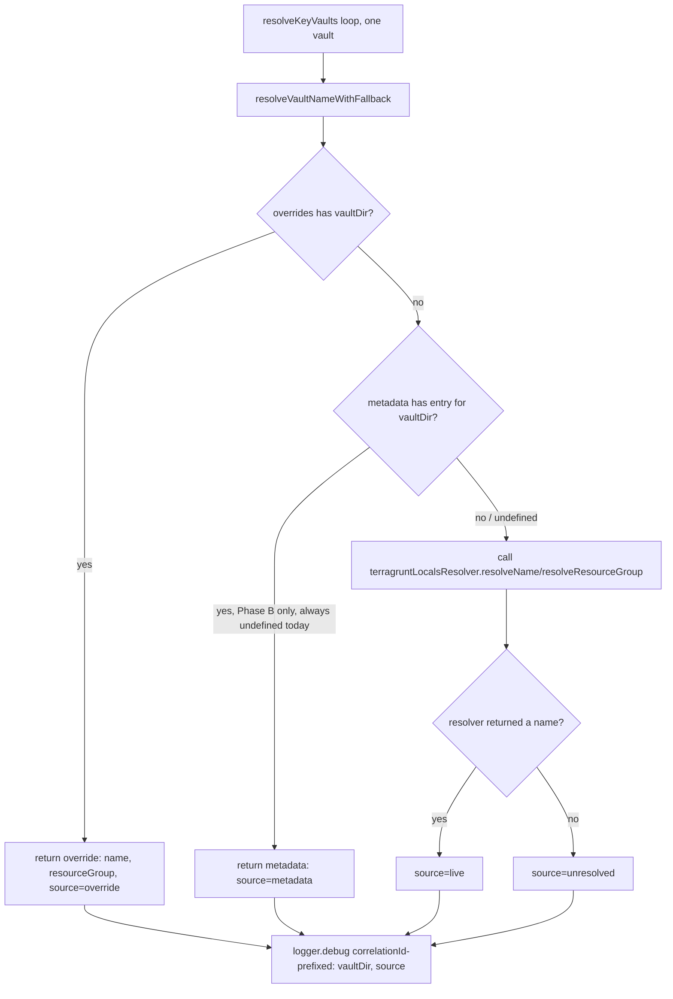
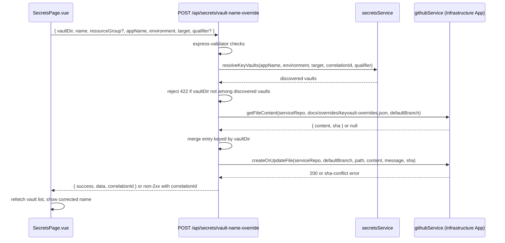

# Architecture Spec: Vault Resolution Override

- **Feature**: `vault-resolution-override`
- **Source PRD**: [docs/prd/vault-resolution-override.md](../prd/vault-resolution-override.md)
- **PRD Challenger verdict**: approved ([round2](../reviews/vault-resolution-override-prd-review-round2.md))
- **Status**: ready_for_challenger
- **Last modified**: 2026-08-12

## 1. Context

`resolveKeyVaults()` in [services/secretsService.js](../../services/secretsService.js) resolves a
vault's display name/resource group by calling
[terragruntLocalsResolver.js](../../services/terragruntLocalsResolver.js) at request time. That
parser cannot follow Terragrunt `include` blocks (confirmed root cause for IDM/ITG-style layouts),
so some vaults permanently show "Key Vault name unavailable" with no recovery path short of a code
change to the parser itself (frozen per roadmap decision).

This feature adds a **human-correctable override tier** that takes priority over the live
resolver, plus a pass-through slot for a future CI-written metadata tier (Phase B, out of scope).
No changes to the external service-catalog CI workflow or Terraform modules are made or required.

## 2. Design

### 2.1 Resolution tier priority

`override > metadata > live`. In this PRD's scope `metadata` is always `undefined` — the helper
treats that as a normal no-op and falls through to tier 3 unchanged from today's behavior.

### 2.2 Override submission flow

`defaultBranch = process.env.SERVICE_CATALOG_BRANCH || 'main'` — the same default
`githubService.getFileContent()` already uses. This is a **direct commit to the default branch**:
no feature branch is created and no PR is opened. See §2.4 for why this deliberately differs from
`submitSecretViaGitOps()`'s branch+PR pattern.

### 2.3 Component changes

| Component | File | Change |
|---|---|---|
| Override sidecar schema | `docs/overrides/keyvault-overrides.json` (service-catalog repo) | New file, created lazily on first write |
| `loadVaultOverrides()` | [services/secretsService.js](../../services/secretsService.js) | New function; reads `config.github.serviceRepo` via `githubService.getFileContent()`, 60s TTL cache, in-flight promise stampede protection (mirrors existing `treeCache` pattern) |
| `resolveVaultNameWithFallback()` | [services/secretsService.js](../../services/secretsService.js) | New helper; single resolution call site, returns `{ name, resourceGroup, source }` |
| `resolveKeyVaults()` | [services/secretsService.js](../../services/secretsService.js) | Modified: replaces direct `terragruntLocalsResolver` calls with the helper; adds one correlationId-prefixed `logger.debug` per vault |
| `POST /api/secrets/vault-name-override` | [routes/api.js](../../routes/api.js) | New route; `requireAuth`, `express-validator`, allow-list check against `resolveKeyVaults()`, sha-based read-modify-write |
| Inline self-heal control | [srcV2/pages/SecretsPage.vue](../../srcV2/pages/SecretsPage.vue) | Modified: adds "Set name manually" form for vaults with `vaultName === null`, calls new endpoint, refetches vault list on success |

### 2.4 Deliberate GitOps deviation: direct commit, no PR

Unlike `submitSecretViaGitOps()` (branch-per-submission + PR), the override write commits directly
to the service-catalog repo's default branch via `githubService.createOrUpdateFile()` with the
`branch` argument explicitly set to `defaultBranch` (`process.env.SERVICE_CATALOG_BRANCH || 'main'`).
No feature branch is created and no PR is opened.

**Why this deviation is justified, not an oversight**:
1. The PRD's core success metric (Goal 1) requires the override to be reflected in the *next*
   `resolveKeyVaults()` call within one 60s cache TTL window. A PR-gated write only lands on the
   default branch once a human merges it — that cannot satisfy this metric, so the branch+PR
   pattern is structurally incompatible with this PRD's scope, not just slower.
2. This is a display-only correction written to a new, dedicated sidecar file
   (`docs/overrides/keyvault-overrides.json`), not a Terraform/infrastructure change — it carries
   none of the deployment risk that the branch+PR/CODEOWNERS gate exists to control for
   `docs/metadata/*` or Terraform modules.
3. Write safety is preserved: the same sha-based optimistic-concurrency check
   (`createOrUpdateFile()`'s `sha` parameter) used by `submitSecretViaGitOps()` still applies —
   a stale `sha` is rejected with a 409, never silently overwritten. Only the branch-creation/PR
   steps are omitted, not the concurrency guard.
4. `docs/overrides/` is a new path with no existing CODEOWNERS entry to bypass; this is tracked as
   an assumption alongside the PRD's existing assumption that `githubService.octokit` already has
   write access to `docs/` in the service-catalog repo (PRD §10).

### 2.5 Key constraints (carried from PRD, load-bearing for implementation)

- `loadVaultOverrides()` never calls `mapRepo(target)` — always reads/writes
  `config.github.serviceRepo`, regardless of which repo (`service-catalog` vs
  `infrastructure-live`) the vault itself was discovered in.
- The override endpoint uses `target` only to run the `resolveKeyVaults()` allow-list check; it is
  never used to select which repo the sidecar file lives in.
- `resolveKeyVaults()` always calls the helper with `metadata: undefined` in this PRD's scope. A
  missing/absent `metadata` (or its `.keyvaults` field, in the future Phase B shape) is a normal
  no-op fall-through to the live resolver — never an error path, never logged as a failure.
- Only `githubService.octokit` (Infrastructure App) is used; `codeOctokit` is never touched by this
  feature.
- Sidecar writes commit directly to `defaultBranch` (no PR) per §2.4 — a deliberate, documented
  deviation from `submitSecretViaGitOps()`'s branch+PR pattern, not a new unreviewed convention.

## 3. Contracts

See `vault-resolution-override-spec.json` → `technical.api_endpoints` and `technical.data_contracts`
for the machine-readable request/response schemas and the override sidecar / helper return shape.

## 4. Testing

See `vault-resolution-override-spec.json` → `testing` for the full scenario list. Summary of the
four required regression cases (PRD FR-007): override present (short-circuits resolver), metadata
present (exercised only via direct helper call, not reachable through `resolveKeyVaults()` in this
scope), both absent (unchanged live-resolver behavior), IDM nested-qualifier override.

## 5. NFRs

See `vault-resolution-override-spec.json` → `nfrs`. Carried directly from PRD NFR-001..006:
override-lookup cache-hit performance, sha-conflict write safety, unchanged auth/validation
surface, correlationId-prefixed observability, ≤2-action accessible self-heal UX, and zero
behavior change for vaults without an override.

## 6. References

- [docs/prd/vault-resolution-override.md](../prd/vault-resolution-override.md)
- [docs/reviews/vault-resolution-override-prd-review-round2.md](../reviews/vault-resolution-override-prd-review-round2.md)
- [services/secretsService.js](../../services/secretsService.js)
- [services/githubService.js](../../services/githubService.js)
- [services/terragruntLocalsResolver.js](../../services/terragruntLocalsResolver.js)
- [routes/api.js](../../routes/api.js)
- [srcV2/pages/SecretsPage.vue](../../srcV2/pages/SecretsPage.vue)
