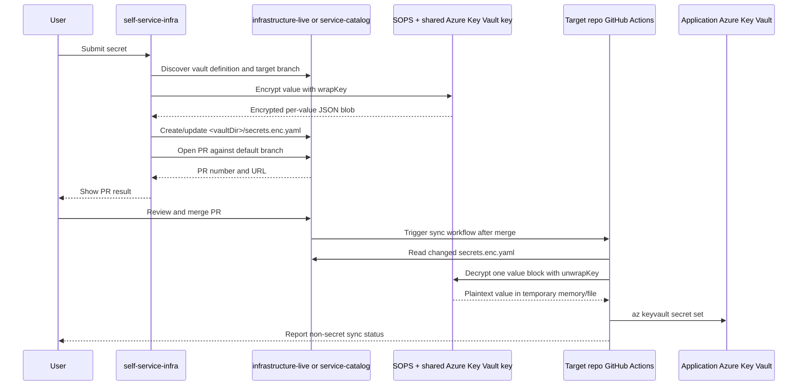

# Secret Self-Service: Responsibilities and Flow

## Scope

This document explains the boundary between `self-service-infra` and the target infrastructure repositories:

- `infrastructure-live` for portal target `live`
- `service-catalog` for portal target `sand`

The portal creates the encrypted GitHub file and opens the pull request. The target repository's CI workflow decrypts the merged file and writes values to Azure Key Vault.

## Responsibility Matrix

| Responsibility | `self-service-infra` | Target repository / CI |
|---|---|---|
| Secret form and validation | Owns the Vue page, authentication, Jira/CR validation, secret-name validation, and confirmation fields | Not applicable |
| Target selection | Maps `live` to `GITHUB_INFRA_LIVE_REPO` and `sand` to `GITHUB_SERVICE_REPO` | Provides the corresponding repository |
| Vault discovery | Enumerates the target repository tree and resolves the matching Terragrunt vault definition | Maintains valid Terragrunt definitions and locals |
| Encryption | Runs SOPS with Azure Key Vault `wrapKey` access; uses temporary `0600` files | Must be able to decrypt in post-merge CI using `unwrapKey` |
| `secrets.enc.yaml` generation | Creates or updates the file on a branch | Reviews and merges the PR; does not need to pre-create an empty file |
| Branch and PR | Creates the branch, commits the file, and opens the PR | Applies branch protection and CODEOWNERS review |
| Azure secret synchronization | Does not write plaintext values to application Key Vaults | Decrypts each value after merge and runs `az keyvault secret set` |
| Runtime status | Returns the PR number/URL synchronously to the portal | Reports sync success or failure in GitHub Actions |

## Where `secrets.enc.yaml` Is Generated

The file is generated by `self-service-infra`, not by the target repository workflow.

When the user submits a secret:

1. The portal sends `POST /api/secrets`.
2. `routes/api.js` authenticates and validates the request.
3. `services/secretsService.js` resolves the selected vault and validates `vaultDir` against the discovered vault list.
4. The service runs SOPS encryption for each submitted value.
5. If the file does not exist, the service starts with empty content:

   ```javascript
   let newContent = currentFile ? currentFile.content : '';
   ```

6. The service adds or replaces the submitted top-level secret block.
7. The resulting file is written to:

   ```text
   <vaultDir>/secrets.enc.yaml
   ```

The generated extension is `.yaml`, not `.yml`.

The file format is a plain YAML map containing independently encrypted SOPS JSON blobs:

```yaml
API_TOKEN: |
  {"value":"ENC[...]","sops":{"azure_kv":[...],"mac":"ENC[...]"}}
```

Existing sibling secret blocks remain unchanged. The portal never decrypts existing blocks and never writes plaintext to GitHub.

## Where the Pull Request Is Created

The target is selected by the request's `target` value:

```text
live -> config.github.infrastructureLiveRepo -> <org>/infrastructure-live
sand -> config.github.serviceRepo            -> <org>/service-catalog
```

For `live`, the PR is opened against the default branch of `infrastructure-live`.
For `sand`, the PR is opened against the default branch of `service-catalog`.

The portal performs these GitHub operations through the Infrastructure GitHub App:

1. Read the target repository tree and vault files.
2. Read the target repository default branch.
3. Check whether the deterministic secret branch already has an open PR.
4. Create the branch when it does not exist.
5. Create or update `<vaultDir>/secrets.enc.yaml` on that branch.
6. Open the PR against the target repository default branch.

The Code Deployment GitHub App is not used for this flow.

## End-to-End Flow



## `self-service-infra` Responsibilities

### Portal and API

- Render the Secrets page and collect target, application, environment, vault, secret name, and value.
- Require authentication on secret endpoints.
- Validate request fields and redact submitted values from validation errors.
- Return the PR number and URL synchronously; this flow does not use workflow polling.

Relevant implementation: [routes/api.js](../routes/api.js#L175-L430) and [SecretsPage.vue](../srcV2/pages/SecretsPage.vue#L213-L249).

### Repository and vault resolution

- Map `live` and `sand` to the correct repository.
- Discover supported vault definitions under `infrastructure/` and `azureDatabricks/`.
- Resolve the Azure vault name from the matching Terragrunt configuration.
- Reject an unrecognized or ambiguous `vaultDir` before constructing a repository path.

Relevant implementation: [secretsService.js](../services/secretsService.js#L24-L220).

### SOPS encryption

- Write `{ "value": "<submitted value>" }` to a temporary `0600` file.
- Run SOPS with the configured Azure Key Vault key.
- Remove the temporary directory in a `finally` block.
- Return only the encrypted blob to the file-building logic.

Relevant implementation: [secretsService.js](../services/secretsService.js#L516-L539).

The runtime must explicitly set:

```text
SOPS_KEYVAULT_URL=https://<shared-platform-kv>.vault.azure.net
SOPS_KEY_NAME=self-service-infra-sops-master-key
```

`config.js` currently has a legacy fallback of `sops-master-key`, so production configuration must set `SOPS_KEY_NAME` explicitly.

### GitHub branch, commit, and PR

- Use the Infrastructure GitHub App client only.
- Use a deterministic branch name containing the app, environment, vault, and secret.
- Reject an existing open PR for the same branch.
- Detect a default-branch file SHA change and require the user to retry instead of merging encrypted documents.
- Create or update the encrypted file, then open the PR.

Relevant implementation: [secretsService.js](../services/secretsService.js#L558-L700) and [githubService.js](../services/githubService.js#L208-L305).

## Target Repository Responsibilities

Each target repository must provide:

1. A discoverable Terragrunt Key Vault definition for the supported application/environment.
2. `.sops.yaml` rules that reference the shared RSA key `self-service-infra-sops-master-key`.
3. CODEOWNERS and branch protection for encrypted files, `.sops.yaml`, and the sync workflow.
4. `.github/workflows/secrets-sync.yml` triggered after merged changes to `secrets.enc.yaml`.
5. An OIDC federated credential for the CI identity.
6. CI access to unwrap the shared SOPS key and write only to the resolved application Key Vault.

The target repository must not require a manually committed empty `secrets.enc.yaml` for the first portal submission. The portal creates it when the first PR is submitted.

## CI Sync Responsibilities

After a PR is merged, the target repository workflow must:

1. Identify changed `secrets.enc.yaml` files under accepted roots.
2. Validate the file-to-vault mapping from the sibling Terragrunt definition.
3. Parse the outer YAML using a pinned YAML parser.
4. Process one top-level encrypted block at a time.
5. Decrypt the block with SOPS using `unwrapKey`.
6. Write the resulting value to the resolved application Key Vault.
7. Delete temporary plaintext files immediately, including on failure.
8. Publish only non-secret diagnostics.

The workflow must never:

- decrypt the entire outer YAML document as one SOPS file;
- infer a destination vault only from the application/environment name;
- print plaintext, decrypted JSON, or encrypted block contents;
- use a client secret when OIDC is available; or
- write to an application Key Vault outside the resolved scope.

## Completion Evidence

The implementation is complete when all of the following are demonstrated:

- A real Terragrunt vault definition is discovered by the portal.
- A first secret submission creates `<vaultDir>/secrets.enc.yaml` without a pre-existing file.
- The portal opens a PR in `infrastructure-live` for `live`, or `service-catalog` for `sand`.
- The PR is reviewed and merged under branch protection.
- Post-merge CI decrypts the per-value blob and writes it to the intended application Key Vault.
- The secret name is visible in the portal after merge, without exposing the secret value.
- Logs, PR descriptions, artifacts, and repository files contain no plaintext secret value.
